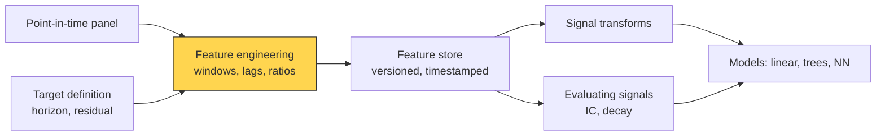

# Feature engineering

> **TL;DR**
>
> - A feature is one number per stock per timestamp, built only from data public before the decision, that might predict the target return.
> - A few families carry most of the signal: past returns over several windows, volatility, liquidity and trading activity, fundamental ratios, and expectations data. Gu, Kelly & Xiu (2020) found momentum, liquidity and volatility dominant.
> - The craft is making features scale-free, correctly lagged, relative to peers and robust to outliers.
> - Libraries run from 101 formulaic alphas to 300+ academic characteristics. More features mostly add leakage risk and multiple testing, not alpha.

**Level:** Core · **Pipeline stage:** signal · **Last verified:** 2026-11

| Field | Value |
|---|---|
| Purpose (the question it answers) | Which numbers, computable at decision time, carry information about future residual returns? |
| Inputs → Outputs | Point-in-time panel (prices, volumes, fundamentals, estimates, book snapshots, alt data) → lagged, normalized feature matrix X[date, stock, feature] |
| Used by strategies | [ML short-horizon alpha](../../02-strategies/c-statistical-arbitrage/ml-driven-short-horizon-alpha.md) · [Cross-sectional alpha](../../02-strategies/d-mid-frequency-alpha/cross-sectional-alpha-and-neutralization.md) · [Fundamental signals](../../02-strategies/d-mid-frequency-alpha/fundamental-quant-signals.md) · [Earnings and events](../../02-strategies/d-mid-frequency-alpha/earnings-and-event-driven.md) · [Analyst revisions](../../02-strategies/d-mid-frequency-alpha/analyst-revisions-and-sentiment.md) · [Alternative data](../../02-strategies/d-mid-frequency-alpha/alternative-data.md) · [NLP signals](../../02-strategies/d-mid-frequency-alpha/nlp-and-llm-signals.md) · [Intraday patterns](../../02-strategies/c-statistical-arbitrage/intraday-patterns-and-seasonality.md) · [Factor-residual reversion](../../02-strategies/c-statistical-arbitrage/factor-residual-mean-reversion.md) |
| Latency / compute regime | Overnight batch: 500 features × 3,000 stocks × 20 years ≈ 7.5 billion cells, minutes to hours on a cluster `[Estimate]`; order-book features update per message in µs |
| Key parameters | Windows 1–252 days; momentum skip 21 days; vol half-life 20–60 days; clip at ±3 robust z; one-session information lag; 20–2,000 features |
| Main failure modes | Leakage; nonstationary raw levels; redundant substitutes; feature-search overfitting; microcap-driven features |
| Lab | — |

## Intuition

A raw price of \$412 says nothing; "fell 8% in five days while its sector fell 2%, on twice its usual volume" says a lot. Feature engineering is the analyst's normalization of comps: EV/EBITDA instead of raw EBITDA, adjusted for one-offs, on a common calendar. Each feature should be comparable across stocks and decades, known at decision time, and tied to an economic story.

| Family | Examples | Typical windows |
|---|---|---|
| Returns | reversal, 12–1 momentum, distance to 52-week high | 1–252 days |
| Risk | realized vol, beta, idiosyncratic vol | 20–252 days |
| Liquidity | turnover, log ADV, [Amihud illiquidity](../../09-reference/glossary.md#amihud-illiquidity), spread | 5–63 days |
| Fundamentals | E/P, gross profitability, accruals, asset growth | latest filing |
| Expectations | revisions, earnings surprise, days to earnings | event-driven |
| Microstructure | [order-flow imbalance](../../09-reference/glossary.md#order-flow-imbalance-ofi), book imbalance | ms to minutes |
| Relative | sector-relative return, ETF flow | varies |

## Where it sits in the pipeline



## The algorithm

1. **Fix the target first** (say, 5-day residual return); lag rules follow from it.
2. **Compute raw features** per family over explicit trailing windows.
3. **Lag** by the gap between data cutoff and trade. With features through close t−1, the book can trade anytime on day t, including the close.
4. **Make features scale-free:** returns, ratios, logs of skewed quantities.
5. **Make them relative:** subtract the date's sector median ([neutralization](../../09-reference/glossary.md#neutralization)).
6. **Robustify per date:** median/MAD z-scores, clipped. Statistics come from the same date only, never the full sample.
7. **Add a few interactions** with an economic story.
8. **Store** with definitions versioned and knowledge timestamps attached.

```python
import numpy as np
import pandas as pd

def xs_robust_z(x, clip=3.0):
    """Per-date cross-sectional z-score with median/MAD, clipped (more in D3)."""
    med = x.median(axis=1)
    mad = x.sub(med, axis=0).abs().median(axis=1) * 1.4826
    return x.sub(med, axis=0).div(mad, axis=0).clip(-clip, clip)

def sector_relative(x, sector):
    """Subtract each date's sector median. sector: Series stock -> sector code."""
    return x - x.T.groupby(sector).transform("median").T

def make_features(px, dollar_vol, sector, lag=1):
    """px, dollar_vol: [date x stock] adjusted close and $ volume from the PIT panel.
    After shift(lag), row t uses data through close t-1 only."""
    r = px.pct_change(fill_method=None)                       # never fill across gaps
    raw = {
        "rev_5d":   -(px / px.shift(5) - 1),                  # short-term reversal
        "mom_12_1": px.shift(21) / px.shift(252) - 1,         # skip the latest month
        "vol_63d":  r.rolling(63, min_periods=40).std() * np.sqrt(252),
        "turn_chg": np.log(dollar_vol.rolling(5).mean() / dollar_vol.rolling(63).mean()),
        "amihud":   np.log((r.abs() / dollar_vol).rolling(21, min_periods=15).mean() * 1e6),
    }
    feats = {}
    for name, x in raw.items():
        x = x.shift(lag)                                      # the information lag
        if name in ("rev_5d", "mom_12_1"):
            x = sector_relative(x, sector)
        feats[name] = xs_robust_z(x)                          # same-date stats only
    feats["rev_x_illiq"] = feats["rev_5d"] * feats["amihud"]  # one motivated interaction
    return pd.concat(feats, axis=1)                           # columns: (feature, stock)

def make_target(px, horizon=5):
    # close t -> close t+horizon; features end at close t-1, so no overlap
    return px.shift(-horizon) / px - 1
```

## Worked example with numbers

One stock, four days (illustrative): returns +2.0%, −1.0%, −3.0%, +1.0% on dollar volumes \$40M, \$25M, \$60M, \$20M.

**Amihud** (|return| ÷ dollar volume × 10⁶, averaged): 0.02/40 = 0.00050; 0.01/25 = 0.00040; 0.03/60 = 0.00050; 0.01/20 = 0.00050. Mean 0.000475: about 4.75 bps of price move per \$1M traded. A mega-cap moving 1% on \$10B gives 0.000001, a ratio of 475×. That is why the code takes logs: ln 0.000475 = −7.65 versus ln 0.000001 = −13.8.

**Reversal:** cumulative return = 1.02 × 0.99 × 0.97 × 1.01 − 1 = −1.07%, so raw reversal is +1.07% (buy). The sector median fell 2.5%, so the stock *outperformed* by 1.43% and the sector-relative reversal is −1.43% (sell). If the sector-relative feature's cross-sectional median is about zero and its MAD-scaled spread 3%, the z-score is −0.48. Normalization flipped the trade.

## Key parameters and how practitioners tune them

- **Windows** spaced roughly geometrically (5, 21, 63, 252 days) so they are not near-duplicates.
- **Momentum skip:** the 12–1 convention drops the latest month, which tends to reverse ([momentum](../../02-strategies/e-risk-premia-and-factors/momentum.md)) `[Reported]`.
- **Minimum history:** about two-thirds of the window. Note that 252-day features exclude recent IPOs.
- **Missing values:** fill with the date's median plus a "missing" flag, since missingness is often informative `[Lore]`.
- **Count:** fewer than the model can support. Each feature added in a search is another trial ([multiple testing](../c-validation-and-backtesting/overfitting-and-multiple-testing.md)).

## Textbook version vs what firms actually do

- **Academic zoo:** [GKX 2020](https://doi.org/10.1093/rfs/hhaa009) used 94 characteristics `[Verified]`. Chen & Zimmermann reproduce 319; 98% of the 161 originally clear predictors give t > 1.96 `[Verified]`.
- **Formulaic alphas:** Kakushadze (2016) published 101 price-volume formulas with average holding periods of 0.6–6.4 days and 15.9% average pairwise correlation `[Verified]`. Microsoft's open-source Qlib ships Alpha158 and Alpha360 feature sets `[Verified]`.
- **Order-book features:** Cont, Kukanov & Stoikov (2014) found price changes linear in [OFI](../f-market-making-and-hft-algorithms/order-book-and-trade-flow-signals.md) with slope inversely proportional to depth `[Verified]`, so OFI is normalized by depth.
- **Stationarity:** fractional differentiation keeps memory while removing trends (López de Prado 2018, ch. 5) `[Verified]`; most desks use returns, ratios and ranks `[Lore]`.
- **Practice:** versioned feature stores with thousands of features; edge comes more from data and careful variants than new formulas `[Lore]`.

## How to tell if it's working

- Univariate rank [IC](../../09-reference/glossary.md#information-coefficient-ic) and its decay by horizon ([evaluating signals](evaluating-signals.md)).
- Coverage, autocorrelation (turnover cost) and correlation clusters across features.
- Drop-column importance under purged CV ([time-series CV](../c-validation-and-backtesting/time-series-cross-validation.md)).
- **Null test:** shuffle the target within each date; IC must fall to about 0.
- Stable IC across size buckets and years.

## Failure modes and pitfalls

- **[Leakage](../../09-reference/glossary.md#look-ahead-bias):** centered windows, full-sample normalization, backfilled vendor fields, label windows overlapping feature windows.
- **Nonstationary levels:** raw price, raw dollar volume or market cap drift for decades; use logs, ratios, ranks.
- **Substitutes:** turnover, ADV and spread overlap; importance splits among them.
- **Microcap features:** IC driven by stocks you cannot trade at size.
- **Same-close trading:** a feature built from today's close cannot trade today's close.

## How practitioners talk about it

- "Is that lagged a day?" → Could you have known it when you traded?
- "Normalize it sector-relative." → Remove the common sector move.
- "That's just size in disguise." → The feature mostly proxies market cap.
- "Rank it per date." → Use cross-sectional ranks so outliers and drift stop mattering.
- "Shuffle the target and rerun." → Leakage check.

## Questions you could ask a quant about this

1. Which feature families carry most of your IC? (basic)
2. How do you lag features relative to execution? (informed)
3. Raw, sector-relative or residualized features? (informed)
4. How many features does the production model use, and how many did you try? 🔒 (sharp)
5. How do you catch a vendor backfill before it enters a feature? (sharp)

## Go deeper

<details markdown="1">
<summary>Math: Amihud, momentum, OFI, fractional differencing</summary>

Amihud illiquidity over $D$ days with return $r_d$ and dollar volume $V_d$:

$$
\text{ILLIQ} = \frac{1}{D} \sum_{d=1}^{D} \frac{|r_d|}{V_d}
$$

Momentum 12–1: $P_{t-21}/P_{t-252} - 1$. Annualized realized vol: $\sqrt{252}\,\mathrm{sd}(r_{t-62..t})$.

OFI sums signed changes in best bid and ask queues; Cont, Kukanov & Stoikov fit $\Delta P = \beta\,\text{OFI} + \varepsilon$ with $\beta \propto 1/\text{depth}$.

Fractional difference of order $d$: $\tilde x_t = \sum_k w_k x_{t-k}$ with $w_0 = 1$, $w_k = -w_{k-1}(d-k+1)/k$.

Cost: rolling features are $O(TN)$ per feature with cumulative sums.

</details>

## Related pages

- [Point-in-time data and cleaning](point-in-time-data-and-cleaning.md) · [Signal transforms](signal-transforms.md)
- [Tree ensembles](../b-forecasting-models/tree-ensembles.md) · [Backtest pitfalls](../c-validation-and-backtesting/backtest-pitfalls.md)
- [ML-driven short-horizon alpha](../../02-strategies/c-statistical-arbitrage/ml-driven-short-horizon-alpha.md)

## Sources

- [Verified] Amihud, Y. (2002). "Illiquidity and stock returns: cross-section and time-series effects." *Journal of Financial Markets* 5(1), 31–56. <https://doi.org/10.1016/S1386-4181(01)00024-6> (accessed 2026-11)
- [Verified] Gu, S., Kelly, B. & Xiu, D. (2020). "Empirical Asset Pricing via Machine Learning." *Review of Financial Studies* 33(5), 2223–2273. <https://doi.org/10.1093/rfs/hhaa009> (accessed 2026-11)
- [Verified] Chen, A. Y. & Zimmermann, T. (2022). "Open Source Cross-Sectional Asset Pricing." *Critical Finance Review* 11(2), 207–264. <https://doi.org/10.1561/104.00000112> (accessed 2026-11)
- [Verified] Chen, A. Y. & Zimmermann, T. (2021). "Open Source Cross-Sectional Asset Pricing" (abstract: 319 characteristics, 161 clear predictors). FEDS 2021-037. <https://doi.org/10.17016/FEDS.2021.037> (accessed 2026-11)
- [Verified] Kakushadze, Z. (2016). "101 Formulaic Alphas." *Wilmott* 2016(84), 72–81. <https://doi.org/10.1002/wilm.10525> (accessed 2026-11)
- [Verified] Cont, R., Kukanov, A. & Stoikov, S. (2014). "The Price Impact of Order Book Events." *Journal of Financial Econometrics* 12(1), 47–88. <https://doi.org/10.1093/jjfinec/nbt003> (accessed 2026-11)
- [Verified] Microsoft Qlib documentation. "Data Layer: Data Framework and Usage" (Alpha158, Alpha360 handlers). <https://qlib.readthedocs.io/en/latest/component/data.html> (accessed 2026-11)
- [Verified] López de Prado, M. (2018). *Advances in Financial Machine Learning*, Wiley (ch. 5, fractionally differentiated features). <https://www.wiley.com/en-us/Advances+in+Financial+Machine+Learning-p-9781119482086> (accessed 2026-11)
