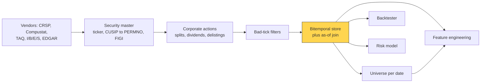

# Point-in-time data and cleaning

> **TL;DR**
>
> - Every value needs two dates: the period it describes and the moment it became public. Backtests must key on the second.
> - Most fake alpha comes from four errors: as-restated fundamentals, missing dead stocks, unadjusted corporate actions and broken identifier maps.
> - The core tool is an as-of join: for each stock and decision time, take the latest record public strictly before the decision, plus a safety lag.
> - Missing delisting returns are large and negative. Standard imputation: −30% (NYSE/Amex, Shumway 1997), −55% (Nasdaq, Shumway & Warther 1999). With the fix, the Nasdaq size effect vanishes.

**Level:** Core · **Pipeline stage:** data · **Last verified:** 2026-11

| Field | Value |
|---|---|
| Purpose (the question it answers) | What did the market know, about which security, when the decision was made? |
| Inputs → Outputs | Vendor prices, corporate actions, timestamped filings, estimates, identifiers, index membership → clean panel keyed by permanent ID and knowledge time; universe per date |
| Used by strategies | [Fundamental signals](../../02-strategies/d-mid-frequency-alpha/fundamental-quant-signals.md) · [Earnings and events](../../02-strategies/d-mid-frequency-alpha/earnings-and-event-driven.md) · [Cross-sectional alpha](../../02-strategies/d-mid-frequency-alpha/cross-sectional-alpha-and-neutralization.md) · [Analyst revisions](../../02-strategies/d-mid-frequency-alpha/analyst-revisions-and-sentiment.md) · [Value, quality, low vol](../../02-strategies/e-risk-premia-and-factors/value-quality-low-vol.md) · [Momentum](../../02-strategies/e-risk-premia-and-factors/momentum.md) · [Reversal](../../02-strategies/c-statistical-arbitrage/short-term-cross-sectional-reversal.md) · [Flow-driven](../../02-strategies/d-mid-frequency-alpha/flow-driven-strategies.md) · [Alternative data](../../02-strategies/d-mid-frequency-alpha/alternative-data.md) · [NLP signals](../../02-strategies/d-mid-frequency-alpha/nlp-and-llm-signals.md) |
| Latency / compute regime | Overnight batch: as-of joins over ~10⁸ stock-days take minutes on a columnar store `[Estimate]`; tick filters run per message |
| Key parameters | Lag after public timestamp (minutes to one session); delisting imputation −30% / −55%; bad-tick limits (spread > 50× daily median); price ≥ \$5, ADV ≥ \$1–10M |
| Main failure modes | Restated or period-end-dated data; survivorship; split errors; reused tickers; time-zone slips; silent vendor revisions |
| Lab | — |

## Intuition

A database says "FY2024 EPS = \$1.60." A backtest needs what the market believed FY2024 EPS was at 3:45 p.m. on 2025-03-31. To an accountant: the fiscal period is not the filing date, and a restatement overwrites the number investors actually traded on.

[Point-in-time](../../09-reference/glossary.md#point-in-time-data) data keeps both clocks, valid time and knowledge time, and appends every revision instead of overwriting. Cleaning is the other half: prices comparable across splits, one identity per security, and dead stocks kept with their final losses (no [survivorship bias](../../09-reference/glossary.md#survivorship-bias)).

## Where it sits in the pipeline



## The algorithm

1. **Security master:** map every vendor identifier to one permanent ID with validity dates. CRSP's PERMNO is permanent `[Verified]`; a FIGI is never reused `[Verified]`; tickers and CUSIPs change.
2. **Stamp knowledge time** (EDGAR acceptance, press-release or vendor-receipt time, in UTC); else apply a conservative lag.
3. **Append, never overwrite** restatements and revisions.
4. **Adjust for [corporate actions](../../09-reference/glossary.md#corporate-action)** via total returns; keep raw prices for price screens.
5. **Filter bad ticks;** **keep the dead**, imputing missing [delisting returns](../../09-reference/glossary.md#delisting-return).
6. **Universe** from prior-day price, trailing [ADV](../../09-reference/glossary.md#average-daily-volume-adv) and historical index membership; then **as-of join** everything onto decision times.

```python
import numpy as np
import pandas as pd

def asof_join(decisions, records, key="permno", lag=pd.Timedelta(days=1)):
    """decisions: [permno, decision_time]; records: one row per VERSION of a fact,
    with known_at = EDGAR acceptance / vendor receipt time (UTC). Restatements are
    extra rows, never overwrites. Returns the latest version usable at each decision."""
    recs = records.assign(usable_at=records["known_at"] + lag).sort_values("usable_at")
    dec = decisions.sort_values("decision_time")
    return pd.merge_asof(dec, recs, left_on="decision_time", right_on="usable_at",
                         by=key, direction="backward",     # only the past
                         allow_exact_matches=False)        # a tie is not yet known

def total_return(px, prev_px, div=0.0, split=1.0, dlret=np.nan,
                 delisted=False, perf_delist=False, exch="NYSE"):
    """split = new shares per old share (2.0 for 2-for-1); div per old share."""
    r = (px * split + div) / prev_px - 1 if px == px else 0.0  # px NaN on delist day
    if delisted:
        if np.isnan(dlret) and perf_delist:              # Shumway imputation
            dlret = -0.55 if exch == "NASDAQ" else -0.30
        r = (1 + r) * (1 + np.nan_to_num(dlret)) - 1     # compound, don't drop
    return r

def universe(snap, min_price=5.0, min_adv_usd=5e6, top_n=3000):
    """snap: one row per permno with PRIOR-day raw close, trailing ADV and cap."""
    ok = (snap["prev_close_raw"] >= min_price) & (snap["adv20_usd"] >= min_adv_usd)
    return snap[ok].nlargest(top_n, "mcap_prev")["permno"]
```

## Worked example with numbers

Company figures are illustrative. A firm's 10-K is accepted Wednesday 2025-02-26 at 18:05 ET. Filings started after 5:30 p.m. are dated the next business day `[Verified]`, so EDGAR shows 2025-02-27. EPS is \$2.00; in August 2025 it is restated to \$1.60.

| Data treatment | First decision that sees FY2024 EPS | EPS in March 2025 | E/P at \$40 |
|---|---|---|---|
| Period-end dating | 2024-12-31 (59 days early) | \$2.00 | 5.0% |
| As-restated | 2024-12-31 | \$1.60 | 4.0% |
| PIT, 1-day lag | Fri 2025-02-28 close | \$2.00 | 5.0% |

Against a median E/P of 4.5%, the stock is cheap on PIT data and expensive on restated data. A restated-data value backtest skips or shorts it from March and banks any August drop on the news, which nothing public predicted.

**Delisting:** 100 equal-weighted Nasdaq small caps; 97 survivors average +1.2%; 3 performance delistings lack returns. Dropping them reports +1.2%. Imputing −55%: (97 × 1.2% + 3 × −55%) / 100 = 1.164% − 1.65% = **−0.486%**.

## Key parameters and how practitioners tune them

- **Lag.** 10-Ks are due 60, 75 or 90 days after year-end by filer size `[Verified]`; academic sorts often assume six months `[Reported]`. Practitioners use acceptance time plus a buffer, from minutes to a session `[Lore]`. Forms 4 and 13D filed until 10 p.m. keep same-day dates `[Verified]`, so the filing date misleads.
- **Bad ticks.** Barndorff-Nielsen et al. (2009) rules drop quotes with spreads above 50× the day's median, mids beyond 10 median absolute deviations of a 50-quote centered median, and trades over one spread outside the quote `[Verified]`.
- **Screens.** A \$5 floor removes penny stocks; NYSE size breakpoints and value weights stop microcaps dominating (Hou, Xue & Zhang) `[Verified]`.

## Textbook version vs what firms actually do

- **Academic default:** CRSP/Compustat via WRDS, conservative lags, Shumway imputation `[Verified]`.
- **History is versioned.** CRSP's legacy SIZ format had its last release in January 2025. CIZ reinvests dividends on the ex-date, rewriting 9.62% of monthly returns by over 1 bp ([Schwarz, Walter & Weiss 2026](https://jfqa.org/wp-content/uploads/2026/02/26501_Rewriting_CRSP_History.pdf)) `[Verified]`. CIZ does not impute −30% for missing delisting returns `[Verified]`.
- **Careful code still leaks.** The Chen-Zimmermann replication fixed a look-ahead bug in one signal in October 2024 `[Verified]`.
- **Practice:** in-house bitemporal stores, snapshots of every vendor delivery, pinned vintages per backtest `[Lore]`.

## How to tell if it's working

- Index returns rebuilt from your panel track the published index within a few bps a month `[Lore]`.
- Every daily |return| above 40% matches a split, merger or news event.
- Delistings per year are non-zero and stable across vendor changes.
- One extra day of lag barely moves Sharpe; a collapse means edge-timing or a leak.
- Last year's panel rebuilt today matches the archived snapshot.

## Failure modes and pitfalls

- **Today's index members** define the past universe: pure survivorship.
- **Backward fill** copies the future into the past; only forward fill is safe.
- **Time zones:** a fixed ET-to-UTC offset is wrong for part of the year (DST).
- **Closing price:** NYSE MOC orders must be in by 3:50 p.m. `[Verified]`, so a signal using the 4:00 p.m. close cannot trade it.
- **Vendor backfill:** history added later was never available live.

## How practitioners talk about it

- "First-reported or as-restated?" → Were these the numbers investors saw that day?
- "Key it on acceptance time." → Use the moment the data became public.
- "Did you keep the dead?" → Are delisted stocks and their delisting returns included?
- "Join as-of, strictly before." → A record stamped at the decision time does not count.
- "Pin the vintage." → Record which data snapshot produced the result.

## Questions you could ask a quant about this

1. Which identifier do you key on? (basic)
2. Do you stamp fundamentals by filing date, acceptance time or vendor receipt? (informed)
3. What delisting returns do you assume when missing? (informed)
4. Can you reproduce a two-year-old backtest bit-for-bit? (sharp)
5. How much did Sharpe change when you moved to PIT data? 🔒 (sharp)

## Go deeper

<details markdown="1">
<summary>Math: as-of join, adjustment factors, delisting compounding</summary>

As-of join for security $i$, decision time $\tau$, lag $\ell$, versions $v$ known at $k_v$:

$$
x_{i,\tau} = x_{i,v^*}, \qquad v^* = \arg\max_{v} \{\, k_v : k_v + \ell < \tau \,\}
$$

A sorted merge costs $O((N+M)\log(N+M))$.

Total return with split ratio $s_t$ and dividend $D_t$; past prices are divided by later cumulative splits:

$$
r_t = \frac{s_t P_t + D_t}{P_{t-1}} - 1, \qquad \tilde P_u = P_u \Big/ \prod_{u < w \le T} s_w
$$

Delisting month: $1 + r^{\text{adj}} = (1 + r)(1 + r^{\text{dl}})$.

</details>

## Related pages

- [Feature engineering](feature-engineering.md) · [Signal transforms](signal-transforms.md)
- [Backtesting engines](../c-validation-and-backtesting/backtesting-engines.md) · [Backtest pitfalls](../c-validation-and-backtesting/backtest-pitfalls.md)
- [Order types and auctions](../../01-market-structure/order-types-and-auctions.md) · [NBBO and market data](../../01-market-structure/nbbo-and-market-data.md)
- [Fundamental quant signals](../../02-strategies/d-mid-frequency-alpha/fundamental-quant-signals.md)

## Sources

- [Verified] Shumway, T. (1997). "The Delisting Bias in CRSP Data." *Journal of Finance* 52(1), 327–340. <https://doi.org/10.1111/j.1540-6261.1997.tb03818.x> (accessed 2026-11)
- [Verified] Shumway, T. & Warther, V. A. (1999). "The Delisting Bias in CRSP's Nasdaq Data and Its Implications for the Size Effect." *Journal of Finance* 54(6), 2361–2379. <https://doi.org/10.1111/0022-1082.00192> (accessed 2026-11)
- [Reported] SAFE Data Center (2025). "Data Description: CRSP monthly returns with Shumway delisting adjustment" (−30% NYSE/Amex, −55% Nasdaq imputation). <https://datacenter.safe-frankfurt.de/documents/Data_Description_CRSP_Shumway_20250317.pdf> (accessed 2026-11)
- [Verified] Schwarz, P., Walter, D. & Weiss, P. (2026). "Rewriting CRSP's History: Impact of Altered Monthly Returns on Asset Pricing." *Journal of Financial and Quantitative Analysis*, accepted manuscript. <https://jfqa.org/wp-content/uploads/2026/02/26501_Rewriting_CRSP_History.pdf> (accessed 2026-11)
- [Verified] CRSP. "CRSP US Stock Databases" (coverage; PERMNO and PERMCO identifiers). <https://www.crsp.org/research/crsp-us-stock-databases/> (accessed 2026-11)
- [Verified] U.S. Code of Federal Regulations. 17 CFR § 232.13, "Date of filing; adjustment of filing date" (Regulation S-T). <https://www.ecfr.gov/current/title-17/chapter-II/part-232/subpart-A/section-232.13> (accessed 2026-11)
- [Verified] U.S. SEC. "Form 10-K General Instructions" (filing deadlines by filer status). <https://www.sec.gov/files/form10-k.pdf> (accessed 2026-11)
- [Verified] OpenFIGI. "Overview: the Financial Instrument Global Identifier." <https://www.openfigi.com/about/overview> (accessed 2026-11)
- [Verified] Barndorff-Nielsen, O. E., Hansen, P. R., Lunde, A. & Shephard, N. (2009). "Realized kernels in practice: trades and quotes." *Econometrics Journal* 12(3), C1–C32. <https://doi.org/10.1111/j.1368-423X.2008.00275.x> (accessed 2026-11)
- [Verified] Boudt, K. et al. R package `highfrequency`: `rmLargeSpread`, `rmOutliersQuotes`, `rmTradeOutliersUsingQuotes` documentation. <https://search.r-project.org/CRAN/refmans/highfrequency/html/rmOutliersQuotes.html> (accessed 2026-11)
- [Verified] Hou, K., Xue, C. & Zhang, L. (2020). "Replicating Anomalies." *Review of Financial Studies* 33(5), 2019–2133. <https://doi.org/10.1093/rfs/hhy131> (accessed 2026-11)
- [Verified] Chen, A. Y. & Zimmermann, T. Open Source Asset Pricing (release notes, October 2024 look-ahead fix). <https://www.openassetpricing.com/> (accessed 2026-11)
