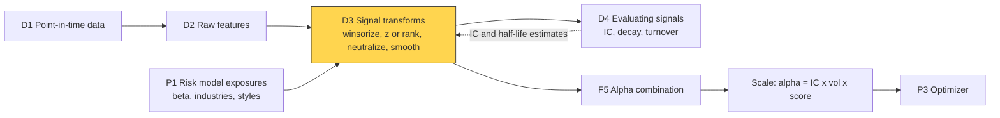
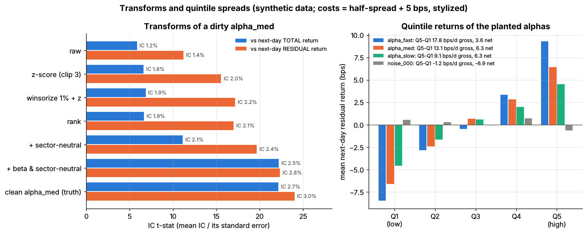

# Signal transforms

> **TL;DR**
>
> - Transforms turn a raw, dirty signal into a clean cross-sectional score: winsorize, z-score or rank, neutralize, smooth, scale.
> - Winsorize *before* z-scoring, or one bad print sets everyone's scale.
> - Neutralization is a per-date regression on beta, industries and styles; keep the residual. In Lab 11 it lifts a winsorized signal's IC from 0.019 to 0.025 (synthetic lab result).
> - Smoothing trades a little IC for much less turnover.
> - Optimizers need expected returns: alpha = IC × volatility × score (Grinold 1994).

**Level:** Core · **Pipeline stage:** signal · **Last verified:** 2026-11

| Field | Value |
|---|---|
| Purpose (the question it answers) | How do I make a raw number per stock comparable, outlier-proof and free of unintended bets? |
| Inputs → Outputs | Raw signal [date × stock], exposures, residual volatilities → per-date score (mean 0, sd 1) → alpha |
| Used by strategies | [Cross-sectional alpha](../../02-strategies/d-mid-frequency-alpha/cross-sectional-alpha-and-neutralization.md) · [Fundamental signals](../../02-strategies/d-mid-frequency-alpha/fundamental-quant-signals.md) · [Revisions](../../02-strategies/d-mid-frequency-alpha/analyst-revisions-and-sentiment.md) · [Earnings](../../02-strategies/d-mid-frequency-alpha/earnings-and-event-driven.md) · [Alt data](../../02-strategies/d-mid-frequency-alpha/alternative-data.md) · [NLP](../../02-strategies/d-mid-frequency-alpha/nlp-and-llm-signals.md) · [ML short-horizon](../../02-strategies/c-statistical-arbitrage/ml-driven-short-horizon-alpha.md) · [Reversal](../../02-strategies/c-statistical-arbitrage/short-term-cross-sectional-reversal.md) · [Factor-residual](../../02-strategies/c-statistical-arbitrage/factor-residual-mean-reversion.md) · [Stat arb](../../02-strategies/c-statistical-arbitrage/stat-arb-overview-and-history.md) · [Factor investing](../../02-strategies/e-risk-premia-and-factors/factor-investing-fundamentals.md) · [Value and quality](../../02-strategies/e-risk-premia-and-factors/value-quality-low-vol.md) · [Momentum](../../02-strategies/e-risk-premia-and-factors/momentum.md) |
| Latency / compute regime | Overnight batch: one least-squares solve per date, about a millisecond for 3,000 names × 80 exposures `[Estimate]` |
| Key parameters | Winsorize at 1st/99th percentile or ±3–5 MAD; z clip ±3; beta + 60–70 industries + 5–12 styles; EWMA half-life ≈ the signal's half-life |
| Main failure modes | Z-scoring before winsorizing; over-neutralizing; stale exposures; look-ahead in statistics |
| Lab | [Lab 11](https://github.com/FrankHuang94/quant_trading_claude/tree/main/labs/11-signal-transforms-ic) |

## Intuition

Before ranking EV/EBITDA you strip one-offs and compare within an industry; transforms do the same for signals. A raw revision signal arrives in dollars per share, one stale share count makes a value 100× normal, and a good month for semis makes it secretly long semis:

| Step | Removes | Price paid |
|---|---|---|
| Winsorize | bad prints, tiny denominators | some genuine extremes |
| Z-score or rank | units, scale drift | ranks discard magnitude |
| Neutralize | market, sector, style bets | alpha that lives in those factors |
| Smooth | noise, turnover | timeliness (some IC) |

## Where it sits in the pipeline



## The algorithm

1. **Per date, point in time:** that date's universe and data only ([PIT data](point-in-time-data-and-cleaning.md)); never full-sample statistics.
2. **[Winsorize](../../09-reference/glossary.md#winsorization)** at the 1st/99th percentiles or median ± 5 MAD (median absolute deviation).
3. **Normalize:** a [z-score](../../09-reference/glossary.md#z-score) keeps magnitude, a rank only order; Gaussianized ranks (rank, then normal quantile) sit between.
4. **[Neutralize](../../09-reference/glossary.md#neutralization):** least squares on exposures, keep the residual. Sector demeaning is the dummies-only case; adding beta removes the market tilt it leaves.
5. **Smooth** with an EWMA, then re-neutralize.
6. **Re-standardize, combine horizons** ([F5](../b-forecasting-models/alpha-combination-and-ensembling.md)) and **scale to alpha** for the [optimizer](../d-portfolio-construction/mean-variance-optimization.md).

```python
import numpy as np

# Signals are T x N arrays (dates x stocks) known at the close of t; one row = one date.
# winsorize, zscore, rank_score and neutralize follow Lab 11's lab.py; ewma and to_alpha are
# not in the lab. Simplified: no NaNs, no ties, exposures fixed over time.

def winsorize(x, pct=0.01):
    lo = np.nanquantile(x, pct, axis=-1, keepdims=True)       # per-date 1st percentile
    hi = np.nanquantile(x, 1 - pct, axis=-1, keepdims=True)   # per-date 99th percentile
    return np.clip(x, lo, hi)

def zscore(x, clip=3.0):
    mu = np.nanmean(x, axis=-1, keepdims=True)
    sd = np.nanstd(x, axis=-1, keepdims=True)
    return np.clip((x - mu) / sd, -clip, clip)                # clipping here does NOT replace winsorizing

def rank_score(x):
    r = np.argsort(np.argsort(x, axis=-1), axis=-1)           # ranks 0..N-1 per date
    return r / (x.shape[-1] - 1) - 0.5                        # uniform on [-0.5, 0.5]

def neutralize(signal, exposures):
    """exposures: N x K, e.g. [beta, sector dummies]. Residual is orthogonal to every column."""
    coef, *_ = np.linalg.lstsq(exposures, signal.T, rcond=None)   # K x T factor tilts
    return signal - (exposures @ coef).T

def ewma(x, halflife=2.0):
    lam = 0.5 ** (1 / halflife)                               # weight on yesterday's smoothed score
    out = x.copy()
    for t in range(1, len(x)):
        out[t] = lam * out[t - 1] + (1 - lam) * x[t]
    return out

def transform(raw, beta, sector_dummies, halflife=None):
    exposures = np.column_stack([beta, sector_dummies])       # dummies already span the intercept
    s = neutralize(zscore(winsorize(raw, 0.01)), exposures)   # Lab 11's best step
    if halflife:
        s = neutralize(ewma(s, halflife), exposures)          # smoothing re-imports old exposures
    return zscore(s, clip=3.0)                                # re-standardize: mean 0, sd 1

def to_alpha(score, ic=0.02, resid_vol_daily=0.015):
    return ic * resid_vol_daily * score                       # Grinold: alpha = IC x vol x score
```

## Worked example with numbers

**A. One date, five stocks (illustrative).** Raw signal −2, −1, 0, +1, +20; E's +20 is a bad print. Median 0, MAD 1, so winsorize at ±5.

| Stock | Sector | Raw | z, raw | Winsorized | z | Sector-demeaned |
|---|---|---|---|---|---|---|
| A | Banks | −2 | −0.68 | −2 | −1.08 | −0.21 |
| B | Banks | −1 | −0.56 | −1 | −0.66 | +0.21 |
| C | Tech | 0 | −0.44 | 0 | −0.25 | −0.83 |
| D | Tech | +1 | −0.31 | +1 | +0.17 | −0.41 |
| E | Tech | +20 | +1.99 | +5 | +1.82 | +1.24 |

- **Raw z** (mean 3.6, sd 8.26): D, above the median, is a short because E dragged the mean up. A ±3 clip is useless: E's z is 1.99.
- **Winsorized** (mean 0.6, sd 2.42): D is long. Ranks get the order right regardless but cannot see that E is extreme.
- **Sector-demeaned** (Tech +0.58, Banks −0.87): B becomes the long bank, D the short Tech laggard.

**B. Smoothing a fast signal.** Lab 11's `alpha_fast` (IC 0.041, half-life 2 days) earns 17.8 bps/day gross but 3.6 net after 14.1 bps of costs (synthetic lab result). A 2-day EWMA (λ = 0.707) keeps 82% of the IC and cuts daily turnover from 86% to about 38% (Go deeper): 14.5 gross − 6.2 cost ≈ 8.3 net `[Estimate]`. Our rerun of the lab's simulator with the EWMA (not in results.json) gives 7.9 net.

## Key parameters and how practitioners tune them

- **Winsorization:** 1st/99th percentile or ±3–5 MAD `[Lore]`.
- **Z vs rank:** ranks for fat-tailed inputs (text, alt data), z-scores where magnitude matters. Rank IC ignores monotone transforms (Lab 11: 0.020 for raw, z-scored and winsorized; synthetic lab result).
- **Exposures:** MSCI's Barra USE4 has 60 industries and 12 styles `[Verified]`; groups need ~10+ names `[Lore]`.
- **Half-life:** start at the signal's IC half-life ([D4](evaluating-signals.md)); tune net of costs.

## Textbook version vs what firms actually do

- **Scaling:** Grinold (1994) sets alpha = volatility × IC × score `[Verified]`.
- **Industrial primitives:** WorldQuant's 101 alphas (Kakushadze 2016) use the same operators: cross-sectional `rank`, `scale`, `decay_linear` and `indneutralize` (demean within industry groups) `[Verified]`.
- **Partial neutralization:** Numerai's open-source scoring ranks, Gaussianizes and neutralizes by least squares with a `proportion` from 0 to 1 `[Verified]`; partial neutralization is common `[Lore]`.
- **Where:** in the signal and again in the optimizer `[Lore]`, which over-loads alpha its risk model cannot see (Ceria, Saxena & Stubbs 2012) `[Reported]`.
- **Smoothing vs slow trading:** Gârleanu & Pedersen (2013) trade partway toward an aim that weights persistent signals more `[Verified]`; heavy smoothing on top double-counts `[Lore]`.

## How to tell if it's working

- **IC up, IC volatility down.** Lab 11 (synthetic lab result): raw IC 0.012 (t 5.8); winsorized z 0.019 (t 6.8); beta- and sector-neutral 0.025 (t 22.2), near the clean signal's 0.027. IC daily sd fell from 0.075 to 0.040, correlation with beta from 0.28 to 0.00.
- **These t-stats are stylized:** the simulator plants IC 0.03 across 500 stocks. Real single signals show daily ICs of ~0.005–0.03 `[Lore]` and t-stats of ~2–5 over five years `[Estimate]`.
- **Residual factor exposures** near zero; lower turnover after smoothing.



*Lab 11, synthetic data (500 stocks × 1,260 days). Left: IC t-stat of each transform step against next-day total and residual returns. Right: quintile returns of the planted alphas and a noise signal.*

## Failure modes and pitfalls

- **Clip instead of winsorize** (example A).
- **Over-neutralizing:** a value signal neutralized to value is gone.
- **[Look-ahead](../../09-reference/glossary.md#look-ahead-bias):** full-sample means or percentiles.
- **Stale exposures, tiny groups:** old betas leave factor bets; a two-name industry turns its names into opposites.
- **Smoothing without re-neutralizing.**

## How practitioners talk about it

- "Did you winsorize before you z-scored?" → One bad print sets everyone's scale.
- "Neutralize to subindustry." → Compare each stock with its closest peers.
- "That signal is mostly beta." → Its IC vanishes once beta is regressed out.
- "Gauss-rank it." → Rank, then map to normal quantiles.
- "Put a three-day decay on it." → Smooth to cut turnover.

## Questions you could ask a quant about this

1. Ranks, z-scores or Gaussianized ranks, and why? (basic)
2. Do you neutralize in the signal, the optimizer, or both? (basic)
3. How often are your neutralization exposures re-estimated? (informed)
4. Do you smooth each signal or only the combined forecast? (informed)
5. How much IC does full style neutralization cost you? 🔒 (sharp)

## Go deeper

<details markdown="1">
<summary>Math: projection and the EWMA trade-off</summary>

**Neutralization as projection.** Signal $s$, exposures $X$ ($N \times K$):

$$
s_\perp = \left(I - X (X^\top X)^{-1} X^\top\right) s, \qquad X^\top s_\perp = 0 .
$$

Dummies only: group demeaning. Cost $O(NK^2)$ per date.

**EWMA of an AR(1) signal** with autocorrelation $\varphi$ and IC with day $t+1+k$ equal to $IC\cdot\varphi^k$ (as in Lab 11), smoothed as $e_t = \lambda e_{t-1} + (1-\lambda)s_t$:

$$
\frac{IC_e}{IC} = \sqrt{\frac{1-\lambda^2}{1-\lambda^2\varphi^2}}, \qquad
\rho_e = \lambda + \frac{\varphi(1-\lambda^2)}{1+\lambda\varphi} .
$$

Turnover scales with $\sqrt{1-\rho}$. With $\lambda = \varphi = 0.707$: IC ratio 0.82, $\rho_e = 0.943$, turnover ratio $\sqrt{0.057/0.293} = 0.44$.

</details>

## Related pages

- [Evaluating signals](evaluating-signals.md) · [Feature engineering](feature-engineering.md) · [Point-in-time data and cleaning](point-in-time-data-and-cleaning.md)
- [Cross-sectional alpha and neutralization](../../02-strategies/d-mid-frequency-alpha/cross-sectional-alpha-and-neutralization.md)
- [Alpha combination](../b-forecasting-models/alpha-combination-and-ensembling.md) · [Risk models](../d-portfolio-construction/risk-models.md) · [Trading toward the aim](../d-portfolio-construction/multi-period-and-trading-toward-aim.md)

## Sources

- [Verified] Grinold, R. C. (1994). "Alpha Is Volatility Times IC Times Score." *Journal of Portfolio Management* 20(4), 9–16. <https://doi.org/10.3905/jpm.1994.409482> (accessed 2026-11)
- [Verified] Kakushadze, Z. (2016). "101 Formulaic Alphas." *Wilmott* 2016(84), 72–81. <https://arxiv.org/abs/1601.00991> (accessed 2026-11)
- [Verified] Numerai. numerai-tools, `scoring.py` (`tie_kept_rank`, `gaussian`, `neutralize` with `proportion`). GitHub. <https://github.com/numerai/numerai-tools/blob/master/numerai_tools/scoring.py> (accessed 2026-11)
- [Verified] MSCI (2011). "Barra US Equity Model (USE4)" product description (60 industries, 12 style factors). <https://www.msci.com/documents/10199/242721/Barra_US_Equity_Model_USE4.pdf> (accessed 2026-11)
- [Reported] Ceria, S., Saxena, A. & Stubbs, R. A. (2012). "Factor Alignment Problems and Quantitative Portfolio Management." *Journal of Portfolio Management* 38(2), 29–43. <https://doi.org/10.3905/jpm.2012.38.2.029> (accessed 2026-11)
- [Verified] Gârleanu, N. & Pedersen, L. H. (2013). "Dynamic Trading with Predictable Returns and Transaction Costs." *Journal of Finance* 68(6), 2309–2340. <https://doi.org/10.1111/jofi.12080> (accessed 2026-11)
- [Reported] Grinold, R. C. & Kahn, R. N. (2000). *Active Portfolio Management*, 2nd ed. McGraw-Hill. <https://www.mheducation.com/> (accessed 2026-11)
