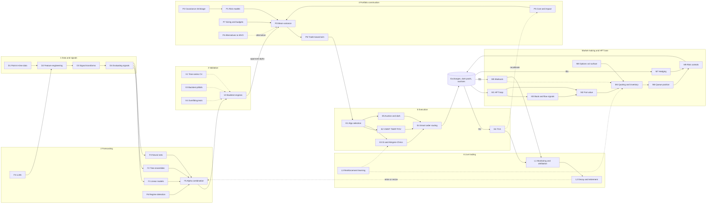
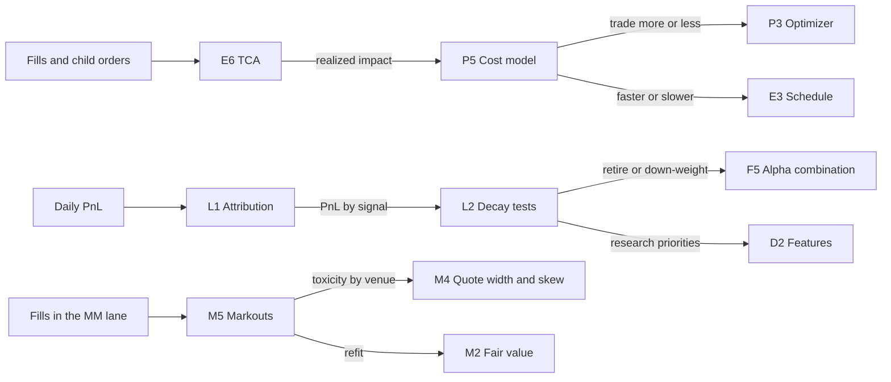

# Algorithm map

> **TL;DR**
>
> - All 39 algorithm cards on one diagram: five research-to-trading stages (data and signals → forecasting → validation → portfolio construction → execution), a parallel market-making/HFT lane, and live trading as the loop that feeds results back.
> - Every card has a stable ID (D1…L3). The ID's letter tells you the stage; the [five canonical pipelines](there-is-no-single-algorithm.md) are different paths through the same map.
> - Latency regimes run from nanosecond risk gates to research jobs that take hours. A card's regime tells you what kind of engineering it needs.
> - The map is not a one-way conveyor. Three feedback loops matter: TCA recalibrates the cost model, live monitoring retires decaying alphas, and markouts retune quoting.

**Level:** Core · **Read time:** ~7 min · **Last verified:** 2026-11

## How to read the map

Solid arrows show what feeds what on a normal trading day; dotted arrows show research gates and feedback. Validation cards (V) never touch live orders; they decide whether a forecast reaches production. The market-making lane (M) is a separate, much faster loop that shares venues, risk controls and monitoring with the main pipeline. [M9 Algorithmic risk controls](f-market-making-and-hft-algorithms/algorithmic-risk-controls.md) sits in that lane, but every live order in every pipeline passes a [pre-trade risk check](../09-reference/glossary.md#pre-trade-risk-check).

## The master map

Market-making systems use the data and validation cards to build their models, but on the live path they go from venue data straight to quotes.

## The 39 cards

Latency regimes are typical orders of magnitude, not firm-specific measurements `[Estimate]` (reasoning: a market-making critical path must finish between microsecond-spaced book updates; a daily rebalance only has to finish overnight). Pipelines: 1 HFT/market making, 2 short-horizon stat arb, 3 mid-frequency, 4 factor, 5 agency execution.

| ID | Card | Stage | One-line purpose | Latency regime | Pipelines |
|---|---|---|---|---|---|
| D1 | [Point-in-time data and cleaning](a-data-and-signals/point-in-time-data-and-cleaning.md) | data | Make every backtest see only what was knowable then | overnight batch | 2, 3, 4 |
| D2 | [Feature engineering](a-data-and-signals/feature-engineering.md) | signal | Turn prices, fundamentals, book data and text into predictors | daily batch to streaming | 2, 3, 4 |
| D3 | [Signal transforms](a-data-and-signals/signal-transforms.md) | signal | Winsorize, rank, z-score, neutralize | same cadence as features | 2, 3, 4 |
| D4 | [Evaluating signals](a-data-and-signals/evaluating-signals.md) | signal | IC, decay, turnover and capacity before a signal gets capital | offline research | 2, 3, 4 |
| F1 | [Linear models and regularization](b-forecasting-models/linear-models-and-regularization.md) | forecast | Ridge and lasso: the robust baseline | train offline; predict µs–ms | 1, 2, 3 |
| F2 | [Tree ensembles](b-forecasting-models/tree-ensembles.md) | forecast | Boosted trees for nonlinear interactions | train hours; predict ms | 2, 3 |
| F3 | [Neural nets and sequence models](b-forecasting-models/neural-nets-and-sequence-models.md) | forecast | Learn from raw sequences when data are plentiful | GPU training; ms inference | 1, 2 |
| F4 | [LLMs and foundation models in quant](b-forecasting-models/llms-and-foundation-models-in-quant.md) | forecast | Turn text into signals | batch, minutes to hours | 3 |
| F5 | [Alpha combination and ensembling](b-forecasting-models/alpha-combination-and-ensembling.md) | forecast | Blend many signals into one forecast per stock | daily, sometimes intraday | 2, 3, 4 |
| F6 | [Regime detection](b-forecasting-models/regime-detection.md) | forecast | Detect volatility regimes to scale risk | daily | 3, 4 |
| V1 | [Time-series cross-validation](c-validation-and-backtesting/time-series-cross-validation.md) | validation | Purged, embargoed CV that respects time order | offline research | 2, 3 |
| V2 | [Backtesting engines](c-validation-and-backtesting/backtesting-engines.md) | validation | Simulate with realistic fills, costs and constraints | offline research | 2, 3, 4 |
| V3 | [Backtest pitfalls](c-validation-and-backtesting/backtest-pitfalls.md) | validation | Look-ahead, survivorship, data snooping | offline research | 2, 3, 4 |
| V4 | [Overfitting and multiple testing](c-validation-and-backtesting/overfitting-and-multiple-testing.md) | validation | Deflated Sharpe, PBO, higher t-hurdles | offline research | 2, 3, 4 |
| P1 | [Risk models](d-portfolio-construction/risk-models.md) | portfolio | Factor exposures, factor covariance, specific risk | overnight batch | 2, 3, 4 |
| P2 | [Covariance estimation and shrinkage](d-portfolio-construction/covariance-estimation-and-shrinkage.md) | portfolio | Stable covariance from noisy data | overnight batch | 2, 3, 4 |
| P3 | [Mean-variance optimization](d-portfolio-construction/mean-variance-optimization.md) | portfolio | Forecasts, risk and costs → target weights | seconds per solve | 2, 3, 4 |
| P4 | [Alternatives to MVO](d-portfolio-construction/alternatives-to-mvo.md) | portfolio | Risk parity, HRP, heuristics when MVO is fragile | seconds | 3, 4 |
| P5 | [Transaction cost and impact models](d-portfolio-construction/transaction-cost-and-impact-models.md) | portfolio | Predict spread plus impact for a trade | fit offline; evaluate in ms | 2, 3, 4, 5 |
| P6 | [Multi-period optimization and trading toward the aim](d-portfolio-construction/multi-period-and-trading-toward-aim.md) | portfolio | Trade partway toward a target that anticipates decay | per rebalance | 2, 3, 4 |
| P7 | [Position sizing and risk budgeting](d-portfolio-construction/position-sizing-and-risk-budgeting.md) | portfolio | Vol targeting and risk budgets across books | daily | 2, 3, 4 |
| E1 | [Execution algorithms overview](e-execution-algorithms/execution-algorithms-overview.md) | execution | Pick the algo family for a parent order | per order | 2, 3, 5 |
| E2 | [VWAP, TWAP and POV](e-execution-algorithms/vwap-twap-pov.md) | execution | Benchmark-tracking schedules | slices every seconds to minutes | 3, 4, 5 |
| E3 | [Implementation shortfall and Almgren-Chriss](e-execution-algorithms/implementation-shortfall-and-almgren-chriss.md) | execution | Optimal impact-versus-risk schedule | at start; re-optimized intraday | 3, 5 |
| E4 | [Smart order routing](e-execution-algorithms/smart-order-routing.md) | execution | Venue and order-type choice per child | µs–ms per decision | 1, 2, 5 |
| E5 | [Auction, close and dark-liquidity algos](e-execution-algorithms/auction-close-and-dark-liquidity-algos.md) | execution | Access auctions and dark pools | minutes (auctions); ms (dark) | 3, 4, 5 |
| E6 | [Transaction cost analysis](e-execution-algorithms/transaction-cost-analysis.md) | execution | Realized cost versus benchmarks | post-trade, daily | 3, 5 |
| M1 | [Anatomy of an HFT trading loop](f-market-making-and-hft-algorithms/anatomy-of-an-hft-trading-loop.md) | market making | Event loop from market data to orders | ns–µs | 1 |
| M2 | [Fair value and microprice](f-market-making-and-hft-algorithms/fair-value-and-microprice.md) | market making | Best estimate of the current price | ns–µs | 1 |
| M3 | [Order-book and trade-flow signals](f-market-making-and-hft-algorithms/order-book-and-trade-flow-signals.md) | market making | Predict the next ticks from imbalance and flow | µs | 1, 2 |
| M4 | [Quoting and inventory control](f-market-making-and-hft-algorithms/quoting-and-inventory-control.md) | market making | Set quote width and skew against inventory | µs | 1 |
| M5 | [Adverse selection and markouts](f-market-making-and-hft-algorithms/adverse-selection-and-markouts.md) | market making | Measure price moves after fills | post-trade | 1, 5 |
| M6 | [Queue position and order placement](f-market-making-and-hft-algorithms/queue-position-and-order-placement.md) | market making | Value and keep queue priority | µs | 1, 2, 5 |
| M7 | [Hedging algorithms](f-market-making-and-hft-algorithms/hedging-algorithms.md) | market making | Offset inventory risk in correlated instruments | µs–ms | 1 |
| M8 | [Options pricing and vol surfaces for MM](f-market-making-and-hft-algorithms/options-pricing-and-vol-surfaces-for-mm.md) | market making | Fit the surface; price the chain | fit ms–s; price µs | 1 |
| M9 | [Algorithmic risk controls](f-market-making-and-hft-algorithms/algorithmic-risk-controls.md) | market making | Pre-trade checks, limits, kill switches | inline, ns–µs | all |
| L1 | [Live monitoring and P&L attribution](g-live-trading/live-monitoring-and-pnl-attribution.md) | live | Explain P&L by source; catch breaks | real time and daily | all |
| L2 | [Alpha decay detection and model retirement](g-live-trading/alpha-decay-detection-and-model-retirement.md) | live | Detect dying signals; resize or retire | weekly to monthly | 2, 3, 4 |
| L3 | [Reinforcement learning in trading](g-live-trading/reinforcement-learning-in-trading.md) | live | Learn quoting or execution policies | offline training; fast inference | 1, 5 |

## The feedback loops

Solid arrows explain one day; dotted arrows explain why a pipeline gets better or worse over months.

1. **Execution cost loop.** [TCA](e-execution-algorithms/transaction-cost-analysis.md) feeds realized [market impact](../09-reference/glossary.md#market-impact) into the [cost model](d-portfolio-construction/transaction-cost-and-impact-models.md). If impact runs above forecast, the optimizer trades less and schedules slow down. Without it, capacity estimates are guesses.
2. **Alpha lifecycle loop.** [Attribution](g-live-trading/live-monitoring-and-pnl-attribution.md) splits P&L by signal; [decay tests](g-live-trading/alpha-decay-detection-and-model-retirement.md) decide when live [IC](../09-reference/glossary.md#information-coefficient-ic) has fallen far enough below the backtest to cut a signal's weight, freeing risk budget for new research.
3. **Adverse-selection loop.** [Markouts](f-market-making-and-hft-algorithms/adverse-selection-and-markouts.md) expose [adverse selection](../09-reference/glossary.md#adverse-selection) by venue and counterparty; quoting widens or skews and the [fair-value model](f-market-making-and-hft-algorithms/fair-value-and-microprice.md) is refit.

## Related pages

- [There is no single algorithm](there-is-no-single-algorithm.md): the five pipelines as paths through this map
- [Algorithms: overview](index.md): how to read a card; labs; walkthroughs
- [Strategy x algorithm matrix](../02-strategies/h-cross-cutting/strategy-x-algorithm-matrix.md): which strategies use which cards
- [Walkthrough: a day at an ETF market maker](h-end-to-end-walkthroughs/walkthrough-etf-market-maker.md)
- [Walkthrough: executing a \$500M buy order](h-end-to-end-walkthroughs/walkthrough-institutional-execution.md)

## Sources

- [Verified] López de Prado, M. (2018). *Advances in Financial Machine Learning*. Wiley. <https://www.wiley-vch.de/en/areas-interest/finance-economics-law/advances-in-financial-machine-learning-978-1-119-48208-6> (accessed 2026-11)
- [Verified] Grinold, R. C. & Kahn, R. N. (2000). *Active Portfolio Management*, 2nd ed. McGraw-Hill. <https://www.econbiz.de/Record/active-portfolio-management-a-quantitative-approach-for-producing-superior-returns-and-controlling-risk/10004551679> (accessed 2026-11)
- [Verified] Isichenko, M. (2021). *Quantitative Portfolio Management: The Art and Science of Statistical Arbitrage*. Wiley. <https://www.oreilly.com/library/view/-/9781119821328/> (accessed 2026-11)
- [Verified] Narang, R. K. (2024). *Inside the Black Box: A Simple Guide to Systematic Investing*, 3rd ed. Wiley. <https://www.harvard.com/book/9781119931898> (accessed 2026-11)
- [Verified] Kissell, R. (2020). *Algorithmic Trading Methods*, 2nd ed. Academic Press. <https://shop.elsevier.com/books/algorithmic-trading-methods/kissell/978-0-12-815630-8> (accessed 2026-11)
- [Verified] Almgren, R. & Chriss, N. (2000). "Optimal execution of portfolio transactions." *Journal of Risk* 3(2), 5–39. <https://doi.org/10.21314/JOR.2001.041> (accessed 2026-11)
- [Verified] Avellaneda, M. & Stoikov, S. (2008). "High-frequency trading in a limit order book." *Quantitative Finance* 8(3), 217–224. <https://doi.org/10.1080/14697680701381228> (accessed 2026-11)
- [Verified] Gârleanu, N. & Pedersen, L. H. (2013). "Dynamic trading with predictable returns and transaction costs." *Journal of Finance* 68(6), 2309–2340. <https://doi.org/10.1111/jofi.12080> (accessed 2026-11)
- [Verified] STAC (2024-06-25). "STAC-T0 results with an Exegy/AMD FPGA solution" (vendor-commissioned benchmark; the nanosecond end of the latency range). <https://stacresearch.com/node/48577> (accessed 2026-11)
