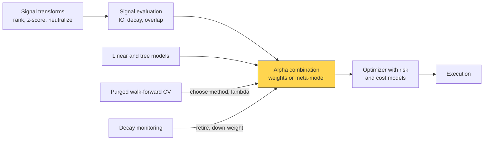
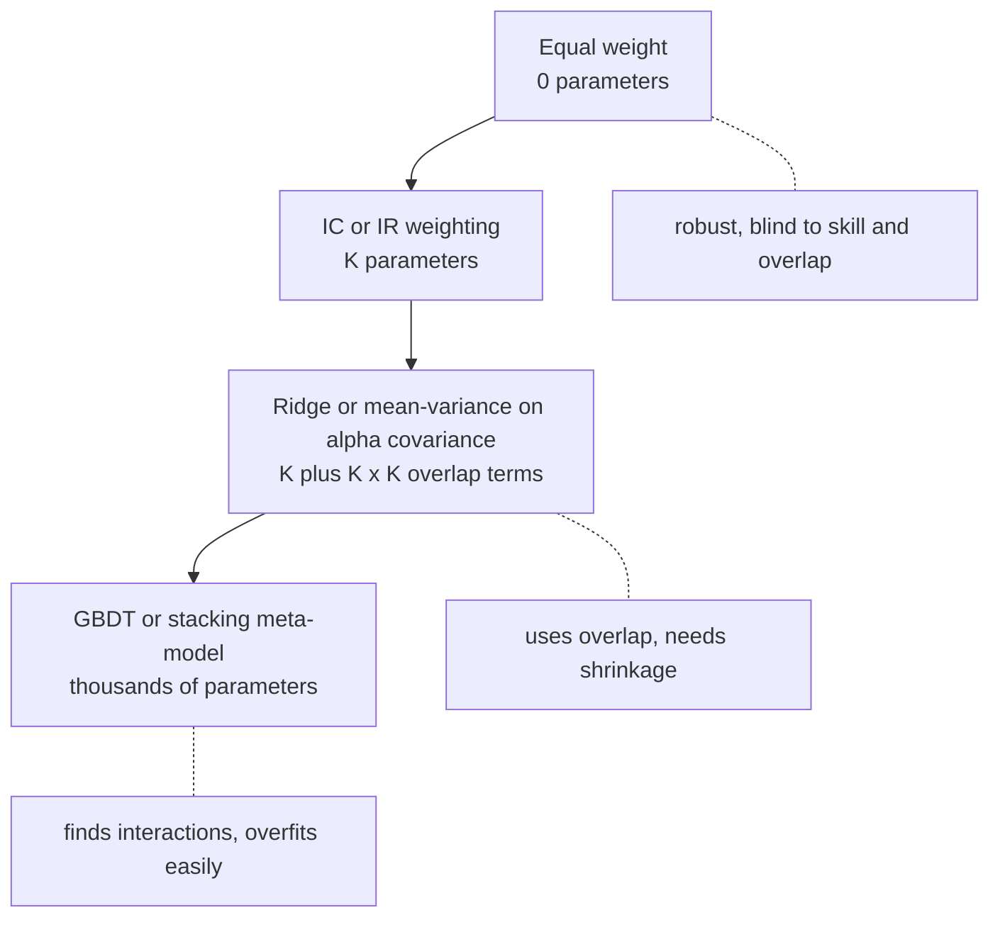
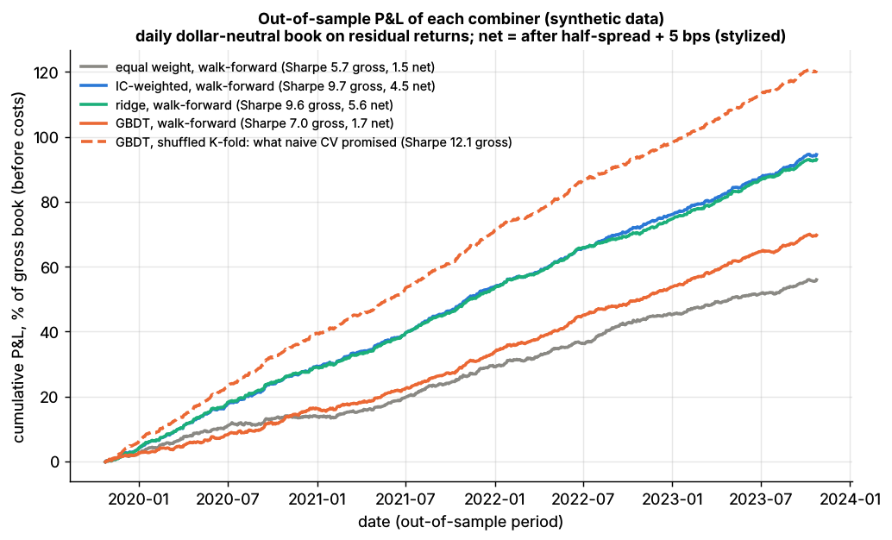

# Alpha combination and ensembling

> **TL;DR**
>
> - The combiner turns 10–1,000 alphas into one forecast per stock, weighted by skill net of overlap, with weights stable enough to survive estimation error.
> - The ladder: equal weight → IC weighting → ridge or mean-variance on the alpha covariance → nonlinear meta-models. Each rung estimates more parameters.
> - Ridge sits between mean-variance (λ → 0) and IC weighting (λ → ∞) and pulls near-duplicates toward a shared weight. In Lab 12 it matched the oracle (out-of-sample IC 0.085 vs 0.087); equal weight, diluted by noise signals, scored 0.050 (synthetic lab result).
> - IC weighting double-counts correlated signals. Weight fast-decaying signals by the alpha that survives costs, not by raw IC.

**Level:** Core · **Pipeline stage:** forecast · **Last verified:** 2026-11

| Field | Value |
|---|---|
| Purpose (the question it answers) | Which single forecast per stock, built from K overlapping signals, gives the best out-of-sample IC after costs? |
| Inputs → Outputs | Per-date ranked signals (date × stock × K) and forward residual returns or IC histories → weights (or a meta-model) and one composite forecast per stock |
| Used by strategies | [Cross-sectional alpha](../../02-strategies/d-mid-frequency-alpha/cross-sectional-alpha-and-neutralization.md) · [Stat arb overview](../../02-strategies/c-statistical-arbitrage/stat-arb-overview-and-history.md) · [ML-driven short-horizon alpha](../../02-strategies/c-statistical-arbitrage/ml-driven-short-horizon-alpha.md) · [Analyst revisions and sentiment](../../02-strategies/d-mid-frequency-alpha/analyst-revisions-and-sentiment.md) · [Fundamental quant signals](../../02-strategies/d-mid-frequency-alpha/fundamental-quant-signals.md) · [NLP and LLM signals](../../02-strategies/d-mid-frequency-alpha/nlp-and-llm-signals.md) · [Alternative data](../../02-strategies/d-mid-frequency-alpha/alternative-data.md) · [Factor-residual mean reversion](../../02-strategies/c-statistical-arbitrage/factor-residual-mean-reversion.md) · [Short-term reversal](../../02-strategies/c-statistical-arbitrage/short-term-cross-sectional-reversal.md) · [Factor investing](../../02-strategies/e-risk-premia-and-factors/factor-investing-fundamentals.md) · [Value, quality, low vol](../../02-strategies/e-risk-premia-and-factors/value-quality-low-vol.md) · [Momentum](../../02-strategies/e-risk-premia-and-factors/momentum.md) · [Trend following](../../02-strategies/g-futures-and-macro-context/trend-following-and-ctas.md) |
| Latency / compute regime | Overnight batch: a 100-signal ridge solve takes under a millisecond, a GBDT meta-model minutes; refit daily to monthly |
| Key parameters | IC lookback 1–3 years (half-life 6–24 months); ridge λ by purged CV; covariance shrinkage 30–70%; per-signal cap 10–25%; entry IC t-stat 2–3 `[Lore]` |
| Main failure modes | Double-counting near-duplicates; weights chasing recent IC; meta-models fit on in-sample base forecasts; ignoring decay and turnover |
| Lab | [Lab 12](https://github.com/FrankHuang94/quant_trading_claude/tree/main/labs/12-alpha-combination-purged-cv) |

## Intuition

Think of an investment committee: one vote per analyst; votes weighted by track record; track record discounted for analysts who echo a colleague; or a meta-analyst who learns whom to trust. Those are the four rungs of [alpha combination](../../09-reference/glossary.md#alpha-combination).

The third rung is consolidation: eliminate intercompany balances before adding up subsidiaries. Two reversal signals from two researchers are mostly one bet; add their [information coefficients (IC)](../../09-reference/glossary.md#information-coefficient-ic) as if independent and you book the same revenue twice.

The tension is estimation error. In the *forecast combination puzzle*, simple averages beat "optimal" weights because estimation error swamps skill differences ([Smith & Wallis 2009](https://doi.org/10.1111/j.1468-0084.2008.00541.x)) `[Verified]`. But equal weight fails once the library holds dead or duplicated signals.

## Where it sits in the pipeline





## The algorithm

1. **Prepare:** rank or z-score and neutralize each signal per date ([signal transforms](../a-data-and-signals/signal-transforms.md)); target = per-date rank of the forward [residual return](../../09-reference/glossary.md#residual-return).
2. **Estimate on training dates only** (purged, see [time-series CV](../c-validation-and-backtesting/time-series-cross-validation.md)): each signal's mean daily IC and, for mean-variance, its IC series.
3. **Combine:** equal weight, IC-weighted (negative ICs floored at zero), pooled ridge, max-IR on the IC covariance, or a GBDT meta-model.
4. **Forecast** the next block with frozen weights; score out-of-sample rank IC, turnover and net P&L.
5. **Roll forward:** refit monthly, cap any one signal's weight, re-neutralize, and log every variant tried ([overfitting](../c-validation-and-backtesting/overfitting-and-multiple-testing.md)).

```python
import numpy as np
import pandas as pd
# rank_target, combine_ic_weighted, fit_ridge: Lab 12 core functions (same names and logic).
# combine_mv and the loop are sketches added here. Rows = (date, stock).
# X: rows x K signals z-scored per date; dates: date index of each row.

def rank_target(ret, dates):
    # per-date percentile rank of the forward residual return, mapped to [-0.5, 0.5]
    g = pd.Series(ret).groupby(dates)
    return ((g.rank() - 1) / (g.transform("count") - 1) - 0.5).to_numpy()

def combine_ic_weighted(X, ic):
    # w ~ max(training IC, 0), summing to 1. Ignores overlap: a near-copy gets double weight
    w = np.clip(np.asarray(ic, dtype=float), 0.0, None)
    w = w / w.sum() if w.sum() > 0 else np.full(len(w), 1.0 / len(w))
    return X @ w, w

def fit_ridge(X, y, lam):
    # beta = (X'X + lam I)^-1 X'y. lam -> 0: OLS, uses overlap; lam -> inf: beta ~ X'y ~ IC weights
    return np.linalg.solve(X.T @ X + lam * np.eye(X.shape[1]), X.T @ y)

def combine_mv(ic_hist, shrink=0.5):
    # NOT in Lab 12. Max-IR weights from the alphas' daily IC series (T x K):
    # w ~ inv(IC covariance) @ mean IC, with the covariance shrunk toward its diagonal
    S = np.cov(ic_hist, rowvar=False)
    S = (1 - shrink) * S + shrink * np.diag(np.diag(S))
    w = np.linalg.solve(S, ic_hist.mean(axis=0))
    return w / np.abs(w).sum()

# Lab 12 setting: 5-day horizon, lam = 0.1 x training rows (about 10% shrinkage)
# y = rank_target(fwd_resid_ret_5d, dates)
# for train_d, test_d in walk_forward_splits(n_dates, n_folds=5, horizon=5):
#     tr, te = rows_of(train_d), rows_of(test_d)
#     beta = fit_ridge(X[tr], y[tr], lam=0.1 * len(tr))
#     forecast[te] = X[te] @ beta            # weights frozen over the test block
```

## Worked example with numbers

Illustrative. Signal A has IC 0.040; A′ is a noisy copy (correlation 0.85, IC 0.85 × 0.040 = 0.034); B has IC 0.030 and is uncorrelated with both. Composite IC is $w^\top c / \sqrt{w^\top \Sigma w}$ ($c$: ICs, $\Sigma$: correlations).

| Method | Weights A / A′ / B | Composite IC |
|---|---|---|
| OLS = mean-variance, Σ⁻¹c | 57% / 0% / 43% | **0.0500** |
| Ridge, λ = 1 (correlation units) | 38% / 25% / 37% | 0.0489 |
| Equal weight | 33% / 33% / 33% | 0.0480 |
| IC-weighted | 38% / 33% / 29% | 0.0473 |
| Equal weight plus 10 pure-noise signals | 7.7% each | 0.0271 |

By hand: the inverse of the A/A′ correlation block is 1/(1 − 0.85²) = 3.60 times [[1, −0.85], [−0.85, 1]]. So β_A = 3.60 × (0.040 − 0.85 × 0.034) = 0.040, β_A′ = 3.60 × (0.034 − 0.85 × 0.040) = 0, and β_B = 0.030. Composite IC = √(0.040² + 0.030²) = 0.050.

A′ adds nothing A lacks; OLS sees this, IC weighting gives the A cluster 71%. The top four rows differ by under 6%; noise costs 46% of the IC, the Lab 12 story.

**Why ridge ≈ shrinking toward equal weight.** Strictly, ridge shrinks toward zero, and as λ grows its weights approach the ICs. But the penalty bites hardest on the small-eigenvalue direction, "A minus A′", so within a correlated cluster weights move toward equality: A : A′ goes from ∞ (OLS) to 1.5 (λ = 1) to 1.2 (λ = 10). [Stock & Watson (2004)](https://doi.org/10.1002/for.928) shrink explicitly toward 1/K instead `[Verified]`.

## Key parameters and how practitioners tune them

- **Window:** 1–3 years of daily ICs, or a 6–24-month exponential half-life `[Lore]`.
- **λ and covariance shrinkage:** chosen on purged walk-forward folds by rank IC. Lab 12's λ = 0.1 × rows is about 10% shrinkage, since X′X ≈ rows × Σ.
- **Caps and floors:** 10–25% per signal; negative-IC signals floored at zero, not flipped (a flip is a fresh data-mined bet) `[Lore]`.
- **Decay-aware weights:** if positions move a fraction κ per day toward target and alpha decays at δ = ln 2 / [half-life](../../09-reference/glossary.md#half-life), the book captures κ/(κ + δ) of gross alpha. At κ = 0.2, a 1-day half-life keeps 22%, a 20-day half-life 85% `[Estimate]` (derivation below). Hence [Gârleanu & Pedersen (2013)](https://doi.org/10.1111/jofi.12080) weight slow signals more in the aim portfolio `[Verified]`.
- **Horizon blending:** rescale signals to the optimizer's horizon by decay profile, or feed several horizons to a [multi-period optimizer](../d-portfolio-construction/multi-period-and-trading-toward-aim.md) `[Lore]`.

## Textbook version vs what firms actually do

- **Textbook:** Grinold & Kahn's refined forecast is volatility × IC × score; with several signals it becomes the regression Cov(r, g)·Var(g)⁻¹·g, the mean-variance combination ([Grinold & Kahn 2000](https://www.econbiz.de/Record/active-portfolio-management-a-quantitative-approach-for-producing-superior-returns-and-controlling-risk/10004551679)) `[Verified]`. Qian, Hua & Sorensen (2007) maximize the composite's mean IC / sd IC instead: w ∝ Σ_IC⁻¹ · mean IC `[Reported]`.
- **Simple often beats optimal:** in Stock & Watson the best combinations, like the mean, ignore recent performance `[Verified]`; Smith & Wallis support ignoring forecast-error covariances `[Verified]`. That helps when covariances are noisy, and hurts when a true near-copy is present.
- **Practice:** slowly refit, shrunk linear weights dominate mid-frequency books; nonlinear meta-models appear mostly in short-horizon ML books `[Lore]`. For thousands of alphas, [Kakushadze & Yu (2017)](https://doi.org/10.1057/s41260-016-0004-9) give an algorithm linear in their number `[Verified]`. Stacking must use out-of-fold base forecasts, as in [Breiman (1996)](https://doi.org/10.1007/BF00117832) `[Reported]`.
- **Signal-level vs portfolio-level** (contested): blending signals nets opposing trades before they reach the market ([how firms combine strategies](../../02-strategies/h-cross-cutting/how-firms-combine-strategies.md)). AQR researchers find integrating beats mixing for long-only style portfolios ([Fitzgibbons et al. 2017](https://doi.org/10.3905/joi.2017.26.4.153)) `[Verified]`; [Ghayur, Heaney & Platt (2018)](https://doi.org/10.2469/faj.v74.n3.5) find portfolio blending wins except at high factor exposure `[Reported]`.

## How to tell if it's working

- Composite out-of-sample rank IC beats the best single signal on identical purged folds; drop-one tests flag duplicates (near-zero marginal IC).
- Weights keep their signs across refits; [turnover](../../09-reference/glossary.md#turnover) is reported next to IC.

Lab 12 (150 stocks × 1,260 days; 3 planted alphas, 1 near-duplicate, 10 noise signals; 1,045 walk-forward test dates), synthetic lab result: mean daily out-of-sample rank IC of 0.050 for equal weight, 0.082 IC-weighted, 0.085 ridge and 0.066 GBDT; oracle 0.087, best single signal 0.051. Ridge's in-sample IC (0.084) matched its out-of-sample IC; GBDT's was 0.238. The planted truth is linear, so trees add only variance here ([tree ensembles](tree-ensembles.md)).



*Lab 12, synthetic data: cumulative out-of-sample P&L (before costs) of each combiner under walk-forward validation; dashed line, what naive shuffled K-fold promised for GBDT.*

P&L follows IC: Sharpe 9.6 gross and 5.6 net for ridge, 5.7 and 1.5 for equal weight (synthetic lab result). These levels are stylized: clean, stable planted alphas, free factor hedging and simple costs, and the [fundamental law](../../09-reference/glossary.md#fundamental-law-of-active-management) turns a daily IC of 0.03 across 500 stocks into an IR near 0.03 × √(500 × 252) ≈ 10 `[Estimate]`. Real diversified multi-alpha equity books run about 1.5–3 gross and 1–2 net `[Lore]`; the PCA stat arb of [Avellaneda & Lee (2010)](https://doi.org/10.1080/14697680903124632) earned 1.44 net over 1997–2007, an academic backtest that weakened later `[Verified]`. Compare rows, not levels.

## Failure modes and pitfalls

- **Double-counting:** in Lab 12's last fold, IC weighting gave the original signal and its near-copy 43% of the weight; ridge gave the copy 6% of its absolute weight against 22% for the original (synthetic lab result).
- **Chasing IC:** short lookbacks whipsaw weights; handle [alpha decay](../../09-reference/glossary.md#alpha-decay) with [decay monitoring](../g-live-trading/alpha-decay-detection-and-model-retirement.md).
- **Stacking leak:** a meta-model fit on in-sample base forecasts overweights the most overfit base model.
- **Shared signals:** popular alphas sit in many firms' composites and unwind together ([crowding](../../09-reference/glossary.md#crowding)).

## How practitioners talk about it

- "That new alpha is 0.8 correlated with the book, so its marginal IC is basically zero." → It duplicates existing signals.
- "We ridge the combo and cap anything above 20%." → Shrunk regression weights with concentration limits.
- "Fast stuff looks great on IC and dies on costs." → Weight by alpha that survives trading speed.
- "Blend at the signal level so the optimizer nets the trades." → Signal-level combination saves costs.
- "Stack on out-of-fold predictions only." → Meta-models must not see base models' training data.

## Questions you could ask a quant about this

1. Do you combine forecasts before the optimizer or positions after it? (basic)
2. How do you weight alphas: equal, IC, regression or something nonlinear? (basic)
3. How do you adjust weights for decay and turnover? (informed)
4. What marginal IC must a new signal show to enter the combination? 🔒 (sharp)
5. How much IC does your combiner add over equal weight, out of sample? 🔒 (sharp)

## Go deeper

<details markdown="1">
<summary>Math: composite IC, ridge along principal components, max-IR weights, decay capture</summary>

Signal correlation $\Sigma$, IC vector $c$:

$$
\text{IC}(w) = \frac{w^\top c}{\sqrt{w^\top \Sigma w}}, \qquad \arg\max_w \text{IC}(w) \propto \Sigma^{-1} c .
$$

Ridge, with $\Sigma = \sum_j d_j u_j u_j^\top$:

$$
\hat\beta(\lambda) = \sum_j \frac{u_j^\top c}{d_j + \lambda}\, u_j ,
$$

so contrasts between near-duplicates ($d_j \approx 1-\rho$) shrink most, and $\hat\beta \to c/\lambda$ (IC weighting) as $\lambda \to \infty$.

Max-IR weights: $w \propto \Sigma_{IC}^{-1}\,\overline{\text{IC}}$, with $\Sigma_{IC}$ the covariance of daily ICs.

Decay capture with signal $s_0 e^{-\delta t}$ and position $\dot x = \kappa(s - x)$, $x_0 = 0$:

$$
\frac{\int_0^\infty x(t)\,s(t)\,dt}{\int_0^\infty s(t)^2\,dt} = \frac{\kappa}{\kappa + \delta}.
$$

Cost: ridge $O(nK^2 + K^3)$; IC covariance $O(TK^2)$.

</details>

## Related pages

- [Linear models and regularization](linear-models-and-regularization.md) · [Tree ensembles](tree-ensembles.md)
- [Evaluating signals](../a-data-and-signals/evaluating-signals.md) · [Signal transforms](../a-data-and-signals/signal-transforms.md)
- [Time-series cross-validation](../c-validation-and-backtesting/time-series-cross-validation.md) · [Overfitting and multiple testing](../c-validation-and-backtesting/overfitting-and-multiple-testing.md)
- [How firms combine strategies](../../02-strategies/h-cross-cutting/how-firms-combine-strategies.md) · [Walkthrough: a mid-frequency stat-arb book](../h-end-to-end-walkthroughs/walkthrough-mid-frequency-stat-arb.md)

## Sources

- [Verified] Grinold, R. C. & Kahn, R. N. (2000). *Active Portfolio Management*, 2nd ed. McGraw-Hill. <https://www.econbiz.de/Record/active-portfolio-management-a-quantitative-approach-for-producing-superior-returns-and-controlling-risk/10004551679> (accessed 2026-11)
- [Reported] Qian, E., Hua, R. & Sorensen, E. (2007). *Quantitative Equity Portfolio Management: Modern Techniques and Applications*. Chapman & Hall/CRC. <https://doi.org/10.1201/9781420010794> (accessed 2026-11)
- [Verified] Smith, J. & Wallis, K. F. (2009). "A Simple Explanation of the Forecast Combination Puzzle." *Oxford Bulletin of Economics and Statistics* 71(3), 331–355. <https://doi.org/10.1111/j.1468-0084.2008.00541.x> (accessed 2026-11)
- [Verified] Stock, J. H. & Watson, M. W. (2004). "Combination forecasts of output growth in a seven-country data set." *Journal of Forecasting* 23(6), 405–430. <https://doi.org/10.1002/for.928> (accessed 2026-11)
- [Verified] Timmermann, A. (2006). "Forecast Combinations." *Handbook of Economic Forecasting* vol. 1, 135–196. <https://doi.org/10.1016/S1574-0706(05)01004-9> (accessed 2026-11)
- [Verified] Kakushadze, Z. & Yu, W. (2017). "How to combine a billion alphas." *Journal of Asset Management* 18(1), 64–80. <https://doi.org/10.1057/s41260-016-0004-9> (accessed 2026-11)
- [Reported] Breiman, L. (1996). "Stacked Regressions." *Machine Learning* 24(1), 49–64. <https://doi.org/10.1007/BF00117832> (accessed 2026-11)
- [Verified] Gârleanu, N. & Pedersen, L. H. (2013). "Dynamic Trading with Predictable Returns and Transaction Costs." *Journal of Finance* 68(6), 2309–2340. <https://doi.org/10.1111/jofi.12080> (accessed 2026-11)
- [Verified] Fitzgibbons, S., Friedman, J., Pomorski, L. & Serban, L. (2017). "Long-Only Style Investing: Don't Just Mix, Integrate." *Journal of Investing* 26(4), 153–164. <https://doi.org/10.3905/joi.2017.26.4.153> (accessed 2026-11)
- [Reported] Ghayur, K., Heaney, R. & Platt, S. (2018). "Constructing Long-Only Multifactor Strategies: Portfolio Blending vs. Signal Blending." *Financial Analysts Journal* 74(3), 70–85. <https://doi.org/10.2469/faj.v74.n3.5> (accessed 2026-11)
- [Verified] Avellaneda, M. & Lee, J.-H. (2010). "Statistical arbitrage in the US equities market." *Quantitative Finance* 10(7), 761–782. <https://doi.org/10.1080/14697680903124632> (accessed 2026-11)
