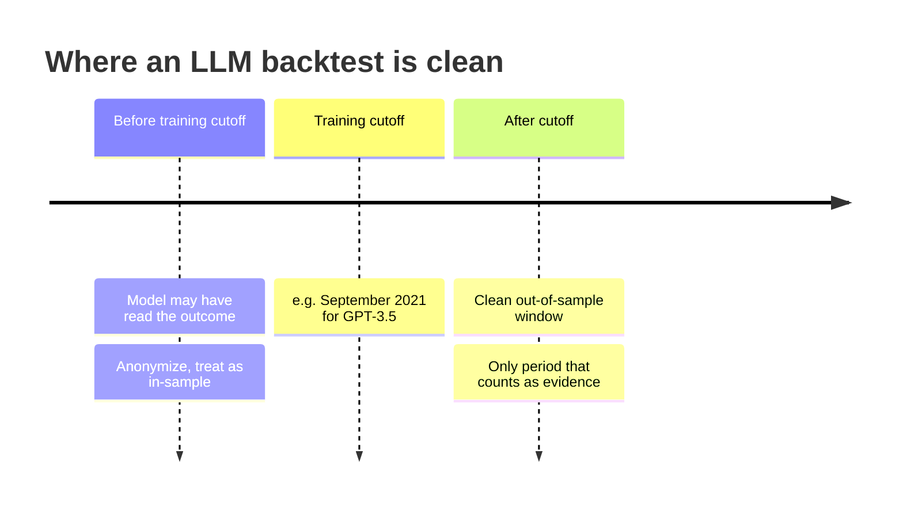

# LLMs and foundation models in quant

> **TL;DR**
>
> - In production quant, LLMs mainly turn text (news, filings, call transcripts) into features for ordinary forecasting models, and serve as coding and research tools.
> - Lopez-Lira & Tang (*JFE*, 2026): GPT headline scores predict next-day returns; portfolios sorted on GPT-4 scores get the (non-tradable) same-day reaction right on about 90% of days.
> - Look-ahead leakage is the central problem: a model trained on text through year Y has read what happened next. Only post-cutoff backtests are clean.
> - Time-series foundation models (Chronos, TimesFM) forecast generic series well zero-shot; off the shelf they trail boosted trees on daily stock returns.

**Level:** Core · **Pipeline stage:** forecast · **Last verified:** 2026-11

| Field | Value |
|---|---|
| Purpose (the question it answers) | How do you turn unstructured text (and, speculatively, price series) into point-in-time forecasting features? |
| Inputs → Outputs | Timestamped text (headlines, 8-Ks and 10-Ks, transcripts) mapped to tickers → per stock-day scores (−1, 0, +1; event labels) or embedding vectors reduced to 16–128 dimensions |
| Used by strategies | [NLP and LLM signals](../../02-strategies/d-mid-frequency-alpha/nlp-and-llm-signals.md) · [Analyst revisions and sentiment](../../02-strategies/d-mid-frequency-alpha/analyst-revisions-and-sentiment.md) · [Earnings and event-driven](../../02-strategies/d-mid-frequency-alpha/earnings-and-event-driven.md) · [Alternative data](../../02-strategies/d-mid-frequency-alpha/alternative-data.md) · [Fundamental quant signals](../../02-strategies/d-mid-frequency-alpha/fundamental-quant-signals.md) |
| Latency / compute regime | Hosted LLM call 0.2–5 s per document; local embedding model ms per document on a GPU `[Estimate]`. Overnight batch or event-driven within seconds; never in the µs path |
| Key parameters | Pinned model version; prompt and answer format; temperature 0; news-to-session mapping (after 16:00 ET → next open); anonymization; embedding dimension after PCA |
| Main failure modes | Look-ahead from pretraining; bad timestamps; silent model updates; prompt overfitting; crowding on public models and public text; hallucinated extractions |
| Lab | — |

## Intuition

Text signals predate LLMs: dictionaries count negative words in filings ([Loughran & McDonald 2011](https://doi.org/10.1111/j.1540-6261.2010.01625.x)). An [LLM](../../09-reference/glossary.md#large-language-model-llm) reads in context ("beat estimates but cut guidance" is bad news): a better reader, not a price oracle.

Two ways to use one: **prompt it** ("good or bad for the stock?") for a score, or **[embed](../../09-reference/glossary.md#embedding)** the text as a vector and let your own [ridge](linear-models-and-regularization.md) or [tree model](tree-ensembles.md) learn which directions predict returns. Embedding keeps learning inside your validated, point-in-time pipeline; prompting outsources it to a model whose training data you cannot audit.

**Time-series [foundation models](../../09-reference/glossary.md#foundation-model)** are pretrained on huge collections of series (web traffic, energy, retail) to forecast new ones zero-shot. They transfer seasonality and trend, which daily returns barely have.

## Where it sits in the pipeline


## The algorithm

1. Store each document with its vendor receive time and a point-in-time ticker mapping.
2. Assign it to a session: after the 16:00 ET close (or before the open) means the next open.
3. Backtest only on post-cutoff text; anonymize firm names for earlier periods.
4. Score with a pinned model at temperature 0, or embed and reduce.
5. Aggregate to stock-day, standardize, and test incremental IC over existing signals.

```python
import numpy as np
import pandas as pd
# Headline scoring in the spirit of Lopez-Lira & Tang; anonymization per Glasserman & Lin.
# llm(prompt) and embed(text) stand for a pinned hosted model and a local embedding model.

def score_headline(llm, headline, company_name, anonymize=True):
    text = headline.replace(company_name, "Company X") if anonymize else headline
    prompt = ("Is this headline good, bad or unclear news for Company X's stock over the "
              "next trading day? Answer GOOD, BAD or UNKNOWN.\n" + text)
    answer = llm(prompt, temperature=0)            # store raw output, model id and version
    return {"GOOD": 1, "BAD": -1}.get(answer.strip().upper(), 0)

def daily_llm_signal(news, llm, model_cutoff):
    # news: DataFrame [ts (vendor receive time, ET), ticker, company_name, headline]
    news = news[news.ts > model_cutoff].copy()     # only post-cutoff text is a clean test
    day = news.ts.dt.normalize()                   # after the 16:00 close -> next business day
    news["trade_date"] = day.where(news.ts.dt.hour < 16, day + pd.offsets.BDay(1))
    # (simplified: pre-open news maps to the same day; exchange holidays ignored)
    news["s"] = [score_headline(llm, h, c) for h, c in zip(news.headline, news.company_name)]
    sig = news.groupby(["trade_date", "ticker"])["s"].mean().unstack()
    return sig.sub(sig.mean(axis=1), axis=0)       # demean per day -> long-short tilt

def embedding_features(docs, embed, pca_mean, pca_components):
    # alternative: text -> vector -> PCA -> features for ridge or GBDT
    E = np.vstack([embed(d) for d in docs])         # e.g. 768-4,096 dims per document
    return (E - pca_mean) @ pca_components          # 16-128 dims; mean and PCA fit on PAST docs only
```

## Worked example with numbers

**Compute cost (`[Estimate]`).** 20,000 headlines a day × ~200 tokens (prompt plus headline) = 4 million tokens a day, ~1 billion a year. At \$0.10–\$3 per million input tokens (small to mid-size models; prices vary and keep falling), that is \$100–\$3,000 a year. Earnings calls: 3,000 firms × 4 calls × 12,000 tokens = 144 million tokens, \$14–\$430. Inference is cheap next to the news-feed license.

**Does it survive costs? (illustrative)** A \$100M long-short book (\$50M a side) whose longs beat its shorts by 10 bps a day earns \$50M × 0.10% = **\$50,000 a day**. Full daily turnover trades \$100M; at 5 bps per dollar, costs are **\$50,000 a day**. Net ≈ 0: a daily-turnover headline signal needs slower holding, cheaper execution, or a place in a [combined forecast](alpha-combination-and-ensembling.md).

## Key parameters and how practitioners tune them

- **Scoring vs embeddings:** scores are interpretable and need little data; embeddings capture more but need history to fit a model on `[Lore]`.
- **Model version:** pin it and store raw outputs; a silently updated hosted model rewrites the backtest.
- **Aggregation:** mean or sum per stock-day, novelty filters for repeats, decay half-life of hours to days.
- **Prompt:** fix it before seeing backtest results; every variant tried is a trial.

## Textbook version vs what firms actually do

- **Return predictability:** [Lopez-Lira & Tang (2026)](https://doi.org/10.1016/j.jfineco.2026.104335) find ChatGPT headline scores predict next-day returns, especially in small stocks and after bad news, and that strategy returns fall as LLM adoption rises `[Verified]`.
- **Leakage:** [Glasserman & Lin (2023)](https://arxiv.org/abs/2309.17322) tested GPT-3.5 (training data to September 2021). Anonymizing firm names *improved* in-sample results: company knowledge distracted the model more than look-ahead helped `[Verified]`.
- **Older baselines matter:** FinBERT beat dictionaries on finance sentiment ([Huang, Wang & Yang 2023](https://doi.org/10.1111/1911-3846.12832)); year-over-year 10-K text changes predicted returns ([Cohen, Malloy & Nguyen 2020](https://doi.org/10.1111/jofi.12885)) `[Verified]`.
- **Foundation models:** [Chronos](https://arxiv.org/abs/2403.07815) (Amazon) quantizes scaled values into tokens for T5-family models of 20M–710M parameters; [TimesFM](https://arxiv.org/abs/2310.10688) (Google) is a 200M-parameter decoder trained on ~100 billion points, mostly Google Trends and Wikipedia pageviews. Both rival dataset-specific models zero-shot on general benchmarks `[Verified]`. On daily excess returns, zero-shot and fine-tuned versions trailed CatBoost and LightGBM; versions pre-trained from scratch on financial data came close on long-short Sharpe, gross of costs, but not on R² ([Rahimikia, Ni & Wang 2025](https://arxiv.org/abs/2511.18578)) `[Verified]`.
- **Practice:** Man Group built ManGPT, an internal portal to OpenAI's models (2023), and says its AlphaGPT agent drafts, codes and backtests signal ideas, several dozen approved for live trading after human review `[Reported]`. Claims that LLMs generate standalone alpha at scale are `[Lore]`.

## How to tell if it's working

- IC on a post-cutoff window only, by hour since publication (news effects concentrate early `[Lore]`).
- Incremental IC after controlling for earnings surprise, analyst revisions and news volume.
- Agreement between anonymized and named scores, and across paraphrased prompts.
- Cost-adjusted returns at realistic turnover, not gross decile spreads.

## Failure modes and pitfalls



- **Pretraining look-ahead:** the model may "remember" a stock's later move ([look-ahead bias](../../09-reference/glossary.md#look-ahead-bias); [point-in-time data](../a-data-and-signals/point-in-time-data-and-cleaning.md)).
- **Timestamps:** publication time, vendor time and the time you could act differ by seconds to hours.
- **Prompt search** on the backtest is [multiple testing](../c-validation-and-backtesting/overfitting-and-multiple-testing.md).
- **Crowding:** public models reading public headlines produce correlated signals that decay fast ([alpha decay](../g-live-trading/alpha-decay-detection-and-model-retirement.md)) `[Lore]`.
- **Hallucinated extraction:** numbers "read" from a filing that aren't in it.

## How practitioners talk about it

- "What's the model's knowledge cutoff versus your backtest?" → Is any of this out of sample?
- "We embed and let ridge decide." → Keep learning inside the validated pipeline.
- "Same-day reaction is priced; show me tomorrow." → Only post-publication drift is tradable.
- "The vendor updated the model and our history changed." → Pin versions, store raw outputs.

## Questions you could ask a quant about this

1. LLMs for signals, productivity, or both? (basic)
2. How do you handle the training-cutoff problem in backtests? (informed)
3. Do you prompt for scores or embed and learn your own mapping? (informed)
4. How much incremental IC does text add over earnings and revisions signals? 🔒 (sharp)
5. How fast does the edge decay now that everyone has the same models? (sharp)

## Go deeper

<details markdown="1">
<summary>Math: leakage decomposition, embedding regression, cost scaling</summary>

Glasserman–Lin framing of an in-sample backtest return:

$$
R_{\text{observed}} = R_{\text{true}} + B_{\text{look-ahead}} + B_{\text{distraction}}, \qquad B_{\text{look-ahead}} \ge 0
$$

Comparing named and anonymized runs bounds the two biases.

Embedding signal: with document vectors $e_{i,t}\in\mathbb{R}^d$ reduced by past-only PCA to $u_{i,t}=P^\top e_{i,t}$, fit ridge $\hat r_{i,t+1} = u_{i,t}^\top \beta$.

Annual cost ≈ documents/day × tokens/document × 250 × price per token.

</details>

## Related pages

- [NLP and LLM signals](../../02-strategies/d-mid-frequency-alpha/nlp-and-llm-signals.md) · [Earnings and event-driven](../../02-strategies/d-mid-frequency-alpha/earnings-and-event-driven.md)
- [Neural nets and sequence models](neural-nets-and-sequence-models.md) · [Tree ensembles](tree-ensembles.md)
- [Point-in-time data and cleaning](../a-data-and-signals/point-in-time-data-and-cleaning.md)
- [Backtest pitfalls](../c-validation-and-backtesting/backtest-pitfalls.md)

## Sources

- [Verified] Lopez-Lira, A. & Tang, Y. (2026). "Can ChatGPT Forecast Stock Price Movements? Return Predictability and Large Language Models." *Journal of Financial Economics* 184, 104335. <https://doi.org/10.1016/j.jfineco.2026.104335> (accessed 2026-11)
- [Verified] Glasserman, P. & Lin, C. (2023). "Assessing Look-Ahead Bias in Stock Return Predictions Generated by GPT Sentiment Analysis." arXiv:2309.17322. <https://arxiv.org/abs/2309.17322> (accessed 2026-11)
- [Verified] Ansari, A. F. et al. (2024). "Chronos: Learning the Language of Time Series." *Transactions on Machine Learning Research*. <https://arxiv.org/abs/2403.07815> (accessed 2026-11)
- [Verified] Das, A., Kong, W., Sen, R. & Zhou, Y. (2024). "A decoder-only foundation model for time-series forecasting." *ICML 2024*, PMLR 235. <https://arxiv.org/abs/2310.10688> (accessed 2026-11)
- [Verified] Google Research (2024-02). "A decoder-only foundation model for time-series forecasting." <https://research.google/blog/a-decoder-only-foundation-model-for-time-series-forecasting/> (accessed 2026-11)
- [Verified] Rahimikia, E., Ni, H. & Wang, W. (2025). "Re(Visiting) Time Series Foundation Models in Finance." arXiv:2511.18578 (also presented at FoFI 2026). <https://arxiv.org/abs/2511.18578> (accessed 2026-11)
- [Reported] Hedgeweek (2023-07-25). "Man Group develops ManGPT AI portal." <https://www.hedgeweek.com/man-group-develops-mangpt-ai-portal/> (accessed 2026-11)
- [Reported] Hedgeweek (2025-07-11), citing Bloomberg. "Man Group deploys agentic AI for quant signal discovery." <https://www.hedgeweek.com/man-group-deploys-agentic-ai-for-quant-signal-discovery/> (accessed 2026-11)
- [Verified] Loughran, T. & McDonald, B. (2011). "When Is a Liability Not a Liability? Textual Analysis, Dictionaries, and 10-Ks." *Journal of Finance* 66(1), 35–65. <https://doi.org/10.1111/j.1540-6261.2010.01625.x> (accessed 2026-11)
- [Verified] Huang, A. H., Wang, H. & Yang, Y. (2023). "FinBERT: A Large Language Model for Extracting Information from Financial Text." *Contemporary Accounting Research* 40(2), 806–841. <https://doi.org/10.1111/1911-3846.12832> (accessed 2026-11)
- [Verified] Cohen, L., Malloy, C. & Nguyen, Q. (2020). "Lazy Prices." *Journal of Finance* 75(3), 1371–1415. <https://doi.org/10.1111/jofi.12885> (accessed 2026-11)
