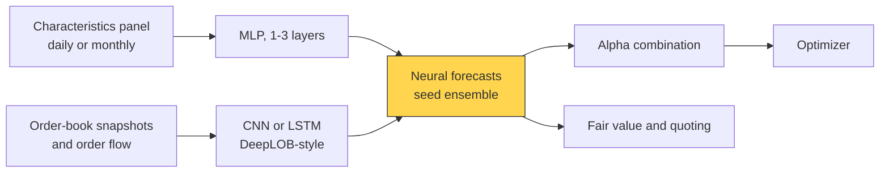

# Neural nets and sequence models

> **TL;DR**
>
> - Two distinct uses: feed-forward nets (MLPs) on stock characteristics, and sequence models (CNN, LSTM, transformer) on limit-order-book data for seconds-ahead moves.
> - In Gu, Kelly & Xiu (2020) a three-layer net had the best monthly out-of-sample R² (0.40%). DeepLOB (Zhang, Zohren & Roberts 2019) is the reference order-book model.
> - Low signal-to-noise, nonstationary data punish flexible models; single nets vary by random seed, so seed ensembles are standard.
> - Training runs on GPUs overnight; HFT inference must fit a µs budget, so hot-path models are tiny, quantized or distilled.

**Level:** Deep dive · **Pipeline stage:** forecast · **Last verified:** 2026-11

| Field | Value |
|---|---|
| Purpose (the question it answers) | Can a flexible function approximator find nonlinear or temporal structure (characteristic interactions, order-book dynamics) that linear models and trees miss? |
| Inputs → Outputs | Characteristics → expected return; or the last 50–100 book snapshots (10 levels × price, size × 2 sides = 40 features) → probability of an up, flat or down mid-price move |
| Used by strategies | [ML-driven short-horizon alpha](../../02-strategies/c-statistical-arbitrage/ml-driven-short-horizon-alpha.md) · [Cross-sectional alpha](../../02-strategies/d-mid-frequency-alpha/cross-sectional-alpha-and-neutralization.md) · [Equity market making](../../02-strategies/a-liquidity-provision/equity-market-making.md) · [NLP and LLM signals](../../02-strategies/d-mid-frequency-alpha/nlp-and-llm-signals.md) · [Alternative data](../../02-strategies/d-mid-frequency-alpha/alternative-data.md) |
| Latency / compute regime | Training: GPU hours to days, overnight or weekly. Inference: ms for a whole universe; in HFT roughly 1 µs or less of the tick-to-trade budget `[Estimate]` |
| Key parameters | 1–3 hidden layers (32-16-8 units in GKX); Adam learning rate 1e-4 to 1e-3; L1/dropout; early-stopping patience 5–20 epochs; 5–10 seeds; LOB lookback 50–100 events, horizon 10–100 events |
| Main failure modes | Seed variance; nonstationarity; leakage through normalization or labels; accuracy that doesn't survive the spread; latency overruns; opacity |
| Lab | — |

## Intuition

A feed-forward net ([MLP](../../09-reference/glossary.md#multilayer-perceptron-mlp)) stacks regressions with a kink (ReLU) between them, so it learns interactions ("momentum matters only in illiquid names") unprompted. A **CNN** reads the book's spatial layout (levels near the touch versus deeper); an **[LSTM](../../09-reference/glossary.md#long-short-term-memory-lstm)** or **[transformer](../../09-reference/glossary.md#transformer)** remembers recent events.

Why deep learning dominates less here than in vision: a cat in a 2010 photo is still a cat in 2025, and labels are clean. Stock returns have R² below 1%, and patterns change once others trade them ([nonstationarity](../../09-reference/glossary.md#nonstationarity)); many parameters plus weak signal means high variance. Nets do best where data is plentiful and mechanics stable: microstructure, with millions of book events per stock per day.

## Where it sits in the pipeline



## The algorithm

1. Standardize inputs per date, or with trailing statistics only (order book).
2. Split by time: train, purge gap, validation, test.
3. Train a small penalized net; stop when validation loss stops falling.
4. Repeat for 5–10 random seeds; average the forecasts.
5. Standardize the averaged forecast and pass it to the combiner, or distill it into a smaller model for low-latency use.

```python
import numpy as np
# GKX-style "NN1": one hidden layer, L1 penalty, early stopping, seed ensemble.
# Simplified: plain mini-batch SGD instead of Adam, no batch normalization.

def train_mlp(X_tr, y_tr, X_va, y_va, hidden=32, lr=1e-3, l1=1e-5,
              epochs=100, batch=10_000, patience=5, seed=0):
    rng = np.random.default_rng(seed)                     # seed drives init and batch order
    k = X_tr.shape[1]
    W1, b1 = rng.normal(0, np.sqrt(2 / k), (k, hidden)), np.zeros(hidden)
    w2, b2 = rng.normal(0, np.sqrt(1 / hidden), hidden), 0.0
    best, best_loss, bad = None, np.inf, 0
    for ep in range(epochs):
        for idx in np.array_split(rng.permutation(len(y_tr)), max(1, len(y_tr) // batch)):
            X, y = X_tr[idx], y_tr[idx]
            H = np.maximum(X @ W1 + b1, 0)                # ReLU hidden layer
            err = H @ w2 + b2 - y                         # MSE gradient pieces
            gH = np.outer(err, w2) * (H > 0)
            w2 -= lr * (H.T @ err / len(y) + l1 * np.sign(w2)); b2 -= lr * err.mean()
            W1 -= lr * (X.T @ gH / len(y) + l1 * np.sign(W1)); b1 -= lr * gH.mean(0)
        pred_va = np.maximum(X_va @ W1 + b1, 0) @ w2 + b2
        loss = np.mean((pred_va - y_va) ** 2)             # time-ordered validation block
        if loss < best_loss:
            best, best_loss, bad = (W1.copy(), b1.copy(), w2.copy(), b2), loss, 0
        else:
            bad += 1
            if bad >= patience:                           # early stopping
                break
    W1, b1, w2, b2 = best
    return lambda X: np.maximum(X @ W1 + b1, 0) @ w2 + b2

def seed_ensemble(X_tr, y_tr, X_va, y_va, X_live, n_seeds=10):
    # single nets disagree at low SNR; averaging seeds removes the seed-specific part
    preds = [train_mlp(X_tr, y_tr, X_va, y_va, seed=s)(X_live) for s in range(n_seeds)]
    p = np.mean(preds, axis=0)
    return (p - p.mean()) / p.std()                       # cross-sectional z-score for the combiner
```

## Worked example with numbers

**Seed ensembling (illustrative).** Each seed's forecast = common signal + seed-specific noise. Single-seed IC = 0.020; correlation between seeds' forecasts ρ = 0.5. Averaging M seeds divides the noise variance by M:

IC_ens = IC × √(1 / (ρ + (1 − ρ)/M)) = 0.020 × √(1 / (0.5 + 0.05)) = 0.020 × 1.35 = **0.027** for M = 10.

The infinite-seed ceiling is 0.020 × √2 = 0.028. With breadth and costs fixed, 35% more IC is roughly 35% more Sharpe.

**HFT latency budget (`[Estimate]`).** An MLP with 40 inputs, layers of 64 and 32, and one output needs 40 × 64 + 64 × 32 + 32 = 4,640 multiply-adds. At ~5 billion useful multiply-adds per second on one core, that is ≈ **0.9 µs**. A CNN-LSTM over 100 snapshots × 40 features needs ~3 million, ≈ **600 µs**: fine for a seconds-horizon signal, far too slow for quoting. A GPU adds microseconds of transfer and launch overhead. Hence tiny or distilled models on CPU, or fixed-point nets on [FPGAs](../../09-reference/glossary.md#fpga).

## Key parameters and how practitioners tune them

- **Depth and width:** GKX used a pyramid (32, 16, 8, ...); three layers was best `[Verified]`. Add depth only if validation IC rises across seeds.
- **Regularization:** GKX used an L1 weight penalty, early stopping, batch normalization and seed ensembles `[Verified]`; dropout is a common alternative.
- **Seeds:** 5–10; seed-to-seed forecast correlation below ~0.5 means mostly noise `[Lore]`.
- **LOB labels:** smooth future mid-prices over k events and use a threshold to define "flat", or the model learns bid-ask bounce.

## Textbook version vs what firms actually do

- **Cross-sectional MLPs:** in [GKX 2020](https://doi.org/10.1093/rfs/hhaa009), monthly stock-level R² rose from 0.33% (one layer) to 0.40% (three), against 0.16% for OLS-3; the value-weighted long-short decile Sharpe was 1.35 gross, 1987–2016 `[Verified]`.
- **Order books:** [DeepLOB](https://doi.org/10.1109/TSP.2019.2907260) (convolutions, an Inception module, an LSTM) beat earlier models on the FI-2010 benchmark and a year of London Stock Exchange data, and transferred to unseen instruments `[Verified]`. [Sirignano & Cont (2019)](https://doi.org/10.1080/14697688.2019.1622295) found a "universal" model pooled across many US stocks beat stock-specific ones `[Verified]`. Both report accuracy, not P&L after costs.
- **Autoencoder factor models:** [Gu, Kelly & Xiu (2021)](https://doi.org/10.1016/j.jeconom.2020.07.009) let betas be a neural function of characteristics, with latent factors and a no-arbitrage restriction, and report much smaller out-of-sample pricing errors than leading factor models `[Verified]`.
- **Practice:** market makers train sizable nets on GPU clusters but run small, distilled versions in the latency-critical path `[Lore]`; mid-frequency books use nets as one ensemble input `[Lore]`.

## How to tell if it's working

- The seed-ensemble IC beats [GBDT](tree-ensembles.md) and [ridge](linear-models-and-regularization.md) on identical purged folds.
- For order-book models, convert accuracy into [markouts](../f-market-making-and-hft-algorithms/adverse-selection-and-markouts.md) net of spread and fees.
- IC by month since training shows decay and sets the retrain schedule.
- p99 inference latency on production hardware stays inside budget.

## Failure modes and pitfalls

- **Leakage through normalization:** z-scoring with statistics that include the test window.
- **Overlapping or smoothed labels** that peek ahead and inflate accuracy ([time-series CV](../c-validation-and-backtesting/time-series-cross-validation.md)).
- **Architecture search:** fifty architectures on one test set is [multiple testing](../c-validation-and-backtesting/overfitting-and-multiple-testing.md).
- **Regime breaks:** a net trained in calm markets has never seen March 2020 ([regime detection](regime-detection.md)).
- **Opacity:** in a drawdown it is hard to tell a broken model from bad luck.

## How practitioners talk about it

- "Single-seed results are anecdotes." → Report the seed ensemble and the spread across seeds.
- "Seventy percent accuracy on mid moves, minus the spread, is zero." → Direction accuracy is not edge after costs.
- "We distill the big model into something that fits in a microsecond." → Train large offline, deploy small.
- "Three layers was plenty." → Deeper nets add variance at this signal-to-noise ratio.
- "Retrain weekly; it decays." → Nonstationarity makes stale weights lose edge.

## Questions you could ask a quant about this

1. Where do nets beat trees in your stack? (basic)
2. How many seeds do you average, and how correlated are they? (informed)
3. How do you normalize order-book inputs without leaking the future? (informed)
4. How do you turn classification accuracy into expected P&L after costs? (sharp)
5. What runs in the hot path versus offline, and what latency does the model get? 🔒 (sharp)

## Go deeper

<details markdown="1">
<summary>Math: MLP, autoencoder asset pricing, attention cost</summary>

MLP: $h^{(l)} = \text{ReLU}(W^{(l)} h^{(l-1)} + b^{(l)})$, $\hat r = w^\top h^{(L)}$, loss $\sum (r-\hat r)^2 + \lambda \lVert W\rVert_1$.

Conditional autoencoder (GKX 2021):

$$
r_{i,t} = \beta(z_{i,t-1})^\top f_t + \varepsilon_{i,t}, \qquad f_t = W\, (Z_{t-1}^\top Z_{t-1})^{-1} Z_{t-1}^\top r_t
$$

Betas come from a net on characteristics; factors are linear combinations of characteristic-managed portfolios.

Self-attention over $L$ events of width $d$ costs $O(L^2 d)$, one reason lookbacks stay short when latency binds.

</details>

## Related pages

- [Tree ensembles](tree-ensembles.md) · [Linear models and regularization](linear-models-and-regularization.md)
- [Order-book and trade-flow signals](../f-market-making-and-hft-algorithms/order-book-and-trade-flow-signals.md) · [Anatomy of an HFT trading loop](../f-market-making-and-hft-algorithms/anatomy-of-an-hft-trading-loop.md)
- [How infrastructure constrains algorithms](../../05-infrastructure/how-infrastructure-constrains-algorithms.md)
- [ML-driven short-horizon alpha](../../02-strategies/c-statistical-arbitrage/ml-driven-short-horizon-alpha.md)

## Sources

- [Verified] Gu, S., Kelly, B. & Xiu, D. (2020). "Empirical Asset Pricing via Machine Learning." *Review of Financial Studies* 33(5), 2223–2273. <https://doi.org/10.1093/rfs/hhaa009> (accessed 2026-11)
- [Verified] Gu, S., Kelly, B. & Xiu, D. (2021). "Autoencoder Asset Pricing Models." *Journal of Econometrics* 222(1), 429–450. <https://doi.org/10.1016/j.jeconom.2020.07.009> (accessed 2026-11)
- [Verified] Zhang, Z., Zohren, S. & Roberts, S. (2019). "DeepLOB: Deep Convolutional Neural Networks for Limit Order Books." *IEEE Transactions on Signal Processing* 67(11), 3001–3012. <https://doi.org/10.1109/TSP.2019.2907260> (accessed 2026-11)
- [Verified] Sirignano, J. & Cont, R. (2019). "Universal features of price formation in financial markets: perspectives from deep learning." *Quantitative Finance* 19(9), 1449–1459. <https://doi.org/10.1080/14697688.2019.1622295> (accessed 2026-11)
- [Verified] Hochreiter, S. & Schmidhuber, J. (1997). "Long Short-Term Memory." *Neural Computation* 9(8), 1735–1780. <https://doi.org/10.1162/neco.1997.9.8.1735> (accessed 2026-11)
- [Verified] Vaswani, A. et al. (2017). "Attention Is All You Need." *NeurIPS 30*. <https://arxiv.org/abs/1706.03762> (accessed 2026-11)
- [Verified] Lakshminarayanan, B., Pritzel, A. & Blundell, C. (2017). "Simple and Scalable Predictive Uncertainty Estimation using Deep Ensembles." *NeurIPS 30*. <https://arxiv.org/abs/1612.01474> (accessed 2026-11)
