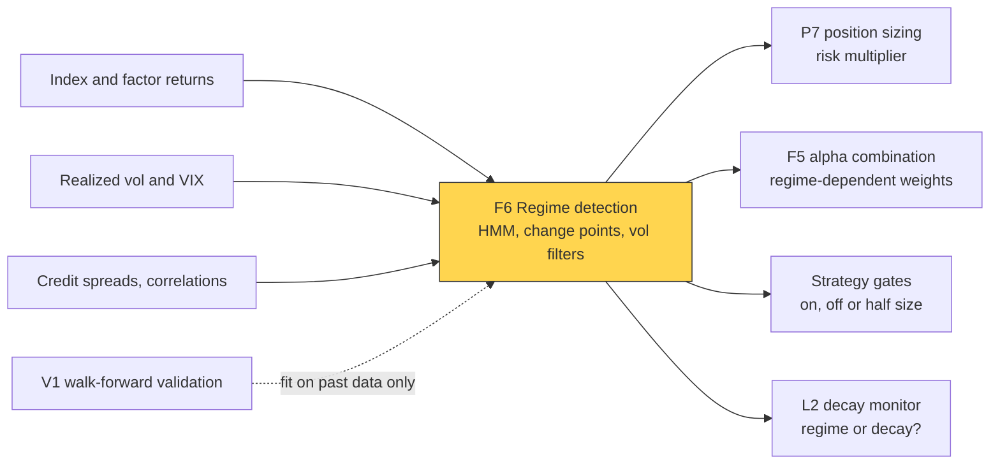
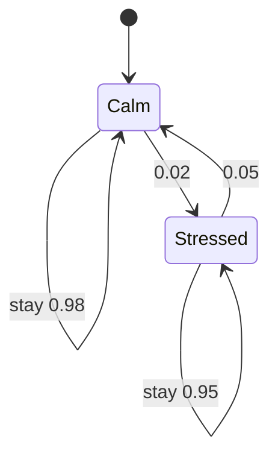

# Regime detection

> **TL;DR**
>
> - A regime is a persistent market state, such as calm or stressed. Detection estimates each day the probability of each state, using only data available that day.
> - The toolkit: Markov-switching models and Gaussian [hidden Markov models](../../09-reference/glossary.md#hidden-markov-model-hmm), change-point detectors, simple volatility filters and clustering.
> - Firms mostly use regimes defensively, to scale risk or gate strategies, rarely to forecast returns.
> - The trap is hindsight: smoothed probabilities and official recession dates use future data. Evidence that regime timing pays is contested.

**Level:** Deep dive · **Pipeline stage:** forecast · **Last verified:** 2026-11

| Field | Value |
|---|---|
| Purpose (the question it answers) | Which state is the market in now, and did it just change? |
| Inputs → Outputs | returns, realized vol, VIX, credit spreads → state probabilities, change alarms, a risk multiplier or on/off flag |
| Used by strategies | [Momentum](../../02-strategies/e-risk-premia-and-factors/momentum.md) · [Factor timing and crowding](../../02-strategies/e-risk-premia-and-factors/factor-timing-crowding-and-quant-winters.md) · [Trend following](../../02-strategies/g-futures-and-macro-context/trend-following-and-ctas.md) · [Volatility risk premium](../../02-strategies/f-volatility-and-derivatives/volatility-risk-premium-and-vol-arb.md) · [Carry](../../02-strategies/g-futures-and-macro-context/carry-and-cross-asset-risk-premia.md) · [Factor-residual mean reversion](../../02-strategies/c-statistical-arbitrage/factor-residual-mean-reversion.md) |
| Latency / compute regime | daily batch; a filter update takes microseconds, a refit seconds `[Estimate]` |
| Key parameters | 2–3 states; daily stay probability 0.95–0.99 (average spells of 20–100 days); vol lookback 20–63 days; VIX trigger 25–30; hysteresis band |
| Main failure modes | hindsight labels; detection lag; whipsaw; states changing meaning on refit; too many states |
| Lab | — |

## Intuition

A credit analyst underwrites the same balance sheet differently in a boom and a bust. Markets are similar, and wild days cluster. From 1990 to November 2026 the VIX closed above 30 on 7.9% of days, and after such a close it stayed above 30 the next day 87% of the time (FRED data) `[Estimate]`. A regime model turns that persistence into a probability. The aim is not to call the crash but to notice quickly that the world changed, and resize.

## Where it sits in the pipeline



## The algorithm

A two-state Gaussian HMM, filtered with the forward algorithm (Hamilton's filter):

1. **Model.** A hidden state, calm or stressed, sets the mean and volatility of a normal daily return. A transition matrix with a large diagonal makes states persistent.
2. **Fit** by expectation-maximization on past data only, walk-forward ([V1](../c-validation-and-backtesting/time-series-cross-validation.md)).
3. **Predict:** yesterday's probabilities times the transition matrix give today's prior.
4. **Update:** multiply by the likelihood of today's return in each state, then normalize.
5. **Act:** map the filtered probability, with hysteresis, to tomorrow's risk multiplier ([P7](../d-portfolio-construction/position-sizing-and-risk-budgeting.md)).

The simplest alternative skips the model: scale by target vol ÷ 20-day realized vol, or halve risk above VIX 30.

```python
import numpy as np

def normal_pdf(x, mu, sd):
    return np.exp(-0.5 * ((x - mu) / sd) ** 2) / (sd * np.sqrt(2 * np.pi))

def hmm_filter_step(p_prev, r_t, P, mu, sd):
    """One forward-algorithm step of a 2-state Gaussian HMM (state 0 calm, 1 stressed).
    p_prev: P(state | returns to t-1); P[i, j] = P(state j today | state i yesterday)."""
    prior = P.T @ p_prev                       # predict: where could we be today?
    post = prior * normal_pdf(r_t, mu, sd)     # update: how likely is today's return per state?
    return post / post.sum()                   # filtered: uses data up to t only

def regime_risk_multiplier(returns, P, mu, sd, enter=0.7, exit=0.3,
                           target_vol=10.0, max_mult=1.5, stressed_cut=0.5):
    """Tomorrow's risk multiplier per day. Returns in % per day, vols in % per year.
    P, mu, sd must be fit on data BEFORE the first return here (walk-forward)."""
    p, stressed, out = np.array([0.95, 0.05]), False, []
    for r in returns:                          # today's close-to-close return
        p = hmm_filter_step(p, r, P, mu, sd)
        if not stressed and p[1] > enter:      # hysteresis: switching needs strong evidence
            stressed = True
        elif stressed and p[1] < exit:
            stressed = False
        p_next = P.T @ p                       # state probabilities for tomorrow
        var = p_next @ (sd**2 + mu**2) - (p_next @ mu) ** 2   # variance of the mixture
        mult = min(max_mult, target_vol / (np.sqrt(var) * np.sqrt(252)))
        if stressed:
            mult *= stressed_cut               # optional gate on top of vol scaling
        out.append((p[1], stressed, mult))     # applied to TOMORROW's positions
    return out
```

## Worked example with numbers

Illustrative: calm days have mean +0.05% and volatility 0.7%; stressed days −0.10% and 2.0%. Stay probabilities 0.98 and 0.95 give average spells of 50 and 20 days and a long-run stressed share of 0.02 ÷ 0.07 = 29%. Start at P(stressed) = 0.05.

**One −3.0% day.**

- Prior stressed = 0.95 × 0.02 + 0.05 × 0.95 = 0.0665; calm = 0.9335.
- Likelihoods: calm z = (−3.0 − 0.05) ÷ 0.7 = −4.36, density 0.000043; stressed z = (−3.0 + 0.10) ÷ 2.0 = −1.45, density 0.0697.
- Posterior stressed = (0.0665 × 0.0697) ÷ (0.0665 × 0.0697 + 0.9335 × 0.000043) = 0.00464 ÷ 0.00468 = **0.991**.

Tomorrow's mixture volatility jumps from 13.5% to 30.9% a year, so with a 10% target the multiplier falls from 0.74 to 0.32; the gate halves it to 0.16.

**Three −1.5% days instead.** P(stressed) goes 0.18, 0.43, 0.70: a slow grind takes three days just to approach the 0.7 trigger; one shock flips the model at once.



## Key parameters and how practitioners tune them

- **States:** two is standard; a third crash state rests on few observations. Choose by out-of-sample likelihood `[Lore]`.
- **Persistence:** stay probability *p* means spells of 1 ÷ (1 − *p*) days on average; higher *p* gives fewer whipsaws but slower detection.
- **Inputs:** realized vol, the VIX or credit spreads sharpen a returns-only model `[Lore]`.
- **Thresholds:** since 1990 the VIX closed above 25 on 17% of days `[Estimate]`; realized-vol filters often trigger at the 80th–90th percentile `[Lore]`.

## Textbook version vs what firms actually do

- **Origins:** Hamilton (1989) modeled US output growth as switching between two unobserved states, with the filter above `[Verified]`; Hamilton & Susmel (1994) added switching ARCH `[Verified]`; Ang & Bekaert (2002) found a high-volatility, high-correlation bear regime in international equities `[Verified]`.
- **Change points:** [CUSUM](../../09-reference/glossary.md#cusum) (Page 1954) accumulates evidence of a shift `[Verified]`; Adams & MacKay's (2007) Bayesian online change-point detection tracks a posterior over the time since the last break `[Verified]`. Both flag one-off breaks, not recurring states ([L2](../g-live-trading/alpha-decay-detection-and-model-retirement.md)).
- **Clustering:** Two Sigma fit a Gaussian mixture to 17 factors and named four conditions: Crisis, Steady State, Inflation and Walking on Ice `[Verified]`.
- **Practice:** HMMs fill allocation research (Kritzman, Page & Turkington 2012; Nystrup et al. 2015) `[Verified]`; production mostly uses plain [volatility targeting](../../09-reference/glossary.md#volatility-targeting) `[Lore]`.
- **Evidence for:** cutting exposure when volatility is high raised Sharpe ratios for the market and many factors (Moreira & Muir 2017) `[Verified]`. Vol targeting raised Sharpe for equities and credit, not bonds, currencies or commodities, and thinned left tails (Harvey et al. 2018) `[Verified]`. [Momentum crashes](../../09-reference/glossary.md#momentum-crash) cluster in panic states; a dynamic version roughly doubled momentum's Sharpe (Daniel & Moskowitz 2016) `[Verified]`.
- **Evidence against:** across 103 equity strategies, real-time versions generally earned lower Sharpe ratios and certainty-equivalent returns than the unmanaged originals, losing on the latter in 72 cases (Cederburg et al. 2020) `[Verified]`. Both sides have strong evidence; the debate is open.

## How to tell if it's working

- Walk-forward backtests on filtered probabilities only, against inverse 20-day realized vol. If the model does not beat it after costs, ship the simple one `[Lore]`.
- Detection delay at known breaks versus false alarms and switches per year.
- After a refit, "stressed" still means stressed.

## Failure modes and pitfalls

- **Hindsight labels.** Smoothed probabilities use future returns. Official dates are worse: the NBER dated the December 2007 peak on 1 December 2008 and the June 2009 trough on 20 September 2010 `[Verified]`.
- **Lag.** Filters confirm stress after the first big loss and exit after the rebound, when momentum crashes.
- **Whipsaw** near thresholds becomes turnover.
- **Overfitting:** extra states and features fit history ([V4](../c-validation-and-backtesting/overfitting-and-multiple-testing.md)).

## How practitioners talk about it

- "We're in the high-vol regime; risk is at 60%." → the multiplier is 0.6.
- "That chart is smoothed, not filtered." → it used future data.
- "The HMM flipped on one day." → one large return dominated.
- "Vol targeting did the work; the HMM added nothing." → it failed the benchmark test.
- "Momentum's in a panic state." → high volatility after a fall; crash risk on the rebound.

## Questions you could ask a quant about this

1. *Basic:* When regimes shift, do you change risk or change the model?
2. *Informed:* Are backtests run on filtered or smoothed probabilities?
3. *Informed:* Does the regime model beat inverse-vol scaling after costs?
4. *Sharp:* How many days did your detector lag in March 2020, and what did that cost? 🔒

## Go deeper

<details markdown="1">
<summary>Forward filter, durations and change-point recursion</summary>

Forward recursion with transition matrix $P$ and state densities $f_j$:

$$
\alpha_t(j) = \Big[\sum_i \hat p_{t-1}(i)\, P_{ij}\Big] f_j(r_t), \qquad \hat p_t(j) = \frac{\alpha_t(j)}{\sum_k \alpha_t(k)}.
$$

The long-run share of state 1 is $P_{01}/(P_{01}+P_{10})$. Smoothed probabilities $P(s_t \mid r_{1:T})$ add a backward pass over future data. Online change-point detection tracks run length $\ell_t$, which grows by one with probability $1-H$ or resets to 0.

</details>

## Related pages

- [Position sizing and risk budgeting](../d-portfolio-construction/position-sizing-and-risk-budgeting.md)
- [Alpha decay detection and model retirement](../g-live-trading/alpha-decay-detection-and-model-retirement.md)
- [Overfitting and multiple testing](../c-validation-and-backtesting/overfitting-and-multiple-testing.md)
- [Momentum](../../02-strategies/e-risk-premia-and-factors/momentum.md)
- [Factor timing, crowding and quant winters](../../02-strategies/e-risk-premia-and-factors/factor-timing-crowding-and-quant-winters.md)

## Sources

- [Verified] Hamilton, J. D. (1989). "A New Approach to the Economic Analysis of Nonstationary Time Series and the Business Cycle." *Econometrica* 57(2), 357–384. <https://doi.org/10.2307/1912559> (accessed 2026-11)
- [Verified] Hamilton, J. D. & Susmel, R. (1994). "Autoregressive conditional heteroskedasticity and changes in regime." *Journal of Econometrics* 64(1–2), 307–333. <https://doi.org/10.1016/0304-4076(94)90067-1> (accessed 2026-11)
- [Verified] Ang, A. & Bekaert, G. (2002). "International Asset Allocation With Regime Shifts." *Review of Financial Studies* 15(4), 1137–1187. <https://doi.org/10.1093/rfs/15.4.1137> (accessed 2026-11)
- [Verified] Page, E. S. (1954). "Continuous inspection schemes." *Biometrika* 41(1/2), 100–115. <https://doi.org/10.1093/biomet/41.1-2.100> (accessed 2026-11)
- [Verified] Adams, R. P. & MacKay, D. J. C. (2007). "Bayesian Online Changepoint Detection." arXiv:0710.3742. <https://arxiv.org/abs/0710.3742> (accessed 2026-11)
- [Verified] Moreira, A. & Muir, T. (2017). "Volatility-Managed Portfolios." *Journal of Finance* 72(4), 1611–1644. <https://doi.org/10.1111/jofi.12513> (accessed 2026-11)
- [Verified] Cederburg, S., O'Doherty, M. S., Wang, F. & Yan, X. (2020). "On the performance of volatility-managed portfolios." *Journal of Financial Economics* 138(1), 95–117. <https://doi.org/10.1016/j.jfineco.2020.04.015> (accessed 2026-11)
- [Verified] Harvey, C. R., Hoyle, E., Korgaonkar, R., Rattray, S., Sargaison, M. & Van Hemert, O. (2018). "The Impact of Volatility Targeting." *Journal of Portfolio Management* 45(1), 14–33. <https://doi.org/10.3905/jpm.2018.45.1.014> (accessed 2026-11)
- [Verified] Daniel, K. & Moskowitz, T. J. (2016). "Momentum crashes." *Journal of Financial Economics* 122(2), 221–247. <https://doi.org/10.1016/j.jfineco.2015.12.002> (accessed 2026-11)
- [Verified] Kritzman, M., Page, S. & Turkington, D. (2012). "Regime Shifts: Implications for Dynamic Strategies." *Financial Analysts Journal* 68(3), 22–39. <https://doi.org/10.2469/faj.v68.n3.3> (accessed 2026-11)
- [Verified] Nystrup, P., Hansen, B. W., Madsen, H. & Lindström, E. (2015). "Regime-Based Versus Static Asset Allocation: Letting the Data Speak." *Journal of Portfolio Management* 42(1), 103–109. <https://doi.org/10.3905/jpm.2015.42.1.103> (accessed 2026-11)
- [Verified] Botte, A. & Bao, D. (2021). "A Machine Learning Approach to Regime Modeling." Two Sigma Street View. <https://www.twosigma.com/articles/a-machine-learning-approach-to-regime-modeling/> (accessed 2026-11)
- [Verified] Federal Reserve Bank of St. Louis. "CBOE Volatility Index: VIX (VIXCLS)," daily, 1990-01-02 to 2026-11-10. <https://fred.stlouisfed.org/series/VIXCLS> (accessed 2026-11)
- [Verified] NBER. "Business Cycle Dating Committee Announcements." <https://www.nber.org/research/business-cycle-dating/business-cycle-dating-committee-announcements> (accessed 2026-11)
