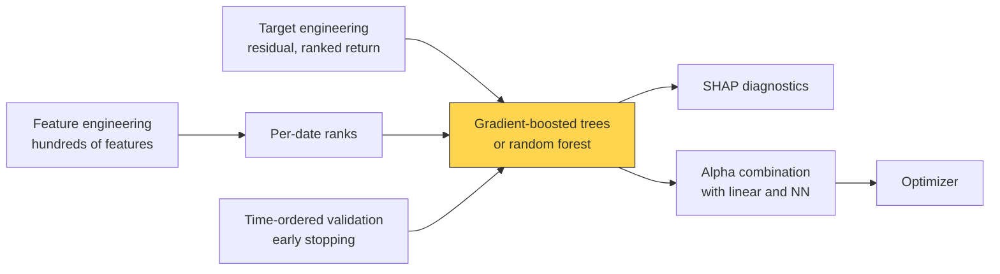

# Tree ensembles

> **TL;DR**
>
> - Gradient-boosted trees (LightGBM, XGBoost) are the default nonlinear model for tabular stock data, finding thresholds and interactions automatically.
> - In Gu, Kelly & Xiu (2020), trees and neural nets reached monthly out-of-sample R² of 0.33–0.40% versus 0.16% for a three-characteristic OLS; the gains came from nonlinear interactions.
> - Winning settings are deliberately weak: shallow trees, learning rates of 0.01–0.05, big leaves, subsampling, early stopping on time-ordered validation.
> - Gain-based importance misleads; SHAP still splits credit among substitutes. Target engineering (residualized, ranked returns) often matters more than hyperparameters.

**Level:** Core · **Pipeline stage:** forecast · **Last verified:** 2026-11

| Field | Value |
|---|---|
| Purpose (the question it answers) | What is each stock's expected (residual) return given many features, allowing nonlinear effects and interactions? |
| Inputs → Outputs | Panel of 20–500 ranked features per stock-date and a forward-return target → 200–5,000 small trees; per-stock scores |
| Used by strategies | [ML-driven short-horizon alpha](../../02-strategies/c-statistical-arbitrage/ml-driven-short-horizon-alpha.md) · [Cross-sectional alpha](../../02-strategies/d-mid-frequency-alpha/cross-sectional-alpha-and-neutralization.md) · [Alternative data](../../02-strategies/d-mid-frequency-alpha/alternative-data.md) · [Fundamental quant signals](../../02-strategies/d-mid-frequency-alpha/fundamental-quant-signals.md) · [Earnings and event-driven](../../02-strategies/d-mid-frequency-alpha/earnings-and-event-driven.md) · [Intraday patterns](../../02-strategies/c-statistical-arbitrage/intraday-patterns-and-seasonality.md) |
| Latency / compute regime | Overnight batch: minutes on a multi-core CPU for ~5M rows × 100 features `[Estimate]`. Inference: 1,000 trees × depth 6 ≈ 6,000 comparisons, µs per stock `[Estimate]` |
| Key parameters | num_leaves 15–63 (depth 3–6); learning rate 0.01–0.05; 300–3,000 rounds via early stopping (patience 100–200); min_data_in_leaf 500–5,000; feature and bagging fraction 0.5–0.8; L2 1–100 |
| Main failure modes | Fitting noise or leaky features; early stopping on a random split; misread importances; no extrapolation; jumpy forecasts raising turnover |
| Lab | [Lab 12](https://github.com/FrankHuang94/quant_trading_claude/tree/main/labs/12-alpha-combination-purged-cv) |

## Intuition

A decision tree asks yes/no questions ("5-day return below −2%? turnover in the top third?") and outputs the average return of the bucket it lands in. A depth-2 tree is a two-way interaction that a linear model gets only from a hand-crafted product term. One deep tree memorizes noise; ensembles fix that:

- **[Random forest](../../09-reference/glossary.md#random-forest):** average hundreds of trees fit to bootstrap samples and random feature subsets; averaging cuts variance.
- **[Gradient boosting](../../09-reference/glossary.md#gradient-boosting):** add small trees one at a time, each fit to what the ensemble still gets wrong, scaled down by a learning rate. When R² is a fraction of a percent, boosting must be throttled hard and stopped early, before it fits noise.

## Where it sits in the pipeline



## The algorithm

1. Rank features per date so a split means the same thing in 1999 and 2025.
2. Target: residual forward return, ranked per date (or clipped, with Huber loss).
3. Split by time: train, a purge gap of one label horizon, 6–12 months of validation.
4. Boost: fit a small tree to residuals on subsampled rows and columns, add it times the learning rate; stop after *patience* rounds without validation improvement.
5. Refit on train plus validation, average 3–10 seeds, predict.

```python
import numpy as np
# Boosting for L2 loss written out to show the mechanics; production uses LightGBM/XGBoost.
# Lab 12 uses LightGBM if installed, with a scikit-learn fallback.
# fit_tree(X, r, max_depth, min_leaf, lam): any CART regressor whose leaf value is
#   sum(residuals in leaf) / (n_leaf + lam)   <- ridge-like shrinkage of each leaf mean

def rank_target(ret, dates):
    # per-date percentile rank in [-0.5, 0.5]: removes outliers and the day's market move
    out = np.empty_like(ret)
    for d in np.unique(dates):
        m = dates == d
        out[m] = ret[m].argsort().argsort() / (m.sum() - 1) - 0.5
    return out

def boost(X_tr, y_tr, X_va, y_va, lr=0.02, n_rounds=5000, patience=200,
          max_depth=5, min_leaf=2000, lam=10.0, row_frac=0.7, col_frac=0.7, seed=0):
    rng = np.random.default_rng(seed)
    pred_tr, pred_va = np.zeros(len(y_tr)), np.zeros(len(y_va))
    trees, best, best_loss, since_best = [], 0, np.inf, 0
    for m in range(n_rounds):
        rows = rng.random(len(y_tr)) < row_frac                   # bagging
        cols = rng.choice(X_tr.shape[1], int(col_frac * X_tr.shape[1]), replace=False)
        resid = y_tr - pred_tr                                    # negative gradient of L2 loss
        tree = fit_tree(X_tr[rows][:, cols], resid[rows], max_depth, min_leaf, lam)
        pred_tr += lr * tree.predict(X_tr[:, cols])               # shrink every step by lr
        pred_va += lr * tree.predict(X_va[:, cols])
        trees.append((tree, cols))
        loss = np.mean((y_va - pred_va) ** 2)                     # or minus validation rank IC
        if loss < best_loss:
            best, best_loss, since_best = m + 1, loss, 0
        else:
            since_best += 1
        if since_best >= patience:                                # early stopping
            break
    return trees[:best]

def predict(trees, X, lr=0.02):
    return lr * sum(t.predict(X[:, c]) for t, c in trees)
```

## Worked example with numbers

Illustrative mean next-day residual returns (bps) in four equal-sized buckets:

| | High turnover | Low turnover |
|---|---|---|
| 5-day loser | +6 | +1 |
| 5-day winner | −5 | −1 |

**Linear fit** (rev = +1 for losers, liq = +1 for high turnover, no interaction): intercept = (6 + 1 − 5 − 1)/4 = 0.25; rev slope = (6 + 1 + 5 + 1)/4 = 3.25; liq slope = (6 − 1 − 5 + 1)/4 = 0.25. Predictions +3.75, +3.25, −2.75, −3.25: every bucket is off by 2.25 bps, the missing interaction (6 − 1 + 5 − 1)/4.

**Depth-2 tree:** split on rev, then liq; leaves are exactly +6, +1, −5, −1. The liquid-name spread is 11 bps, not 6.5.

**Boosting at learning rate 0.1** on noise-free data reaches 1 − 0.9ᵐ of the truth after m rounds: 65% after 10, 88% after 20. With noisy data, validation loss stops improving much earlier, and early stopping halts there.

## Key parameters and how practitioners tune them

- **Depth:** 3–6 (up to 6-way interactions); deeper fits noise `[Lore]`.
- **Learning rate × rounds:** halve the rate, double the rounds. Stopping before ~50 rounds at 0.02 means weak signal `[Lore]`.
- **min_data_in_leaf:** the key regularizer; each leaf should average thousands of returns `[Lore]`.
- **Subsampling:** 0.5–0.8 of rows and features decorrelates trees; sampling whole dates respects cross-sectional correlation.
- **Monotone constraints** (LightGBM, XGBoost) encode economic priors on a feature's direction.

## Textbook version vs what firms actually do

- **Foundations:** [Breiman (2001)](https://doi.org/10.1023/A:1010933404324) and [Friedman (2001)](https://doi.org/10.1214/aos/1013203451); XGBoost added a regularized second-order objective, LightGBM histogram binning and leaf-wise growth `[Verified]`.
- **Academic evidence:** in [GKX 2020](https://doi.org/10.1093/rfs/hhaa009) (US stocks 1957–2016, tested 1987–2016, 94 characteristics), random forests and boosted trees with Huber loss sat near the top with neural nets, and all methods agreed on momentum, liquidity and volatility as the dominant predictors `[Verified]`. Neural-net long-short deciles reached a value-weighted Sharpe of 1.35 gross over 1987–2016 `[Verified]`, against about 0.6 for a linear benchmark `[Reported]`.
- **Recent benchmark:** on daily excess returns, LightGBM and CatBoost ensembles beat zero-shot time-series foundation models (Rahimikia et al., 2026 workshop paper) `[Verified]`; see [LLMs and foundation models](llms-and-foundation-models-in-quant.md).
- **Practice:** boosted trees are common in short-horizon books with hundreds of features, usually blended with linear and neural models `[Lore]`.

## How to tell if it's working

- Out-of-sample rank IC beats a [ridge](linear-models-and-regularization.md) baseline on identical purged folds, net of added turnover.
- **Null test:** retrain on per-date shuffled targets. IC should collapse to ~0; if not, a feature leaks.
- IC by size bucket: microcap-only gains won't survive costs.
- SHAP dependence plots look economically sane. [Lab 12](https://github.com/FrankHuang94/quant_trading_claude/tree/main/labs/12-alpha-combination-purged-cv) compares GBDT with linear combiners under purged CV.

## Failure modes and pitfalls

- **Importance illusions:** gain and split counts favor high-cardinality, noisy features ([Strobl et al. 2007](https://doi.org/10.1186/1471-2105-8-25)); substitutes split credit, so each looks unimportant while the pair matters (López de Prado 2018, ch. 8). Cluster correlated features first. [SHAP](../../09-reference/glossary.md#shap) measures attribution, not P&L.
- **Raw-return targets:** squared error is dominated by volatile stocks, so splits go to predicting volatility. Rank the target.
- **Leaky or nonstationary features:** IDs, dates, raw prices.
- **No extrapolation:** beyond the training range (March 2020 volatility), trees predict a constant.
- **Early stopping on a random split** leaks the future ([time-series CV](../c-validation-and-backtesting/time-series-cross-validation.md)).

## How practitioners talk about it

- "Bump min leaf to 5k; it's fitting noise." → Force each leaf to average more returns.
- "It stopped at round 40." → Too little signal or too high a learning rate.
- "Turnover's top SHAP feature, but it's a substitute for spread." → Correlated features share attribution.
- "Ranked target, otherwise it's a vol model." → Raw squared error over-weights volatile names.
- "Blend it with the ridge, don't replace it." → Trees add interactions; linear adds stability.

## Questions you could ask a quant about this

1. Trees or linear for your main forecast, and why? (basic)
2. Where does your early-stopping block sit relative to the test period? (informed)
3. What target do you train on: raw, residual, ranked? (informed)
4. How much of the tree model's edge over ridge survives costs? 🔒 (sharp)
5. How do you stop forecasts jumping between retrains? (sharp)

## Go deeper

<details markdown="1">
<summary>Math: boosting update, XGBoost split gain, SHAP</summary>

Boosting: $F_m = F_{m-1} + \nu h_m$. XGBoost leaf weight and split gain (gradient sums $G$, Hessian sums $H$):

$$
w^* = -\frac{G}{H+\lambda}, \qquad \text{Gain} = \tfrac12\Big[\tfrac{G_L^2}{H_L+\lambda} + \tfrac{G_R^2}{H_R+\lambda} - \tfrac{(G_L+G_R)^2}{H_L+H_R+\lambda}\Big] - \gamma
$$

For L2 loss $H$ equals the leaf count, so $w^*$ is the residual sum over $(n+\lambda)$: a ridge-shrunk mean.

SHAP values are Shapley values (average marginal contribution over feature subsets), exact in polynomial time for trees.

</details>

## Related pages

- [Linear models and regularization](linear-models-and-regularization.md) · [Neural nets and sequence models](neural-nets-and-sequence-models.md)
- [Alpha combination and ensembling](alpha-combination-and-ensembling.md) · [Feature engineering](../a-data-and-signals/feature-engineering.md)
- [Overfitting and multiple testing](../c-validation-and-backtesting/overfitting-and-multiple-testing.md)
- [ML-driven short-horizon alpha](../../02-strategies/c-statistical-arbitrage/ml-driven-short-horizon-alpha.md)

## Sources

- [Verified] Gu, S., Kelly, B. & Xiu, D. (2020). "Empirical Asset Pricing via Machine Learning." *Review of Financial Studies* 33(5), 2223–2273. <https://doi.org/10.1093/rfs/hhaa009> (accessed 2026-11)
- [Reported] Mirova Research Center. Summary of "Empirical Asset Pricing via Machine Learning" (Sharpe ratios of NN vs linear decile portfolios). <https://www.research-center.mirova.com/en/research-library/Empirical-Asset-Pricing-via-Machine-Learning> (accessed 2026-11)
- [Verified] Breiman, L. (2001). "Random Forests." *Machine Learning* 45(1), 5–32. <https://doi.org/10.1023/A:1010933404324> (accessed 2026-11)
- [Verified] Friedman, J. H. (2001). "Greedy Function Approximation: A Gradient Boosting Machine." *Annals of Statistics* 29(5), 1189–1232. <https://doi.org/10.1214/aos/1013203451> (accessed 2026-11)
- [Verified] Chen, T. & Guestrin, C. (2016). "XGBoost: A Scalable Tree Boosting System." *KDD '16*, 785–794. <https://doi.org/10.1145/2939672.2939785> (accessed 2026-11)
- [Verified] Ke, G. et al. (2017). "LightGBM: A Highly Efficient Gradient Boosting Decision Tree." *NeurIPS 30*. <https://papers.nips.cc/paper/6907-lightgbm-a-highly-efficient-gradient-boosting-decision-tree> (accessed 2026-11)
- [Verified] Lundberg, S. M. & Lee, S.-I. (2017). "A Unified Approach to Interpreting Model Predictions." *NeurIPS 30*. <https://arxiv.org/abs/1705.07874> (accessed 2026-11)
- [Verified] Lundberg, S. M. et al. (2020). "From local explanations to global understanding with explainable AI for trees." *Nature Machine Intelligence* 2, 56–67. <https://doi.org/10.1038/s42256-019-0138-9> (accessed 2026-11)
- [Verified] Strobl, C., Boulesteix, A.-L., Zeileis, A. & Hothorn, T. (2007). "Bias in random forest variable importance measures." *BMC Bioinformatics* 8:25. <https://doi.org/10.1186/1471-2105-8-25> (accessed 2026-11)
- [Verified] López de Prado, M. (2018). *Advances in Financial Machine Learning*, Wiley (ch. 8, feature importance). <https://www.wiley.com/en-us/Advances+in+Financial+Machine+Learning-p-9781119482086> (accessed 2026-11)
- [Verified] Rahimikia, E. et al. (2026). "Re(Visiting) Time Series Foundation Models in Finance." FoFI 2026 conference paper. <http://wp.lancs.ac.uk/fofi2026/files/2026/03/FoFI-2026-020-Eghbal-Rahimikia.pdf> (accessed 2026-11)
