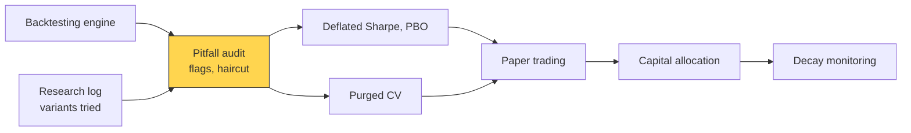
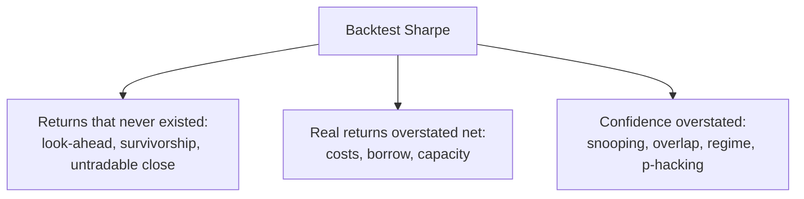

# Backtest pitfalls

> **TL;DR**
>
> - Nearly every backtest bias pushes the same way: up. The audit asks by how much, and why.
> - Data and timing errors invent returns; cost, borrow and capacity errors inflate real ones; statistical errors inflate confidence.
> - Predictor returns fall 26% out of sample and 58% after publication (McLean & Pontiff 2016). Across 888 Quantopian algorithms, backtest Sharpe explained under 2.5% of out-of-sample Sharpe.
> - Harvey & Liu (2015) haircut Sharpe ratios for the number of strategies tried. The haircut is nonlinear: a flat 50% is too lenient for marginal Sharpe ratios and too harsh for strong ones (table below).

**Level:** Core · **Pipeline stage:** validation · **Last verified:** 2026-11

| Field | Value |
|---|---|
| Purpose (the question it answers) | Why does this backtest look better than live trading will be, and by how much? |
| Inputs → Outputs | Backtest P&L, weights, trade log, data lineage, a log of variants tried → flags with severity, haircut Sharpe, go/no-go for paper trading |
| Used by strategies | [Earnings and events](../../02-strategies/d-mid-frequency-alpha/earnings-and-event-driven.md) · [Fundamental signals](../../02-strategies/d-mid-frequency-alpha/fundamental-quant-signals.md) · [Cross-sectional alpha](../../02-strategies/d-mid-frequency-alpha/cross-sectional-alpha-and-neutralization.md) · [Momentum](../../02-strategies/e-risk-premia-and-factors/momentum.md) · [Value, quality, low vol](../../02-strategies/e-risk-premia-and-factors/value-quality-low-vol.md) · [Factor investing](../../02-strategies/e-risk-premia-and-factors/factor-investing-fundamentals.md) · [Reversal](../../02-strategies/c-statistical-arbitrage/short-term-cross-sectional-reversal.md) · [Alternative data](../../02-strategies/d-mid-frequency-alpha/alternative-data.md) · [ML short-horizon alpha](../../02-strategies/c-statistical-arbitrage/ml-driven-short-horizon-alpha.md) · [Factor timing](../../02-strategies/e-risk-premia-and-factors/factor-timing-crowding-and-quant-winters.md) |
| Latency / compute regime | Offline audit: seconds to minutes per strategy, before capital and after every material change |
| Key parameters | Honest trial count N; t-hurdle 3.0; cost stress 2×; +1 day lag stress; position cap 1–5% of ADV; Newey–West lags = horizon − 1 |
| Main failure modes | Uncounted trials; box-ticking; interacting biases; fixing bugs only when results disappoint |
| Lab | — |

## Intuition

A backtest is a model of the past built by someone who knows how it ended. Like management's adjusted EBITDA, each adjustment is defensible alone and all point the same way; diligence reverses them one at a time.

| Pitfall | How it inflates | Fix |
|---|---|---|
| [Look-ahead](../../09-reference/glossary.md#look-ahead-bias) | restated, period-end-dated or same-bar data | as-of joins ([D1](../a-data-and-signals/point-in-time-data-and-cleaning.md)) |
| [Survivorship](../../09-reference/glossary.md#survivorship-bias) | drops dead stocks and their final losses | full history plus delisting returns |
| Untradable close | signal and fill on one print; bid-ask bounce | next bar, or MOC before cutoff |
| Costs | flat bps ignore impact | spread + fees + [impact](../../09-reference/glossary.md#market-impact) ([P5](../d-portfolio-construction/transaction-cost-and-impact-models.md)) |
| Short constraints | free borrow, always locatable | [borrow fees](../../09-reference/glossary.md#borrow-fee), locate data |
| [Capacity](../../09-reference/glossary.md#capacity) | profit sits in untradably small names | ADV caps, impact at target AUM |
| [Data snooping](../../09-reference/glossary.md#data-snooping) | best of many variants | count trials, haircut ([V4](overfitting-and-multiple-testing.md)) |
| Overlapping returns | daily-sampled h-day returns treated as independent | Newey–West errors |
| Regime dependence | one crisis carries the P&L | subperiod Sharpe |
| Parameter p-hacking | lookbacks tuned to the sample | choose plateaus, not peaks |

## Where it sits in the pipeline





## The algorithm

1. **Lineage:** point-in-time data, delisting returns, pinned vintage.
2. **Timing:** compare same-day and forward IC; rerun with one extra day of lag.
3. **Costs:** break-even cost per unit turnover; rerun at 2× costs.
4. **Shorts:** hard-to-borrow share and fees.
5. **Capacity:** position sizes as % of ADV at target AUM.
6. **Regimes:** P&L by year; concentration in the best period.
7. **Statistics:** overlap-corrected t-stats, then a multiple-testing haircut with an honest trial count.
8. **Decide:** unresolved red flags block paper trading.

```python
import numpy as np
import pandas as pd

def sanity_check(bt, n_trials, horizon=5, cost_bps=10.0, aum=5e8, ann=252):
    """bt: backtester output (V2), daily rows; frames are [date x stock].
    norm_sf / norm_isf: standard normal tail and its inverse (e.g. scipy.stats.norm)."""
    flags = []
    sig, w, pnl_g, pnl_n = bt["signal"], bt["weights"], bt["pnl_gross"], bt["pnl_net"]
    ic = sig.corrwith(bt["fwd_ret_h"], axis=1, method="spearman")    # h-day forward
    ic_now = sig.corrwith(bt["ret_same_day"], axis=1, method="spearman").mean()
    if abs(ic_now) > 2 * abs(ic.mean()):                    # 1 look-ahead
        flags.append(("look-ahead?", f"same-day IC {ic_now:.3f} vs fwd {ic.mean():.3f}"))
    if bt["n_delisted_names_held"] == 0:                    # 2 survivorship
        flags.append(("survivorship?", "never held a stock that later delisted"))
    turnover = w.diff().abs().sum(axis=1).mean()            # 3 costs (one-way, daily)
    breakeven = 1e4 * pnl_g.mean() / turnover
    if breakeven < 2 * cost_bps:
        flags.append(("cost-fragile", f"break-even {breakeven:.1f} bps"))
    shorts = w.clip(upper=0).abs()                          # 4 borrow (fee > 5%/yr)
    htb = (shorts[bt["borrow_fee"] > 0.05].sum(axis=1) / shorts.sum(axis=1)).mean()
    if htb > 0.05:
        flags.append(("borrow", f"{htb:.0%} of the short book is hard to borrow"))
    part = (w.abs() * aum / bt["adv_usd"]).max(axis=1).quantile(0.95)   # 5 capacity
    if part > 0.05:
        flags.append(("capacity", f"largest positions reach {part:.0%} of ADV"))
    yearly = pnl_n.groupby(pnl_n.index.year).sum()          # 6 regime dependence
    if yearly.max() > 0.5 * yearly.sum():
        flags.append(("regime", "one year carries over half of the P&L"))
    t_ic = ic.mean() / ic.std() * np.sqrt(len(ic)) / np.sqrt(horizon)  # 7 overlap
    if t_ic < 3.0:
        flags.append(("weak IC", f"overlap-adjusted t = {t_ic:.1f}"))
    sr, years = pnl_n.mean() / pnl_n.std() * np.sqrt(ann), len(pnl_n) / ann
    p_multi = min(1.0, n_trials * 2 * norm_sf(abs(sr) * np.sqrt(years)))   # 8 Bonferroni
    sr_hc = norm_isf(p_multi / 2) / np.sqrt(years) if p_multi < 1 else 0.0
    flags.append(("haircut", f"Sharpe {sr:.2f} -> {sr_hc:.2f} after {n_trials} trials"))
    return flags
```

## Worked example with numbers

**Haircut by hand** (Bonferroni, the bluntest of Harvey & Liu's three adjustments), 10 years of data:

| Backtest Sharpe | t = SR·√10 | Trials N | p × N | Haircut t | Haircut Sharpe | Haircut |
|---|---|---|---|---|---|---|
| 1.0 | 3.16 | 10 | 0.016 | 2.42 | 0.76 | 24% |
| 1.0 | 3.16 | 100 | 0.157 | 1.42 | 0.45 | 55% |
| 0.4 | 1.26 | 10 | 1.0 (capped) | 0 | 0 | 100% |
| 2.0 | 6.32 | 100 | ≈ 0 | 5.57 | 1.76 | 12% |

Harvey & Liu's own example: Sharpe 1.0 over 120 months, 100 tests and 0.4 average correlation becomes 0.44 under their BHY method, a 52% haircut from the autocorrelation-corrected 0.91 `[Verified]`.

**Overlap** (illustrative): daily IC on 21-day forward returns with a naive t of 6.0 is really about 6.0 / √21 ≈ 1.3.

**Bid-ask bounce** (illustrative): a small cap with a 20 bp spread closes at the bid, looking 10 bps weak; a next close at mid gives a reversal backtest +10 bps of fake alpha `[Estimate]`.

## Key parameters and how practitioners tune them

- **N trials:** count every variant, abandoned ones included. Harvey, Liu & Zhu counted at least 316 published factors and set a t-hurdle of 3.0 `[Verified]`.
- **Cost stress:** with cost-aware design, most anomalies under 50% monthly turnover survive costs; few above do (Novy-Marx & Velikov 2016) `[Verified]`.
- **Lag stress:** add one day; a large drop means the edge lives in timing you may not get.
- **Capacity cap:** positions at about 1–5% of ADV at target AUM `[Lore]`.
- **Overlap:** autocorrelation-robust errors with h − 1 lags for h-period returns (Hansen & Hodrick 1980; Newey & West 1987) `[Verified]`.

## Textbook version vs what firms actually do

- **Decay:** [McLean & Pontiff (2016)](https://doi.org/10.1111/jofi.12365): 97 predictors, 26% lower out of sample, 58% lower post-publication `[Verified]`.
- **Replication:** [Hou, Xue & Zhang (2020)](https://doi.org/10.1093/rfs/hhy131): with microcaps controlled, 65% of 452 anomalies fail t ≥ 1.96, and 82% fail t ≥ 2.78 `[Verified]`.
- **Survivorship:** correcting Nasdaq delisting returns removes any evidence of a Nasdaq size effect (Shumway & Warther 1999) `[Verified]`.
- **Backtests vs live:** across 888 Quantopian algorithms, backtest Sharpe had R² < 0.025 for out-of-sample Sharpe, and more backtesting meant a bigger gap ([Wiecki et al. 2016](https://doi.org/10.3905/joi.2016.25.3.069)) `[Verified]`.
- **Practice:** a flat 50% haircut is a common rule of thumb (Harvey & Liu) `[Verified]`. Allocators typically want months of paper or small-capital live trading first `[Lore]`.

## How to tell if it's working

The audit works when live results land inside the backtest's confidence band. Checklist:

- [ ] Point-in-time data, delisting returns, pinned vintage
- [ ] Fill price attainable after the signal time
- [ ] Profitable at 2× modeled costs at target AUM
- [ ] Borrow fees and hard-to-borrow share modeled
- [ ] Largest positions within the ADV cap
- [ ] Positive in most years; no year above half the P&L
- [ ] Overlap-corrected t ≥ 3 and haircut Sharpe reported with honest N
- [ ] Parameters on a plateau

## Failure modes and pitfalls

- **Asymmetric debugging:** bugs get hunted when results disappoint, so surviving bugs flatter `[Lore]`.
- **Interacting biases:** survivorship, microcaps and light costs compound in the same small, illiquid names.
- **The audit is a degree of freedom too:** relax a flag, rerun, repeat.
- **Pre-publication samples:** backtests of published factors include years before the crowd arrived ([factor timing](../../02-strategies/e-risk-premia-and-factors/factor-timing-crowding-and-quant-winters.md)).

## How practitioners talk about it

- "What's the haircut Sharpe?" → Sharpe after adjusting for strategies tried.
- "How many backtests did it take?" → The honest trial count.
- "Break-even cost?" → Cost per unit turnover that zeroes the alpha.
- "Is it all 2008?" → Is P&L concentrated in one regime?
- "That's bounce, not reversal." → Profit comes from closing prints at bid or ask.

## Questions you could ask a quant about this

1. How do you count trials across a research team? (basic)
2. What fill price does your daily backtest assume? (informed)
3. How much of the short-side P&L is in hard-to-borrow names? (informed)
4. What's your typical backtest-to-live Sharpe ratio? 🔒 (sharp)
5. Which flag most often kills a strategy at your shop? 🔒 (sharp)

## Go deeper

<details markdown="1">
<summary>Math: haircut Sharpe, overlap inflation, Newey–West</summary>

With $T$ years, $t = \widehat{SR}\sqrt{T}$, two-sided $p_S = 2\,\Phi(-|t|)$. Bonferroni: $p_M = \min(N p_S, 1)$; Holm and BHY are less severe. Haircut Sharpe and haircut:

$$
\widehat{SR}_{hc} = \frac{\Phi^{-1}(1 - p_M/2)}{\sqrt{T}}, \qquad hc = 1 - \widehat{SR}_{hc}/\widehat{SR}
$$

Overlap: for i.i.d. daily returns, $h$-day sums sampled daily make the naive standard error too small by about $\sqrt{h}$.

Newey–West with $L = h-1$ lags and autocovariances $\hat\gamma_j$:

$$
\hat\sigma^2_{NW} = \hat\gamma_0 + 2\sum_{j=1}^{L}\Big(1 - \frac{j}{L+1}\Big)\hat\gamma_j
$$

</details>

## Related pages

- [Overfitting and multiple testing](overfitting-and-multiple-testing.md) · [Time-series cross-validation](time-series-cross-validation.md)
- [Backtesting engines](backtesting-engines.md) · [Point-in-time data and cleaning](../a-data-and-signals/point-in-time-data-and-cleaning.md)
- [How quants evaluate a strategy](../../02-strategies/how-quants-evaluate-a-strategy.md)

## Sources

- [Verified] Harvey, C. R. & Liu, Y. (2015). "Backtesting." *Journal of Portfolio Management* 42(1), 13–28. <https://doi.org/10.3905/jpm.2015.42.1.013> (accessed 2026-11)
- [Verified] Harvey, C. R., Liu, Y. & Zhu, H. (2016). "… and the Cross-Section of Expected Returns." *Review of Financial Studies* 29(1), 5–68. <https://doi.org/10.1093/rfs/hhv059> (accessed 2026-11)
- [Verified] McLean, R. D. & Pontiff, J. (2016). "Does Academic Research Destroy Stock Return Predictability?" *Journal of Finance* 71(1), 5–32. <https://doi.org/10.1111/jofi.12365> (accessed 2026-11)
- [Verified] Hou, K., Xue, C. & Zhang, L. (2020). "Replicating Anomalies." *Review of Financial Studies* 33(5), 2019–2133. <https://doi.org/10.1093/rfs/hhy131> (accessed 2026-11)
- [Verified] Novy-Marx, R. & Velikov, M. (2016). "A Taxonomy of Anomalies and Their Trading Costs." *Review of Financial Studies* 29(1), 104–147. <https://doi.org/10.1093/rfs/hhv063> (accessed 2026-11)
- [Verified] Shumway, T. & Warther, V. A. (1999). "The Delisting Bias in CRSP's Nasdaq Data and Its Implications for the Size Effect." *Journal of Finance* 54(6), 2361–2379. <https://doi.org/10.1111/0022-1082.00192> (accessed 2026-11)
- [Verified] Wiecki, T., Campbell, A., Lent, J. & Stauth, J. (2016). "All That Glitters Is Not Gold: Comparing Backtest and Out-of-Sample Performance on a Large Cohort of Trading Algorithms." *Journal of Investing* 25(3), 69–80. <https://doi.org/10.3905/joi.2016.25.3.069> (accessed 2026-11)
- [Verified] Hansen, L. P. & Hodrick, R. J. (1980). "Forward Exchange Rates as Optimal Predictors of Future Spot Rates: An Econometric Analysis." *Journal of Political Economy* 88(5), 829–853. <https://doi.org/10.1086/260910> (accessed 2026-11)
- [Verified] Newey, W. K. & West, K. D. (1987). "A Simple, Positive Semi-Definite, Heteroskedasticity and Autocorrelation Consistent Covariance Matrix." *Econometrica* 55(3), 703–708. <https://doi.org/10.2307/1913610> (accessed 2026-11)
