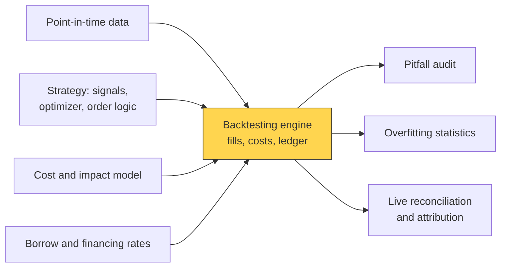
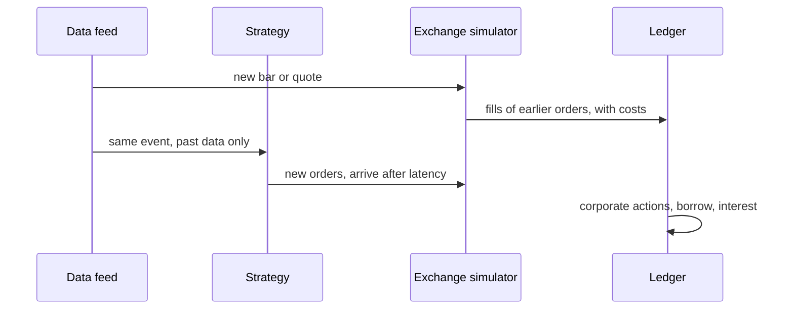

# Backtesting engines

> **TL;DR**
>
> - A backtester simulates a P&L: it replays history, lets the strategy decide on past data only, models fills and keeps the books.
> - Vectorized engines run decades in seconds and suit daily cross-sectional research. Event-driven engines process one event at a time on production's code path; intraday and passive strategies need them.
> - Realism lives in the fill and cost model: spread, fees and rebates, impact, partial fills, queue position, latency, borrow, financing and corporate actions.
> - HFT uses market-replay simulators that rebuild the book and estimate queue position. Replay cannot show others reacting to you; live trading is the final test.

**Level:** Core · **Pipeline stage:** validation · **Last verified:** 2026-11

| Field | Value |
|---|---|
| Purpose (the question it answers) | What would this strategy's P&L, costs and risk have been, trading as production would, on data it could have seen? |
| Inputs → Outputs | PIT data, strategy code, fill and cost model, borrow and financing rates → fill log, positions, daily P&L split into alpha, costs and financing |
| Used by strategies | [Cross-sectional alpha](../../02-strategies/d-mid-frequency-alpha/cross-sectional-alpha-and-neutralization.md) · [Short-term reversal](../../02-strategies/c-statistical-arbitrage/short-term-cross-sectional-reversal.md) · [Factor-residual reversion](../../02-strategies/c-statistical-arbitrage/factor-residual-mean-reversion.md) · [Pairs trading](../../02-strategies/c-statistical-arbitrage/pairs-trading-and-cointegration.md) · [ML short-horizon alpha](../../02-strategies/c-statistical-arbitrage/ml-driven-short-horizon-alpha.md) · [Intraday patterns](../../02-strategies/c-statistical-arbitrage/intraday-patterns-and-seasonality.md) · [Equity market making](../../02-strategies/a-liquidity-provision/equity-market-making.md) · [Trend following](../../02-strategies/g-futures-and-macro-context/trend-following-and-ctas.md) |
| Latency / compute regime | Vectorized daily, 3,000 stocks × 20 years: seconds `[Estimate]`. Event-driven daily: minutes. Full-depth tick replay: hours per stock-year `[Estimate]` |
| Key parameters | Fill price (next open, VWAP, MOC); latency (1 bar daily; 10 µs–5 ms HFT); participation cap 5–20% of volume; cost model (half-spread + fees + k·σ·√(Q/ADV)); borrow 0.25% to 50%+ a year |
| Main failure modes | Unattainable fill prices; free passive fills; zero latency; infinite liquidity; no borrow; divergent research code; irreproducible runs |
| Lab | — |

## Intuition

Think of a backtester as a sub-ledger with a simulated counterparty. The strategy sends orders; an exchange model decides what fills, when and at what price; the ledger books cash, positions, fees, dividends, borrow and interest. Like a pro-forma P&L, it is only as good as its assumptions, and the ones that matter most sit in the fill model.

| | Vectorized | Event-driven |
|---|---|---|
| Unit of work | whole weight matrix × return matrix | one bar, quote, trade or fill at a time |
| Speed | seconds for decades | 10–1,000× slower `[Estimate]` |
| Fits | daily and weekly cross-sectional books, parameter sweeps | intraday, limit orders, path-dependent rules |
| Look-ahead risk | high: one wrong `shift` | lower: data arrives in order |

## Where it sits in the pipeline





## The algorithm

1. Merge bars or ticks, corporate actions and financing into one time-ordered event stream.
2. Apply corporate actions to positions before trading. Shorts pay dividends.
3. Let the simulated exchange fill earlier orders against the new event. Respect latency, the participation cap and, for passive orders, queue position.
4. Charge costs on each fill: half-spread, fees or rebates, impact.
5. Show the event to the strategy, which sees only the past, and queue its new orders.
6. Accrue borrow on shorts and interest on cash, mark to market and log.

```python
import numpy as np

class CostModel:
    """Per-fill cost in $: half-spread + fees + square-root impact (see P5).
    Defaults are illustrative; firms calibrate k and fees on their own fills (E6)."""
    def __init__(self, fee_per_share=0.003, k=0.7, max_part=0.10, borrow_rate=0.003):
        self.fee, self.k, self.max_part, self.borrow = fee_per_share, k, max_part, borrow_rate

    def cost(self, qty, px, spread, sigma, adv):
        q = abs(qty)
        impact = self.k * sigma * np.sqrt(q / adv) * q * px      # square-root law
        return 0.5 * spread * q + self.fee * q + impact

def run_backtest(bars, strategy, cm, cash=1e7, latency_bars=1):
    """bars: time-ordered, one per (day t, sym): open, close, volume, adv, spread,
    sigma, split, div. An order sent on bar t fills no earlier than t + latency_bars."""
    pos, pending, ledger = {}, [], []
    for b in bars:
        q = pos.get(b.sym, 0.0) * b.split                    # corporate actions first
        cash += q * b.div                                    # shorts pay the dividend
        pos[b.sym] = q
        still = []
        for (t0, sym, qty) in pending:                       # the simulated exchange
            if sym != b.sym or b.t < t0 + latency_bars:
                still.append((t0, sym, qty))
                continue
            fill = np.sign(qty) * min(abs(qty), cm.max_part * b.volume)  # partial fill
            c = cm.cost(fill, b.open, b.spread, b.sigma, b.adv)
            cash -= fill * b.open + c                        # a LATER bar's open
            pos[sym] += fill
            ledger.append((b.t, sym, fill, b.open, c))
            if qty != fill:
                still.append((t0, sym, qty - fill))          # remainder keeps working
        pending = still
        if pos[b.sym] < 0:                                   # daily borrow on shorts
            cash -= cm.borrow / 252 * abs(pos[b.sym]) * b.close
        for sym, qty in strategy.on_bar(b, dict(pos)).items():   # sees only the past
            pending.append((b.t, sym, qty))
    return ledger, pos, cash          # simplified: no cash interest, no locates
```

## Worked example with numbers

Illustrative: buy 50,000 shares of a \$40 stock with a 2¢ spread, 2% daily volatility, 1M shares ADV, a \$0.003 per-share take fee and k = 0.7.

| Component | Calculation | $ | bps |
|---|---|---|---|
| Half-spread | \$0.01 × 50,000 | 500 | 2.5 |
| Fees | \$0.003 × 50,000 | 150 | 0.75 |
| Impact | 0.7 × 0.02 × √(50,000 / 1,000,000) × \$2,000,000 | 6,261 | 31.3 |
| **Total** | | **6,911** | **34.6** |

A flat 5 bps charge books \$1,000, about 7× too little. Against 30 bps of expected alpha, the flat model reports +25 bps net; the realistic one, −4.6 bps. With a 10% participation cap, a 150,000-share order on a 1M-share day fills 100,000 today and 50,000 tomorrow while the alpha decays.

**Passive fills:** you join a 10,000-share bid with 500 shares. Then 3,000 trade at your price and 2,000 cancel. A fill-on-touch engine fills you. A risk-averse [queue model](../../09-reference/glossary.md#queue-position) puts the cancels behind you, leaving 7,000 ahead. A probabilistic model leaves 5,000–7,000 ahead.

## Key parameters and how practitioners tune them

- **Fill price:** next open or next-interval VWAP for daily books. The close is usable only if the decision came before the MOC cutoff (3:50 p.m. on NYSE) `[Verified]`.
- **Impact coefficient:** order 1 in the [square-root law](../../09-reference/glossary.md#square-root-law) literature ([Tóth et al. 2011](https://doi.org/10.1103/PhysRevX.1.021006)) `[Reported]`. Firms refit it on their own fills via [TCA](../e-execution-algorithms/transaction-cost-analysis.md) `[Lore]`.
- **Latency:** HFT engines sample measured distributions, not constants `[Lore]`.
- **Borrow:** general collateral about 0.25–0.50% a year, hard-to-borrow 5–50%+ `[Lore]` ([shorting](../../01-market-structure/shorting-financing-and-settlement.md)).
- **Fees:** take fees are capped at \$0.0030 per share `[Verified]`.

## Textbook version vs what firms actually do

- **Zipline-reloaded:** event-driven; Quantopian's engine, maintained by Stefan Jansen since Quantopian closed in late 2020; v3.2.1 in October 2026 `[Verified]`.
- **backtrader:** event-driven; last PyPI release April 2023 `[Verified]`.
- **vectorbt:** array-based research at scale; open-source edition of VectorBT PRO `[Verified]`.
- **NautilusTrader:** Rust-native, deterministic, event-driven; the same strategy code runs in backtest and live `[Verified]`.
- **LEAN** (QuantConnect): open-source event-driven engine in C# with Python support `[Verified]`.
- **hftbacktest:** L2/L3 replay with feed and order latency and queue models; its docs warn replay cannot model your impact `[Verified]`.
- **ABIDES:** agent-based discrete-event simulation, so other agents can react to yours ([Byrd et al. 2019](https://arxiv.org/abs/1904.12066)) `[Verified]`.
- **In-house:** large firms build simulators that share production code and are calibrated on live fills `[Lore]`.

## How to tell if it's working

- **Unit tests:** buy-and-hold reproduces the total-return series; no trades means zero P&L; split days show no jump.
- **Live reconciliation:** replay the live period against realized P&L; the residual is unmodeled slippage.
- **Determinism:** same data vintage, code and seed give identical output.
- **Sensitivity:** P&L degrades smoothly at 2× costs and 2× latency.
- **Fill realism:** simulated passive fill rates match live ones.

## Failure modes and pitfalls

- **Same-bar fills:** trading at the close that generated the signal.
- **Free passive fills:** a limit order filled whenever price touches it ignores the queue and [adverse selection](../../09-reference/glossary.md#adverse-selection).
- **Infinite liquidity:** no participation cap.
- **No short frictions:** no locates, recalls or borrow fees.
- **Two code paths:** research logic drifts from production. More in [backtest pitfalls](backtest-pitfalls.md).

## How practitioners talk about it

- "Are you filling on the signal bar?" → Is there same-bar look-ahead?
- "Touch fills are fantasy." → Passive orders need a queue model.
- "What's the sim-to-live slippage?" → Gap between simulated and realized P&L.
- "Same code path as prod?" → Does the backtest run production logic?
- "Pin the vintage." → Record the exact data snapshot.

## Questions you could ask a quant about this

1. Vectorized or event-driven, and why? (basic)
2. What fill price do you assume for daily rebalances? (informed)
3. How do you model queue position for passive orders? (informed)
4. How big is your sim-to-live gap, and is it stable? 🔒 (sharp)
5. Is your impact model fitted on your own fills? (sharp)

## Go deeper

<details markdown="1">
<summary>Math: P&L identity, cost model, queue probability</summary>

Daily P&L with positions $q_{i,t-1}$, dividends $D$, fills $f$, borrow rate $b$ and cash rate $r^c$:

$$
\Pi_t = \sum_i q_{i,t-1}(P_{i,t} - P_{i,t-1} + D_{i,t}) - \sum_{\text{fills}} c(f) - \sum_{i:q<0} \tfrac{b_i}{252}|q_i|P_i + \tfrac{r^c}{252}\,\text{cash}
$$

Cost per fill: $c(f) = \tfrac12 s|f| + \phi|f| + k\,\sigma\sqrt{|f|/\text{ADV}}\;|f|P$.

Queue models (hftbacktest): a cancel of size $C$ is ahead of you with probability $f(x)/(f(x)+f(1-x))$, where $x$ is the queue fraction ahead, with $f(x)=x^n$ or $\log(1+x)$.

</details>

## Related pages

- [Backtest pitfalls](backtest-pitfalls.md) · [Overfitting and multiple testing](overfitting-and-multiple-testing.md)
- [Transaction cost and impact models](../d-portfolio-construction/transaction-cost-and-impact-models.md)
- [Queue position and order placement](../f-market-making-and-hft-algorithms/queue-position-and-order-placement.md)
- [Point-in-time data and cleaning](../a-data-and-signals/point-in-time-data-and-cleaning.md)

## Sources

- [Verified] Stefan Jansen. zipline-reloaded (README and PyPI release 3.2.1). <https://pypi.org/project/zipline-reloaded/> (accessed 2026-11)
- [Verified] backtrader on PyPI (release history). <https://pypi.org/project/backtrader/> (accessed 2026-11)
- [Verified] Polakow, O. vectorbt (README and PyPI). <https://github.com/polakowo/vectorbt> (accessed 2026-11)
- [Verified] Nautech Systems. NautilusTrader (README, PyPI). <https://github.com/nautechsystems/nautilus_trader> (accessed 2026-11)
- [Verified] QuantConnect. LEAN algorithmic trading engine (README). <https://github.com/QuantConnect/Lean> (accessed 2026-11)
- [Verified] hftbacktest documentation, "Order Fill" (exchange and queue models). <https://hftbacktest.readthedocs.io/en/latest/order_fill.html> (accessed 2026-11)
- [Verified] Byrd, D., Hybinette, M. & Balch, T. H. (2019). "ABIDES: Towards High-Fidelity Market Simulation for AI Research." arXiv:1904.12066. <https://arxiv.org/abs/1904.12066> (accessed 2026-11)
- [Verified] Tóth, B., Lempérière, Y., Deremble, C., de Lataillade, J., Kockelkoren, J. & Bouchaud, J.-P. (2011). "Anomalous Price Impact and the Critical Nature of Liquidity in Financial Markets." *Physical Review X* 1(2), 021006. <https://doi.org/10.1103/PhysRevX.1.021006> (accessed 2026-11)
