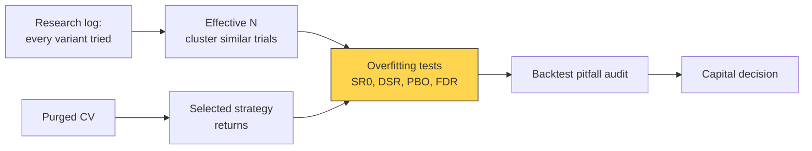
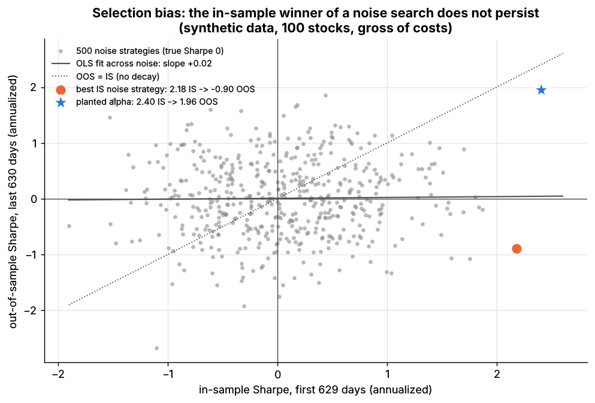
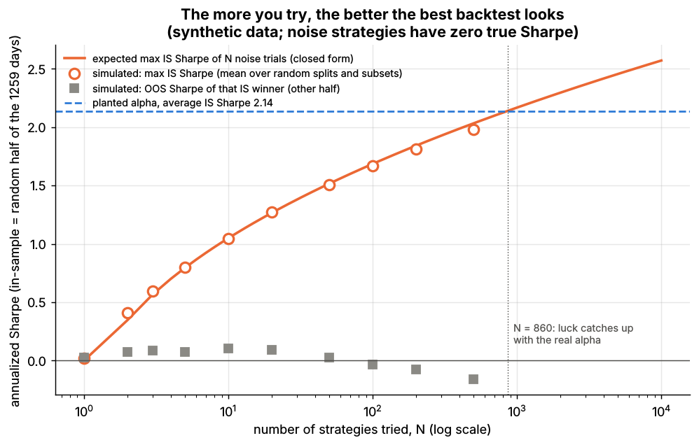

# Overfitting and multiple testing

> **TL;DR**
>
> - Try enough strategies and the best backtest looks good by luck: the best Sharpe of N zero-skill trials grows like √(2 ln N) standard errors.
> - The Deflated Sharpe Ratio (DSR) is the probability that the true Sharpe beats that luck hurdle; the Probability of Backtest Overfitting (PBO) is how often the in-sample winner ends up below the out-of-sample median.
> - Lab 13: the best of 500 noise strategies went from Sharpe 2.18 in-sample to −0.90 out of sample; DSR 0.34 vs 0.94 for a planted alpha; PBO 0.64 vs 0.22 (synthetic lab result).
> - Every correction needs an honest trial count, research graveyard included.

**Level:** Core · **Pipeline stage:** validation · **Last verified:** 2026-11

| Field | Value |
|---|---|
| Purpose (the question it answers) | Given everything we tried, is the best backtest evidence of skill or of luck? |
| Inputs → Outputs | Returns of the chosen strategy and all N variants tried → SR0, DSR, PBO, adjusted p-values |
| Used by strategies | [Cross-sectional alpha](../../02-strategies/d-mid-frequency-alpha/cross-sectional-alpha-and-neutralization.md) · [ML-driven short-horizon alpha](../../02-strategies/c-statistical-arbitrage/ml-driven-short-horizon-alpha.md) · [Factor investing](../../02-strategies/e-risk-premia-and-factors/factor-investing-fundamentals.md) · [Momentum](../../02-strategies/e-risk-premia-and-factors/momentum.md) · [Value, quality, low vol](../../02-strategies/e-risk-premia-and-factors/value-quality-low-vol.md) · [Alternative data](../../02-strategies/d-mid-frequency-alpha/alternative-data.md) · [NLP and LLM signals](../../02-strategies/d-mid-frequency-alpha/nlp-and-llm-signals.md) · [Fundamental quant signals](../../02-strategies/d-mid-frequency-alpha/fundamental-quant-signals.md) · [Trend following](../../02-strategies/g-futures-and-macro-context/trend-following-and-ctas.md) · [Pairs trading](../../02-strategies/c-statistical-arbitrage/pairs-trading-and-cointegration.md) |
| Latency / compute regime | Offline, seconds: Lab 13 runs 12,870 CSCV splits on 500 strategies in 6 s |
| Key parameters | Effective N; DSR pass mark 0.95; CSCV blocks S = 16; t-hurdle 3.0; false discovery rate 5% `[Lore]` |
| Main failure modes | Undercounting trials; miscounting correlated variants; trusting one noisy estimate; overfitting these statistics cannot see |
| Lab | [Lab 13](https://github.com/FrankHuang94/quant_trading_claude/tree/main/labs/13-backtest-overfitting-dsr-pbo) |

## Intuition

Twenty invoices picked by management prove nothing; an auditor needs the population. A backtest shown after 500 tries is a maximum, and maxima of noise are large.

Five years of daily data pin down an annualized [Sharpe ratio](../../09-reference/glossary.md#sharpe-ratio) only to about ±0.45, so the best of 100 zero-skill strategies is expected to show 1.13. [Multiple testing](../../09-reference/glossary.md#multiple-testing) corrections raise the hurdle to match the search.

## Where it sits in the pipeline



## The algorithm

1. **Log every trial** (configuration, returns, date); abandoned ideas count.
2. **Estimate effective N** by clustering correlated variants, and the spread of their Sharpe ratios.
3. **Hurdle:** SR0 = expected maximum Sharpe of N zero-skill trials.
4. **[DSR](../../09-reference/glossary.md#deflated-sharpe-ratio):** probabilistic Sharpe against SR0, adjusted for length, skew and kurtosis.
5. **[PBO](../../09-reference/glossary.md#probability-of-backtest-overfitting-pbo) by CSCV:** over all half-and-half splits of S time blocks, the share where the in-sample winner ranks at or below the out-of-sample median.
6. **Cross-check** with adjusted p-values ([backtest pitfalls](backtest-pitfalls.md)); proceed if DSR ≥ 0.95 and PBO is low `[Lore]`.

```python
import numpy as np
from itertools import combinations
from scipy.stats import norm
# Lab 13 core functions (same names and formulas). Sharpe ratios are PER PERIOD (daily).
EULER_GAMMA = 0.5772156649

def expected_max_sharpe(n_trials, sr_std):
    # E[max Sharpe] of n_trials zero-skill strategies; sr_std = sd of their Sharpe estimates
    if n_trials <= 1:
        return 0.0
    g = EULER_GAMMA
    return sr_std * ((1 - g) * norm.ppf(1 - 1 / n_trials) + g * norm.ppf(1 - 1 / (n_trials * np.e)))

def deflated_sharpe(returns, n_trials, sr_std_trials):
    r = np.asarray(returns, dtype=float)
    n, sr = r.size, r.mean() / r.std(ddof=1)
    z = (r - r.mean()) / r.std()
    skew, kurt = np.mean(z ** 3), np.mean(z ** 4)             # kurt = 3 for a normal
    sr0 = expected_max_sharpe(n_trials, sr_std_trials)        # the luck hurdle
    stat = (sr - sr0) * np.sqrt(n - 1) / np.sqrt(1 - skew * sr + (kurt - 1) / 4 * sr ** 2)
    return norm.cdf(stat), sr0                                # DSR = P[true Sharpe > SR0]

def pbo_cscv(R, n_blocks=16):
    # R: T x N returns of all N variants tried. Loop version of Lab 13's vectorized code.
    T, N = R.shape
    blocks = np.array_split(np.arange(T), n_blocks)
    logits = []
    for is_ids in combinations(range(n_blocks), n_blocks // 2):    # C(16, 8) = 12,870
        is_rows = np.concatenate([blocks[b] for b in is_ids])
        oos_rows = np.setdiff1d(np.arange(T), is_rows)
        sr_is = R[is_rows].mean(0) / R[is_rows].std(0)
        sr_oos = R[oos_rows].mean(0) / R[oos_rows].std(0)
        rank = (sr_oos < sr_oos[sr_is.argmax()]).sum() + 1     # IS winner's OOS rank, 1 = worst
        w = rank / (N + 1.0)
        logits.append(np.log(w / (1 - w)))
    return float(np.mean(np.array(logits) <= 0))              # PBO
```

## Worked example with numbers

**Luck hurdle by hand.** Five years of daily data; a zero-skill strategy's annualized Sharpe has standard error ≈ 1/√5 = 0.447. For N = 100, with γ = 0.5772:

z = (1 − γ)·Φ⁻¹(1 − 1/100) + γ·Φ⁻¹(1 − 1/(100e)) = 0.4228 × 2.326 + 0.5772 × 2.680 = 2.53,

so SR0 = 0.447 × 2.53 = **1.13**. For N = 45, SR0 = 1.00 `[Estimate]`: five years of data absorb only about 45 independent trials, the Minimum Backtest Length idea of [Bailey, Borwein, López de Prado & Zhu (2014)](https://doi.org/10.1090/noti1105) `[Verified]`.

**DSR, the paper's example.** Sharpe 2.5 over 5 years of daily data, after 100 trials with Sharpe variance 0.5; skew −3, kurtosis 10. SR0 = 1.79 and DSR = 0.90, below the 95% bar; after 46 trials DSR would be 0.95 ([Bailey & López de Prado 2014](https://doi.org/10.3905/jpm.2014.40.5.094)) `[Verified]`, reproduced with `deflated_sharpe` above.

## Key parameters and how practitioners tune them

- **N:** count configurations, then cluster near-identical variants into a few effective trials `[Reported]` (López de Prado).
- **Pass marks:** DSR ≥ 0.95; PBO below about 0.2–0.3 `[Lore]`; t > 3.0 for a new factor, the hurdle [Harvey, Liu & Zhu (2016)](https://doi.org/10.1093/rfs/hhv059) set after counting at least 316 published factors `[Verified]`.
- **CSCV blocks:** S = 16 (12,870 splits) is the PBO authors' suggested default `[Verified]`.
- **Error rate:** Bonferroni and Holm control the chance of any false discovery; BHY controls the false discovery rate under dependence ([Benjamini & Yekutieli 2001](https://doi.org/10.1214/aos/1013699998)) `[Verified]`.

## Textbook version vs what firms actually do

- **Factor zoo (contested):** Harvey, Liu & Zhu argue most claimed findings are likely false `[Verified]`; in the Bayesian model of [Jensen, Kelly & Pedersen (2023)](https://doi.org/10.1111/jofi.13249), most factors replicate, across 93 countries `[Verified]`.
- **Haircuts:** Harvey & Liu cut a 10-year Sharpe of 1.0 found among 100 tests to 0.44 under BHY `[Verified]` ([backtest pitfalls](backtest-pitfalls.md)); the DSR authors call their hurdle complementary `[Verified]`. [White's (2000)](https://doi.org/10.1111/1468-0262.00152) Reality Check is a bootstrap alternative `[Verified]`.
- **Practice:** López de Prado urges recording every backtest and reporting the trial count ([2018](https://doi.org/10.3905/jpm.2018.44.6.120)) `[Reported]`.

## How to tell if it's working



*Lab 13, synthetic data: first- vs second-half Sharpe of 500 noise strategies (gray), the in-sample winner (orange, 2.18 → −0.90) and a planted alpha (star, 2.40 → 1.96).*

Synthetic lab result (100 stocks × 1,260 days, gross): corr(IS, OOS Sharpe) across noise strategies = +0.015; for N = 500 the hurdle was 2.03 (closed form) vs 1.98 (simulated); luck matches the planted alpha near N = 860. The best noise strategy's PSR was 0.998, its DSR 0.34. PBO was 0.64 for the noise-only search and 0.22 with the planted alpha included.



*Lab 13, synthetic data: the best in-sample Sharpe of N noise strategies rises with N; the winner's out-of-sample Sharpe stays near zero.*

The setting is generous: the planted alpha's true Sharpe is near 2, cost-free. Single [academic factors](../../02-strategies/e-risk-premia-and-factors/factor-investing-fundamentals.md) earned gross Sharpe ratios of about 0.2–0.5 in the US over 1963–2026 (size 0.21, value 0.34, momentum 0.50; French data library) `[Verified]` and lose about 58% of their return after publication ([McLean & Pontiff 2016](https://doi.org/10.1111/jofi.12365)) `[Verified]`; t = 2 takes about seven years at Sharpe 0.75 and 25 at 0.4 `[Estimate]`.

## Failure modes and pitfalls

- **Miscounting:** colleagues' attempts and the papers behind the idea are trials; overcounting correlated variants kills real alphas.
- **Noisy statistics:** across four Lab 13 seeds the planted alpha's DSR at N = 500 ranged 0.56–0.95, its PBO 0.20–0.58 (synthetic lab result).
- **Invisible channels:** look-ahead and survivorship inflate Sharpe without showing up in N ([backtest pitfalls](backtest-pitfalls.md)).
- **Decay is not overfitting:** real alphas also die ([alpha decay](../g-live-trading/alpha-decay-detection-and-model-retirement.md)).

## How practitioners talk about it

- "What's the DSR at your real N?" → Is it significant after the search?
- "Best of 400 lookbacks: that's a maximum, not an estimate." → Selection bias.
- "PBO is 0.6; the in-sample winner is a coin flip." → Rankings do not persist.
- "Show me the graveyard." → Disclose the failed variants.
- "It clears t = 3 after BHY." → It survives a factor-zoo hurdle.

## Questions you could ask a quant about this

1. How do you count trials across a research team? (basic)
2. Do you compute deflated Sharpe or PBO before allocating? (informed)
3. How do you estimate the effective number of trials? (informed)
4. What share of strategies passing your hurdle hold up live? 🔒 (sharp)
5. Have you funded a strategy that failed DSR? 🔒 (sharp)

## Go deeper

<details markdown="1">
<summary>Math: expected maximum, DSR, PBO, Minimum Backtest Length</summary>

Expected maximum of $N$ zero-skill Sharpe estimates with dispersion $\sigma_{SR}$:

$$
SR_0 = \sigma_{SR}\Big[(1-\gamma)\,\Phi^{-1}\!\big(1 - \tfrac{1}{N}\big) + \gamma\,\Phi^{-1}\!\big(1 - \tfrac{1}{Ne}\big)\Big]
$$

The bracket grows roughly like $\sqrt{2\ln N}$.

Deflated Sharpe (per-period $\widehat{SR}$, $T$ observations, skew $\hat\gamma_3$, kurtosis $\hat\gamma_4$):

$$
DSR = \Phi\!\left[\frac{(\widehat{SR} - SR_0)\sqrt{T-1}}{\sqrt{1 - \hat\gamma_3\widehat{SR} + \tfrac{\hat\gamma_4 - 1}{4}\widehat{SR}^2}}\right]
$$

PBO: with $w_c$ the in-sample winner's relative out-of-sample rank in split $c$, $\lambda_c = \ln\frac{w_c}{1-w_c}$ and $PBO = \Pr[\lambda \le 0]$, about 0.5 for pure noise.

Minimum Backtest Length (years) keeping $E[\max] \le \bar{SR}$: $(z_N / \bar{SR})^2$, $z_N$ the bracket above. CSCV cost: $\binom{S}{S/2}$ splits × $N$ Sharpes.

</details>

## Related pages

- [Backtest pitfalls](backtest-pitfalls.md) · [Time-series cross-validation](time-series-cross-validation.md) · [Backtesting engines](backtesting-engines.md)
- [Alpha decay detection and model retirement](../g-live-trading/alpha-decay-detection-and-model-retirement.md)
- [How quants evaluate a strategy](../../02-strategies/how-quants-evaluate-a-strategy.md) · [Factor investing fundamentals](../../02-strategies/e-risk-premia-and-factors/factor-investing-fundamentals.md)

## Sources

- [Verified] Bailey, D. H. & López de Prado, M. (2014). "The Deflated Sharpe Ratio: Correcting for Selection Bias, Backtest Overfitting and Non-Normality." *Journal of Portfolio Management* 40(5), 94–107. <https://doi.org/10.3905/jpm.2014.40.5.094> (accessed 2026-11)
- [Verified] Bailey, D. H., Borwein, J. M., López de Prado, M. & Zhu, Q. J. (2017). "The Probability of Backtest Overfitting." *Journal of Computational Finance* 20(4). <https://doi.org/10.21314/JCF.2016.322> (accessed 2026-11)
- [Verified] Bailey, D. H., Borwein, J. M., López de Prado, M. & Zhu, Q. J. (2014). "Pseudo-Mathematics and Financial Charlatanism: The Effects of Backtest Overfitting on Out-of-Sample Performance." *Notices of the AMS* 61(5), 458–471. <https://doi.org/10.1090/noti1105> (accessed 2026-11)
- [Verified] Harvey, C. R., Liu, Y. & Zhu, H. (2016). "… and the Cross-Section of Expected Returns." *Review of Financial Studies* 29(1), 5–68. <https://doi.org/10.1093/rfs/hhv059> (accessed 2026-11)
- [Verified] Harvey, C. R. & Liu, Y. (2015). "Backtesting." *Journal of Portfolio Management* 42(1), 13–28. <https://doi.org/10.3905/jpm.2015.42.1.013> (accessed 2026-11)
- [Verified] Benjamini, Y. & Yekutieli, D. (2001). "The control of the false discovery rate in multiple testing under dependency." *Annals of Statistics* 29(4), 1165–1188. <https://doi.org/10.1214/aos/1013699998> (accessed 2026-11)
- [Verified] Jensen, T. I., Kelly, B. & Pedersen, L. H. (2023). "Is There a Replication Crisis in Finance?" *Journal of Finance* 78(5), 2465–2518. <https://doi.org/10.1111/jofi.13249> (accessed 2026-11)
- [Verified] White, H. (2000). "A Reality Check for Data Snooping." *Econometrica* 68(5), 1097–1126. <https://doi.org/10.1111/1468-0262.00152> (accessed 2026-11)
- [Verified] López de Prado, M. (2018). "The 10 Reasons Most Machine Learning Funds Fail." *Journal of Portfolio Management* 44(6), 120–133. <https://doi.org/10.3905/jpm.2018.44.6.120> (accessed 2026-11)
- [Verified] French, K. R. Data Library: Fama/French 5 factors (2x3) and momentum factor, monthly, 1963-07 to 2026-09 (Sharpe ratios computed by the KB). <https://mba.tuck.dartmouth.edu/pages/faculty/ken.french/data_library.html> (accessed 2026-11)
- [Verified] McLean, R. D. & Pontiff, J. (2016). "Does Academic Research Destroy Stock Return Predictability?" *Journal of Finance* 71(1), 5–32. <https://doi.org/10.1111/jofi.12365> (accessed 2026-11)
