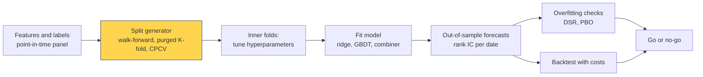
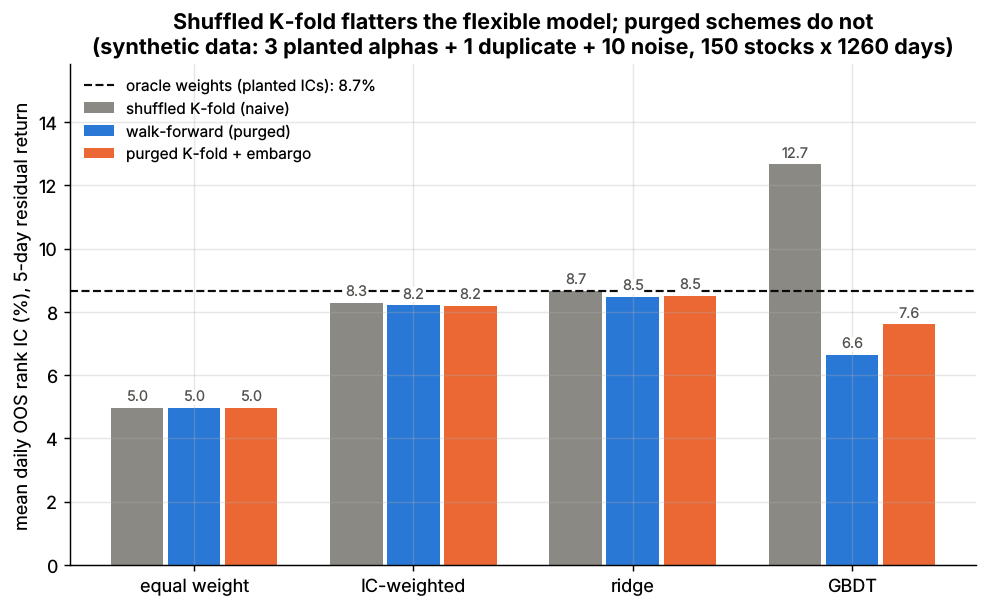

# Time-series cross-validation

> **TL;DR**
>
> - Shuffled K-fold assumes independent rows. Financial labels overlap (a daily-sampled 5-day return shares 4 days with its neighbor) and features persist, so shuffling leaks near-copies of test rows into training.
> - The fixes: walk-forward, **purging** training dates whose labels overlap test labels, and an **embargo** after each test block (López de Prado 2018). Combinatorial purged CV (CPCV) yields many backtest paths instead of one.
> - The leak scales with model flexibility. In Lab 12, GBDT's out-of-sample IC was 0.127 under shuffled K-fold, 0.066 walk-forward and 0.076 purged; ridge leaked 0.002 (synthetic lab result).
> - Tune hyperparameters in inner folds (nested CV). Separating two models whose ICs differ by 0.005 can take about three years of test data (illustrative).

**Level:** Core · **Pipeline stage:** validation · **Last verified:** 2026-11

| Field | Value |
|---|---|
| Purpose (the question it answers) | How well will this model forecast unseen data, and which configuration should we pick, without leaking the future into training? |
| Inputs → Outputs | Date-indexed feature and label panel, label horizon h, a fitting routine → train/test date splits, out-of-sample forecasts, per-fold rank IC, a chosen configuration |
| Used by strategies | [ML-driven short-horizon alpha](../../02-strategies/c-statistical-arbitrage/ml-driven-short-horizon-alpha.md) · [Cross-sectional alpha](../../02-strategies/d-mid-frequency-alpha/cross-sectional-alpha-and-neutralization.md) · [Stat arb overview](../../02-strategies/c-statistical-arbitrage/stat-arb-overview-and-history.md) · [Factor-residual mean reversion](../../02-strategies/c-statistical-arbitrage/factor-residual-mean-reversion.md) · [Short-term reversal](../../02-strategies/c-statistical-arbitrage/short-term-cross-sectional-reversal.md) · [Intraday patterns](../../02-strategies/c-statistical-arbitrage/intraday-patterns-and-seasonality.md) · [Alternative data](../../02-strategies/d-mid-frequency-alpha/alternative-data.md) · [NLP and LLM signals](../../02-strategies/d-mid-frequency-alpha/nlp-and-llm-signals.md) · [Fundamental quant signals](../../02-strategies/d-mid-frequency-alpha/fundamental-quant-signals.md) · [Earnings and event-driven](../../02-strategies/d-mid-frequency-alpha/earnings-and-event-driven.md) · [Pairs trading](../../02-strategies/c-statistical-arbitrage/pairs-trading-and-cointegration.md) |
| Latency / compute regime | Offline batch, one fit per fold: Lab 12's 12 scheme-model pairs take about 30 s; production grids take cluster-hours `[Estimate]` |
| Key parameters | Purge = label horizon h (1–20 days); embargo ≈ 1% of the sample, at least the feature memory; 5–10 folds; test blocks 3–12 months; training window 1–5 years rolling or expanding; CPCV with 6–10 groups and 2 test groups |
| Main failure modes | Shuffled rows; splitting by stock; full-sample preprocessing; tuning on the test fold; too few test dates |
| Lab | [Lab 12](https://github.com/FrankHuang94/quant_trading_claude/tree/main/labs/12-alpha-combination-purged-cv) |

## Intuition

Cross-validation hides part of the sample, fits on the rest and scores the hidden part. It is honest only if the hidden part is truly unseen.

In finance it usually is not. Monday's 5-day label covers Tuesday to the next Monday; Tuesday's covers Wednesday to the next Tuesday. They share four days (correlation about 0.8), and a 60-day momentum feature barely changes overnight. Shuffle rows and the model trains on Monday, is tested on Tuesday, and effectively sees the answer. A flexible model memorizes these near-copies; a dozen linear coefficients cannot.

Auditors test cut-off because transactions near period end leak between periods. [Purging](../../09-reference/glossary.md#purged-cross-validation) is cut-off testing for labels; the [embargo](../../09-reference/glossary.md#embargo) is a margin for slow-moving features.

## Where it sits in the pipeline



One purged K-fold split (Lab 12 defaults, 1,000 dates, 5-day labels, 10-day embargo, test fold 3):


## The algorithm

1. **Split by date, not row:** stocks on one day share the market's move. The label of date t is the return over t+1 … t+h.
2. **Walk-forward** ([walk-forward analysis](../../09-reference/glossary.md#walk-forward-analysis)): each fold trains on dates whose labels end before the test block; expanding or rolling.
3. **Purged K-fold:** contiguous test blocks; drop training dates whose labels overlap a test label, plus an embargo after the block. Keeping dates after the test block assumes stationarity.
4. **CPCV** ([CPCV](../../09-reference/glossary.md#combinatorial-purged-cross-validation-cpcv)): N groups, test on every choice of k, giving (k/N)·C(N, k) complete backtest paths and a distribution of Sharpe ratios.
5. **Nest:** tune hyperparameters with an inner purged split inside each outer training set; score each outer test block once.

```python
import numpy as np
from itertools import combinations
# purged_kfold_splits and walk_forward_splits: Lab 12 core functions (same names and logic).
# Splits are over DATES (all stocks on a date move together). Label of t = return t+1..t+horizon.

def purged_kfold_splits(n_dates, n_folds=5, horizon=5, embargo=10):
    dates = np.arange(n_dates)
    for test in np.array_split(dates, n_folds):           # contiguous test blocks
        first, last = test[0], test[-1]
        # keep a training date only if its label ends before the test block starts,
        # or it starts after the test labels end plus the embargo (serial correlation)
        keep = (dates + horizon <= first) | (dates >= last + horizon + embargo)
        yield dates[keep], test

def walk_forward_splits(n_dates, n_folds=5, horizon=5):
    blocks = np.array_split(np.arange(n_dates), n_folds + 1)
    for test in blocks[1:]:                               # expanding window, past only
        yield np.arange(0, test[0] - horizon + 1), test

def cpcv_splits(n_dates, n_groups=6, k_test=2, horizon=5, embargo=10):
    # NOT in Lab 12: combinatorial purged CV (Lopez de Prado 2018, ch. 12).
    # C(6, 2) = 15 splits; each group is tested 5 times -> 5 complete backtest paths
    dates = np.arange(n_dates)
    groups = np.array_split(dates, n_groups)
    for combo in combinations(range(n_groups), k_test):
        keep = np.ones(n_dates, dtype=bool)
        for g in combo:                                   # purge and embargo around each test group
            keep &= (dates + horizon <= groups[g][0]) | (dates >= groups[g][-1] + horizon + embargo)
        yield dates[keep], np.concatenate([groups[g] for g in combo])

# Nested use: tune on inner purged folds INSIDE each outer training set, score outer test once.
# for tr, te in walk_forward_splits(n_dates, 5, horizon=5):
#     lam = choose_lambda(...)          # inner walk-forward on dates in tr only (F1 card)
#     beta = fit_ridge(X[rows(tr)], y[rows(tr)], lam)
#     oos_ic.append(daily_rank_ic(X[rows(te)] @ beta, y[rows(te)]))
```

## Worked example with numbers

**Purge arithmetic** (Lab 12 defaults, 1,000 dates). Test fold 3 is dates 400–599, whose labels span days 401–604. Date 395's label (days 396–400) ends before day 401, so it stays; date 396's label (397–401) overlaps and is purged. After the block, date 603's label (604–608) overlaps the last test label (600–604); date 604 is the first clean date, and the 10-day embargo moves the restart to 614. Training keeps 396 + 386 = 782 dates: 18 of 800 dropped, 2.25% of the training data.

**Leak size.** Two h-day returns sharing k days have correlation k/h for i.i.d. daily returns: 4/5 = 0.8 for neighbors, 0.2 for dates four apart `[Estimate]`.

**How much test data?** Illustrative. Two models' daily rank ICs differ by a true 0.005, and the daily difference has a standard deviation of 0.03. With 5-day labels, consecutive daily ICs overlap, so roughly n/5 observations are independent. For t = 2 you need n/5 = (2 × 0.03 / 0.005)² = 144, so n ≈ 720 trading days, almost three years of out-of-sample data `[Estimate]`. Small IC gaps between models are usually noise.

## Key parameters and how practitioners tune them

- **Purge length:** the longest label horizon used anywhere in training; purging 5 days with 20-day labels still leaks.
- **Embargo:** covers feature autocorrelation; about 1% of the sample is commonly cited from López de Prado `[Reported]`. Lab 12 uses 10 of 1,255 dates.
- **Expanding vs rolling:** expanding for slow, stable signals; rolling 1–3 years where alphas decay `[Lore]`. Step at the production refit cadence.
- **Folds and block length:** 5–10 folds; test blocks of 3–12 months so each spans more than one market regime `[Lore]`.
- **CPCV size:** N = 6, k = 2 gives 15 fits and 5 paths; N = 10, k = 2 gives 45 fits and 9 paths.

## Textbook version vs what firms actually do

- **When plain K-fold is fine:** [Bergmeir, Hyndman & Koo (2018)](https://doi.org/10.1016/j.csda.2017.11.003) show it is valid for purely autoregressive models with uncorrelated errors `[Verified]`. Overlapping labels break that condition, though Lab 12's ridge shows the leak needs a flexible model to bite.
- **Purging, embargo, CPCV:** from López de Prado's *Advances in Financial Machine Learning* (2018), ch. 7 and ch. 12 `[Verified]`; he argues walk-forward tests a single path and is easy to overfit `[Reported]`.
- **Walk-forward vs CPCV is contested.** Walk-forward never trains on the future, so it best mimics live trading. One synthetic study ([Arian, Norouzi Mobarekeh & Seco 2024](https://doi.org/10.1016/j.knosys.2024.112477)) finds CPCV gives lower probability of backtest overfitting and better deflated Sharpe ratios `[Reported]`.
- **Academic ML in asset pricing:** [Gu, Kelly & Xiu (2020)](https://doi.org/10.1093/rfs/hhaa009) did not cross-validate: training expanded from 18 years, a 12-year validation window rolled forward, models were refit yearly and tested on 1987–2016 `[Verified]`.
- **Nested CV:** tuning and scoring on the same folds is optimistic, shown on null data by [Varma & Simon (2006)](https://doi.org/10.1186/1471-2105-7-91); [Cawley & Talbot (2010)](https://www.jmlr.org/papers/v11/cawley10a.html) call it overfitting the selection criterion `[Verified]`.
- **Practice:** purged schemes for model selection, a final walk-forward over the most recent 1–2 years touched once, then paper trading as the last fold `[Lore]`.

## How to tell if it's working

- **Shuffled vs purged side by side:** a large gap means a leakage-sensitive model. Also check the in-sample gap and fold-to-fold IC dispersion.
- **Null test:** shuffle labels within each date; out-of-sample IC should fall to about zero.
- **Live check:** paper or live results land inside the cross-validated range.



*Lab 12, synthetic data: mean daily out-of-sample rank IC for four combiners under three validation schemes; dashed line, oracle weights using the planted ICs.*

Synthetic lab result (150 stocks × 1,260 days, same 1,045 test dates): shuffled K-fold gave GBDT 0.127 and ranked it first; walk-forward (0.066) and purged K-fold (0.076) ranked it last of the fitted combiners; its in-sample IC was 0.238. Ridge: 0.087 shuffled vs 0.085 walk-forward. Purged K-fold scores GBDT higher than walk-forward because its folds train on about 80% of the sample, not 17–83%. Shuffled CV promised GBDT a gross Sharpe of 12.1; walk-forward delivered 7.0. Both are stylized (clean planted alphas, frictionless market); realistic net Sharpe for ML short-horizon books is about 1–2 at scale `[Lore]` ([ML-driven short-horizon alpha](../../02-strategies/c-statistical-arbitrage/ml-driven-short-horizon-alpha.md)).

## Failure modes and pitfalls

- **Early stopping on a random split** leaks even when the final test is clean ([tree ensembles](../b-forecasting-models/tree-ensembles.md)).
- **Splitting by stock:** the same dates in train and test share market and sector moves.
- **Preprocessing leaks:** full-sample z-scores, a risk model or PCA fit on all dates, feature selection on all data ([look-ahead bias](../../09-reference/glossary.md#look-ahead-bias)).
- **Test-set reuse:** every rerun after peeking is another trial ([overfitting and multiple testing](overfitting-and-multiple-testing.md)).
- **Regime folds:** one fold holding 2008 can dominate the average; report per-fold results.
- **Training on the future:** purged K-fold assumes stationarity and flatters decaying alphas; walk-forward is the safer final test.

## How practitioners talk about it

- "Did you purge? Your labels are 20-day." → Training labels overlap the test period.
- "Shuffled CV says 0.12, walk-forward says 0.07; I believe the 0.07." → The gap is leakage.
- "The early-stopping set was random rows, so the whole thing leaks." → Validation inside training must also respect time.
- "That's one path; show me the CPCV distribution." → One walk-forward Sharpe is a single draw.
- "We burned the 2024 hold-out; it's in-sample now." → A test set looked at repeatedly is no longer out of sample.

## Questions you could ask a quant about this

1. Walk-forward, purged K-fold or CPCV, and why? (basic)
2. Do you split by date, and how long are your test blocks? (basic)
3. How do you set the purge and embargo for your label horizon? (informed)
4. Where do hyperparameters get tuned relative to the test period? (informed)
5. How many times has your final hold-out been looked at? (sharp)
6. How does your cross-validated IC compare with live IC on the same models? 🔒 (sharp)

## Go deeper

<details markdown="1">
<summary>Math: overlap correlation, effective sample size, CPCV paths, cost</summary>

Overlapping labels: for i.i.d. daily returns, two $h$-day returns sharing $k$ days have

$$
\rho = \frac{k}{h}.
$$

A daily-sampled series of $h$-day quantities has a variance inflation factor of about $1 + 2\sum_{j=1}^{h-1}(1 - j/h) = h$, so $n_{\text{eff}} \approx n/h$ (the logic behind Hansen–Hodrick and Newey–West errors with $h-1$ lags).

Data needed to detect an IC gap $\Delta$ with daily difference volatility $\sigma_d$ at t-stat $z$:

$$
n \approx h \left(\frac{z\,\sigma_d}{\Delta}\right)^2 .
$$

CPCV with $N$ groups and $k$ test groups: $\binom{N}{k}$ splits, each training on about $(N-k)/N$ of the data before purging; every group is tested $\binom{N-1}{k-1}$ times, giving

$$
\varphi[N, k] = \frac{k}{N}\binom{N}{k}
$$

complete backtest paths. Cost: one fit per split (45 for $N = 10$, $k = 2$).

</details>

## Related pages

- [Overfitting and multiple testing](overfitting-and-multiple-testing.md) · [Backtest pitfalls](backtest-pitfalls.md) · [Backtesting engines](backtesting-engines.md)
- [Linear models and regularization](../b-forecasting-models/linear-models-and-regularization.md) · [Tree ensembles](../b-forecasting-models/tree-ensembles.md) · [Alpha combination and ensembling](../b-forecasting-models/alpha-combination-and-ensembling.md)
- [ML-driven short-horizon alpha](../../02-strategies/c-statistical-arbitrage/ml-driven-short-horizon-alpha.md)

## Sources

- [Verified] López de Prado, M. (2018). *Advances in Financial Machine Learning*, Wiley (ch. 7, cross-validation in finance; ch. 12, backtesting through cross-validation). <https://www.wiley.com/en-us/Advances+in+Financial+Machine+Learning-p-9781119482086> (accessed 2026-11)
- [Verified] Bergmeir, C., Hyndman, R. J. & Koo, B. (2018). "A note on the validity of cross-validation for evaluating autoregressive time series prediction." *Computational Statistics & Data Analysis* 120, 70–83. <https://doi.org/10.1016/j.csda.2017.11.003> (accessed 2026-11)
- [Verified] Bergmeir, C. & Benítez, J. M. (2012). "On the use of cross-validation for time series predictor evaluation." *Information Sciences* 191, 192–213. <https://doi.org/10.1016/j.ins.2011.12.028> (accessed 2026-11)
- [Reported] Arian, H., Norouzi Mobarekeh, D. & Seco, L. (2024). "Backtest overfitting in the machine learning era: A comparison of out-of-sample testing methods in a synthetic controlled environment." *Knowledge-Based Systems* 305, 112477. <https://doi.org/10.1016/j.knosys.2024.112477> (accessed 2026-11)
- [Verified] Gu, S., Kelly, B. & Xiu, D. (2020). "Empirical Asset Pricing via Machine Learning." *Review of Financial Studies* 33(5), 2223–2273. <https://doi.org/10.1093/rfs/hhaa009> (accessed 2026-11)
- [Verified] Varma, S. & Simon, R. (2006). "Bias in error estimation when using cross-validation for model selection." *BMC Bioinformatics* 7, 91. <https://doi.org/10.1186/1471-2105-7-91> (accessed 2026-11)
- [Verified] Cawley, G. C. & Talbot, N. L. C. (2010). "On Over-fitting in Model Selection and Subsequent Selection Bias in Performance Evaluation." *Journal of Machine Learning Research* 11, 2079–2107. <https://www.jmlr.org/papers/v11/cawley10a.html> (accessed 2026-11)
- [Verified] Hansen, L. P. & Hodrick, R. J. (1980). "Forward Exchange Rates as Optimal Predictors of Future Spot Rates: An Econometric Analysis." *Journal of Political Economy* 88(5), 829–853. <https://doi.org/10.1086/260910> (accessed 2026-11)
