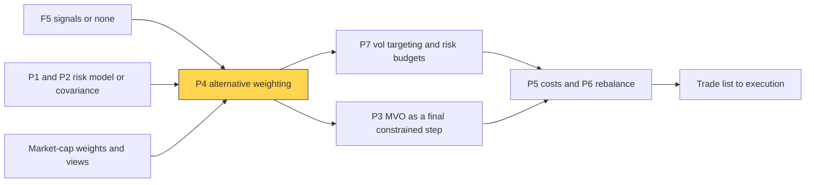

# Alternatives to MVO

> **TL;DR**
>
> - Plain mean-variance optimization (MVO) "maximizes error": it piles into assets with overestimated returns and underestimated risk (Michaud 1989).
> - Risk-based rules drop return forecasts: 1/N, inverse volatility, equal risk contribution (risk parity), minimum variance, hierarchical risk parity (HRP).
> - Other fixes keep MVO but tame its inputs: Black–Litterman starts from market-implied returns, robust optimization penalizes estimation error, constraints act as shrinkage.
> - Factor managers often skip the optimizer: rank- or signal-weighted long-short books, with risk controls bolted on.
> - Choose by how much you trust your return forecasts; the 1/N debate is unresolved.

**Level:** Core · **Pipeline stage:** portfolio · **Last verified:** 2026-11

| Field | Value |
|---|---|
| Purpose (the question it answers) | How should I weight positions when mean-variance inputs are too noisy to trust? |
| Inputs → Outputs | covariance matrix; optionally signals, market weights, views → portfolio weights |
| Used by strategies | [Factor investing](../../02-strategies/e-risk-premia-and-factors/factor-investing-fundamentals.md) · [Value, quality, low vol](../../02-strategies/e-risk-premia-and-factors/value-quality-low-vol.md) · [Momentum](../../02-strategies/e-risk-premia-and-factors/momentum.md) · [Factor timing and crowding](../../02-strategies/e-risk-premia-and-factors/factor-timing-crowding-and-quant-winters.md) · [Trend following](../../02-strategies/g-futures-and-macro-context/trend-following-and-ctas.md) · [Carry and cross-asset premia](../../02-strategies/g-futures-and-macro-context/carry-and-cross-asset-risk-premia.md) · [Cross-sectional alpha](../../02-strategies/d-mid-frequency-alpha/cross-sectional-alpha-and-neutralization.md) |
| Latency / compute regime | monthly or overnight batch; milliseconds for 50-asset risk parity, seconds for HRP on 3,000 names |
| Key parameters | covariance lookback 1–3 years (or EWMA half-life 60–250 days); risk budgets; volatility target ~10% for levered risk parity; Black–Litterman τ 0.01–0.05; rebalance monthly |
| Main failure modes | ignoring returns (bond-heavy, levered books); correlation regime shifts; unstable clusters; overconfident views |
| Lab | — |

## Intuition

MVO weights are proportional to Σ⁻¹μ: a noisy covariance matrix, inverted, times noisy expected returns. The optimizer hunts for the most flattering estimates, so its biggest bets sit where errors are largest. The alternatives trade a precise-looking, fragile answer for a biased, stable one: budgeting by headcount when the ROI forecasts are worthless.

Three routes: drop μ (risk-based rules), shrink inputs toward a prior (Black–Litterman, [covariance shrinkage](covariance-estimation-and-shrinkage.md)), or constrain the answer.

## Where it sits in the pipeline



## The algorithm

1. **1/N**: equal weights. **Inverse volatility**: w ∝ 1/σᵢ (ignores correlations).
2. **Equal risk contribution (ERC)**: choose w so each asset's share of variance, wᵢ(Σw)ᵢ / w′Σw, is equal. With two assets this equals inverse volatility.
3. **Minimum variance**: w ∝ Σ⁻¹1, usually long-only with caps.
4. **HRP**: cluster on correlation distance √(½(1−ρ)), order similar assets together, then split the list in halves recursively, giving the lower-variance half more weight.
5. **Black–Litterman**: back out market-implied returns π = δΣw_mkt, blend with views by confidence, then run MVO.
6. **Rank weights**: wᵢ ∝ rank(signalᵢ) − average rank, scaled to $1 long and $1 short (Asness, Moskowitz and Pedersen).

```python
import numpy as np

def erc_weights(cov, budget=None, n_iter=500, tol=1e-10):
    """Equal risk contribution (risk parity): each asset's share of portfolio
    variance, w_i (cov @ w)_i / w'cov w, equals its budget b_i (1/N by default)."""
    n = len(cov)
    b = np.full(n, 1.0 / n) if budget is None else np.asarray(budget)
    w = 1.0 / np.sqrt(np.diag(cov)); w /= w.sum()        # start at inverse vol
    for _ in range(n_iter):
        sigma = np.sqrt(w @ cov @ w)
        target = b * sigma / (cov @ w)                     # w_i that would give RC_i = b_i
        target /= target.sum()
        if np.abs(target - w).max() < tol:
            break
        w = 0.5 * w + 0.5 * target                         # damped fixed-point step
    return w

def hrp_weights(cov, order):
    """HRP stage 3, recursive bisection (Lopez de Prado 2016). order: indices from
    hierarchical clustering on sqrt(0.5 * (1 - corr)), read off the dendrogram."""
    w = np.ones(len(cov))
    clusters = [list(order)]
    while clusters:
        clusters = [c[s] for c in clusters if len(c) > 1
                    for s in (slice(0, len(c) // 2), slice(len(c) // 2, None))]
        for left, right in zip(clusters[0::2], clusters[1::2]):
            v_l, v_r = cluster_var(cov, left), cluster_var(cov, right)
            alpha = 1.0 - v_l / (v_l + v_r)                 # less risky half gets more
            w[left] *= alpha
            w[right] *= 1.0 - alpha
    return w / w.sum()

def cluster_var(cov, idx):
    """Variance of the inverse-variance portfolio inside one cluster."""
    sub = cov[np.ix_(idx, idx)]
    ivp = 1.0 / np.diag(sub); ivp /= ivp.sum()
    return ivp @ sub @ ivp
```

## Worked example with numbers

*Illustrative.* Equities (vol 15%), bonds (5%), commodities (18%); correlations equity–bond −0.2, equity–commodity 0.3, bond–commodity 0.

Check 1/N by hand: variance = (1/9)(0.0225 + 0.0025 + 0.0324 − 0.0030 + 0.0162) = 0.00784, so vol 8.86%. (Σw)₁ = (0.0225 − 0.0015 + 0.0081)/3 = 0.0097, so equity's risk share = (0.0097/3) ÷ 0.00784 = 41%.

| Method | Weights E / B / C | Vol | Risk shares E / B / C | Leverage for 10% vol |
|---|---|---|---|---|
| 1/N | 33 / 33 / 33% | 8.9% | 41 / 1 / 57% | 1.1× |
| Inverse vol | 21 / 62 / 17% | 5.6% | 34 / 25 / 41% | 1.8× |
| ERC | 20 / 66 / 14% | 5.2% | 33 / 33 / 33% | 1.9× |
| HRP | 7 / 87 / 5% | 4.5% | 3 / 91 / 6% | 2.2× |
| Minimum variance | 13 / 84 / 3% | 4.4% | 13 / 84 / 3% | 2.3× |

Equal dollars are not equal risk: under 1/N, bonds carry 1% of it. Every risk-based answer is bond-heavy, so a 10% volatility target needs about 2× leverage. HRP lands near minimum variance: clustering splits bonds from equities and commodities first, and inverse variance favors bonds.

## Key parameters and how practitioners tune them

- **Covariance window**: 1–3 years daily or an exponentially weighted half-life; shrink it ([P2](covariance-estimation-and-shrinkage.md)).
- **Risk budgets**: unequal budgets (e.g. 50% equity risk) turn ERC into general [risk budgeting](position-sizing-and-risk-budgeting.md).
- **Volatility target and leverage**: risk-parity books are levered to a target, often around 10% `[Lore]`.
- **Black–Litterman**: δ (market risk aversion) ≈ 2–3, τ 0.01–0.05, and view confidence `[Lore]`.
- **Rank vs raw signal**: ranks blunt outliers; Asness et al. found raw signals similar or slightly better `[Verified]`.

## Textbook version vs what firms actually do

- **The critique**: Michaud (1989) called mean-variance optimizers "estimation-error maximizers" `[Reported]`.
- **1/N's case**: across 14 models and 7 datasets, none consistently beat 1/N; beating it would take about 3,000 months of data for 25 assets `[Verified]` ([DeMiguel, Garlappi & Uppal 2009](https://doi.org/10.1093/rfs/hhm075)).
- **The rebuttal**: on 13 datasets, Kritzman, Page and Turkington blame rolling short-sample return estimates, not optimization; sensible inputs beat 1/N `[Reported]`. The evidence is mixed.
- **Constraints as shrinkage**: long-only limits cut risk even when "wrong"; with them, the sample covariance does as well as factor or shrinkage estimators `[Verified]` (Jagannathan & Ma 2003).
- **Minimum variance**: since 1968, long-only minimum variance had about three-quarters of the cap-weighted market's risk with higher average return `[Reported]` (Clarke, de Silva & Thorley 2006).
- **ERC** volatility lies between minimum variance and 1/N `[Verified]` (Maillard, Roncalli & Teïletche 2010).
- **HRP**: in López de Prado's Monte Carlo (10 assets, 10,000 runs), the minimum-variance optimizer had 72% more out-of-sample variance than HRP, inverse variance 38% more `[Verified]`: the author's simulation, not live data.
- **Practice**: factor managers mostly rank- or z-score signals and run a risk-model optimizer with caps; multi-asset and CTA books lean on inverse-volatility and risk parity `[Lore]`.

## How to tell if it's working

- Realized volatility near target; risk shares near budget between rebalances.
- Out-of-sample Sharpe and drawdown versus a 1/N baseline: the honest benchmark.
- Stable weights and HRP clusters month to month.

## Failure modes and pitfalls

- **No return view**: risk parity owns what is least volatile, often long-duration bonds; positive stock–bond correlation (2022) hurts levered books `[Lore]`.
- **Correlations jump in crises**, so diversification fails when needed.
- **HRP's halving**: the original code splits the sorted list in halves, not at dendrogram branches.
- **Black–Litterman views** are only as good as their confidence settings.
- **Rank books carry hidden bets**: without neutralization, value ranks are sector bets.

## How practitioners talk about it

- "Equal weight is the benchmark to beat." → the DeMiguel test.
- "It's risk-balanced, levered to ten vol." → ERC scaled to a volatility target.
- "The optimizer found our estimation errors." → MVO went to extremes.
- "We rank, then neutralize." → rank weights plus a risk-model step.
- "Our prior is the market." → Black–Litterman's starting point.

## Questions you could ask a quant about this

1. Do you trust your expected returns enough to optimize on them?
2. What does 1/N do on your universe over the same period?
3. How much leverage does your risk-parity sleeve need?
4. How stable are your HRP clusters month to month?
5. 🔒 How do you set view confidence in Black–Litterman?

## Go deeper

<details markdown="1">
<summary>Math: risk contributions, Black–Litterman, robust MVO</summary>

Risk contributions sum to portfolio volatility:

$$
\sigma(w) = \sqrt{w^\top\Sigma w}, \qquad RC_i = \frac{w_i(\Sigma w)_i}{\sigma(w)}, \qquad \sum_i RC_i = \sigma(w).
$$

ERC solves $RC_i = \sigma/N$; Maillard et al. show $\sigma_{MV} \le \sigma_{ERC} \le \sigma_{1/N}$. Long-only ERC is unique and solves a convex problem: minimize $\tfrac12 w^\top\Sigma w - c\sum_i \log w_i$, then rescale.

Black–Litterman posterior mean, views $P\mu = Q + \varepsilon$, $\varepsilon \sim N(0,\Omega)$:

$$
\mu_{BL} = \big[(\tau\Sigma)^{-1} + P^\top\Omega^{-1}P\big]^{-1}\big[(\tau\Sigma)^{-1}\pi + P^\top\Omega^{-1}Q\big], \qquad \pi = \delta\Sigma w_{mkt}.
$$

Robust MVO with an ellipsoidal uncertainty set on μ (covariance of the estimate $\Omega_\mu$):

$$
\max_w\; \hat\mu^\top w - \kappa\sqrt{w^\top\Omega_\mu w} - \lambda\, w^\top\Sigma w ,
$$

a second-order cone program (Ceria & Stubbs 2006).

</details>

## Related pages

- [Mean-variance optimization](mean-variance-optimization.md)
- [Covariance estimation and shrinkage](covariance-estimation-and-shrinkage.md)
- [Position sizing and risk budgeting](position-sizing-and-risk-budgeting.md)
- [Factor investing fundamentals](../../02-strategies/e-risk-premia-and-factors/factor-investing-fundamentals.md)
- [Trend following and CTAs](../../02-strategies/g-futures-and-macro-context/trend-following-and-ctas.md)
- [How firms combine strategies](../../02-strategies/h-cross-cutting/how-firms-combine-strategies.md)

## Sources

- [Verified] Michaud, R. O. (1989). "The Markowitz optimization enigma: Is 'optimized' optimal?" *Financial Analysts Journal* 45(1), 31–42. <https://doi.org/10.2469/faj.v45.n1.31> (accessed 2026-11)
- [Verified] DeMiguel, V., Garlappi, L. & Uppal, R. (2009). "Optimal versus naive diversification: How inefficient is the 1/N portfolio strategy?" *Review of Financial Studies* 22(5), 1915–1953. <https://doi.org/10.1093/rfs/hhm075> (accessed 2026-11)
- [Reported] Kritzman, M., Page, S. & Turkington, D. (2010). "In defense of optimization: The fallacy of 1/N." *Financial Analysts Journal* 66(2), 31–39. <https://doi.org/10.2469/faj.v66.n2.6> (accessed 2026-11)
- [Verified] Maillard, S., Roncalli, T. & Teïletche, J. (2010). "The properties of equally weighted risk contribution portfolios." *Journal of Portfolio Management* 36(4), 60–70. <https://doi.org/10.3905/jpm.2010.36.4.060> (accessed 2026-11)
- [Verified] López de Prado, M. (2016). "Building diversified portfolios that outperform out of sample." *Journal of Portfolio Management* 42(4), 59–69. <https://doi.org/10.3905/jpm.2016.42.4.059> (accessed 2026-11)
- [Verified] Black, F. & Litterman, R. (1992). "Global portfolio optimization." *Financial Analysts Journal* 48(5), 28–43. <https://doi.org/10.2469/faj.v48.n5.28> (accessed 2026-11)
- [Verified] Jagannathan, R. & Ma, T. (2003). "Risk reduction in large portfolios: Why imposing the wrong constraints helps." *Journal of Finance* 58(4), 1651–1683. <https://doi.org/10.1111/1540-6261.00580> (accessed 2026-11)
- [Reported] Clarke, R., de Silva, H. & Thorley, S. (2006). "Minimum-variance portfolios in the U.S. equity market." *Journal of Portfolio Management* 33(1), 10–24. <https://doi.org/10.3905/jpm.2006.661366> (accessed 2026-11)
- [Verified] Asness, C. S., Moskowitz, T. J. & Pedersen, L. H. (2013). "Value and momentum everywhere." *Journal of Finance* 68(3), 929–985. <https://doi.org/10.1111/jofi.12021> (accessed 2026-11)
- [Verified] Ceria, S. & Stubbs, R. A. (2006). "Incorporating estimation errors into portfolio selection: Robust portfolio construction." *Journal of Asset Management* 7(2), 109–127. <https://doi.org/10.1057/palgrave.jam.2240207> (accessed 2026-11)
