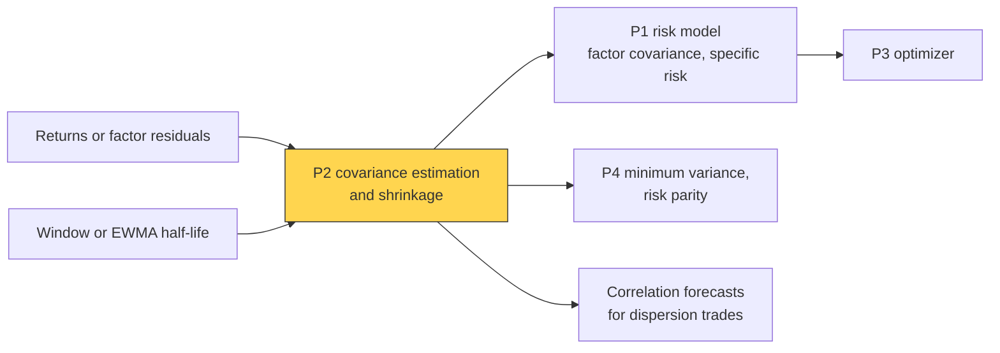
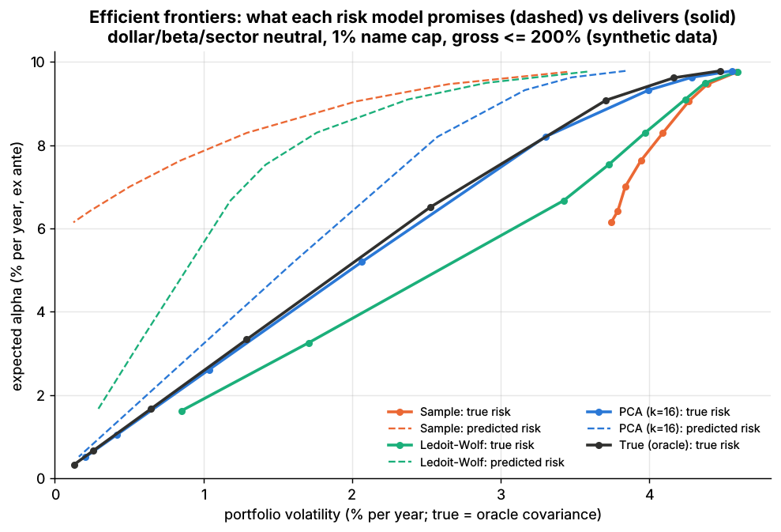

# Covariance estimation and shrinkage

> **TL;DR**
>
> - The sample covariance of N stocks from T days is singular when N > T (Lab 14: 500 stocks, 252 days, rank 251); near N = T its small eigenvalues are too small and large ones too large.
> - Random-matrix theory sizes the noise: pure-noise eigenvalues spread over (1 ± √(N/T))². For S&P 500 stocks, 94% of correlation eigenvalues fit such a band.
> - Fixes: linear shrinkage toward a target (Ledoit–Wolf), factor models, eigenvalue clipping, nonlinear shrinkage.
> - EWMA weighting helps, but its effective sample (about 2.9 half-lives) must stay well above N; volatilities get short half-lives, correlations long ones.

**Level:** Core · **Pipeline stage:** portfolio · **Last verified:** 2026-11

| Field | Value |
|---|---|
| Purpose (the question it answers) | How do I get an invertible covariance that does not mislead an optimizer when assets rival observations? |
| Inputs → Outputs | T×N returns or residuals, weights, shrinkage target → N×N covariance |
| Used by strategies | [Dispersion and correlation](../../02-strategies/f-volatility-and-derivatives/dispersion-and-correlation-trading.md) · [Factor-residual](../../02-strategies/c-statistical-arbitrage/factor-residual-mean-reversion.md) · [Stat arb](../../02-strategies/c-statistical-arbitrage/stat-arb-overview-and-history.md) · [Cross-sectional alpha](../../02-strategies/d-mid-frequency-alpha/cross-sectional-alpha-and-neutralization.md) · [Value, quality, low vol](../../02-strategies/e-risk-premia-and-factors/value-quality-low-vol.md) · [Factor investing](../../02-strategies/e-risk-premia-and-factors/factor-investing-fundamentals.md) · [Trend following](../../02-strategies/g-futures-and-macro-context/trend-following-and-ctas.md) · [Carry and cross-asset premia](../../02-strategies/g-futures-and-macro-context/carry-and-cross-asset-risk-premia.md) |
| Latency / compute regime | overnight batch; an eigendecomposition of a 3,000 × 3,000 matrix takes seconds `[Estimate]` |
| Key parameters | shrinkage intensity δ (data-chosen; 0.08 in Lab 14); half-life 42–252 days (volatility), 200–756 (correlation); RiskMetrics λ = 0.94 |
| Main failure modes | singular matrix; optimizer loading on noise; half-life too short for N; poor target |
| Lab | [Lab 14](https://github.com/FrankHuang94/quant_trading_claude/tree/main/labs/14-risk-model-mvo) |

## Intuition

A covariance matrix is a list of portfolios (eigenvectors) and their variances (eigenvalues). Estimation noise spreads the eigenvalues: some portfolios look far safer than they are. An optimizer is a bargain hunter and buys exactly those.

Shrinkage pulls extreme eigenvalues toward the middle: a deliberately biased, much less noisy estimate, like blending an outlier analyst forecast with consensus. [Ledoit–Wolf shrinkage](../../09-reference/glossary.md#ledoit-wolf-shrinkage) picks the blend from the data; a [factor model](risk-models.md) imposes structure instead.

## Where it sits in the pipeline



## The algorithm

1. **Data**: clean daily returns with aligned closes, or residuals after a factor model.
2. **Weighting**: an equal-weight window or EWMA. Check the effective sample, T_eff = (1 + λ)/(1 − λ) ≈ 2.9 × half-life, against N.
3. **Estimate** the sample covariance S.
4. **Regularize**: linear shrinkage (1 − δ)S + δ·target with δ from Ledoit–Wolf, clipping at the Marchenko–Pastur edge, nonlinear shrinkage, or a [factor model](../../09-reference/glossary.md#factor-model).
5. **Split horizons**: short half-life for volatilities, long for correlations; recombine.
6. **Validate** on optimized portfolios, not random ones.

```python
import numpy as np

def ledoit_wolf_cov(returns):
    """Ledoit-Wolf (2004) shrinkage toward mu * I: the estimator sklearn's LedoitWolf
    computes for Lab 14, written out so each step is visible."""
    X = returns - returns.mean(axis=0)
    T, N = X.shape
    S = X.T @ X / T                                    # sample covariance (MLE scaling)
    mu = np.trace(S) / N                               # target: average variance times I
    d2 = ((S - mu * np.eye(N)) ** 2).sum() / N         # distance of S from the target
    b2 = ((X ** 2).sum(axis=1) ** 2).sum() / T - (S ** 2).sum()
    b2 = min(b2 / (N * T), d2)                         # sampling noise in S
    delta = b2 / d2                                    # shrinkage intensity in [0, 1]
    return (1 - delta) * S + delta * mu * np.eye(N), delta

def ewma_cov(returns, half_life=84):
    """Exponentially weighted covariance, newest row last; effective sample ~2.9 half-lives."""
    lam = 0.5 ** (1 / half_life)
    wts = lam ** np.arange(len(returns))[::-1]
    wts /= wts.sum()
    X = returns - wts @ returns
    return (X * wts[:, None]).T @ X

def clip_eigenvalues(returns):
    """RMT cleaning (Laloux et al. 1999): flatten correlation eigenvalues in the noise band."""
    T, N = returns.shape
    sd = returns.std(axis=0, ddof=1)
    C = np.corrcoef(returns, rowvar=False)
    ev, V = np.linalg.eigh(C)
    noise = ev < (1 + np.sqrt(N / T)) ** 2             # Marchenko-Pastur upper edge
    ev[noise] = ev[noise].mean()                       # keep the trace, drop the noise structure
    C = V @ np.diag(ev) @ V.T
    d = np.sqrt(np.diag(C))
    return C / np.outer(d, d) * np.outer(sd, sd)       # unit diagonal, then back to covariance
```

## Worked example with numbers

*Illustrative.* 500 stocks whose true correlation matrix is the identity (every eigenvalue 1).

- **T = 252 days**: S has rank 251, leaving 249 zero-variance directions: "riskless" long-short books that carry ordinary risk.
- **T = 1,000 days**: N/T = 0.5, so noise eigenvalues spread from (1 − √0.5)² = 0.086 to (1 + √0.5)² = 2.91. The safest-looking portfolio's volatility is understated by 1/√0.086 = 3.4×. In our simulation the minimum-variance portfolio's true volatility was 2.1× its estimate, near the theoretical 1/(1 − N/T) = 2 `[Estimate]`.
- **Shrink** with δ = 0.33 toward the identity: 0.67 × 0.086 + 0.33 = 0.39, and 2.91 becomes 2.28. The eigenvalue range falls from 34:1 to 6:1.
- **EWMA**: RiskMetrics' λ = 0.94 gives an effective sample of 1.94/0.06 ≈ 32 days: fine for five assets, singular for 100 stocks.

## Key parameters and how practitioners tune them

- **Target**: Ledoit and Wolf proposed a single-index target (2003), then constant correlation, "comparable" and simpler `[Verified]`. On pure noise their δ ≈ 1 (the identity is the truth); on stocks with a strong market factor the identity is far off, so Lab 14's δ averaged 0.08 and the fix was partial.
- **Half-lives**: MSCI's US models use 42–252 days for volatilities, 200–756 for correlations `[Verified]`; RiskMetrics used λ = 0.94 daily, 0.97 monthly `[Verified]`.
- **Sample size**: even N/T = 0.1 spreads noise eigenvalues from 0.47 to 1.73.
- **Tuning**: minimize out-of-sample minimum-variance volatility or the optimized-portfolio bias statistic.

## Textbook version vs what firms actually do

- **Against the sample matrix**: on the largest US stocks, 1983–2002, constant-correlation shrinkage raised an active manager's realized information ratio by about 50% `[Verified]` ([Ledoit & Wolf 2004](https://doi.org/10.3905/jpm.2004.110)).
- **Random-matrix evidence**: for 406 S&P 500 stocks over 1,309 days, 94% of eigenvalues fell in the noise band (rescaled for the market mode's share of variance); the informative 6% carried 26% of total volatility `[Verified]` ([Laloux et al. 1999](https://doi.org/10.1103/PhysRevLett.83.1467)).
- **Nonlinear shrinkage** adjusts each eigenvalue separately (Ledoit & Wolf 2012, 2017); the 2020 analytical version is about 1,000× faster and handles 10,000+ assets, including N > T `[Verified]`.
- **In equities the factor model is the main regularizer**; shrinkage goes into its pieces, as in USE4's eigenfactor adjustment and Bayesian specific-risk shrinkage `[Verified]`. Futures books of 50–200 contracts often use shrunk EWMA matrices directly `[Lore]`.
- **Constraints shrink too**: long-only limits act like covariance shrinkage `[Verified]` (Jagannathan & Ma 2003; see [alternatives to MVO](alternatives-to-mvo.md)).

## How to tell if it's working

- **Condition number** (largest ÷ smallest eigenvalue) finite and stable; **out-of-sample minimum-variance volatility** below the sample matrix's; **bias statistic** of optimized portfolios near 1 ([risk models](risk-models.md)).



*Lab 14: dashed = risk each estimator predicts, solid = true risk of the same portfolios (synthetic data).*

Synthetic lab result: at risk aversion 50, true ÷ predicted volatility was 3.17 (sample), 2.25 (Ledoit–Wolf), 1.28 (PCA), 1.00 (oracle); alpha per unit of true risk was 2.03, 2.09, 2.48, 2.58. A poor covariance cost about 20% of the achievable information ratio, with alpha known exactly. Real data shows the same mechanism: on weekly returns of the largest 100 US stocks, a 10-week EWMA half-life gave a minimum-volatility portfolio 550% long, 450% short, turning over 200%+ a week `[Verified]` (Menchero 2017).

## Failure modes and pitfalls

- **Ragged panels**: pairwise-complete estimates can show negative variance; repair to the nearest valid matrix.
- **Asynchronous closes** bias daily correlations toward zero; use multi-day returns or Newey–West.
- **Half-life too short** makes the matrix near-singular; too long makes it stale in a regime shift.
- **Clipping real structure**: share classes of one company (GOOG and GOOGL) have a genuinely tiny spread variance that cleaning erases.

## How practitioners talk about it

- "Five hundred names on a year of data? It's singular." → N > T.
- "Shrink toward constant correlation." → the Ledoit–Wolf 2004 target.
- "Most of those eigenvalues are noise." → They sit inside the Marchenko–Pastur band.
- "What's the effective sample on that half-life?" → About 2.9 half-lives, versus N.
- "The optimizer is long the smallest eigenvector." → It is exploiting estimation error.

## Questions you could ask a quant about this

1. Do you estimate a full covariance or only a factor covariance?
2. What shrinkage target do you use, and how is δ chosen?
3. What is your effective sample size relative to the number of assets?
4. 🔒 Where in production do you use nonlinear shrinkage or RMT cleaning?

## Go deeper

<details markdown="1">
<summary>Math: Ledoit–Wolf intensity, Marchenko–Pastur, EWMA sample size</summary>

Ledoit–Wolf intensity for $\hat\Sigma = (1-\delta)S + \delta\mu I$ (minimizes expected Frobenius loss):

$$
\delta^* = \frac{b^2}{d^2}, \quad d^2 = \tfrac1N\lVert S - \mu I\rVert_F^2, \quad b^2 = \min\Big(d^2,\ \tfrac{1}{NT^2}\sum_{t}\lVert x_t x_t^\top - S\rVert_F^2\Big).
$$

Marchenko–Pastur density for i.i.d. unit-variance data, $q = N/T \le 1$:

$$
\rho(\lambda) = \frac{\sqrt{(\lambda_+ - \lambda)(\lambda - \lambda_-)}}{2\pi q \lambda}, \qquad \lambda_\pm = (1 \pm \sqrt q)^2 .
$$

EWMA weights $w_t \propto \lambda^{T-t}$: effective sample $(\sum w)^2/\sum w^2 = (1+\lambda)/(1-\lambda) \approx 2.885 \times$ half-life.

Pure noise, minimum variance: in-sample variance $\approx (1-q)\times$ the true optimum, out-of-sample $\approx$ optimum$/(1-q)$ `[Estimate]`. Cost: $O(TN^2)$ to form $S$, $O(N^3)$ to diagonalize.

</details>

## Related pages

- [Risk models](risk-models.md) · [Mean-variance optimization](mean-variance-optimization.md) · [Alternatives to MVO](alternatives-to-mvo.md)
- [Dispersion and correlation trading](../../02-strategies/f-volatility-and-derivatives/dispersion-and-correlation-trading.md)
- [Factor-residual mean reversion](../../02-strategies/c-statistical-arbitrage/factor-residual-mean-reversion.md)

## Sources

- [Verified] Ledoit, O. & Wolf, M. (2004). "A well-conditioned estimator for large-dimensional covariance matrices." *Journal of Multivariate Analysis* 88(2), 365–411. <https://doi.org/10.1016/S0047-259X(03)00096-4> (accessed 2026-11)
- [Verified] Ledoit, O. & Wolf, M. (2004). "Honey, I shrunk the sample covariance matrix." *Journal of Portfolio Management* 30(4), 110–119. <https://doi.org/10.3905/jpm.2004.110> (accessed 2026-11)
- [Verified] Ledoit, O. & Wolf, M. (2003). "Improved estimation of the covariance matrix of stock returns with an application to portfolio selection." *Journal of Empirical Finance* 10(5), 603–621. <https://doi.org/10.1016/S0927-5398(03)00007-0> (accessed 2026-11)
- [Verified] Ledoit, O. & Wolf, M. (2012). "Nonlinear shrinkage estimation of large-dimensional covariance matrices." *Annals of Statistics* 40(2), 1024–1060. <https://doi.org/10.1214/12-AOS989> (accessed 2026-11)
- [Verified] Ledoit, O. & Wolf, M. (2017). "Nonlinear Shrinkage of the Covariance Matrix for Portfolio Selection: Markowitz Meets Goldilocks." *Review of Financial Studies* 30(12), 4349–4388. <https://doi.org/10.1093/rfs/hhx052> (accessed 2026-11)
- [Verified] Ledoit, O. & Wolf, M. (2020). "Analytical nonlinear shrinkage of large-dimensional covariance matrices." *Annals of Statistics* 48(5), 3043–3065. <https://doi.org/10.1214/19-AOS1921> (accessed 2026-11)
- [Verified] Laloux, L., Cizeau, P., Bouchaud, J.-P. & Potters, M. (1999). "Noise Dressing of Financial Correlation Matrices." *Physical Review Letters* 83(7), 1467–1470. <https://arxiv.org/abs/cond-mat/9810255> (accessed 2026-11)
- [Reported] Laloux, L., Cizeau, P., Potters, M. & Bouchaud, J.-P. (2000). "Random matrix theory and financial correlations." *International Journal of Theoretical and Applied Finance* 3(3), 391–397. <https://doi.org/10.1142/S0219024900000255> (accessed 2026-11)
- [Verified] Marčenko, V. A. & Pastur, L. A. (1967). "Distribution of eigenvalues for some sets of random matrices." *Mathematics of the USSR-Sbornik* 1(4), 457–483. <https://doi.org/10.1070/SM1967v001n04ABEH001994> (accessed 2026-11)
- [Verified] J.P. Morgan/Reuters (1996). *RiskMetrics Technical Document*, 4th ed. <https://www.msci.com/documents/10199/5915b101-4206-4ba0-aee2-3449d5c7e95a> (accessed 2026-11)
- [Verified] MSCI (2012-07, 2014-12, 2015-03). Barra USE4 and US Total Market model datasheets (hosted by Arcana). <https://help.arcana.io/en/articles/14982987-msci-barra-us-equity-model-use4-methodology-handbook-pdf> (accessed 2026-11)
- [Verified] Menchero, J. (2017-01). "Multi-Asset Factor Covariance Matrices" (Bloomberg MAC2), slides, Boston QWAFAFEW. <https://boston.qwafafew.org/wp-content/uploads/sites/3/2017/01/MAC2-Slide-Deck-Jan-2017-Menchero.pdf> (accessed 2026-11)
- [Verified] Jagannathan, R. & Ma, T. (2003). "Risk reduction in large portfolios: Why imposing the wrong constraints helps." *Journal of Finance* 58(4), 1651–1683. <https://doi.org/10.1111/1540-6261.00580> (accessed 2026-11)
