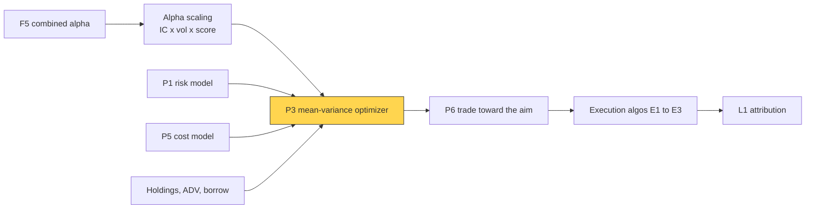
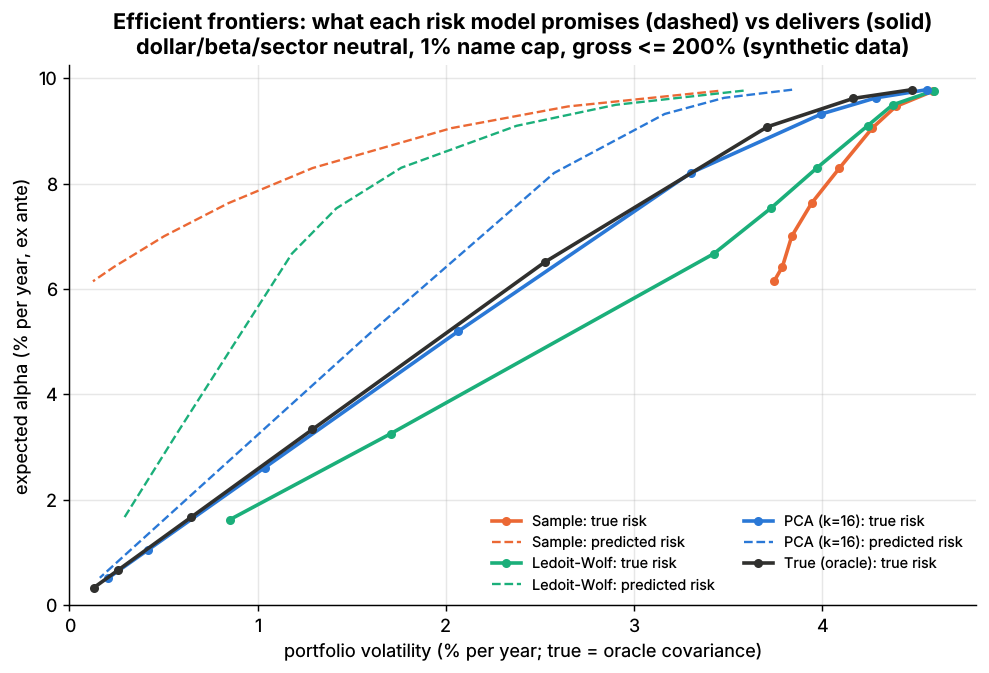
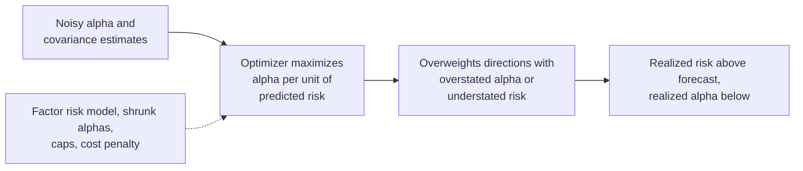

# Mean-variance optimization

> **TL;DR**
>
> - MVO picks weights to maximize α′w − λ·w′Σw − cost(w − w₀) subject to constraints: dollar, beta and sector neutrality, name caps, gross leverage, % of ADV, turnover. The problem is convex, so 3,000 names solve in seconds.
> - Unconstrained, w* = Σ⁻¹α/(2λ): a noisy inverse times noisy forecasts. The optimizer bets hardest where estimates are most wrong, which Michaud called error maximization.
> - Inputs matter more than the solver: scale alphas as IC × volatility × score (Grinold), use a factor risk model, charge realistic costs.
> - Constraints eat forecast: realized performance runs at 0.3–0.8 of the unconstrained Fundamental Law (the transfer coefficient).
> - Risk and cost aversion are tuned by backtest. In Lab 14 a cost aversion of 0.25 kept more net alpha than 0 or 1 (synthetic lab result).

**Level:** Core · **Pipeline stage:** portfolio · **Last verified:** 2026-11

| Field | Value |
|---|---|
| Purpose (the question it answers) | Given forecasts, risk and costs, which portfolio should I hold tomorrow? |
| Inputs → Outputs | alphas, risk model (X, F, Δ), current holdings, cost model, constraints (beta, sectors, ADV, borrow) → target weights and a trade list |
| Used by strategies | [Cross-sectional alpha](../../02-strategies/d-mid-frequency-alpha/cross-sectional-alpha-and-neutralization.md) · [Stat arb](../../02-strategies/c-statistical-arbitrage/stat-arb-overview-and-history.md) · [Factor-residual](../../02-strategies/c-statistical-arbitrage/factor-residual-mean-reversion.md) · [Reversal](../../02-strategies/c-statistical-arbitrage/short-term-cross-sectional-reversal.md) · [ML short-horizon](../../02-strategies/c-statistical-arbitrage/ml-driven-short-horizon-alpha.md) · [Fundamental signals](../../02-strategies/d-mid-frequency-alpha/fundamental-quant-signals.md) · [Revisions](../../02-strategies/d-mid-frequency-alpha/analyst-revisions-and-sentiment.md) · [Alternative data](../../02-strategies/d-mid-frequency-alpha/alternative-data.md) · [Factor investing](../../02-strategies/e-risk-premia-and-factors/factor-investing-fundamentals.md) · [Momentum](../../02-strategies/e-risk-premia-and-factors/momentum.md) · [Value, quality, low vol](../../02-strategies/e-risk-premia-and-factors/value-quality-low-vol.md) · [Factor timing and crowding](../../02-strategies/e-risk-premia-and-factors/factor-timing-crowding-and-quant-winters.md) |
| Latency / compute regime | overnight or intraday batch: seconds per solve for 3,000 names with a factor risk model `[Estimate]`; Lab 14's 500 names solve in under a second |
| Key parameters | risk aversion λ 5–50 (annual decimal units); cost aversion 0.25–3; name cap 0.5–3% of capital; gross 200–600%; trades ≤ 5–10% of ADV |
| Main failure modes | error maximization; alpha–risk misalignment; overtrading; infeasible constraint sets; piling into caps |
| Lab | [Lab 14](https://github.com/FrankHuang94/quant_trading_claude/tree/main/labs/14-risk-model-mvo) |

## Intuition

Think of capital budgeting with correlated projects: fund each by the return it adds per unit of risk it adds *to the whole portfolio*, not of its own risk. [Mean-variance optimization](../../09-reference/glossary.md#mean-variance-optimization-mvo) formalizes this: at the optimum, each position's alpha equals λ times its marginal contribution to variance.

Correlation is where the power and the danger live. Given two highly correlated stocks with different alphas, the optimizer goes long one and short the other: the spread is low-risk, so it can be sized up. If the correlation was overestimated, the hedge is weaker than believed and the book is bigger and riskier than intended. Each input error turns into a confident bet.

## Where it sits in the pipeline



## The algorithm

1. **Scale forecasts** to expected returns over the holding horizon: α_i = IC × σ_i × z_i, with σ_i residual volatility and z_i a [z-score](../../09-reference/glossary.md#z-score).
2. **Match horizons**: α and Σ must cover the same period. Lab 14 uses 21 days for both, which makes λ horizon-free.
3. **Objective**: α′w − λ·w′Σw − Σ cᵢ|wᵢ − w₀ᵢ|, with risk in factor form (w′XFX′w + w′Δw) so the problem stays small.
4. **Constraints**: Σw = 0 (dollar neutral), β′w = 0 ([beta neutral](../../09-reference/glossary.md#beta-neutral)), sector sums zero, |wᵢ| ≤ cap, Σ|wᵢ| ≤ gross, trades within a share of ADV, turnover within budget.
5. **Solve** with a convex solver, then round to shares, drop tiny trades and hand the list to execution.

```python
import numpy as np
import cvxpy as cp   # convex modeling layer, as in Lab 14

def optimize_portfolio(alpha, cov, w_prev=None, risk_aversion=50.0, cost=None, beta=None,
                       sectors=None, max_weight=0.01, max_gross=2.0,
                       max_trade=None, max_turnover=None):
    """maximize alpha'w - risk_aversion * w'Sigma w - sum_i cost_i |w_i - w_prev_i|.
    Weights are fractions of capital; alpha and Sigma cover the same horizon.
    cov is factor form, Sigma = L'L + diag(specific_var) (Lab 14's FactorCov)."""
    n = len(alpha)
    w_prev = np.zeros(n) if w_prev is None else w_prev
    w = cp.Variable(n)
    y = cp.Variable(cov.L.shape[0])                       # factor exposures y = L w
    risk = cp.sum_squares(y) + cp.sum_squares(cp.multiply(np.sqrt(cov.specific_var), w))
    objective = alpha @ w - risk_aversion * risk
    if cost is not None:                                  # half-spread + impact per unit traded
        objective -= cost @ cp.abs(w - w_prev)
    cons = [y == cov.L @ w,
            cp.sum(w) == 0,                               # dollar neutral
            cp.abs(w) <= max_weight,                      # name cap
            cp.norm1(w) <= max_gross]                     # gross leverage
    if beta is not None:
        cons.append(beta @ w == 0)                        # beta neutral
    if sectors is not None:
        cons.append(sectors.T @ w == 0)                   # each sector nets to zero
    if max_trade is not None:                             # not in Lab 14: per-name trade cap,
        cons.append(cp.abs(w - w_prev) <= max_trade)      # e.g. 5% of ADV over capital
    if max_turnover is not None:                          # not in Lab 14: one-way turnover budget
        cons.append(cp.norm1(w - w_prev) / 2 <= max_turnover)
    prob = cp.Problem(cp.Maximize(objective), cons)
    prob.solve()      # Lab 14: SCS with a CLARABEL fallback; desks often license MOSEK or Gurobi
    return np.asarray(w.value).ravel()
```

## Worked example with numbers

*Illustrative.* Two stocks in one industry, each with 20% residual volatility and correlation 0.8. With an [IC](../../09-reference/glossary.md#information-coefficient-ic) of 0.05 and a score of +2, A's alpha is 0.05 × 20% × 2 = **2.0% a year**; B scores 0, so its alpha is 0. Risk aversion λ = 5.

The unconstrained answer is w_A = α_A / (2λσ²(1 − ρ²)) and w_B = −ρ·w_A. With ρ = 0.8: w_A = 0.02 / (2 × 5 × 0.04 × 0.36) = **13.9%** and w_B = −11.1%. The optimizer shorts 0.8 of B per unit of A to hedge the shared industry move, cutting A's 20% risk to the spread's 20% × √0.36 = 12%. Expected alpha is 0.28% with 1.67% volatility.

Now suppose the estimated correlation is too high (truth stays 0.8):

| Estimated ρ | w_A | w_B | Gross | Predicted vol | True vol | True ÷ predicted |
|---|---|---|---|---|---|---|
| 0.80 | 13.9% | −11.1% | 25% | 1.67% | 1.67% | 1.00 |
| 0.90 | 26.3% | −23.7% | 50% | 2.29% | 3.20% | 1.40 |
| 0.95 | 51.3% | −48.7% | 100% | 3.20% | 6.34% | 1.98 |

Gross exposure scales with 1/(1 − ρ̂), so each step doubles the bet. The true information ratio barely moves (0.167, 0.164, 0.162; it is low because this is one pair, not 1,000), but risk runs up to twice the forecast. Lab 14 shows the same signature at scale: bias 2.78 with about 20% of the information ratio lost.

## Key parameters and how practitioners tune them

- **Risk aversion λ**: unconstrained, ex-ante volatility equals IR/(2λ), so λ = IR ÷ (2 × target volatility). An ex-ante IR of 2 at a 5% volatility target gives λ = 20 `[Estimate]`. Desks usually set λ to hit a risk target, then verify realized risk `[Lore]`.
- **Cost aversion κ** multiplies the cost term. A trade's cost should be spread over the position's life, so κ ≈ rebalance interval ÷ holding period, times any overconfidence markup. In Lab 14 that is 10 days ÷ about 29 days (the mean life of a 20-day half-life signal) ≈ 0.35 `[Estimate]`, near the winning 0.25. The 1–3× multiplier on the [cost model card](transaction-cost-and-impact-models.md) is a separate markup for overconfident alphas, applied to correctly amortized costs `[Estimate]`.
- **Caps**: 0.5–3% of capital per name; trades ≤ 5–10% of ADV and positions ≤ a few days of ADV `[Lore]`.
- **Gross**: 200% in Lab 14; market-neutral books often run 400–600% `[Lore]`.
- **Turnover**: a penalty rather than a hard budget, because hard budgets bind arbitrarily `[Lore]`.
- **Tuning**: walk-forward grid over λ and κ, maximizing net Sharpe, with [overfitting](../c-validation-and-backtesting/overfitting-and-multiple-testing.md) controls.

## Textbook version vs what firms actually do

- **Origin**: Markowitz (1952) framed portfolio choice as mean versus variance `[Verified]`.
- **Error maximization**: Michaud (1989) showed optimizers overweight assets with overestimated returns and underestimated risk `[Verified]`. Errors in means did over 10× the damage of errors in variances and over 20× that of errors in covariances (Chopra & Ziemba 1993) `[Reported]`, so alphas need the most shrinkage.
- **Alpha scaling**: Grinold's (1994) rule α = IC × volatility × score turns z-scores into return forecasts `[Verified]`; raw scores give arbitrary position sizes.
- **Transfer coefficient**: Clarke, de Silva and Thorley (2002) generalize the [Fundamental Law](../../09-reference/glossary.md#fundamental-law-of-active-management) to IR ≈ TC × IC × √breadth; realized performance runs at 0.3–0.8 of the unconstrained prediction `[Verified]`. A 50% annual turnover cap alone gives TC 0.73; adding long-only and market-cap neutrality cuts it to 0.3 `[Reported]`.
- **Solvers**: cvxpy is the common open-source modeling layer `[Verified]` (Diamond & Boyd 2016); MOSEK and Gurobi publish portfolio-optimization guides `[Verified]`. Which solver a given fund runs is rarely public `[Lore]`.
- **Constraints as regularizers**: caps and long-only limits act like shrinkage `[Verified]` (Jagannathan & Ma 2003). Robust, resampled and Black–Litterman variants are on [alternatives to MVO](alternatives-to-mvo.md).
- **Cost-aware and multi-period**: Boyd et al. (2017) cast multi-period trading as a sequence of convex problems `[Verified]`; [P6](multi-period-and-trading-toward-aim.md) covers trading partway toward a target.

## How to tell if it's working

- **Optimized-book bias statistic** near 1 ([risk models](risk-models.md)).
- **[Transfer coefficient](../../09-reference/glossary.md#transfer-coefficient)**: correlation between risk-adjusted alphas and risk-adjusted weights; track it as constraints change.
- **Shadow prices**: which constraint costs the most objective per unit relaxed.
- **Realized vs planned** turnover and costs.



*Lab 14: the dashed frontiers are what the optimizer promises with each covariance; solid lines show the true risk of the same portfolios (synthetic data).*

Synthetic lab result: at λ = 50, true risk was 3.17× predicted with the sample covariance and 1.28× with PCA. The biweekly cost test (PCA risk model, two years):

| Cost aversion | Turnover (× capital per year) | Costs (bps/yr) | Expected net alpha (bps/yr) | Realized net Sharpe |
|---|---|---|---|---|
| 0 | 19.4 | 316 | 493 | 2.42 |
| 0.25 | 15.0 | 244 | **549** | 2.63 |
| 1 | 7.4 | 119 | 541 | 2.43 |

The Sharpe ratios are far above real books because the alpha is known exactly and never decays; over two years the standard error is about ±0.7 to ±1.4 (larger once the Sharpe's own size is counted). Diversified market-neutral books are put at net Sharpe 1–2 `[Lore]` ([cross-sectional alpha](../../02-strategies/d-mid-frequency-alpha/cross-sectional-alpha-and-neutralization.md)). The gap between 0.25 and 1 is small; the robust lesson is that ignoring costs overtrades.

## Failure modes and pitfalls

- **Error maximization**: offsetting long-short pairs, positions pinned at caps, weights that flip daily.
- **Alpha–risk misalignment**: alpha the risk model cannot see becomes a hidden factor bet ([risk models](risk-models.md)).
- **Infeasibility**: beta neutrality plus tight caps plus a turnover budget may have no solution; make soft constraints penalties.
- **Horizon mismatch**: a daily Σ with monthly α makes λ meaningless.
- **Crowding**: similar signals, risk models and optimizers produce similar trades (August 2007; [failure gallery](../../02-strategies/h-cross-cutting/strategy-failure-gallery.md)).



## How practitioners talk about it

- "The optimizer is levering up our estimation error." → Error maximization.
- "TC on that book is 0.4." → Constraints let only 40% of the forecast reach positions.
- "We're pinned against the beta constraint." → It binds and has a high shadow price.
- "Scale it to IC times vol before it goes in." → Grinold's alpha scaling.
- "Run cost aversion at a third on a biweekly rebalance." → Costs amortized over the holding period.
- "Half the names sit at the cap." → Caps, not forecasts, are sizing the book.

## Questions you could ask a quant about this

1. Do you set risk aversion to a volatility target or by backtest?
2. How do you make alpha and risk horizons consistent?
3. Which constraint binds most often, and what does it cost in transfer coefficient?
4. How does your cost aversion relate to your signals' half-lives?
5. How often does the problem go infeasible, and what gives way?
6. 🔒 How much do you shrink alphas before the optimizer sees them?

## Go deeper

<details markdown="1">
<summary>Math: the unconstrained solution, risk aversion, transfer coefficient, costs</summary>

Maximizing $\alpha^\top w - \lambda w^\top\Sigma w$ gives

$$
w^* = \frac{1}{2\lambda}\Sigma^{-1}\alpha, \qquad \sigma(w^*) = \frac{\sqrt{\alpha^\top\Sigma^{-1}\alpha}}{2\lambda} = \frac{IR^*}{2\lambda}.
$$

Errors in $\hat\Sigma$ enter through $\hat\Sigma^{-1}$, which amplifies the smallest eigenvalues, where estimation error is largest.

Transfer coefficient (Clarke et al.), with $\sigma_i$ the residual volatilities:

$$
TC = \operatorname{corr}\!\left(\frac{\alpha_i}{\sigma_i},\; w_i\sigma_i\right), \qquad IR \approx TC \cdot IC \cdot \sqrt{BR}.
$$

A linear cost $c_i\lvert w_i - w_{0,i}\rvert$ creates a no-trade band: position $i$ moves only if its marginal utility $\alpha_i - 2\lambda(\Sigma w)_i$ exceeds $c_i$ in absolute value. A 3/2-power impact term stays convex (second-order cone).

Complexity: with factor-form risk the problem has $N + K$ variables and $O(NK)$ nonzeros; interior-point solvers handle $N = 3{,}000$, $K \approx 75$ in seconds `[Estimate]`.

</details>

## Related pages

- [Risk models](risk-models.md) · [Covariance estimation and shrinkage](covariance-estimation-and-shrinkage.md) · [Alternatives to MVO](alternatives-to-mvo.md)
- [Transaction cost and impact models](transaction-cost-and-impact-models.md) · [Multi-period optimization and trading toward the aim](multi-period-and-trading-toward-aim.md)
- [Cross-sectional alpha and neutralization](../../02-strategies/d-mid-frequency-alpha/cross-sectional-alpha-and-neutralization.md) · [How firms combine strategies](../../02-strategies/h-cross-cutting/how-firms-combine-strategies.md)

## Sources

- [Verified] Markowitz, H. (1952). "Portfolio Selection." *Journal of Finance* 7(1), 77–91. <https://doi.org/10.1111/j.1540-6261.1952.tb01525.x> (accessed 2026-11)
- [Verified] Michaud, R. O. (1989). "The Markowitz optimization enigma: is 'optimized' optimal?" *Financial Analysts Journal* 45(1), 31–42. <https://doi.org/10.2469/faj.v45.n1.31> (accessed 2026-11)
- [Reported] Chopra, V. K. & Ziemba, W. T. (1993). "The Effect of Errors in Means, Variances, and Covariances on Optimal Portfolio Choice." *Journal of Portfolio Management* 19(2), 6–11. <https://doi.org/10.3905/jpm.1993.409440> (accessed 2026-11)
- [Verified] Grinold, R. C. (1994). "Alpha is Volatility Times IC Times Score." *Journal of Portfolio Management* 20(4), 9–16. <https://doi.org/10.3905/jpm.1994.409482> (accessed 2026-11)
- [Verified] Clarke, R., de Silva, H. & Thorley, S. (2002). "Portfolio Constraints and the Fundamental Law of Active Management." *Financial Analysts Journal* 58(5), 48–66. <https://doi.org/10.2469/faj.v58.n5.2468> (accessed 2026-11)
- [Reported] Institutional Investor (2002-09-30). "The cost of constraint." <https://www.institutionalinvestor.com/article/b1513547h0wqbx/the-cost-of-constraint> (accessed 2026-11)
- [Verified] Diamond, S. & Boyd, S. (2016). "CVXPY: A Python-Embedded Modeling Language for Convex Optimization." *Journal of Machine Learning Research* 17(83), 1–5. <https://www.jmlr.org/papers/v17/15-408.html> (accessed 2026-11)
- [Verified] Boyd, S., Busseti, E., Diamond, S., Kahn, R. N., Koh, K., Nystrup, P. & Speth, J. (2017). "Multi-Period Trading via Convex Optimization." *Foundations and Trends in Optimization* 3(1), 1–76. <https://doi.org/10.1561/2400000023> (accessed 2026-11)
- [Verified] MOSEK ApS. "MOSEK Portfolio Optimization Cookbook" (release 1.6.0). <https://docs.mosek.com/portfolio-cookbook/index.html> (accessed 2026-11)
- [Verified] Gurobi Optimization. "Mean-Variance Portfolio," Gurobi OptiMods documentation (v3.2.0). <https://gurobi-optimods.readthedocs.io/en/stable/mods/portfolio.html> (accessed 2026-11)
- [Verified] Kolm, P. N., Tütüncü, R. & Fabozzi, F. J. (2014). "60 Years of portfolio optimization: Practical challenges and current trends." *European Journal of Operational Research* 234(2), 356–371. <https://doi.org/10.1016/j.ejor.2013.10.060> (accessed 2026-11)
- [Verified] Jagannathan, R. & Ma, T. (2003). "Risk reduction in large portfolios: Why imposing the wrong constraints helps." *Journal of Finance* 58(4), 1651–1683. <https://doi.org/10.1111/1540-6261.00580> (accessed 2026-11)
