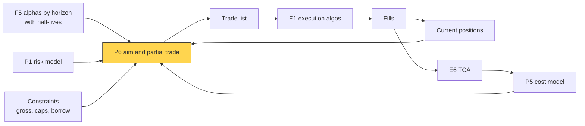
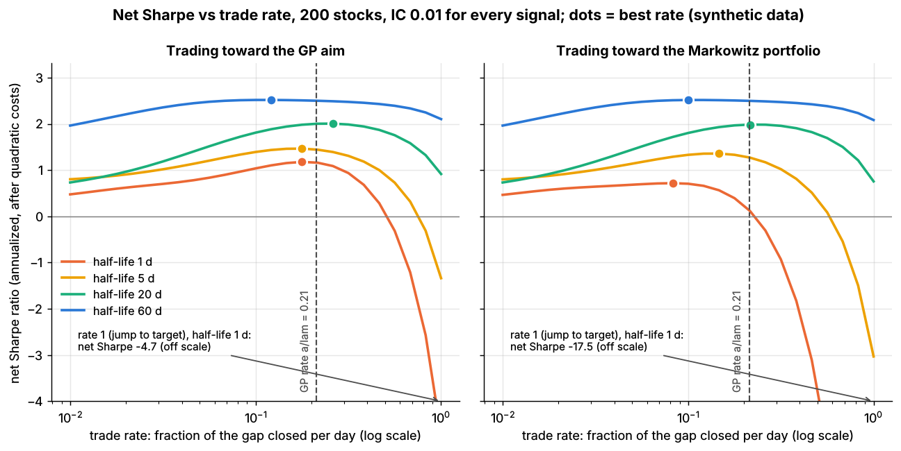
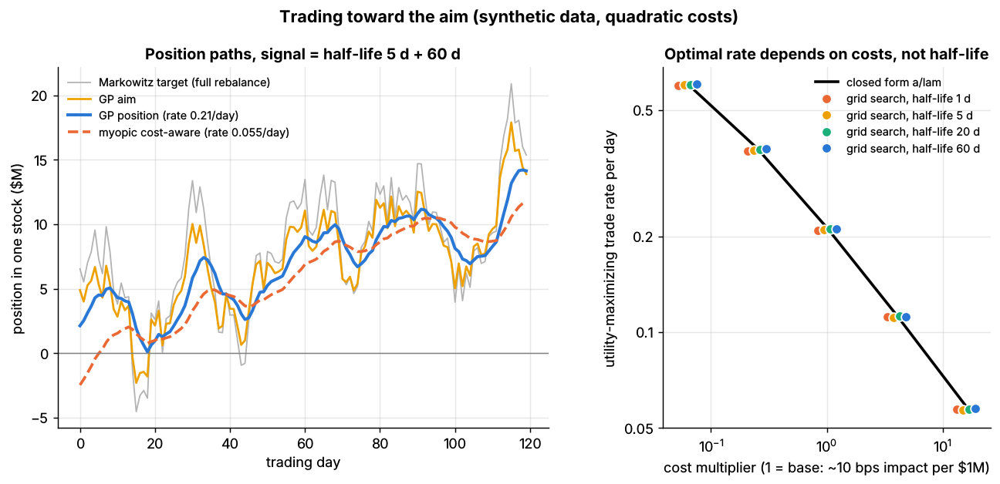

# Multi-period optimization and trading toward the aim

> **TL;DR**
>
> - With costs, rebalancing to today's Markowitz portfolio is a trap. Gârleanu and Pedersen (2013): **aim in front of the target, trade partially toward the aim.**
> - The aim shrinks fast-decaying signals: in Lab 15 a 60-day-half-life signal keeps 96% of its weight, a 1-day signal 35%.
> - The trade rate depends on **costs and risk aversion, not alpha decay**; Lab 15's grid search recovers the closed-form 0.213 within about 2% (synthetic).
> - Full daily rebalancing of a 1-day signal nets a Sharpe of −17.5 (synthetic).
> - Linear costs add no-trade bands and constraints break the closed form, so desks solve multi-period convex problems.

**Level:** Deep dive · **Pipeline stage:** portfolio · **Last verified:** 2026-11

| Field | Value |
|---|---|
| Purpose (the question it answers) | Toward what, and how far, should I trade today when signals decay and costs grow with size? |
| Inputs → Outputs | positions, alpha and decay per signal, risk model, cost model, risk aversion γ, constraints → aim, trade rate, trade list |
| Used by strategies | [Cross-sectional alpha](../../02-strategies/d-mid-frequency-alpha/cross-sectional-alpha-and-neutralization.md) · [Stat arb](../../02-strategies/c-statistical-arbitrage/stat-arb-overview-and-history.md) · [Factor-residual](../../02-strategies/c-statistical-arbitrage/factor-residual-mean-reversion.md) · [ML short-horizon](../../02-strategies/c-statistical-arbitrage/ml-driven-short-horizon-alpha.md) · [Reversal](../../02-strategies/c-statistical-arbitrage/short-term-cross-sectional-reversal.md) · [Momentum](../../02-strategies/e-risk-premia-and-factors/momentum.md) · [Factor investing](../../02-strategies/e-risk-premia-and-factors/factor-investing-fundamentals.md) · [Fundamental signals](../../02-strategies/d-mid-frequency-alpha/fundamental-quant-signals.md) · [Revisions](../../02-strategies/d-mid-frequency-alpha/analyst-revisions-and-sentiment.md) · [Trend following](../../02-strategies/g-futures-and-macro-context/trend-following-and-ctas.md) |
| Latency / compute regime | overnight batch; closed form microseconds per name, constrained multi-period solve seconds to minutes `[Estimate]` |
| Key parameters | trade rate 0.05–0.6 per day (Lab 15: 0.058–0.605 over a 256× cost range); half-lives 1–250 days; γ; cost scale λ; band; horizon 2–20 periods `[Lore]` |
| Main failure modes | full rebalancing; myopic optimizer; overstated persistence; non-quadratic costs; binding constraints |
| Lab | [Lab 15](https://github.com/FrankHuang94/quant_trading_claude/tree/main/labs/15-trading-toward-aim) |

## Intuition

[Mean-variance optimization](../../09-reference/glossary.md#mean-variance-optimization-mvo) says where you would be if trading were free. With costs you cannot get there at once, and the target keeps moving, most for fast signals.

Treat a trade as capital expenditure and alpha as its revenue: a fast signal is a project whose revenue stops before the spend is recovered. [Gârleanu and Pedersen](https://doi.org/10.1111/jofi.12080) (GP) give a closed-form rule for [trading toward the aim](../../09-reference/glossary.md#trading-toward-the-aim). The **aim** averages today's Markowitz portfolio with those expected on future dates, so it leans toward persistent signals. Each day you trade a fixed fraction of the way to it.

## Where it sits in the pipeline



## The algorithm

1. Per signal k: expected return α_k and daily [decay](../../09-reference/glossary.md#alpha-decay) φ_k = 1 − 0.5^(1/half-life), from [IC decay curves](../a-data-and-signals/evaluating-signals.md).
2. Pick γ; fit λ for the cost ½·λ·Δx′ΣΔx.
3. **Rate** a/λ: costs and risk aversion only.
4. **Aim**: each signal's Markowitz portfolio, shrunk by 1/(1 + aφ_k/γ), summed.
5. **Trade**: x_new = x + rate × (aim − x); then bands and caps (not in the lab).

```python
import numpy as np

# Lab 15 core (Garleanu-Pedersen 2013). Positions x in $, factor-hedged book, diagonal Sigma.
# Quadratic trading cost: 1/2 * dx' Lambda dx with Lambda = lam * Sigma.
def gp_trade_rate(gamma, lam, rho=0.0):
    """Fraction of the gap to the aim closed each period: a / lam. No signal decay in here."""
    g = gamma * (1 - rho) + lam * rho
    a = (-g + np.sqrt(g ** 2 + 4 * gamma * lam * (1 - rho) ** 2)) / (2 * (1 - rho))
    return a / lam

def aim_portfolio(signal_alphas, decay_rates, sigma2, gamma, lam, rho=0.0):
    """Each signal's Markowitz portfolio shrunk by 1 / (1 + a * phi_k / gamma).
    phi_k = 1 - 0.5 ** (1 / half_life): fast signals are shrunk the most."""
    a = gp_trade_rate(gamma, lam, rho) * lam
    aim = 0.0
    for alpha_k, phi_k in zip(signal_alphas, decay_rates):
        markowitz_k = alpha_k / (gamma * sigma2)            # (gamma Sigma)^-1 alpha_k
        aim = aim + markowitz_k / (1 + a * phi_k / gamma)
    return aim

def trade_toward_aim(current, aim, rate):
    """rate = 1 is full rebalancing; GP's optimum is gp_trade_rate(gamma, lam)."""
    return current + rate * (aim - current)

# Not in the lab: overlays most desks add because real costs are not purely quadratic.
def todays_positions(current, signal_alphas, half_lives, sigma2, gamma, lam,
                     band_usd=50_000, cap_usd=None):
    phis = [1 - 0.5 ** (1 / h) for h in half_lives]
    aim = aim_portfolio(signal_alphas, phis, sigma2, gamma, lam)
    trade = trade_toward_aim(current, aim, gp_trade_rate(gamma, lam)) - current
    trade[np.abs(trade) < band_usd] = 0.0                   # crude no-trade band (spread, fees)
    if cap_usd is not None:
        trade = np.clip(trade, -cap_usd, cap_usd)           # e.g. a %ADV cap per name
    return current + trade
```

## Worked example with numbers

*Illustrative, Lab 15 parameters.* Specific volatility 1.7% a day, γ = 2×10⁻⁷ and λ = 3.46×10⁻⁶ per \$, so λσ² = 10⁻⁹ (\$1M traded moves the price 10 bps).

1. **Rate.** a = (−γ + √(γ² + 4γλ))/2 = 7.38×10⁻⁷; a/λ = **0.213 per day** (myopic: γ/(γ + λ) = 0.055).
2. **Aim.** a/γ = 3.69. Two signals each imply a \$10M Markowitz position:

| Signal half-life | φ | Shrink 1/(1 + 3.69φ) | Aim contribution |
|---|---|---|---|
| 5 days | 0.129 | 0.677 | \$6.77M |
| 60 days | 0.0115 | 0.959 | \$9.59M |
| **Total** | | | **\$16.36M** (Markowitz: \$20M) |

3. **Trade.** From \$5M: 0.213 × (16.36 − 5) = **\$2.42M**; new position \$7.42M.
4. **Cost.** ½ × 10⁻⁹ × (2.42×10⁶)² = **\$2,930**, 12 bps of the trade.
5. **Full rebalance**: \$15M costs ½ × 10⁻⁹ × (1.5×10⁷)² = **\$112,500**: 6.2× the trade, 38× the cost.

## Key parameters and how practitioners tune them

- **Rate**: derive it; don't hand-tune it. For small γ/λ, a/λ ≈ √(γ/λ): 16× the costs cut Lab 15's rate from 0.213 to 0.058.
- **Half-lives**: from IC decay by horizon. When unsure, understate persistence: overstating it brings back overtrading.
- **λ**: from your impact model ([P5](transaction-cost-and-impact-models.md)); GP's simple form assumes cost proportional to variance, so rescale by liquidity per name.
- **Band**: skip trades whose alpha does not cover half-spread plus fees `[Lore]`.

## Textbook version vs what firms actually do

- **Theory**: closed form for many assets and signals `[Verified]` ([GP 2013](https://doi.org/10.1111/jofi.12080)); continuous time in [GP (2016)](https://doi.org/10.1016/j.jet.2016.06.001) `[Verified]`.
- **Real data**: commodity futures, 5-day, 12-month and 5-year signals (half-lives 3, 205, 701 days): net Sharpe 0.54 for GP, 0.44 for the best static policy, −18 for frictionless rebalancing (low-cost case, in-sample regressions) `[Verified]` ([2009 working paper](https://web-docs.stern.nyu.edu/volatility/docs/Lasse.pdf)).
- **Linear costs** create a no-trade region instead of partial trading `[Verified]` ([Constantinides 1986](https://doi.org/10.1086/261410); [Davis and Norman 1990](https://doi.org/10.1287/moor.15.4.676)).
- **Model-predictive control**: plan trades over a horizon, execute the first, repeat; any convex cost or constraint fits `[Verified]` ([Boyd et al. 2017](https://doi.org/10.1561/2400000023); library cvxportfolio).
- **Common shortcut**: single-period optimization with horizon-blended alphas, amortized costs and turnover limits `[Lore]`. Real impact is nearer 3/2-power in dollars ([P5](transaction-cost-and-impact-models.md)): no closed form.

## How to tell if it's working

- Backtest net utility vs rate peaks near a/λ, on a flat top.
- Costs ÷ gross alpha and [turnover](../../09-reference/glossary.md#turnover) match plan; fast signals net positive in [P&L attribution](../g-live-trading/live-monitoring-and-pnl-attribution.md).



*Lab 15, synthetic: toward the GP aim (left) every half-life peaks near the same rate; toward Markowitz (right) the best rate falls as signals get faster.*

Synthetic lab result (200 stocks, planted IC 0.01, known decay): best rates 0.209–0.212 for every half-life. Toward Markowitz the best rate falls from 0.20 to 0.06 as signals speed up, losing up to 35% of utility. Full rebalancing turns the 1-day signal's gross 2.30 into net **−17.5**, like GP's −18 on commodities. For a 5 + 60-day mix: GP 2.93, myopic 2.74, full rebalancing −0.71 (costs \$67.4M a year vs \$2.9M). Live signals are far noisier: diversified books run net 1–2 `[Lore]`.



*Lab 15, synthetic: the GP position smooths a jumpy target (left); best rates follow the closed form (right).*

## Failure modes and pitfalls

- **Myopia**: a one-period optimizer charges the whole cost against one day of alpha, trading 4× too slowly (0.055 vs 0.213).
- **Markowitz as target**: the best rate shifts with the signal mix.
- **Misestimated decay** gives the wrong aim.
- **Constraints, crowding, transient impact**: none are in the closed form.

## How practitioners talk about it

- "We close about a fifth of the gap each day." → trade rate ≈ 0.2.
- "Reversal rides on the slow book." → the shrunk fast signal mostly tweaks trades made anyway.
- "Don't chase the target." → never rebalance fully to Markowitz.
- "We amortize costs over the holding period." → single-period proxy for multi-period.
- "It's inside the band, leave it." → no-trade region from linear costs.

## Questions you could ask a quant about this

1. Do you rebalance fully, partially, or within bands?
2. Is the trade rate derived or tuned?
3. Do fast signals get less target weight than slow ones of equal IC?
4. How stable are your half-life estimates?
5. Multi-period solve, or single-period with amortized costs?
6. 🔒 What share of gross alpha goes to costs?

## Go deeper

<details markdown="1">
<summary>Math: the GP solution, the myopic rate and no-trade bands</summary>

With $r_{t+1} = B f_t + u_{t+1}$ and $\Delta f_{t+1} = -\Phi f_t + \varepsilon_{t+1}$, maximize

$$
\mathbb{E}\sum_t \Big[x_t^\top B f_t - \tfrac{\gamma}{2} x_t^\top \Sigma x_t - \tfrac12 \Delta x_t^\top \Lambda \Delta x_t\Big], \qquad \Lambda = \lambda\Sigma .
$$

With $\rho = 0$ (see the paper for discounting):

$$
x_t = \Big(1 - \frac{a}{\lambda}\Big) x_{t-1} + \frac{a}{\lambda}\,\text{aim}_t, \qquad a = \frac{-\gamma + \sqrt{\gamma^2 + 4\gamma\lambda}}{2},
$$

$$
\text{aim}_t = (\gamma\Sigma)^{-1} \sum_k \frac{B_k f_t^k}{1 + \phi_k a/\gamma} .
$$

For $\gamma \ll \lambda$, $a/\lambda \approx \sqrt{\gamma/\lambda}$. One period alone gives a rate of $\gamma/(\gamma+\lambda)$. A linear cost $\kappa|\Delta x|$ adds a no-trade region where the marginal gain is below $\kappa$.

</details>

## Related pages

- [Mean-variance optimization](mean-variance-optimization.md)
- [Transaction cost and impact models](transaction-cost-and-impact-models.md)
- [Alternatives to MVO](alternatives-to-mvo.md)
- [Evaluating signals](../a-data-and-signals/evaluating-signals.md)
- [Execution algorithms: overview](../e-execution-algorithms/execution-algorithms-overview.md)
- [Cross-sectional alpha and neutralization](../../02-strategies/d-mid-frequency-alpha/cross-sectional-alpha-and-neutralization.md)
- [Walkthrough: a mid-frequency stat-arb book](../h-end-to-end-walkthroughs/walkthrough-mid-frequency-stat-arb.md)

## Sources

- [Verified] Gârleanu, N. & Pedersen, L. H. (2013). "Dynamic trading with predictable returns and transaction costs." *Journal of Finance* 68(6), 2309–2340. <https://doi.org/10.1111/jofi.12080> (accessed 2026-11)
- [Verified] Gârleanu, N. & Pedersen, L. H. (2009). "Dynamic trading with predictable returns and transaction costs." Working paper, version of 2009-03-27 (commodity futures results, Table 1). <https://web-docs.stern.nyu.edu/volatility/docs/Lasse.pdf> (accessed 2026-11)
- [Verified] Gârleanu, N. & Pedersen, L. H. (2016). "Dynamic portfolio choice with frictions." *Journal of Economic Theory* 165, 487–516. <https://doi.org/10.1016/j.jet.2016.06.001> (accessed 2026-11)
- [Verified] Boyd, S., Busseti, E., Diamond, S., Kahn, R. N., Koh, K., Nystrup, P. & Speth, J. (2017). "Multi-period trading via convex optimization." *Foundations and Trends in Optimization* 3(1), 1–76. <https://doi.org/10.1561/2400000023> (accessed 2026-11)
- [Verified] Constantinides, G. M. (1986). "Capital market equilibrium with transaction costs." *Journal of Political Economy* 94(4), 842–862. <https://doi.org/10.1086/261410> (accessed 2026-11)
- [Verified] Davis, M. H. A. & Norman, A. R. (1990). "Portfolio selection with transaction costs." *Mathematics of Operations Research* 15(4), 676–713. <https://doi.org/10.1287/moor.15.4.676> (accessed 2026-11)
