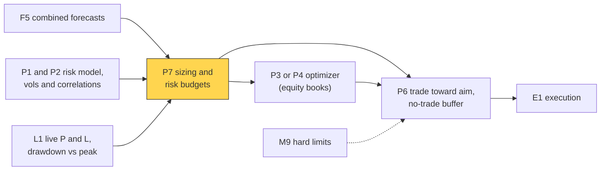
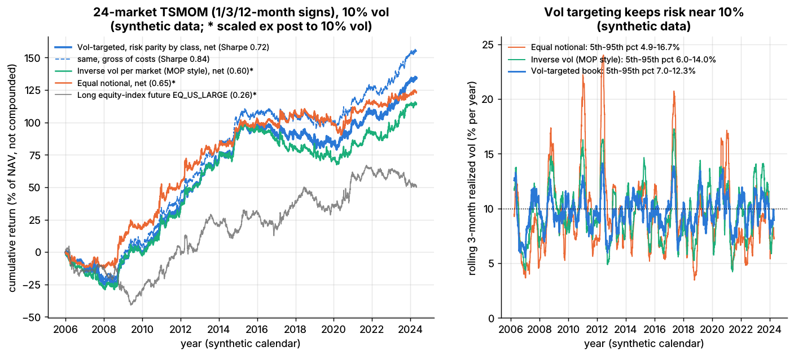

# Position sizing and risk budgeting

> **TL;DR**
>
> - Sizing turns a forecast into a position; it decides drawdowns and survival more than Sharpe.
> - [Volatility targeting](../../09-reference/glossary.md#volatility-targeting) scales each bet by 1/σ so it carries a set risk; risk budgeting splits the total across markets, strategies or pods.
> - The [Kelly criterion](../../09-reference/glossary.md#kelly-criterion) maximizes growth at leverage μ/σ², given the true Sharpe. At twice true Kelly growth is zero, so practitioners run a quarter to half Kelly or less.
> - Stop-losses help when returns trend and cost money under a random walk (Kaminski & Lo 2014) `[Verified]`.
> - Synthetic lab result (Lab 19): vol targeting held rolling volatility at 7.0–12.3% (5th–95th percentile) against 4.9–16.7% for equal notional.

**Level:** Core · **Pipeline stage:** portfolio · **Last verified:** 2026-11

| Field | Value |
|---|---|
| Purpose (the question it answers) | How big should each position, strategy and the book be? |
| Inputs → Outputs | Signals, ex-ante volatilities and correlations, risk budgets, drawdown, leverage limits → target notional per position (fraction of NAV) |
| Used by strategies | [Trend following](../../02-strategies/g-futures-and-macro-context/trend-following-and-ctas.md) · [Carry and cross-asset premia](../../02-strategies/g-futures-and-macro-context/carry-and-cross-asset-risk-premia.md) · [Factor investing](../../02-strategies/e-risk-premia-and-factors/factor-investing-fundamentals.md) · [Factor timing and crowding](../../02-strategies/e-risk-premia-and-factors/factor-timing-crowding-and-quant-winters.md) · [Momentum](../../02-strategies/e-risk-premia-and-factors/momentum.md) · [Value, quality, low vol](../../02-strategies/e-risk-premia-and-factors/value-quality-low-vol.md) · [Volatility risk premium](../../02-strategies/f-volatility-and-derivatives/volatility-risk-premium-and-vol-arb.md) · [Cross-sectional alpha](../../02-strategies/d-mid-frequency-alpha/cross-sectional-alpha-and-neutralization.md) · [Stat arb overview](../../02-strategies/c-statistical-arbitrage/stat-arb-overview-and-history.md) |
| Latency / compute regime | Daily batch: milliseconds for 50 futures, seconds for 3,000 stocks; intraday limits live in [M9](../f-market-making-and-hft-algorithms/algorithmic-risk-controls.md) |
| Key parameters | Volatility target 8–15%, 10% common `[Lore]`; EWMA center of mass 20–60 days; Kelly fraction 0.25–0.5; drawdown triggers 5–10%; gross cap 3–6× NAV (futures); buffer 10–30% of a typical position |
| Main failure modes | Lagging volatility estimates, correlation spikes, Kelly on an overstated Sharpe, procyclical selling |
| Lab | [Lab 19](https://github.com/FrankHuang94/quant_trading_claude/tree/main/labs/19-trend-following-vol-targeting) |

## Intuition

Budget by risk, not revenue: a 2%-volatility bond future and a 40%-volatility gas future get the same risk, so the bond gets 20× the notional. The forecast says which way; sizing says how much, and how much less after a bad month. Over-sizing a good forecast ruins a fund as surely as a bad one.

## Where it sits in the pipeline



## The algorithm

1. Estimate each position's ex-ante volatility (EWMA, 60-day center of mass) and the correlation matrix ([P1](risk-models.md), [P2](covariance-estimation-and-shrinkage.md)).
2. Assign risk budgets: equal per asset class or strategy ([risk parity](../../09-reference/glossary.md#risk-parity), [P4](alternatives-to-mvo.md)), or tilted by conviction.
3. Size inversely to volatility: weight = signal × budget / σ.
4. Scale the book so its ex-ante volatility equals the target.
5. Apply caps: per position, gross leverage, margin.
6. Multiply by a drawdown scaler.
7. Trade only when the target leaves a no-trade band ([P6](multi-period-and-trading-toward-aim.md)).

```python
import numpy as np

def vol_target_positions(signal, ann_vol, corr, asset_class, target_vol=0.10, asset_cap=0.40):
    """As in Lab 19: notional / NAV per market. Equal risk per class, inverse vol inside it."""
    classes, counts = np.unique(asset_class, return_counts=True)
    n_in_class = dict(zip(classes, counts))
    budget = np.array([1.0 / (len(classes) * n_in_class[c]) for c in asset_class])
    w = signal * budget / ann_vol
    port_vol = np.sqrt(w @ (corr * np.outer(ann_vol, ann_vol)) @ w)
    if port_vol > 0:
        w = w * target_vol / port_vol                 # whole book at the target ex-ante vol
    cap = asset_cap * target_vol / ann_vol            # max standalone vol per market
    return np.clip(w, -cap, cap)

def trade_with_buffer(target, current, band):
    """As in Lab 19: move only when the target leaves the band, and only to its edge."""
    gap = target - current
    return np.where(np.abs(gap) > band, target - np.sign(gap) * band, current)

# --- Illustrative extensions, not in Lab 19 ---
def kelly_leverage(mu, sigma, fraction=0.5):
    """Growth-optimal leverage mu / sigma^2 (continuous time), scaled down."""
    return fraction * mu / sigma ** 2

def drawdown_scaler(nav, cut_dd=0.05, stop_dd=0.10, min_scale=0.5):
    """1.0 until a 5% drawdown, linear to 0.5 at 10%, then flat (stop and review)."""
    dd = 1.0 - nav[-1] / np.max(nav)
    if dd >= stop_dd:
        return 0.0
    if dd <= cut_dd:
        return 1.0
    return 1.0 - (1.0 - min_scale) * (dd - cut_dd) / (stop_dd - cut_dd)

def size_book(signal, ann_vol, corr, asset_class, nav, current, typical, max_gross=6.0):
    target = vol_target_positions(signal, ann_vol, corr, asset_class) * drawdown_scaler(nav)
    gross = np.abs(target).sum()
    if gross > max_gross:                             # leverage limit, notional / NAV
        target = target * max_gross / gross
    return trade_with_buffer(target, current, 0.25 * typical)
```

## Worked example with numbers

*Illustrative.* Excess return μ = 7%, volatility σ = 10% at 1× (Sharpe 0.7). Kelly leverage is μ/σ² = 0.07 / 0.01 = 7×. Log growth at leverage f is fμ − f²σ²/2; the chance of ever losing half is 0.5^(2/c − 1) at Kelly fraction c.

| Leverage | Kelly fraction | Volatility | Growth: fμ − f²σ²/2 | P(ever −50%) |
|---|---|---|---|---|
| 1× | 1/7 | 10% | 0.07 − 0.005 = 6.5% | 0.01% |
| 1.75× | 1/4 | 17.5% | 0.1225 − 0.0153 = 10.7% | 0.8% |
| 3.5× | 1/2 | 35% | 0.245 − 0.0613 = 18.4% | 12.5% |
| 7× | 1 | 70% | 0.49 − 0.245 = 24.5% | 50% |
| 14× | 2 | 140% | 0.98 − 0.98 = 0% | 100% |

Half Kelly keeps 75% of the growth at half the volatility. If the true Sharpe is 0.35 (a routine haircut), "full Kelly" 7× is twice true Kelly: zero growth, certain halving. A 10% target here is 1/7 Kelly.

**Volatility rescale.** Ex-ante volatility jumps from 10% to 14%: scale 10/14 = 0.71, gross leverage 3.8× → 2.7× NAV.

**Drawdown cut.** NAV 93 against a peak of 100: scale = 1 − 0.5 × (7 − 5)/(10 − 5) = 0.8.

## Key parameters and how practitioners tune them

- **Target volatility.** 10% in Hurst et al.'s trend simulations `[Verified]`; pods often run lower `[Lore]`.
- **Estimator.** Moskowitz et al. use a 60-day center of mass `[Verified]`; shorter windows churn; floors cap notional in quiet markets `[Lore]`.
- **Kelly fraction.** A quarter to a half `[Lore]`, less for backtest-only Sharpes.
- **Across strategies or pods.** Start near equal risk, tilt toward capacity-adjusted Sharpe, and cut on drawdowns: one multi-manager reportedly halves capital at a 5% loss and exits near 7.5% `[Reported]` ([how firms combine strategies](../../02-strategies/h-cross-cutting/how-firms-combine-strategies.md)).

## Textbook version vs what firms actually do

- **Kelly.** Kelly (1956) derived the growth-optimal bet `[Verified]`; Thorp used fractional Kelly in practice `[Reported]`; full Kelly's short-run drawdowns are large (MacLean, Thorp & Ziemba) `[Reported]`.
- **Volatility timing.** Volatility-managed factors earn large alphas (Moreira & Muir 2017) `[Verified]`, but across 103 equity strategies real-time versions do not systematically win (Cederburg et al. 2020) `[Verified]`. Across 60+ assets since 1926, Sharpe rises for equities and credit only, and left tails shrink (Harvey et al. 2018) `[Verified]`. Risk-managed momentum nearly doubles its Sharpe (Barroso & Santa-Clara 2015) `[Verified]`. Mixed for returns; consistent for risk control.
- **Stop-losses** lower expected return under a random walk and can add value under momentum (Kaminski & Lo 2014) `[Verified]`.
- **Drawdown control.** Risk proportional to the cushion above a floor is optimal (Grossman & Zhou 1993) `[Verified]`; pod ladders are discrete versions.

## How to tell if it's working

- Realized/target volatility near 1 in a narrow band; realized risk shares near budgets; little turnover from rescaling.



*Right panel: rolling volatility of the vol-targeted book hugs the dotted 10% target; equal notional swings far more. Synthetic data.*

Synthetic lab results: realized volatility 9.8% against 10%; risk shares equity 36%, rates 25%, commodities 20%, FX 19% (equities exceed 25%: the budget ignores within-class correlation), against 92% for commodities plus equities under equal notional; the buffer cuts turnover from 252× to 141× NAV. Real volatility jumps, so real bands are wider.

## Failure modes and pitfalls

- **Calm before the storm.** Low trailing volatility means maximum leverage before a shock `[Lore]`.
- **Correlation breaks.** Stocks and bonds fell together in 2022 `[Lore]`.
- **Procyclical selling.** Vol-targeters de-gross into the same spike `[Lore]`; the BIS says procyclical deleveraging amplified the August 2024 sell-off `[Verified]`.
- **Low-volatility instruments** get huge notional and gap risk.

## How practitioners talk about it

- "We run ten vol." → Annualized volatility target 10%.
- "Half Kelly at most." → Leverage at half the growth-optimal level.
- "Risk-budget the sleeves equally." → Equal risk per strategy.
- "Vol spiked, so we de-grossed." → Rescaled to the target.
- "She's at her soft stop." → Drawdown threshold that cuts capital.
- "The buffer halves our turnover." → No-trade band.

## Questions you could ask a quant about this

1. **Basic:** What volatility target do you run?
2. **Basic:** Standalone volatility or risk contribution?
3. **Informed:** Do you floor your volatility estimate?
4. **Informed:** What Kelly fraction does your leverage imply?
5. **Sharp:** How did your de-grossing rules behave in August 2024? 🔒
6. **Sharp:** When do you re-risk after a drawdown cut? 🔒

## Go deeper

<details markdown="1">
<summary>Math: Kelly growth, ruin probability, risk contributions</summary>

With leverage $f$, excess drift $\mu$ and volatility $\sigma$, log wealth drifts at $g(f) = f\mu - \tfrac{1}{2}f^2\sigma^2$, maximized at $f^* = \mu/\sigma^2$ with $g^* = \tfrac{1}{2}(\mu/\sigma)^2 = \tfrac{1}{2}SR^2$. At $f = c f^*$:

$$
g(cf^*) = (2c - c^2)\, g^*, \qquad P(\text{wealth ever falls to } x) = x^{2/c - 1}.
$$

Log wealth is Brownian with drift $m$ and variance $v$, hitting $\ln x < 0$ with probability $e^{2m\ln x / v}$, and $2m/v = 2/c - 1$.

Euler risk contributions for weights $w$ and covariance $\Sigma$:

$$
RC_i = \frac{w_i (\Sigma w)_i}{\sqrt{w^\top \Sigma w}}, \qquad \sum_i RC_i = \sqrt{w^\top \Sigma w}.
$$

Scaling to target $\sigma^*$ uses $k = \sigma^* / \sqrt{w^\top \Sigma w}$, $O(N^2)$ per day.

</details>

## Related pages

- [How firms combine strategies](../../02-strategies/h-cross-cutting/how-firms-combine-strategies.md) (multi-strategy allocation)
- [Alternatives to MVO](alternatives-to-mvo.md)
- [Risk models](risk-models.md)
- [Trend following and CTAs](../../02-strategies/g-futures-and-macro-context/trend-following-and-ctas.md)
- [Algorithmic risk controls](../f-market-making-and-hft-algorithms/algorithmic-risk-controls.md)
- [Risk management at quant firms](../../06-risk-and-regulation/risk-management-at-quant-firms.md)

## Sources

- [Verified] Kelly, J. L. (1956). "A New Interpretation of Information Rate." *Bell System Technical Journal* 35(4), 917–926. <https://doi.org/10.1002/j.1538-7305.1956.tb03809.x> (accessed 2026-11)
- [Reported] Thorp, E. O. (2008). "The Kelly Criterion in Blackjack, Sports Betting, and the Stock Market." In *Handbook of Asset and Liability Management*, Vol. 1, 385–428. <https://doi.org/10.1016/B978-044453248-0.50015-0> (accessed 2026-11)
- [Reported] MacLean, L. C., Thorp, E. O. & Ziemba, W. T. (2011). "Good and Bad Properties of the Kelly Criterion." In *The Kelly Capital Growth Investment Criterion*, World Scientific, 563–572. <https://doi.org/10.1142/9789814293501_0039> (accessed 2026-11)
- [Verified] Moreira, A. & Muir, T. (2017). "Volatility-Managed Portfolios." *The Journal of Finance* 72(4), 1611–1644. <https://doi.org/10.1111/jofi.12513> (accessed 2026-11)
- [Verified] Cederburg, S., O'Doherty, M. S., Wang, F. & Yan, X. (2020). "On the performance of volatility-managed portfolios." *Journal of Financial Economics* 138(1), 95–117. <https://doi.org/10.1016/j.jfineco.2020.04.015> (accessed 2026-11)
- [Verified] Harvey, C. R., Hoyle, E., Korgaonkar, R., Rattray, S., Sargaison, M. & Van Hemert, O. (2018). "The Impact of Volatility Targeting." *The Journal of Portfolio Management* 45(1), 14–33. <https://doi.org/10.3905/jpm.2018.45.1.014> (accessed 2026-11)
- [Verified] Barroso, P. & Santa-Clara, P. (2015). "Momentum has its moments." *Journal of Financial Economics* 116(1), 111–120. <https://doi.org/10.1016/j.jfineco.2014.11.010> (accessed 2026-11)
- [Verified] Kaminski, K. M. & Lo, A. W. (2014). "When do stop-loss rules stop losses?" *Journal of Financial Markets* 18, 234–254. <https://doi.org/10.1016/j.finmar.2013.07.001> (accessed 2026-11)
- [Verified] Grossman, S. J. & Zhou, Z. (1993). "Optimal Investment Strategies for Controlling Drawdowns." *Mathematical Finance* 3(3), 241–276. <https://doi.org/10.1111/j.1467-9965.1993.tb00044.x> (accessed 2026-11)
- [Verified] Moskowitz, T. J., Ooi, Y. H. & Pedersen, L. H. (2012). "Time series momentum." *Journal of Financial Economics* 104(2), 228–250. <https://doi.org/10.1016/j.jfineco.2011.11.003> (accessed 2026-11)
- [Verified] Hurst, B., Ooi, Y. H. & Pedersen, L. H. (2017). "A Century of Evidence on Trend-Following Investing." *The Journal of Portfolio Management* 44(1), 15–29. <https://doi.org/10.3905/jpm.2017.44.1.015> (accessed 2026-11)
- [Verified] Aquilina, M., Lombardi, M. J., Schrimpf, A. & Sushko, V. (2024-08-27). "The market turbulence and carry trade unwind of August 2024." *BIS Bulletin* 90. <https://www.bis.org/publ/bisbull90.htm> (accessed 2026-11)
- [Reported] Business Insider via AOL (2024-10-02). "The strategy a \$69 billion hedge fund uses to make sure it never loses money in the stock market" (citing the Wall Street Journal). <https://www.aol.com/strategy-69-billion-hedge-fund-193733084.html> (accessed 2026-11)
