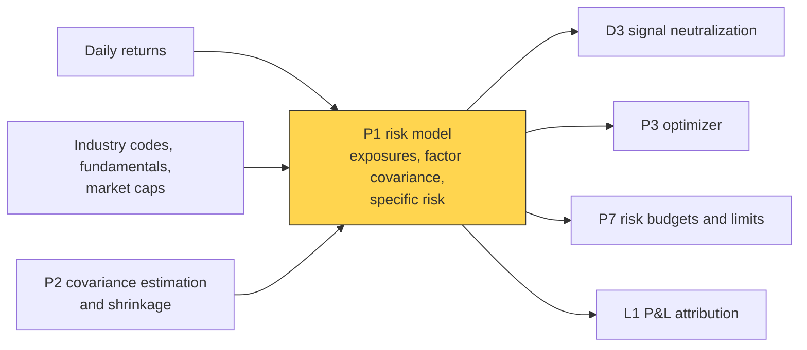
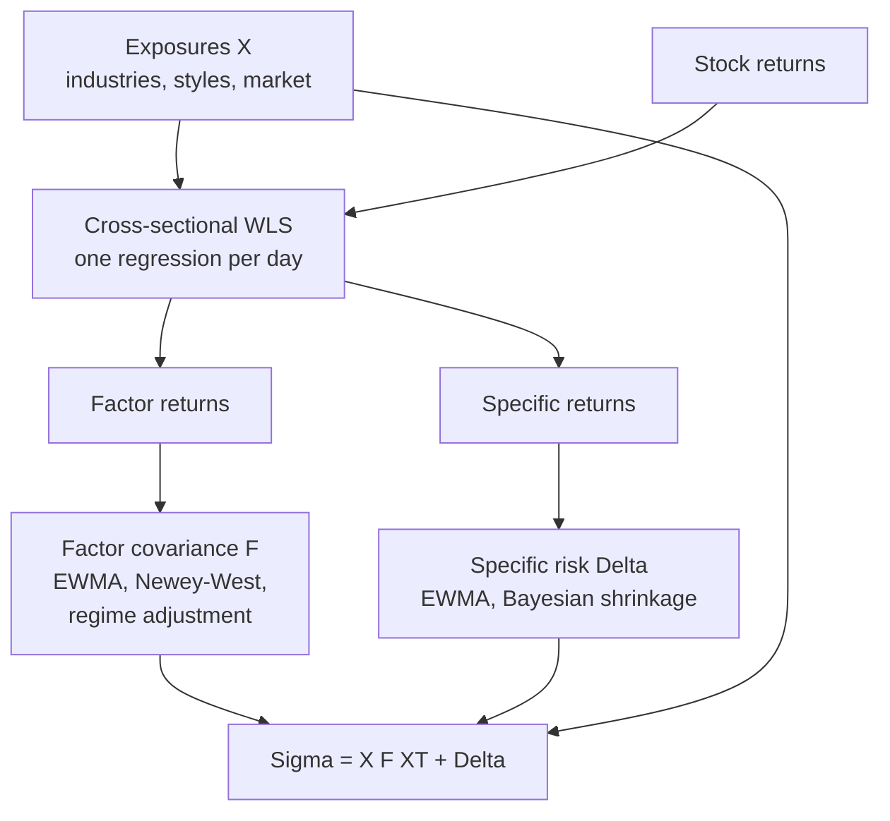
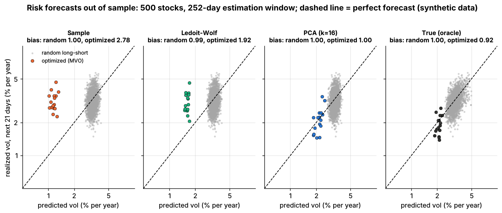

# Risk models

> **TL;DR**
>
> - A risk model forecasts the covariance of 1,000–3,000 stocks from a few dozen factors plus one specific variance per stock: Σ = XFX′ + Δ. Millions of unknowns shrink to thousands.
> - Three families: **fundamental** (BARRA-style industries and styles, factor returns from a daily cross-sectional regression), **statistical** (principal components) and **hybrids**.
> - The craft is in the time series: half-lives (shorter for volatilities than correlations), Newey–West, a volatility-regime adjustment, shrunk specific risk.
> - Grade it with the **bias statistic** (std of return ÷ forecast risk; 1 = unbiased) on *optimized* portfolios. In Lab 14 the sample covariance scored 1.00 on random portfolios and 2.78 on optimized ones (synthetic lab result).
> - Alpha the model cannot see looks diversifiable, so the optimizer overloads it: the alignment problem.

**Level:** Core · **Pipeline stage:** portfolio · **Last verified:** 2026-11

| Field | Value |
|---|---|
| Purpose (the question it answers) | How risky is this portfolio, and how much of the risk is factor bets versus stock-specific bets? |
| Inputs → Outputs | returns, industry codes, style descriptors, market caps → exposures X (N×K), factor covariance F, specific variances Δ; risk and its decomposition for any portfolio |
| Used by strategies | [Cross-sectional alpha](../../02-strategies/d-mid-frequency-alpha/cross-sectional-alpha-and-neutralization.md) · [Stat arb](../../02-strategies/c-statistical-arbitrage/stat-arb-overview-and-history.md) · [Factor-residual](../../02-strategies/c-statistical-arbitrage/factor-residual-mean-reversion.md) · [Reversal](../../02-strategies/c-statistical-arbitrage/short-term-cross-sectional-reversal.md) · [ML short-horizon](../../02-strategies/c-statistical-arbitrage/ml-driven-short-horizon-alpha.md) · [Fundamental signals](../../02-strategies/d-mid-frequency-alpha/fundamental-quant-signals.md) · [Revisions](../../02-strategies/d-mid-frequency-alpha/analyst-revisions-and-sentiment.md) · [Alternative data](../../02-strategies/d-mid-frequency-alpha/alternative-data.md) · [Factor investing](../../02-strategies/e-risk-premia-and-factors/factor-investing-fundamentals.md) · [Momentum](../../02-strategies/e-risk-premia-and-factors/momentum.md) · [Value, quality, low vol](../../02-strategies/e-risk-premia-and-factors/value-quality-low-vol.md) · [Factor timing and crowding](../../02-strategies/e-risk-premia-and-factors/factor-timing-crowding-and-quant-winters.md) · [Carry and cross-asset premia](../../02-strategies/g-futures-and-macro-context/carry-and-cross-asset-risk-premia.md) · [Trend following](../../02-strategies/g-futures-and-macro-context/trend-following-and-ctas.md) |
| Latency / compute regime | overnight batch (vendor files land before the open); one portfolio's risk takes well under a millisecond `[Estimate]` (one N×K product) |
| Key parameters | K: 10–20 statistical, ~70–100 fundamental factors; half-lives 42–252 days (volatility), 200–756 (correlation); Newey–West lags 0–10 |
| Main failure modes | underpredicting optimized portfolios; lagging regime shifts; alpha factors missing from the model; stale exposures |
| Lab | [Lab 14](https://github.com/FrankHuang94/quant_trading_claude/tree/main/labs/14-risk-model-mvo) |

## Intuition

The covariance matrix of 3,000 stocks has 4,501,500 distinct entries; a year of daily returns supplies 756,000 numbers. The [covariance card](covariance-estimation-and-shrinkage.md) shows what goes wrong if you estimate it directly.

A [factor model](../../09-reference/glossary.md#factor-model) assumes stocks co-move only through shared exposures to a few drivers: market, industry, size, momentum, value. With 75 factors, exposures are observed, the factor covariance has 2,850 entries and [specific risk](../../09-reference/glossary.md#specific-risk) adds 3,000. The model is a chart of accounts for risk: each unit of variance is booked to a factor line or the specific line, and [P&L attribution](../g-live-trading/live-monitoring-and-pnl-attribution.md) later reconciles against the same ledger.

## Where it sits in the pipeline



## The algorithm

1. **Exposures** X (N×K): industry dummies, style [z-scores](../../09-reference/glossary.md#z-score) standardized across stocks each day, and a market or country column.
2. **Factor returns**: each day, regress stock returns on X by weighted least squares, giving K factor returns and N specific ([residual](../../09-reference/glossary.md#residual-return)) returns.
3. **Factor covariance** F: exponentially weighted (EWMA), with a shorter [half-life](../../09-reference/glossary.md#half-life) for volatilities than correlations, plus Newey–West terms and a volatility-regime multiplier.
4. **Specific risk** Δ: EWMA of squared residuals, shrunk toward the average of similar stocks.
5. **Statistical alternative**: the top k principal components of trailing returns are the factors; leftover variance is specific (Lab 14's `pca_factor_cov`).
6. **Use**: portfolio variance h′XFX′h + h′Δh; validate with the bias statistic.



```python
import numpy as np

def factor_returns_wls(r, X, mcap):
    """One day of a BARRA-style model (sketch; Lab 14 has no fundamental model).
    r: (N,) returns, X: (N x K) exposures. sqrt(cap) weights proxy 1 / specific variance."""
    w = np.sqrt(mcap)
    XtW = X.T * w                                    # K x N
    f = np.linalg.solve(XtW @ X, XtW @ r)            # today's factor returns (K,)
    return f, r - X @ f                              # ...and specific returns (N,)

def ewma_cov(F, hl_vol=84, hl_corr=504):
    """K x K covariance from T x K daily factor returns, oldest row first.
    Short half-life for volatilities, long one for correlations (USE4S: 84 / 504 days)."""
    def ew(hl):
        wts = 0.5 ** (np.arange(len(F))[::-1] / hl)  # newest day gets weight 1
        return (F * (wts / wts.sum())[:, None]).T @ F
    V, C = ew(hl_vol), ew(hl_corr)
    corr = C / np.sqrt(np.outer(np.diag(C), np.diag(C)))
    vol = np.sqrt(np.diag(V))
    return corr * np.outer(vol, vol)                 # Newey-West and regime scaling omitted

def pca_factor_cov(returns, n_factors=16, min_specific_var=1e-6):
    """Statistical model as in Lab 14: Sigma = L'L + diag(specific_var)."""
    X = returns - returns.mean(axis=0)
    S = X.T @ X / (len(X) - 1)                       # sample covariance (N x N)
    eigval, eigvec = np.linalg.eigh(S)
    top = np.argsort(eigval)[::-1][:n_factors]
    L = (eigvec[:, top] * np.sqrt(eigval[top])).T    # (k, N) loadings times factor vol
    specific = np.maximum(np.diag(S) - (L ** 2).sum(axis=0), min_specific_var)
    return L, specific                               # the lab wraps these in FactorCov

def portfolio_variance(w, L, specific_var):
    return ((L @ w) ** 2).sum() + (w ** 2) @ specific_var   # factor part + specific part

def bias_statistic(realized_returns, predicted_vol):
    """Std of r / sigma_pred. 1 = unbiased; > 1 = risk underpredicted."""
    z = np.asarray(realized_returns) / np.asarray(predicted_vol)
    return float(np.std(z, ddof=1))
```

## Worked example with numbers

*Illustrative.* A dollar-neutral book holds 400 names at 0.5% of capital each (gross 200%). Exposures: market beta 0.02, momentum 0.15, tech 0.05. Annual factor volatilities: market 16%, momentum 10%, tech 12%; momentum–tech correlation 0.3, others 0. Specific volatility is 30% for every stock.

| Line | Calculation | Variance (×10⁻⁴) | Share |
|---|---|---|---|
| Market | (0.02 × 0.16)² | 0.10 | 0.8% |
| Momentum | (0.15 × 0.10)² | 2.25 | 18.4% |
| Tech | (0.05 × 0.12)² | 0.36 | 2.9% |
| Momentum × tech | 2 × 0.3 × 0.015 × 0.006 | 0.54 | 4.4% |
| Specific | 400 × 0.005² × 0.30² | 9.00 | 73.5% |
| **Total** | | **12.25** | **100%** |

Forecast volatility is √0.001225 = **3.50% a year**, 0.22% a day. Specific risk dominates, as intended, but a modest momentum tilt carries almost a fifth of the variance.

If daily P&L over the next 252 days has a standard deviation of 0.29%, the bias statistic is 0.29 ÷ 0.22 = 1.32, outside the 1 ± √(2/252) = 1 ± 0.09 band: realized risk ran about a third above forecast.

## Key parameters and how practitioners tune them

MSCI's published USE4 settings, by horizon `[Verified]`:

| Setting | USE4S (short) | USE4L (long) | USE4D (daily) |
|---|---|---|---|
| Factor volatility half-life | 84 days | 252 | 42 |
| Factor correlation half-life | 504 days | 504 | 200 |
| Newey–West lags, volatility / correlation | 5 / 2 | 5 / 2 | 0 / 0 |
| Volatility-regime half-life | 42 days | 168 | 4 |
| Specific-risk Bayesian shrinkage | 0.1 | 0.1 | 0.05 |

Shorter horizons get shorter half-lives and no Newey–West, since a one-day forecast adds up no autocorrelated days. Correlations get longer half-lives: thousands of factor pairs need more effective data (an EWMA's effective sample is about 2.9 half-lives) or F turns singular.

- **Statistical factors**: 10–20 `[Lore]`; Avellaneda and Lee used 15 eigenportfolios `[Verified]`. Lab 14's 16 matches its simulator; real data has no true k.
- **Regression weights**: √(market cap), used by USE4 as a proxy for inverse specific variance `[Verified]`.
- **Tuning**: pick half-lives by bias statistics across portfolio types, calm and stressed years; match the model's horizon to the holding period.

## Textbook version vs what firms actually do

- **Lineage**: Barra models descend from Rosenberg (1974), who modeled covariance through company descriptors `[Verified]`.
- **Fundamental vs statistical vs macro**: on 779 US stocks (monthly, 1985–1993) they explained 42.6%, 39.0% and 10.9% of return variance; macro factors added nothing to the fundamental model `[Verified]` ([Connor 1995](https://doi.org/10.2469/faj.v51.n3.1904)). Statistical factors are unlabeled and rotate, but catch transient themes (a crowded trade) fast. A **hybrid** adds a few statistical factors estimated on a fundamental model's residuals `[Lore]`.
- **Commercial models**: MSCI's Barra USE4 (2011) has 60 GICS-based industries, 12 styles and a country factor, regresses on √cap weights and lets a firm sit in up to five industries `[Verified]`. MSCI's newer US Total Market suite adds a long-term model (16 styles, 2014) and a trading model (24 styles including sentiment, short interest and one-day reversal, plus option-implied volatility, 2015) `[Verified]`; we found no public "USE5". Axioma, sold by SimCorp, offers fundamental, statistical and macroeconomic variants at trading, short and medium horizons, plus custom models `[Verified]`. Bloomberg also sells factor models `[Verified]`.
- **Custom vs vendor**: large quant funds tend to trade on in-house models and keep a vendor model for limits, investor reporting and talking to prime brokers `[Lore]`. A shared vendor model means shared neutralization, which feeds [crowding](../../09-reference/glossary.md#crowding) `[Lore]`.
- **Optimization bias**: USE4 includes an "Optimization Bias Adjustment" for under-forecast optimized portfolios `[Verified]`. Menchero, Wang and Orr (2012) find the lowest-volatility eigenportfolios carry the largest underprediction and correct them by simulation `[Verified]`.

## How to tell if it's working

The **[bias statistic](../../09-reference/glossary.md#bias-statistic)** is the standard deviation of realized return ÷ forecast volatility. Over T observations, 1 ± √(2/T) is consistent with an unbiased forecast `[Estimate]` (a standard deviation's sampling error is about 1/√(2T)); noisy but unbiased forecasts score about 1.03 `[Verified]` (Menchero 2017). Test random, factor-mimicking and optimized portfolios and the live book.



*Lab 14: grey dots are random dollar-neutral portfolios, colored dots the optimizer's portfolios; the dashed line is a perfect forecast (synthetic data).*

Synthetic lab result: on random long-short portfolios all four estimators score 0.99–1.00; on optimized portfolios, sample covariance **2.78**, Ledoit–Wolf **1.92**, 16-factor PCA **1.00**, true covariance 0.92. Random portfolios cannot tell good from bad; optimized ones can. The lab flatters PCA: exposures never drift and the true factor count is known. Real models need explicit fixes such as MSCI's.

## Failure modes and pitfalls

- **Error maximization**: the optimizer seeks directions with underestimated risk, so a model fine "on average" fails for the one portfolio you hold.
- **Alpha–risk misalignment**: an alpha factor absent from the model looks like diversifiable specific risk, so the optimizer builds a hidden factor bet; an alpha that *is* a risk factor gets penalized: "risk factors eat alphas" `[Reported]` (Lee & Stefek 2008). Fixes include an alpha alignment factor (Saxena & Stubbs 2013) and custom factors `[Reported]` ([Ceria, Saxena & Stubbs 2012](https://doi.org/10.3905/jpm.2012.38.2.029)).
- **Regime shifts**: long half-lives lag a volatility spike. In August 2007 the shared risk was a crowded unwind no factor described ([failure gallery](../../02-strategies/h-cross-cutting/strategy-failure-gallery.md)).
- **Horizon mismatch**: a daily model for a monthly book understates risk when returns are autocorrelated.

## How practitioners talk about it

- "We're flat the Barra styles." → Exposures to the vendor's style factors are near zero.
- "Bias stat on the optimized book is 1.4." → Realized risk ran 40% above forecast for the portfolio that matters.
- "That's a stat factor, it'll rotate." → A PCA factor with no stable label.
- "The optimizer found a factor we don't model." → A hidden common bet drove returns.
- "Vol half-life is too long for this tape." → Forecasts lag the current regime.

## Questions you could ask a quant about this

1. Do you trade on a vendor model, your own, or both?
2. What share of your risk is factor versus specific?
3. What is your bias statistic on optimized portfolios, not just the live book?
4. How do you handle alpha factors that are not in the risk model?
5. 🔒 Which statistical factors do you add on top of the fundamental ones?

## Go deeper

<details markdown="1">
<summary>Math: the factor model, the regression, Newey–West and the bias band</summary>

With $r_t = X_t f_t + u_t$, $\operatorname{cov}(f) = F$ and diagonal $\operatorname{cov}(u) = \Delta$:

$$
\Sigma = X F X^\top + \Delta, \qquad \sigma^2(h) = (X^\top h)^\top F (X^\top h) + \textstyle\sum_i h_i^2 \Delta_{ii}.
$$

Daily weighted least squares with $W = \operatorname{diag}(\sqrt{\text{cap}_i})$:

$$
\hat f_t = (X^\top W X)^{-1} X^\top W r_t .
$$

A country factor plus all industry dummies makes X collinear; USE4 constrains cap-weighted industry returns to sum to zero `[Reported]`.

H-day variance from autocorrelated daily returns (Newey–West, L lags):

$$
\sigma_H^2 = H\Big[\gamma_0 + 2\sum_{l=1}^{L}\Big(1 - \tfrac{l}{L+1}\Big)\gamma_l\Big].
$$

Volatility-regime adjustment, roughly: EWMA-average the daily cross-sectional bias $B_t^2 = \tfrac1K\sum_k (f_{k,t}/\sigma_{k,t})^2$ and scale all factor volatilities by its square root `[Reported]`.

Bias band: for i.i.d. standard normal $z_t$, the sample standard deviation has standard error $\approx 1/\sqrt{2T}$, so 95% lies in $1 \pm \sqrt{2/T}$; fat tails widen it.

Cost: a dense covariance needs $O(N^2)$ memory and $O(N^3)$ to invert; the factor form needs $O(NK)$ and inverts in $O(NK^2)$ (Woodbury).

</details>

## Related pages

- [Covariance estimation and shrinkage](covariance-estimation-and-shrinkage.md) · [Mean-variance optimization](mean-variance-optimization.md) · [Position sizing and risk budgeting](position-sizing-and-risk-budgeting.md)
- [Live monitoring and P&L attribution](../g-live-trading/live-monitoring-and-pnl-attribution.md)
- [Cross-sectional alpha and neutralization](../../02-strategies/d-mid-frequency-alpha/cross-sectional-alpha-and-neutralization.md) · [Factor investing fundamentals](../../02-strategies/e-risk-premia-and-factors/factor-investing-fundamentals.md)
- [Walkthrough: a mid-frequency stat-arb book](../h-end-to-end-walkthroughs/walkthrough-mid-frequency-stat-arb.md)

## Sources

- [Verified] MSCI (2011). "Barra US Equity Model (USE4)" fact sheet. <https://www.msci.com/documents/10199/242721/Barra_US_Equity_Model_USE4.pdf> (accessed 2026-11)
- [Verified] MSCI (2012-07). "USE4S, USE4L and USE4D Data Sheets: Barra U.S. Equity Model" (hosted by Arcana). <https://help.arcana.io/en/articles/14982987-msci-barra-us-equity-model-use4-methodology-handbook-pdf> (accessed 2026-11)
- [Verified] MSCI (2014-12 and 2015-03). Datasheets: "Barra US Total Market Equity Model for Long-Term Investors" and "Barra US Total Market Equity Trading Model" (hosted by Arcana). <https://help.arcana.io/en/articles/14983113-msci-barra-us-total-market-equity-trading-model-usfastd> (accessed 2026-11)
- [Verified] Menchero, J. & Nagy, Z. (2013-03). "Risk and Return of Factor Portfolios: The Impact of Regression Weighting." MSCI Research Insight. <https://www.msci.com/documents/10199/cb704602-b417-4077-a277-c170501a70d7> (accessed 2026-11)
- [Verified] Menchero, J., Wang, J. & Orr, D. J. (2012). "Improving Risk Forecasts for Optimized Portfolios." *Financial Analysts Journal* 68(3), 40–50. <https://doi.org/10.2469/faj.v68.n3.5> (accessed 2026-11)
- [Verified] Menchero, J. (2017-01). "Multi-Asset Factor Covariance Matrices" (Bloomberg MAC2), slides, Boston QWAFAFEW. <https://boston.qwafafew.org/wp-content/uploads/sites/3/2017/01/MAC2-Slide-Deck-Jan-2017-Menchero.pdf> (accessed 2026-11)
- [Verified] Connor, G. (1995). "The Three Types of Factor Models: A Comparison of Their Explanatory Power." *Financial Analysts Journal* 51(3), 42–46. <https://doi.org/10.2469/faj.v51.n3.1904> (accessed 2026-11)
- [Verified] Rosenberg, B. (1974). "Extra-Market Components of Covariance in Security Returns." *Journal of Financial and Quantitative Analysis* 9(2), 263–274. <https://doi.org/10.2307/2330104> (accessed 2026-11)
- [Verified] Newey, W. K. & West, K. D. (1987). "A Simple, Positive Semi-Definite, Heteroskedasticity and Autocorrelation Consistent Covariance Matrix." *Econometrica* 55(3), 703–708. <https://doi.org/10.2307/1913610> (accessed 2026-11)
- [Verified] Avellaneda, M. & Lee, J.-H. (2010). "Statistical arbitrage in the US equities market." *Quantitative Finance* 10(7), 761–782. <https://doi.org/10.1080/14697680903124632> (accessed 2026-11)
- [Verified] SimCorp. "Axioma factor risk models" (product page). <https://www.simcorp.com/solutions/axioma-solutions/axioma-factor-risk-models> (accessed 2026-11)
- [Reported] Ceria, S., Saxena, A. & Stubbs, R. A. (2012). "Factor Alignment Problems and Quantitative Portfolio Management." *Journal of Portfolio Management* 38(2), 29–43. <https://doi.org/10.3905/jpm.2012.38.2.029> (accessed 2026-11)
- [Reported] Lee, J.-H. & Stefek, D. (2008). "Do Risk Factors Eat Alphas?" *Journal of Portfolio Management* 34(4), 12–25. <https://doi.org/10.3905/jpm.2008.709976> (accessed 2026-11)
- [Reported] Saxena, A. & Stubbs, R. A. (2013). "The alpha alignment factor: a solution to the underestimation of risk for optimized active portfolios." *Journal of Risk* 15(3), 3–37. <https://doi.org/10.21314/JOR.2013.261> (accessed 2026-11)
