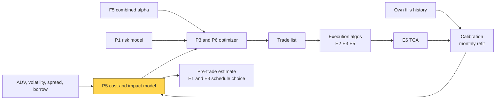

# Transaction cost and impact models

> **TL;DR**
>
> - A cost model prices a trade in advance: fees + half-spread + market impact, plus borrow and the opportunity cost of skipped trades. The optimizer nets it against alpha.
> - Impact is concave. The square-root law, impact ≈ Y·σ·√(Q/V) with Y of order 1, holds across markets and decades. Double the order: +41% cost per share, 2.8× the dollars.
> - Trading 5% of daily volume in a 2%-volatility stock costs roughly 15–30 bps of impact, plus a few bps of spread and commission.
> - Optimizers use a 3/2-power penalty (square-root law) or a quadratic one (linear impact: simpler, wrong at the extremes). Calibrate on your own fills: AQR's live trades cost an order of magnitude less than academic estimates.

**Level:** Core · **Pipeline stage:** portfolio · **Last verified:** 2026-11

| Field | Value |
|---|---|
| Purpose (the question it answers) | What will this trade cost, and how does cost grow with size and speed? |
| Inputs → Outputs | size Q, daily volume V, daily volatility σ, spread, fees, borrow → cost per name (bps, $) and a convex optimizer penalty |
| Used by strategies | [Cross-sectional alpha](../../02-strategies/d-mid-frequency-alpha/cross-sectional-alpha-and-neutralization.md) · [Factor-residual](../../02-strategies/c-statistical-arbitrage/factor-residual-mean-reversion.md) · [Reversal](../../02-strategies/c-statistical-arbitrage/short-term-cross-sectional-reversal.md) · [ML short-horizon](../../02-strategies/c-statistical-arbitrage/ml-driven-short-horizon-alpha.md) · [Stat arb](../../02-strategies/c-statistical-arbitrage/stat-arb-overview-and-history.md) · [Pairs](../../02-strategies/c-statistical-arbitrage/pairs-trading-and-cointegration.md) · [Intraday patterns](../../02-strategies/c-statistical-arbitrage/intraday-patterns-and-seasonality.md) · [Momentum](../../02-strategies/e-risk-premia-and-factors/momentum.md) · [Factor investing](../../02-strategies/e-risk-premia-and-factors/factor-investing-fundamentals.md) · [Value, quality, low vol](../../02-strategies/e-risk-premia-and-factors/value-quality-low-vol.md) · [Fundamental signals](../../02-strategies/d-mid-frequency-alpha/fundamental-quant-signals.md) · [Revisions](../../02-strategies/d-mid-frequency-alpha/analyst-revisions-and-sentiment.md) · [Event-driven](../../02-strategies/d-mid-frequency-alpha/earnings-and-event-driven.md) · [Flow-driven](../../02-strategies/d-mid-frequency-alpha/flow-driven-strategies.md) · [Trend following](../../02-strategies/g-futures-and-macro-context/trend-following-and-ctas.md) |
| Latency / compute regime | overnight batch calibration; microseconds per name inside a seconds-long optimizer solve |
| Key parameters | Y 0.5–1; exponent δ 0.4–0.7; ADV and σ windows 20–60 days; optimizer cost multiplier 1–3×; commission 0.5–2¢/share |
| Main failure modes | alpha leaking into calibration; stale ADV on event days; crowding; linear models at large size |
| Lab | — |

## Intuition

Costs are the cost of goods sold for alpha. **Explicit costs** (commissions, fees) are known in advance. The **half-spread** is paid each time you cross the quote. **[Market impact](../../09-reference/glossary.md#market-impact)** is the hidden line: your demand moves the price. Part is temporary (consumed liquidity that partly returns), part permanent (what the market infers from your flow). Add [borrow fees](../../09-reference/glossary.md#borrow-fee) on shorts and **opportunity cost**: alpha lost on trades skipped or finished late.

Impact is concave because liquidity is latent. Most sellers are not in the visible book; they arrive as price moves. Tóth et al. (2011) derive the [square-root law](../../09-reference/glossary.md#square-root-law) from this.

## Where it sits in the pipeline



## The algorithm

1. Nightly, per name: ADV V (20–60-day median), daily σ, average quoted spread, price, borrow fee.
2. Cost in bps = commission ÷ price + half-spread + Y·σ·(Q/V)^δ, for an order worked over about a day.
3. Give the optimizer a convex penalty per name: linear (spread, fees) plus 3/2-power (impact).
4. Monthly, refit Y and check δ on your own parent orders, binned by participation.

```python
import numpy as np

def expected_cost_bps(q_shares, adv_shares, sigma_daily, spread_bps, price,
                      Y=0.7, delta=0.5, commission_per_share=0.005):
    """Pre-trade cost of a parent order worked over about one day, bps of notional.
    Y here is fitted to average fill slippage (about 2/3 of the peak impact)."""
    participation = q_shares / adv_shares
    commission = 1e4 * commission_per_share / price        # explicit, known in advance
    half_spread = 0.5 * spread_bps                          # paid when crossing
    impact = 1e4 * Y * sigma_daily * participation**delta   # concave in size
    return commission + half_spread + impact

def optimizer_cost(dw, nav, price, adv_shares, sigma_daily, spread_bps, Y=0.7):
    """$ cost of trading dw (fraction of NAV) per name: linear + 3/2-power terms.
    Both are convex, so a conic solver handles them (cvxpy: cp.power(cp.abs(dw), 1.5))."""
    a = 0.5 * spread_bps / 1e4                              # $ per $ traded
    b = Y * sigma_daily * np.sqrt(nav / (adv_shares * price))
    return nav * (a * np.abs(dw) + b * np.abs(dw) ** 1.5)   # summed over names

def calibrate_Y(slip_bps, spread_bps, sigma_daily, participation, n_bins=10):
    """Fit Y from your parent orders (slippage vs arrival, + = cost).
    Bin by participation and use medians: one order is mostly price noise."""
    y = (slip_bps - 0.5 * spread_bps) / (1e4 * sigma_daily)    # impact in units of sigma
    x = np.sqrt(participation)
    edges = np.quantile(x, np.linspace(0, 1, n_bins + 1))
    xb = np.array([np.median(x[(x >= lo) & (x <= hi)]) for lo, hi in zip(edges, edges[1:])])
    yb = np.array([np.median(y[(x >= lo) & (x <= hi)]) for lo, hi in zip(edges, edges[1:])])
    Y_hat = (xb @ yb) / (xb @ xb)                           # least squares through the origin
    delta_hat = np.polyfit(np.log(xb**2), np.log(np.maximum(yb, 1e-6)), 1)[0]
    return Y_hat, delta_hat                                 # expect delta_hat near 0.5
```

## Worked example with numbers

*Illustrative.* \$50 stock, ADV 4M shares (\$200M), σ = 2% a day (200 bps), spread 4 bps, commission 0.5¢. Buy 5% of ADV: 200,000 shares, \$10M.

- √0.05 = 0.2236. **Peak impact** = Y × 200 × 0.2236 = **22.4 bps (Y = 0.5) to 44.7 bps (Y = 1)**.
- At a steady rate the average fill pays 2/3 of the peak (Go deeper): **14.9–29.8 bps**.
- Half-spread 2 bps if every fill crosses; commission 1 bp.
- **Total ≈ 18–33 bps: \$18,000–\$33,000.**

Scaling (peak impact, Y = 0.5) vs a linear model matched at 5%:

| % of ADV | Square-root | Linear | Square-root $ |
|---|---|---|---|
| 1% (\$2M) | 10.0 bps | 4.5 bps | \$2,000 |
| 5% (\$10M) | 22.4 bps | 22.4 bps | \$22,400 |
| 20% (\$40M) | 44.7 bps | 89.4 bps | \$178,900 |

Four times the size: twice the cost per share, eight times the dollars. The linear model halves small-trade costs and doubles large ones.

## Key parameters and how practitioners tune them

- **Y**: "of order unity" (Tóth et al.) `[Verified]`; desks quote 0.5–1 `[Lore]`. Peak-impact and average-slippage fits differ by a third.
- **δ**: published 0.4–0.7 `[Verified]`; keep 0.5 unless your bins disagree.
- **Duration**: slower is cheaper; Bacry et al. find a 1/T^0.25 duration factor `[Verified]`. On earnings and rebalance days use event forecasts of V and σ.
- **Cost multiplier**: 1–3×, tuned to maximize backtested *net* Sharpe, since forecast alpha is overconfident `[Lore]`.
- **Borrow**: annual fee × days ÷ 252; general collateral 0.25–0.5%, hard-to-borrow 5–50%+ `[Lore]` ([shorting and financing](../../01-market-structure/shorting-financing-and-settlement.md)).

## Textbook version vs what firms actually do

- **Textbook:** linear temporary and permanent impact, so quadratic costs ([Almgren & Chriss 2000](https://doi.org/10.21314/JOR.2001.041)). That gives Gârleanu and Pedersen's closed-form partial trading rule `[Verified]` ([P6](multi-period-and-trading-toward-aim.md)).
- **Measured impact is concave:** exponent ≈ 0.6 on about 700,000 Citigroup US orders (Almgren et al. 2005); 0.5–0.6 on nearly 500,000 CFM futures trades `[Verified]` (both per Tóth et al.). About 400,000 European metaorders confirm the square root `[Verified]` (Bacry et al.).
- **Contested at the edges:** a logarithm fits almost five orders of magnitude of size, the square root about two `[Verified]` (Zarinelli et al.); tiny orders look linear `[Verified]` (Bucci et al.).
- **Academic estimates are too high:** on \$1.7 trillion of AQR live trades (21 markets, 19 years), costs were an order of magnitude below earlier studies; a calibrated model beat the literature out of sample `[Verified]`. AQR trades patiently with limit orders, so this may not transfer `[Reported]`.

## How to tell if it's working

- **Realized ÷ predicted ≈ 1.0** per bucket (participation, volatility, sector) over hundreds of orders; a trend across participation buckets means a wrong exponent.
- **Model error at speed**: in [Lab 16](https://github.com/FrankHuang94/quant_trading_claude/tree/main/labs/16-almgren-chriss-frontier) the fastest schedule costs 241.8 bps under linear impact, 83.9 bps under matched square-root impact (synthetic lab result). [Lab 15](https://github.com/FrankHuang94/quant_trading_claude/tree/main/labs/15-trading-toward-aim) uses a simple cost model in a trade-toward-target rule.

## Failure modes and pitfalls

- **Alpha in the calibration**: you buy expected winners, so slippage includes alpha and fitted impact runs high. Subtract expected alpha or market-adjust.
- **Crowding**: others on your side (August 2007) push impact past the model.
- **Accumulation**: daily trading in one name stacks impact; on average it relaxes to only 2/3 of peak `[Verified]` (Zarinelli et al.).
- **Optimizer exploits errors**: underestimated names get traded most.

## How practitioners talk about it

- "What's impact at 10% of ADV?" → cost of a standard-size order.
- "We run costs at 1.5×." → deliberate overcharge against overconfident alpha.
- "Impact is three-halves in dollars." → total cost ∝ size^1.5.
- "Y came in at 0.6." → refit square-root coefficient.
- "Half that slippage was our alpha." → the price moved because the signal was right.

## Questions you could ask a quant about this

1. Is Y fitted to peak impact or average slippage?
2. How do you strip your own alpha out of the calibration?
3. 3/2-power or quadratic penalty in the optimizer, and why?
4. Where does realized cost diverge from the model?
5. 🔒 What cost multiplier do you run?

## Go deeper

<details markdown="1">
<summary>Math: average fill cost and the optimal trade size</summary>

Peak impact $I(Q) = Y\sigma\sqrt{Q/V}$. At a constant rate, the fill after fraction $x$ pays $I(xQ)$, so on average

$$
\int_0^1 Y\sigma\sqrt{xQ/V}\,dx = \tfrac{2}{3}\,I(Q), \qquad \text{dollars} \propto Q^{3/2}.
$$

Fair-pricing theory predicts permanent impact of about $\tfrac{2}{3}I(Q)$ (Farmer et al. 2013).

One trade, gain $\alpha$ per dollar, cost $b\,q^{3/2}$:

$$
q^* = \left(\frac{2\alpha}{3b}\right)^2, \qquad \text{cost}(q^*) = \tfrac{2}{3}\,\alpha q^* .
$$

At the optimum impact eats two-thirds of gross alpha (half under quadratic costs). A linear term $a|q|$ adds a no-trade band: trade only if $|\alpha| > a$. Summed over names, these are second-order cone terms in the [MVO](mean-variance-optimization.md) objective.

</details>

## Related pages

- [Mean-variance optimization](mean-variance-optimization.md)
- [Multi-period optimization and trading toward the aim](multi-period-and-trading-toward-aim.md)
- [Implementation shortfall and Almgren-Chriss](../e-execution-algorithms/implementation-shortfall-and-almgren-chriss.md)
- [Transaction cost analysis](../e-execution-algorithms/transaction-cost-analysis.md)
- [How quants evaluate a strategy](../../02-strategies/how-quants-evaluate-a-strategy.md)
- [Fees, rebates and ticks](../../01-market-structure/fees-rebates-and-ticks.md)

## Sources

- [Verified] Tóth, B., Lempérière, Y., Deremble, C., de Lataillade, J., Kockelkoren, J. & Bouchaud, J.-P. (2011). "Anomalous price impact and the critical nature of liquidity in financial markets." *Physical Review X* 1, 021006. <https://doi.org/10.1103/PhysRevX.1.021006> (accessed 2026-11)
- [Reported] Almgren, R., Thum, C., Hauptmann, E. & Li, H. (2005). "Equity market impact" (working title "Direct estimation of equity market impact"). *Risk* 18(7), 57–62. <https://www.risk.net/derivatives/structured-products/1500270/equity-market-impact> (accessed 2026-11)
- [Verified] Frazzini, A., Israel, R. & Moskowitz, T. J. (2018). "Trading Costs." AQR working paper (SSRN 3229719). <https://www.aqr.com/Insights/Research/Working-Paper/Trading-Costs> (accessed 2026-11)
- [Verified] Almgren, R. & Chriss, N. (2000). "Optimal execution of portfolio transactions." *Journal of Risk* 3(2), 5–39. <https://doi.org/10.21314/JOR.2001.041> (accessed 2026-11)
- [Verified] Gârleanu, N. & Pedersen, L. H. (2013). "Dynamic trading with predictable returns and transaction costs." *Journal of Finance* 68(6), 2309–2340. <https://doi.org/10.1111/jofi.12080> (accessed 2026-11)
- [Verified] Bacry, E., Iuga, A., Lasnier, M. & Lehalle, C.-A. (2015). "Market impacts and the life cycle of investors orders." *Market Microstructure and Liquidity* 1(2), 1550009. <https://doi.org/10.1142/S2382626615500094> (accessed 2026-11)
- [Verified] Zarinelli, E., Treccani, M., Farmer, J. D. & Lillo, F. (2015). "Beyond the square root: Evidence for logarithmic dependence of market impact on size and participation rate." *Market Microstructure and Liquidity* 1(2), 1550004. <https://doi.org/10.1142/S2382626615500045> (accessed 2026-11)
- [Verified] Bucci, F., Benzaquen, M., Lillo, F. & Bouchaud, J.-P. (2019). "Crossover from linear to square-root market impact." *Physical Review Letters* 122, 108302. <https://doi.org/10.1103/PhysRevLett.122.108302> (accessed 2026-11)
- [Verified] Farmer, J. D., Gerig, A., Lillo, F. & Waelbroeck, H. (2013). "How efficiency shapes market impact." *Quantitative Finance* 13(11), 1743–1758. <https://doi.org/10.1080/14697688.2013.848464> (accessed 2026-11)
