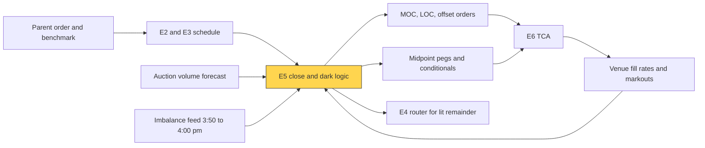

# Auction, close and dark-liquidity algos

> **TL;DR**
>
> - The close is about 9% of US notional, about 20% on rebalance days. Close algos size MOC/LOC orders before the cutoff (NYSE 3:50 p.m., Nasdaq 3:55 p.m.), then react to the imbalance.
> - After the cutoff you may only add on the side that offsets the imbalance, which is exactly when the auction pays a price concession.
> - Dark algos rest midpoint pegs and conditional orders across dark pools and block venues, using minimum fill sizes against probing.
> - Every dark fill trades fill probability against adverse selection: judge venues by markouts, not fill rates. Leakage is the hidden cost; regulators have fined dark-pool operators up to \$84.3M.

**Level:** Core · **Pipeline stage:** execution · **Last verified:** 2026-11

| Field | Value |
|---|---|
| Purpose (the question it answers) | How much of an order should go to the close and to non-displayed liquidity, and how do I get those fills without being picked off? |
| Inputs → Outputs | parent order, auction volume forecast, imbalance feed, venue fill rates and markouts → MOC/LOC and offset orders, dark child orders |
| Used by strategies | [Auctions and closing liquidity](../../02-strategies/a-liquidity-provision/auctions-and-closing-liquidity.md) · [Flow-driven](../../02-strategies/d-mid-frequency-alpha/flow-driven-strategies.md) · [ETF and index arbitrage](../../02-strategies/b-speed-and-structural/etf-and-index-arbitrage.md) · [Event-driven](../../02-strategies/d-mid-frequency-alpha/earnings-and-event-driven.md) · [Cross-sectional alpha](../../02-strategies/d-mid-frequency-alpha/cross-sectional-alpha-and-neutralization.md) · [Factor investing](../../02-strategies/e-risk-premia-and-factors/factor-investing-fundamentals.md) · [Fundamental signals](../../02-strategies/d-mid-frequency-alpha/fundamental-quant-signals.md) |
| Latency / compute regime | seconds for close decisions (imbalance updates about every second); milliseconds for dark routing |
| Key parameters | auction cap 10–20% of forecast print; close share of parent 10–30% (100% if close-benchmarked); minimum fill 1–5% of order; markouts 1 s–5 min |
| Main failure modes | imbalance on your side; no NYSE cancels after 3:58 p.m.; pinging; stale midpoints; overfills |
| Lab | [Lab 17](https://github.com/FrankHuang94/quant_trading_claude/tree/main/labs/17-vwap-twap-pov) |

## Intuition

Large orders want liquidity without advertising it. **The close** is a scheduled call auction: one price, huge volume, and the official benchmark for index funds and NAVs (mechanics in [order types and auctions](../../01-market-structure/order-types-and-auctions.md)). **[Dark pools](../../09-reference/glossary.md#dark-pool)** are continuous, non-displayed books, usually crossing at the midpoint. Both hide your order from the lit book. Both carry a selection problem: the fills you get are not a random sample of the fills you wanted.

## Where it sits in the pipeline



## The algorithm

1. **Forecast** auction volume: median of recent closing prints, scaled up on rebalance days.
2. **Size**: the benchmark sets the close fraction (everything for a close-benchmarked trade; the close's slice of the volume curve for VWAP). Cap it at 10–20% of the forecast print `[Lore]`; trade the rest earlier. Submit MOC, or LOC to bound price, before the cutoff.
3. **React**: if the imbalance opposes you, add offsetting LOC, Nasdaq imbalance-only or NYSE closing-offset orders. If it is on your side, you cannot add.
4. **Dark**: score venues by fill rate and post-fill [markout](../../09-reference/glossary.md#markout); rest [midpoint pegs](../../09-reference/glossary.md#midpoint-peg) with minimum fill sizes, and conditionals at block venues, firming up only if still needed. Cap total resting size to bound overfills.

```python
import numpy as np

def size_close_order(remaining, side, close_frac, auction_hist,
                     rebalance_day=False, max_auction_pct=0.15):
    """Signed shares to send MOC/LOC before the cutoff (NYSE 3:50, Nasdaq 3:55 pm ET).
    side: +1 buy, -1 sell. auction_hist: recent closing-auction volumes."""
    forecast = np.median(auction_hist) * (2.5 if rebalance_day else 1.0)
    want = close_frac * remaining                         # what the benchmark asks for
    return side * min(want, max_auction_pct * forecast)   # never dominate the print

def react_to_imbalance(side, unfilled, imbalance, max_offset_pct=0.25):
    """After the cutoff only orders that OFFSET the imbalance are accepted.
    imbalance: signed shares (+ = buy imbalance). Returns extra LOC shares."""
    if np.sign(imbalance) == -side:                       # other side is crowded:
        return side * min(unfilled, max_offset_pct * abs(imbalance))  # supply it
    return 0                                              # our side: cannot add

def allocate_dark(remaining, venues, max_dark_pct=0.5, min_fill_frac=0.02):
    """Split resting midpoint and conditional orders across dark venues.
    venues: dicts with name, fill_rate, half_spread_bps, block flag, and
    markout_bps (signed, + = price moved our way after our fills)."""
    edge = np.array([v["half_spread_bps"] + v["markout_bps"] for v in venues])
    score = np.maximum(edge, 0.0) * np.array([v["fill_rate"] for v in venues])
    if score.sum() == 0:
        return {}                                         # nothing worth resting dark
    budget = max_dark_pct * remaining                     # caps worst-case overfill
    min_qty = int(min_fill_frac * remaining)              # small fills leak information
    alloc = {}
    for v, s in zip(venues, score):
        qty = int(budget * s / score.sum())
        if qty >= min_qty:
            alloc[v["name"]] = dict(qty=qty, min_qty=min_qty,
                                    conditional=v.get("block", False))
    return alloc
```

## Worked example with numbers

*Illustrative.* Buy 400,000 shares of a \$40 stock, 30% meant for the close; the median closing print is 360,000 shares.

**Close.** Want 0.30 × 400,000 = 120,000; cap 0.15 × 360,000 = **54,000 MOC**; the other 66,000 join the afternoon schedule. At 3:50 p.m. NYSE shows a **500,000-share sell imbalance** with 80,000 shares still unfilled. Offset: min(80,000, 0.25 × 500,000) = **80,000 LOC**. The close prints \$39.90, 10¢ under the last sale, saving \$13,400 on 134,000 shares. A buy imbalance would have pushed the MOC fill up, with nothing to add.

**Dark.** Midday, 200,000 shares left; spread 2¢ (5 bps), so a midpoint fill saves 2.5 bps.

| Venue | Fill rate | Markout | Net edge | Allocation |
|---|---|---|---|---|
| A (midpoint pool) | 0.10 | −1.0 bps | +1.5 bps | 78,947 |
| B (midpoint pool) | 0.30 | −4.0 bps | −1.5 bps | 0 |
| C (block, conditional) | 0.02 | −0.5 bps | +2.0 bps | 21,052 |

Budget 100,000; minimum fill 4,000. Venue B fills most and is dropped: its fills are followed by a 4 bps adverse move, more than the spread saved.

## Key parameters and how practitioners tune them

- **Auction cap**: lower in crowded rebalance names, higher for close-benchmarked flow `[Lore]`.
- **LOC limits**: a few bps through the 3:50 price cap the damage from late swings.
- **Minimum fill**: higher blocks probing but lowers fill odds; block venues set it per order `[Verified]` (Cboe BIDS).
- **Markout horizon**: seconds catch latency arbitrage, minutes informed flow ([M5](../f-market-making-and-hft-algorithms/adverse-selection-and-markouts.md)).

## Textbook version vs what firms actually do

- **Scale of the close**: record 9.44% of notional in Q2 2024; about 20% on rebalance and expiry days `[Reported]`.
- **Pecking order**: midpoint dark pools first (cheap, slow), other dark next, lit last; urgency moves traders down the order `[Verified]` (Menkveld, Yueshen & Zhu).
- **Dark selection**: in Zhu's model, informed traders crowd one side, so they fill less in the dark, and dark pools attract the less informed `[Verified]`.
- **Venue defenses**: Nasdaq's M-ELO midpoint order must rest before trading, 500 ms at launch and 10 ms from May 2020, a cut Nasdaq estimated cost 0.10 bps of markout `[Verified]`.
- **Block venues**: Cboe BIDS takes firm or conditional orders with minimum sizes and counterparty scorecards `[Verified]`.
- **Leakage is real**: Barclays (\$70M) and Credit Suisse (\$84.3M) settled SEC and New York charges over dark-pool representations in 2016; ITG paid \$20.3M in 2015 for a secret desk using subscribers' order information `[Verified]`.

## How to tell if it's working

- **Close**: slippage vs the official close; your share of the print; overnight reversion of the close (large = you moved it).
- **Dark**: per-venue fill rate vs markout, refreshed weekly.
- **Leakage**: drift after order start vs comparable orders not shown dark.
- [Lab 17](https://github.com/FrankHuang94/quant_trading_claude/tree/main/labs/17-vwap-twap-pov) builds the volume curve whose closing slice is sized here.

## Failure modes and pitfalls

- **Late imbalance swings**, with NYSE cancels barred after 3:58 p.m. `[Verified]`.
- **Pinging**: small IOC probes find resting orders.
- **Stale midpoints**: a lagging NBBO view gets you filled at an old midpoint.
- **Overfills** and missed firm-ups that downgrade your scorecard.

## How practitioners talk about it

- "We're 12% of the expected print." → auction participation.
- "The imbalance flipped at 3:57." → late swing in the closing book.
- "That pool's markouts are ugly at one second." → latency-sensitive counterparties.
- "Send conditionals, firm up on invites." → block-venue workflow.
- "We got paid to supply the imbalance." → offset order filled at a concession.

## Questions you could ask a quant about this

1. How do you forecast closing volume on rebalance days?
2. What share of the print will you be?
3. Do you rank dark venues by fill rate, markout, or both?
4. How do you detect pinging?
5. 🔒 What markout cut-off removes a venue?

## Go deeper

<details markdown="1">
<summary>Math: when to rest dark, and why fills are adversely selected</summary>

Rest dark one interval (fill probability $p$, half-spread $h$, markout given a fill $m_f$, drift cost $d$ if unfilled) or cross now:

$$
\mathbb{E}[\text{dark}] = p\,(h + m_f) - (1-p)\,d \quad\text{vs}\quad \mathbb{E}[\text{lit}] = -h .
$$

The trap: $m_f = \mathbb{E}[m \mid \text{fill}] < \mathbb{E}[m]$, because you fill most when someone better informed wants the other side. Estimate $m_f$ from your own fills by venue.

The auction uncross maximizes matched volume $\min(B(p), S(p))$ over price $p$, so an imbalance moves the price until offsetting supply covers it.

</details>

## Related pages

- [Order types and auctions](../../01-market-structure/order-types-and-auctions.md)
- [Auctions and closing liquidity](../../02-strategies/a-liquidity-provision/auctions-and-closing-liquidity.md)
- [Smart order routing](smart-order-routing.md)
- [VWAP, TWAP and POV](vwap-twap-pov.md)
- [Transaction cost analysis](transaction-cost-analysis.md)
- [Walkthrough: executing a \$500M buy order](../h-end-to-end-walkthroughs/walkthrough-institutional-execution.md)

## Sources

- [Verified] NYSE (n.d.). "NYSE Auctions: Closing Process Fact Sheet." <https://www.nyse.com/publicdocs/nyse/NYSE_Auctions_Closing_Process_Fact_Sheet.pdf> (accessed 2026-11)
- [Verified] Nasdaq (n.d.). "Opening and Closing Cross Quick Guide." <https://www.nasdaqtrader.com/content/technicalsupport/specifications/TradingProducts/openclosequickguide.pdf> (accessed 2026-11)
- [Reported] NYSE Research (2024-08-29). "NYSE Closing Auction: price discovery opportunities reach new highs." <https://nyse.com/data-insights/nyse-closing-auction-price-discovery-opportunities-reach-new-highs> (accessed 2026-11)
- [Verified] Menkveld, A. J., Yueshen, B. Z. & Zhu, H. (2017). "Shades of darkness: A pecking order of trading venues." *Journal of Financial Economics* 124(3), 503–534. <https://doi.org/10.1016/j.jfineco.2017.03.004> (accessed 2026-11)
- [Verified] Zhu, H. (2014). "Do dark pools harm price discovery?" *Review of Financial Studies* 27(3), 747–789. <https://doi.org/10.1093/rfs/hht078> (accessed 2026-11)
- [Verified] Federal Register (2020-04-30). Nasdaq order approving a reduced M-ELO holding period. <https://www.federalregister.gov/documents/2020/04/30/2020-09123/self-regulatory-organizations-the-nasdaq-stock-market-llc-order-approving-proposed-rule-change-to> (accessed 2026-11)
- [Verified] Cboe (n.d.). "BIDS Trading." <https://www.cboe.com/markets/bidstrading> (accessed 2026-11)
- [Verified] SEC (2016-01-31). "Barclays, Credit Suisse charged with dark pool violations." Press release 2016-16. <https://www.sec.gov/news/pressrelease/2016-16.html> (accessed 2026-11)
- [Verified] SEC (2015-08-12). "SEC charges ITG with operating secret trading desk and misusing dark pool subscriber trading information." Press release 2015-164. <https://www.sec.gov/news/pressrelease/2015-164.html> (accessed 2026-11)
- [Reported] BMLL (2024). "Into the Close: Unpacking U.S. Closing Auction Dynamics and the Impact of the Russell Reconstitution." <https://www.bmlltech.com/news/market-insight/into-the-close-unpacking-u-s-closing-auction-dynamics-and-the-impact-of-the-russell-reconstitution> (accessed 2026-11)
