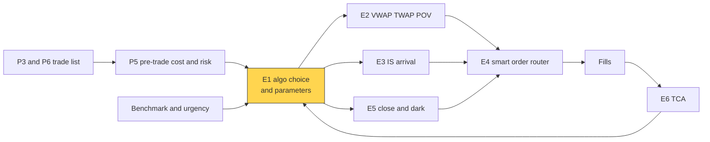
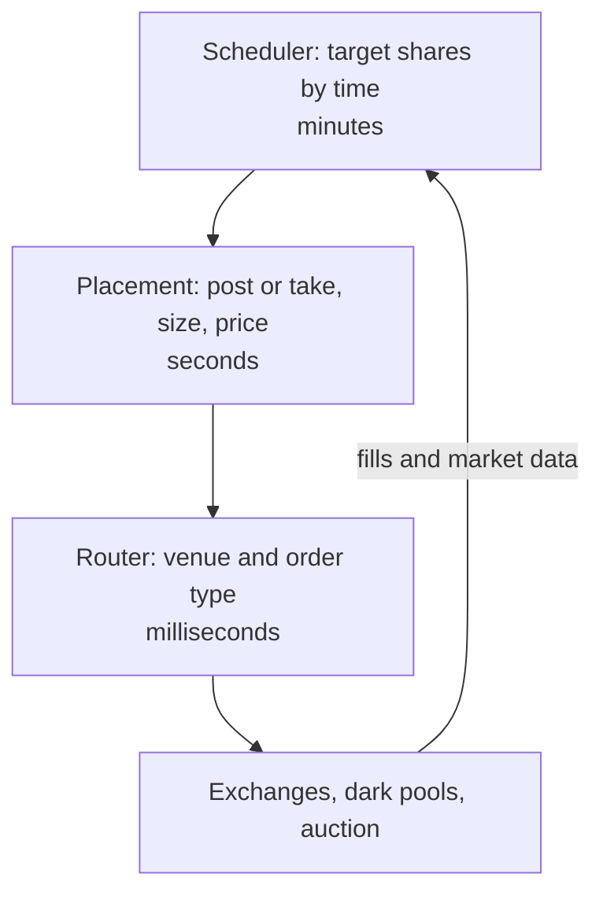
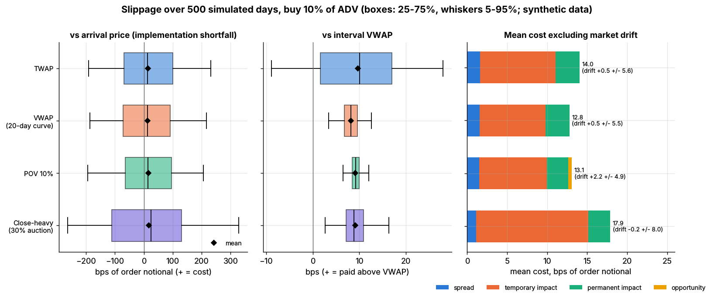

# Execution algorithms: overview

> **TL;DR**
>
> - An execution algo turns one parent order into thousands of child orders through three layers: a **scheduler** (how much by when), **placement** (post or take, size, price) and a **smart order router** (where).
> - Families differ mainly in the benchmark they chase: TWAP, VWAP, POV, implementation shortfall (arrival), target close, liquidity-seeking, pegged.
> - Choose by size (% of ADV), urgency (alpha decay, risk) and benchmark; the benchmark can make a bad choice look good.
> - [Lab 17](https://github.com/FrankHuang94/quant_trading_claude/tree/main/labs/17-vwap-twap-pov) (synthetic, 10% of ADV in a day): expected cost 12.8–17.9 bps by schedule, against shortfall SDs of 122–180 bps.
> - Algos and smart order routers carried 43% of US buy-side equity activity in FY2025; 36% of desks use algo wheels `[Reported]`.

**Level:** Core · **Pipeline stage:** execution · **Last verified:** 2026-11

| Field | Value |
|---|---|
| Purpose (the question it answers) | Which algorithm, benchmark and settings should a parent order get? |
| Inputs → Outputs | parent order, % of ADV, volatility, alpha half-life, benchmark, limits → algo, parameters, child orders |
| Used by strategies | [Cross-sectional alpha](../../02-strategies/d-mid-frequency-alpha/cross-sectional-alpha-and-neutralization.md) · [Stat arb](../../02-strategies/c-statistical-arbitrage/stat-arb-overview-and-history.md) · [Factor-residual](../../02-strategies/c-statistical-arbitrage/factor-residual-mean-reversion.md) · [Momentum](../../02-strategies/e-risk-premia-and-factors/momentum.md) · [Factor investing](../../02-strategies/e-risk-premia-and-factors/factor-investing-fundamentals.md) · [Value, quality, low vol](../../02-strategies/e-risk-premia-and-factors/value-quality-low-vol.md) · [Fundamental signals](../../02-strategies/d-mid-frequency-alpha/fundamental-quant-signals.md) · [Event-driven](../../02-strategies/d-mid-frequency-alpha/earnings-and-event-driven.md) · [Flow-driven](../../02-strategies/d-mid-frequency-alpha/flow-driven-strategies.md) · [Trend following](../../02-strategies/g-futures-and-macro-context/trend-following-and-ctas.md) |
| Latency / compute regime | schedule re-planned every 1–5 min; placement seconds to ms; routing µs to ms |
| Key parameters | urgency; maximum participation 5–30% of volume `[Lore]`; start and end time; limit price; dark and auction allowances; randomization |
| Main failure modes | wrong benchmark; leakage; over-constrained orders; small-sample broker rankings |
| Lab | [Lab 17](https://github.com/FrankHuang94/quant_trading_claude/tree/main/labs/17-vwap-twap-pov) |

## Intuition

The portfolio manager decides *what* to buy; execution decides *how*. An agency algo is a contractor: it takes a [parent order](../../09-reference/glossary.md#parent-order) and instructions and bills you in slippage. It fights three costs at once. Going fast pays [market impact](../../09-reference/glossary.md#market-impact); going slow carries price risk and lets alpha decay; being predictable leaks information that others trade against. Each family is a different compromise between them.

## Where it sits in the pipeline



Inside every algo, the same three layers run on different clocks:



## The algorithm

1. **Pre-trade**: estimate cost and risk ([P5](../d-portfolio-construction/transaction-cost-and-impact-models.md)).
2. **Choose** family and benchmark (table below).
3. **Schedule** ([E2](vwap-twap-pov.md), [E3](implementation-shortfall-and-almgren-chriss.md)), **place** (post or cross, dark: [E5](auction-close-and-dark-liquidity-algos.md)), **route** ([E4](smart-order-routing.md)).
4. **Adapt** to fills, volume and price; **measure** ([E6](transaction-cost-analysis.md)).

```python
import numpy as np

def choose_algo(pct_adv, alpha_half_life_days, benchmark, urgency="medium"):
    """First-pass algo choice. Not in the lab; thresholds are rules of thumb [Lore]."""
    if benchmark == "close":
        return "target_close"                    # E5: index funds, NAV-benchmarked flow
    if urgency == "high" or alpha_half_life_days < 0.5:
        return "is_arrival_high"                 # E3: front-load, accept impact
    if pct_adv > 0.20:
        return "multi_day_pov_plus_dark"         # E5 blocks; spread risk over days
    if benchmark == "vwap" or alpha_half_life_days > 5:
        return "vwap"                            # E2: passive, follows the volume curve
    return "is_arrival_medium"

def run_parent_order(order, algo, market):
    """Three layers per bin: scheduler -> placement -> router (all names illustrative)."""
    plan = vwap_schedule(market.volume_curve, order.qty)  # Lab 17; TWAP = flat curve
    filled = 0.0
    for t in market.bins():
        if algo == "pov":                                # Lab 17: printed volume only
            want = pov_child_order(order.rate, market.others_volume_so_far(t),
                                   filled, order.qty - filled)
        else:
            want = plan[: t + 1].sum() - filled          # catch up to the schedule
        if order.limit_px is not None and market.mid(t) > order.limit_px:
            continue                                     # buy limit: pause, risk non-completion
        want = min(want, order.max_pct * market.expected_volume(t))   # participation cap
        child = place(want, market.book(t), passive_share=0.6,
                      size_jitter=0.3)                   # post vs cross; randomize sizes
        filled += sum(f.qty for f in smart_order_route(child, market.venues(t)))  # E4
    return filled
```

| Family | Slices by | Typical use | Main weakness | Used by (2025) |
|---|---|---|---|---|
| TWAP | the clock | illiquid names | overtrades midday | 38% |
| [VWAP](../../09-reference/glossary.md#vwap) | forecast volume curve | low urgency | benchmark absorbs own impact | 81% |
| POV | live volume ([participation rate](../../09-reference/glossary.md#participation-rate)) | size matters more than time | chases spikes; may not finish | 74% |
| [IS](../../09-reference/glossary.md#implementation-shortfall) / arrival | urgency, front-loaded | alpha-driven orders | pays impact for speed | 51% |
| Target close | ramp into the auction | index funds | moves the close | 56% |
| Liquidity-seeking | contra-side blocks, dark | large % of ADV | adverse selection | 74% |
| Pegged | resting at bid or midpoint | patient, small | non-fill | n/a |

*Share of long-only desks using each type: The TRADE 2025 survey (Figure 6), mostly European respondents `[Verified]`.*

## Worked example with numbers

*Illustrative.* \$50 stock, ADV 5M shares, volatility 2% (200 bps) a day; [square-root](../../09-reference/glossary.md#square-root-law) impact, Y = 0.5, average fill 2/3 of peak ([P5](../d-portfolio-construction/transaction-cost-and-impact-models.md)); risk SD ≈ σ√(T/3) over T days ([E6](transaction-cost-analysis.md)).

| Order | Choice | Why |
|---|---|---|
| 25,000 shares (0.5% ADV), 2-hour alpha | IS high urgency | small; decay beats impact |
| 500,000 (10%), index add | target close, auction slice capped | the close is the benchmark |
| 2,000,000 (40%), slow value signal | multi-day POV plus dark | too big for one day |

For the 40% order:

- **One day**: peak impact 0.5 × 200 × √0.40 = 63 bps; average **42 bps** (\$420,000 on \$100M). Risk SD 200 × √(1/3) = **115 bps**.
- **Four days at 10%**: peak 0.5 × 200 × √0.10 = 31.6 bps, average **21 bps** if impact fades overnight (optimistic). Risk SD 200 × √(4/3) = **231 bps**.

Spreading halves expected cost and doubles risk: the [Almgren-Chriss](../../09-reference/glossary.md#almgren-chriss-model) trade-off ([E3](implementation-shortfall-and-almgren-chriss.md)).

## Key parameters and how practitioners tune them

- **Urgency** maps to a risk-aversion setting `[Verified]` ([IBKR](https://interactivebrokers.github.io/tws-api/ibalgos.html)).
- **Participation cap**: IBKR's POV and VWAP accept up to 50% `[Verified]`; institutions run 5–20% `[Lore]`.
- **Limit price** bounds damage but risks non-completion; dark and auction allowances: [E5](auction-close-and-dark-liquidity-algos.md).

## Textbook version vs what firms actually do

- **Benchmarks**: early cost studies used [VWAP](https://doi.org/10.1111/j.1540-6261.1988.tb02591.x) (1988); [implementation shortfall](https://doi.org/10.3905/jpm.1988.409150) was defined the same year `[Verified]`.
- **Layering**: scheduling, then tactical placement, then routing is the textbook architecture `[Reported]` ([Lehalle and Laruelle](https://doi.org/10.1142/10739)).
- **Broker suites**: a few branded strategies on a shared engine; IBKR's include VWAP, TWAP, POV, Arrival Price, Close Price and Dark Ice `[Verified]`. Large clients get custom variants `[Lore]`.
- **Adoption**: algos and smart order routers handled 43% of buy-side activity in FY2025 ([Markets Media, 2026-05](https://www.marketsmedia.com/us-equities-trading-revenues-jumped-in-2025/)); 36% of North American desks use algo wheels, up 4 points ([Coalition Greenwich, 2026-01](https://www.greenwich.com/market-structure-technology/us-equity-market-trends-2025-dont-call-it-comeback)) `[Reported]`.
- **Algo wheels**: orders in a bucket (say, VWAP, 1–5% of ADV) go to brokers at random under preset weights; TCA compares like with like and reweights quarterly `[Lore]`.
- **Leakage**: high-frequency traders first lean against large institutional orders, then trade *with* the most informed ones `[Verified]` ([van Kervel and Menkveld 2019](https://doi.org/10.1111/jofi.12759)); hence randomized sizes and timing `[Lore]`.

## How to tell if it's working

- Shortfall vs arrival and vs the pre-trade estimate, by algo and size bucket; completion; [information leakage](../../09-reference/glossary.md#information-leakage) (drift beyond modeled impact).
- **Synthetic lab result** (Lab 17, 500 days, buy 10% of ADV): expected cost TWAP 14.0, VWAP 12.8, POV 13.1, close-heavy 17.9 bps; shortfall SD 122–125 bps (close-heavy 180); POV finished on only 61% of days. Real orders this size cost nearer 20 bps `[Estimate]` (square-root law), with per-order SDs of 50–150 bps ([E6](transaction-cost-analysis.md)).
- Telling VWAP from TWAP (1.3 bps) across unrelated orders takes about **77,000 orders**.



*Lab 17, synthetic: vs arrival (left) all four drown in noise; vs interval VWAP (middle) they look tight; costs by component (right).*

## Failure modes and pitfalls

- **Wrong benchmark**: a target-close order scored 0.0 ± 48 bps against the close but cost the most vs arrival in Lab 17.
- **Over-constraint**: tight limits and low caps leave shares unfilled.
- **Predictability**: fixed slices on a fixed clock are easy to detect.
- **Conflicts**: routing to the broker's own pool; see the dark-pool settlements in [E5](auction-close-and-dark-liquidity-algos.md).

## How practitioners talk about it

- "Put it in VWAP, 15% max." → volume-curve schedule with a participation cap.
- "It's a 40% of ADV name, take three days." → spread size over days.
- "Arrival, high urgency, the signal is fast." → IS algo, front-loaded.
- "We're on the wheel for anything under 5% of ADV." → randomized broker allocation.
- "We got footprinted." → leakage: someone read the pattern.
- "Beat VWAP, lost to arrival." → the benchmark flattered the trade.

## Questions you could ask a quant about this

1. Which benchmark is each order judged on?
2. How do you map signal half-life to urgency?
3. How do you check dark fills aren't leaking?
4. How many orders before you trust a wheel's ranking?
5. Broker algos or your own?
6. 🔒 What does in-house execution save?

## Go deeper

<details markdown="1">
<summary>Math: the cost-risk trade-off and why benchmarks need large samples</summary>

For $Q$ shares over $T$ days with square-root impact and a steady schedule:

$$
\mathbb{E}[\text{cost}] \approx \tfrac{2}{3} Y\sigma\sqrt{\frac{Q}{V\,T}}, \qquad \mathrm{SD} \approx \sigma\sqrt{T/3} ,
$$

assuming impact decays between days. Slower is cheaper but riskier; urgency picks the point. To detect a gap $\delta$ between algos with per-order SDs $s_1, s_2$ at two standard errors with unpaired orders:

$$
n \approx \left(\frac{2\sqrt{s_1^2 + s_2^2}}{\delta}\right)^2 = \left(\frac{2 \times 175}{1.26}\right)^2 \approx 77{,}000 .
$$

</details>

## Related pages

- [VWAP, TWAP and POV](vwap-twap-pov.md)
- [Implementation shortfall and Almgren-Chriss](implementation-shortfall-and-almgren-chriss.md)
- [Smart order routing](smart-order-routing.md)
- [Auction, close and dark-liquidity algos](auction-close-and-dark-liquidity-algos.md)
- [Transaction cost analysis](transaction-cost-analysis.md)
- [Life of a stock order](../../01-market-structure/life-of-a-stock-order.md)
- [Walkthrough: executing a \$500M buy order](../h-end-to-end-walkthroughs/walkthrough-institutional-execution.md)

## Sources

- [Verified] Perold, A. F. (1988). "The implementation shortfall: Paper versus reality." *Journal of Portfolio Management* 14(3), 4–9. <https://doi.org/10.3905/jpm.1988.409150> (accessed 2026-11)
- [Verified] Berkowitz, S. A., Logue, D. E. & Noser, E. A. (1988). "The total cost of transactions on the NYSE." *Journal of Finance* 43(1), 97–112. <https://doi.org/10.1111/j.1540-6261.1988.tb02591.x> (accessed 2026-11)
- [Verified] Almgren, R. & Chriss, N. (2000). "Optimal execution of portfolio transactions." *Journal of Risk* 3(2), 5–39. <https://doi.org/10.21314/JOR.2001.041> (accessed 2026-11)
- [Reported] Lehalle, C.-A. & Laruelle, S. (eds.) (2018). *Market Microstructure in Practice*, 2nd ed. World Scientific. <https://doi.org/10.1142/10739> (accessed 2026-11)
- [Verified] Kissell, R. (2014). *The Science of Algorithmic Trading and Portfolio Management*. Academic Press. <https://doi.org/10.1016/B978-0-12-401689-7.00001-5> (accessed 2026-11)
- [Verified] Interactive Brokers (n.d.). "IB Algos" (TWS API documentation: VWAP, TWAP, Percentage of Volume, Arrival Price, Close Price, Dark Ice parameters). <https://interactivebrokers.github.io/tws-api/ibalgos.html> (accessed 2026-11)
- [Reported] Markets Media (2026-05-18). "US Equities Trading Revenues Jumped in 2025" (Crisil Coalition Greenwich FY2025 revenue report: algo and smart-order-router trading 43% of buy-side activity). <https://www.marketsmedia.com/us-equities-trading-revenues-jumped-in-2025/> (accessed 2026-11)
- [Reported] Coalition Greenwich (2026-01-21). "U.S. equity market trends 2025: Don't call it a comeback" (253 North American buy-side equity traders). <https://www.greenwich.com/market-structure-technology/us-equity-market-trends-2025-dont-call-it-comeback> (accessed 2026-11)
- [Reported] The TRADE (2025). "Algorithmic Trading Survey 2025: Long-only" (types of algorithms used, Figure 6). <https://thetradenews.com/wp-content/uploads/2025/04/Algo56-FINAL.pdf> (accessed 2026-11)
- [Verified] van Kervel, V. & Menkveld, A. J. (2019). "High-frequency trading around large institutional orders." *Journal of Finance* 74(3), 1091–1137. <https://doi.org/10.1111/jofi.12759> (accessed 2026-11)
