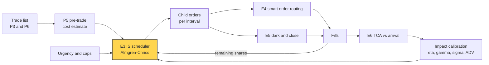
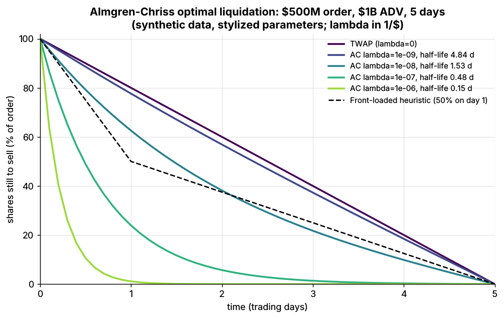
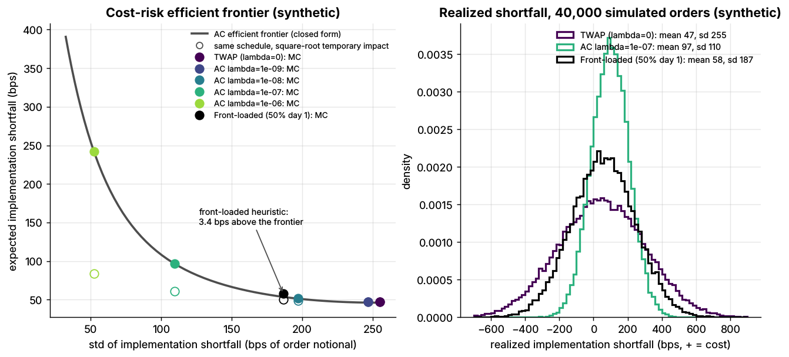

# Implementation shortfall and Almgren-Chriss

> **TL;DR**
>
> - Implementation shortfall (Perold 1988) charges execution against the decision price, unfilled shares included. IS algos minimize it.
> - Almgren-Chriss minimizes E[IS] + λ·Var[IS]: impact punishes speed, risk punishes waiting. Holdings decay like sinh; λ = 0 is TWAP.
> - [Lab 16](https://github.com/FrankHuang94/quant_trading_claude/tree/main/labs/16-almgren-chriss-frontier), \$500M at 50% of a \$1B ADV over 5 days (synthetic): TWAP expects 46 bps, SD 254; a risk-averse schedule 96 bps, SD 110.
> - Real IS algos expose urgency, cap participation, adapt to prices and route dark and lit.
> - Under square-root impact the fastest schedule costs 84 bps, not the linear model's 242. On single orders TWAP beats the risk-averse schedule 61% of the time.

**Level:** Core · **Pipeline stage:** execution · **Last verified:** 2026-11

| Field | Value |
|---|---|
| Purpose (the question it answers) | How fast should a large order be worked when speed costs impact and delay costs risk? |
| Inputs → Outputs | shares X, horizon T, ADV, σ, spread, impact η and γ, urgency λ, cap → holdings per interval, expected cost and SD, the frontier |
| Used by strategies | [Cross-sectional alpha](../../02-strategies/d-mid-frequency-alpha/cross-sectional-alpha-and-neutralization.md) · [Factor-residual](../../02-strategies/c-statistical-arbitrage/factor-residual-mean-reversion.md) · [Stat arb](../../02-strategies/c-statistical-arbitrage/stat-arb-overview-and-history.md) · [Pairs](../../02-strategies/c-statistical-arbitrage/pairs-trading-and-cointegration.md) · [Momentum](../../02-strategies/e-risk-premia-and-factors/momentum.md) · [Factor investing](../../02-strategies/e-risk-premia-and-factors/factor-investing-fundamentals.md) · [Value, quality, low vol](../../02-strategies/e-risk-premia-and-factors/value-quality-low-vol.md) · [Fundamental signals](../../02-strategies/d-mid-frequency-alpha/fundamental-quant-signals.md) · [Revisions](../../02-strategies/d-mid-frequency-alpha/analyst-revisions-and-sentiment.md) · [Event-driven](../../02-strategies/d-mid-frequency-alpha/earnings-and-event-driven.md) · [Flow-driven](../../02-strategies/d-mid-frequency-alpha/flow-driven-strategies.md) · [Trend following](../../02-strategies/g-futures-and-macro-context/trend-following-and-ctas.md) |
| Latency / compute regime | milliseconds: closed form at arrival, re-solved every few minutes; impact refit monthly |
| Key parameters | λ 1e-9 to 1e-6 per \$ (Lab 16: half-lives 4.8 to 0.15 days); participation cap 10–30% of volume; horizon hours to days; 10–80 intervals |
| Main failure modes | linear impact at speed; arbitrary λ; ignored alpha and overnight gaps; leakage; judging single orders |
| Lab | [Lab 16](https://github.com/FrankHuang94/quant_trading_claude/tree/main/labs/16-almgren-chriss-frontier) |

## Intuition

[Implementation shortfall](../../09-reference/glossary.md#implementation-shortfall) compares the real portfolio with a paper one filled at the decision price; [TCA](transaction-cost-analysis.md) splits it afterwards. Beforehand, the question is speed. Sell fast and you pay [market impact](../../09-reference/glossary.md#market-impact). Sell slowly and the unsold block is an unhedged position. The [Almgren-Chriss model](../../09-reference/glossary.md#almgren-chriss-model) prices both in dollars: one schedule per risk aversion λ, tracing a frontier of expected cost vs standard deviation. The client picks a point.

## Where it sits in the pipeline



## The algorithm

1. **Benchmark**: record the decision price.
2. **Calibrate**: daily σ in \$/share, temporary impact η (cost per unit of trading speed), permanent impact γ (lasting price move per share). Lab 16 anchors them to the [square-root law](../../09-reference/glossary.md#square-root-law): 20 bps at 10% of ADV, and 50 bps of permanent impact once the whole order is done.
3. **Pick λ** from the client's urgency.
4. **Schedule**: urgency κ ≈ √(λσ²/η); holdings x(t) = X·sinh(κ(T−t))/sinh(κT); trade n_k = x_{k−1} − x_k per interval.
5. **Report** E and SD against TWAP's; check peak participation against the cap.
6. **Execute and re-solve** on the remaining shares each interval.

```python
import numpy as np

# Units: shares, $, trading days. Sell program; a buy is the mirror image.
# Execution price = S - epsilon - eta * (shares per day); S falls gamma per share sold.
def ac_trajectory(X, T, n, sigma, eta, gamma, lam):
    """Lab 16: Almgren-Chriss holdings x_0..x_n for selling X shares in n intervals."""
    tau = T / n
    t = np.arange(n + 1) * tau
    eta_tilde = eta - 0.5 * gamma * tau          # discrete-time correction from the paper
    if lam <= 0:
        return X * (1.0 - t / T)                 # risk-neutral: straight line = TWAP
    kappa_tilde_sq = lam * sigma**2 / eta_tilde
    kappa = np.arccosh(0.5 * kappa_tilde_sq * tau**2 + 1.0) / tau   # urgency, 1/day
    return X * np.sinh(kappa * (T - t)) / np.sinh(kappa * T)

def ac_cost_variance(holdings, T, sigma, eta, gamma, epsilon=0.0):
    """Lab 16: expected shortfall E ($) and variance V ($^2) of ANY sell schedule."""
    x = np.asarray(holdings, dtype=float)
    tau = T / (len(x) - 1)
    trades = -np.diff(x)                         # n_k: shares sold in interval k
    eta_tilde = eta - 0.5 * gamma * tau
    expected = (0.5 * gamma * x[0] ** 2          # permanent: identical for every schedule
                + epsilon * np.abs(trades).sum() # half-spread
                + eta_tilde / tau * np.sum(trades**2))   # temporary: punishes speed
    variance = sigma**2 * tau * np.sum(x[1:] ** 2)       # risk: punishes waiting
    return expected, variance

def pre_trade_report(X, T, n, S0, sigma, eta, gamma, epsilon, lam, adv, cap=0.25):
    """Not in the lab: the numbers an IS algo shows before it starts."""
    hold = ac_trajectory(X, T, n, sigma, eta, gamma, lam)
    E, V = ac_cost_variance(hold, T, sigma, eta, gamma, epsilon)
    peak = np.max(-np.diff(hold)) / (T / n) / adv    # first-interval rate, share of ADV
    bps = 1e4 / (X * S0)
    return dict(cost_bps=E * bps, sd_bps=np.sqrt(V) * bps,
                peak_pct_adv=100 * peak, breaches_cap=peak > cap)
```

## Worked example with numbers

Lab 16's calibration (synthetic): sell X = 10M shares at \$50 (\$500M, 1 bp = \$50,000), ADV 20M shares, T = 5 days in 50 intervals (τ = 0.1 day), σ = \$1.00 per √day (2%), half-spread ε = \$0.0075, η = 5×10⁻⁸, γ = 2.5×10⁻⁸.

**TWAP by hand** (200,000 shares per interval):

- Permanent: ½γX² = 0.5 × 2.5×10⁻⁸ × 10¹⁴ = \$1.25M = **25.0 bps**.
- Temporary: η̃ = η − ½γτ = 4.875×10⁻⁸; (η̃/τ) × Σn² = 4.875×10⁻⁷ × 50 × (2×10⁵)² = \$0.975M = **19.5 bps**.
- Spread: εX = \$75,000 = **1.5 bps**. Total **46.0 bps, \$2.3M**.
- Risk: σ²τΣx² = 0.1 × 10¹⁴ × 16.17 → SD \$12.7M = **254 bps**, dwarfing the impact.

**Risk-averse, λ = 10⁻⁷.** κ ≈ √(10⁻⁷ × 1 / 5×10⁻⁸) = 1.41 per day (1.43 with the discrete formula), a half-life of ln 2 ÷ 1.43 = 0.48 days. About 1 − e^(−1.43) = 76% is sold on day 1, and the first interval runs at 67% of ADV.

| Schedule (Lab 16) | E[IS] | SD | 95th pct | E[IS], square-root impact | Peak rate |
|---|---|---|---|---|---|
| TWAP | 46 bps (\$2.3M) | 254 bps | 465 bps | 47 bps | 10% ADV |
| AC λ = 10⁻⁸ | 51 bps | 197 bps | 377 bps | 49 bps | 23% |
| AC λ = 10⁻⁷ | 96 bps (\$4.8M) | 110 bps | 277 bps | 61 bps | 67% |
| AC λ = 10⁻⁶ | 242 bps (\$12.1M) | 52 bps | 328 bps | 84 bps | 181% |
| Front-loaded, 50% day 1 | 57 bps | 186 bps | 365 bps | 50 bps | 25% |

λ = 10⁻⁷ pays \$2.5M more expected cost to cut the standard deviation by \$7.2M. Whether that is worth it is the client's call, not the model's.

## Key parameters and how practitioners tune them

- **λ** is unobservable: desks map urgency labels to half-lives, or pick the frontier point that fits a dollar risk budget `[Lore]`.
- **η and γ**: fit on your own fills ([P5](../d-portfolio-construction/transaction-cost-and-impact-models.md)). The paper's rule of thumb (10% of daily volume moves price one spread) gives far less permanent impact at today's spreads than square-root fits `[Reported]`.
- **Participation cap**: 10–30% of volume `[Lore]`; binds first in fast schedules.
- **Horizon**: alpha decay and the close; multi-day orders carry overnight gaps.

## Textbook version vs what firms actually do

- **Benchmark**: [Perold (1988)](https://doi.org/10.3905/jpm.1988.409150) defined paper-vs-real shortfall `[Verified]`.
- **Model**: [Almgren & Chriss (2000)](https://doi.org/10.21314/JOR.2001.041) solved the mean-variance schedule with linear impact `[Verified]`. [Almgren (2003)](https://doi.org/10.1080/135048602100056) extended it to power-law impact `[Verified]`; measured exponents are about 0.6 `[Verified]` (Almgren et al. 2005, per Tóth et al. 2011).
- **Products**: arrival-price algos take an urgency level (Passive to Get Done), a maximum share of ADV (1–50%) and start and end times `[Verified]` ([Interactive Brokers](https://www.interactivebrokers.com/en/trading/orders/arrival-price.php)).
- **Adaptive**: the mean-variance-optimal *dynamic* schedule is "aggressive in the money": it speeds up after favorable moves `[Reported]` ([Lorenz & Almgren 2011](https://doi.org/10.1080/1350486X.2011.560707)). Desks also offer the reverse, slowing down on favorable moves `[Lore]`.
- **Microstructure**: slices post first, take dark midpoint fills ([E5](auction-close-and-dark-liquidity-algos.md)) and route via [E4](smart-order-routing.md) `[Lore]`. Transient impact changes the optimum `[Verified]` ([Obizhaeva & Wang 2013](https://doi.org/10.1016/j.finmar.2012.09.001)).

## How to tell if it's working

- **Realized ÷ predicted** cost and SD ≈ 1 by urgency bucket, over hundreds of orders.
- **Frontier**: Lab 16's 40,000 simulated orders match the closed form within 0.87 standard errors; the front-loaded heuristic sits **3.4 bps above** the frontier (synthetic lab result).
- **Noise**: TWAP beat AC λ = 10⁻⁷ on **61%** of single orders (synthetic lab result).



*Lab 16, synthetic: higher λ sells faster; λ = 0 is TWAP's straight line.*



*Lab 16, synthetic: open circles show the same schedules under square-root impact, far below the linear frontier at high urgency.*

## Failure modes and pitfalls

- **Impact misspecification**: linear impact overprices speed; fitted at one rate, it misleads at others.
- **Impossible schedules**: λ = 10⁻⁶ demands 181% of ADV in its first interval.
- **Alpha ignored**: an expected drift against you argues for front-loading whatever λ is.
- **Leakage**: a smooth, predictable schedule invites front-running.

## How practitioners talk about it

- "Run it at medium urgency, 15% max." → λ via a label, plus a participation cap.
- "We were 40 bps behind arrival." → implementation shortfall.
- "Front-load it, there's a leak." → drift beats risk aversion.
- "The model says 240 bps; nobody pays that." → linear impact overprices speed.

## Questions you could ask a quant about this

1. How do urgency settings map to λ or half-life?
2. Is your temporary impact linear or square-root?
3. Does the algo adapt to price moves, and in which direction?
4. 🔒 How much of realized shortfall is your own leakage?

## Go deeper

<details markdown="1">
<summary>Math: the Almgren-Chriss solution</summary>

Holdings $x(t)$, speed $v = -\dot x$, temporary cost $\eta v$, permanent drift $-\gamma v$:

$$
E = \tfrac12 \gamma X^2 + \eta \int_0^T v^2\,dt, \qquad V = \sigma^2 \int_0^T x^2\,dt .
$$

Minimizing $E + \lambda V$ gives $\ddot x = \kappa^2 x$ with $\kappa^2 = \lambda\sigma^2/\eta$:

$$
x(t) = X\,\frac{\sinh(\kappa(T-t))}{\sinh(\kappa T)} .
$$

Discretely, $\tilde\eta = \eta - \gamma\tau/2$ and $\cosh(\kappa\tau) = 1 + \tfrac12 \tilde\kappa^2 \tau^2$ with $\tilde\kappa^2 = \lambda\sigma^2/\tilde\eta$. Sweeping $\lambda$ traces the frontier. Cost: O(n).

</details>

## Related pages

- [Transaction cost analysis](transaction-cost-analysis.md)
- [Transaction cost and impact models](../d-portfolio-construction/transaction-cost-and-impact-models.md)
- [VWAP, TWAP and POV](vwap-twap-pov.md)
- [Smart order routing](smart-order-routing.md)
- [Walkthrough: executing a \$500M buy order](../h-end-to-end-walkthroughs/walkthrough-institutional-execution.md)

## Sources

- [Verified] Perold, A. F. (1988). "The implementation shortfall: Paper versus reality." *Journal of Portfolio Management* 14(3), 4–9. <https://doi.org/10.3905/jpm.1988.409150> (accessed 2026-11)
- [Verified] Almgren, R. & Chriss, N. (2000). "Optimal execution of portfolio transactions." *Journal of Risk* 3(2), 5–39 (DOI dated 2001). <https://doi.org/10.21314/JOR.2001.041> (accessed 2026-11)
- [Verified] Almgren, R. (2003). "Optimal execution with nonlinear impact functions and trading-enhanced risk." *Applied Mathematical Finance* 10(1), 1–18. <https://doi.org/10.1080/135048602100056> (accessed 2026-11)
- [Reported] Almgren, R., Thum, C., Hauptmann, E. & Li, H. (2005). "Equity market impact" (preprint title "Direct estimation of equity market impact"). *Risk* 18(7), 57–62. <https://www.risk.net/derivatives/structured-products/1500270/equity-market-impact> (accessed 2026-11)
- [Reported] Lorenz, J. & Almgren, R. (2011). "Mean-variance optimal adaptive execution." *Applied Mathematical Finance* 18(5), 395–422 (adaptive result per abstract and citing papers). <https://doi.org/10.1080/1350486X.2011.560707> (accessed 2026-11)
- [Verified] Obizhaeva, A. A. & Wang, J. (2013). "Optimal trading strategy and supply/demand dynamics." *Journal of Financial Markets* 16(1), 1–32. <https://doi.org/10.1016/j.finmar.2012.09.001> (accessed 2026-11)
- [Verified] Tóth, B., Lempérière, Y., Deremble, C., de Lataillade, J., Kockelkoren, J. & Bouchaud, J.-P. (2011). "Anomalous price impact and the critical nature of liquidity in financial markets." *Physical Review X* 1, 021006. <https://doi.org/10.1103/PhysRevX.1.021006> (accessed 2026-11)
- [Verified] Interactive Brokers (n.d.). "Arrival Price" algo: risk aversion and urgency levels, maximum percent of ADV 1–50%. <https://www.interactivebrokers.com/en/trading/orders/arrival-price.php> (accessed 2026-11)
