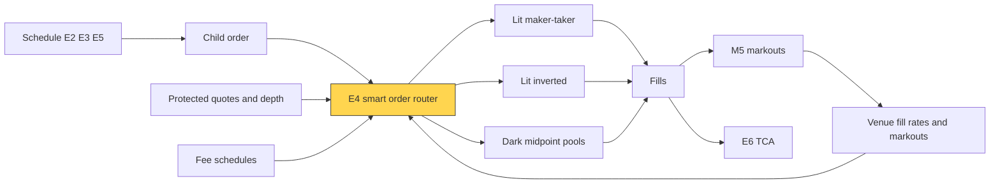
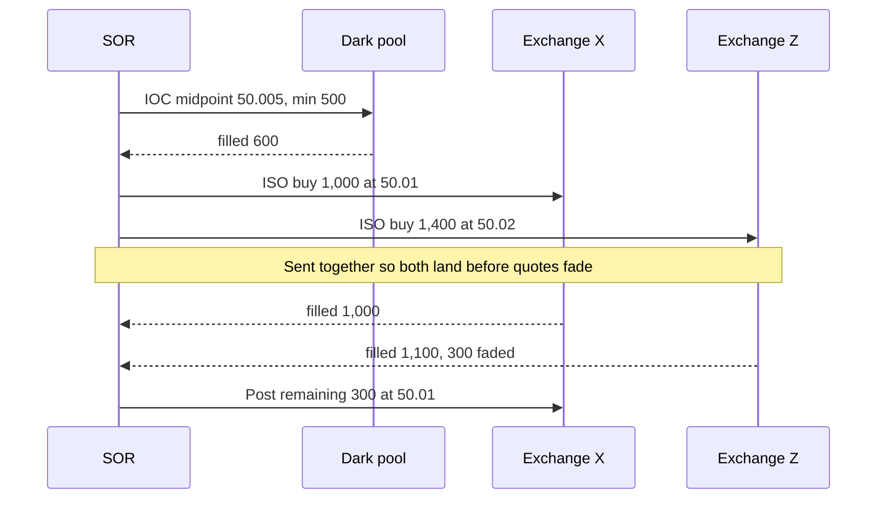
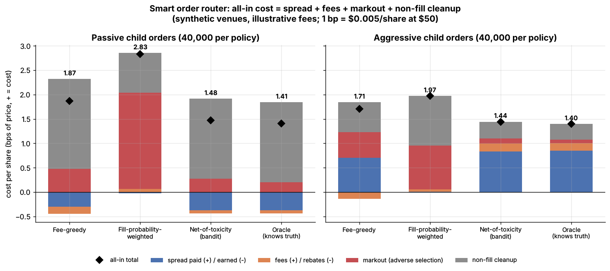
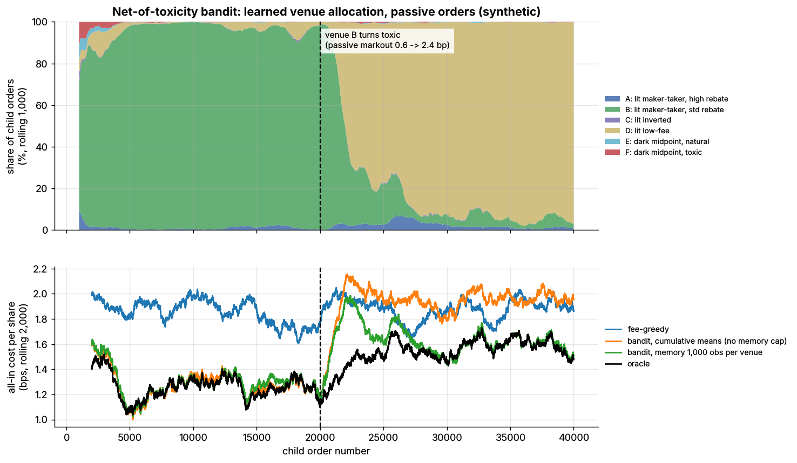

# Smart order routing

> **TL;DR**
>
> - A smart order router (SOR) decides venue, order type, size and sequence for each child order, minimizing all-in cost: spread + fees − rebates + markout + non-fill cleanup.
> - Aggressive orders ping dark midpoint pools, then sweep every protected quote at once with intermarket sweep orders (ISOs). Passive orders go where fill odds, rebate and toxicity net out best.
> - Venue quality must be learned and forgotten. High fill rates often signal toxicity: in [Lab 18](https://github.com/FrankHuang94/quant_trading_claude/tree/main/labs/18-smart-order-router) a fill-chasing router cost 2.83 bps vs 1.48 for a markout-aware bandit (synthetic).
> - Rules in flux (2026-11): Rule 611's repeal was proposed in June 2026; the \$0.0010 access-fee cap is deferred to November 2027.

**Level:** Core · **Pipeline stage:** execution · **Last verified:** 2026-11

| Field | Value |
|---|---|
| Purpose (the question it answers) | Where, how and in what order should each child order go to get the best all-in price? |
| Inputs → Outputs | child order, protected quotes and depth, fees, latencies, learned fill rates and markouts → venue, order type and size per slice; updated venue statistics |
| Used by strategies | [Fee-driven](../../02-strategies/b-speed-and-structural/fee-and-microstructure-driven-strategies.md) · [Equity MM](../../02-strategies/a-liquidity-provision/equity-market-making.md) · [ETF MM](../../02-strategies/a-liquidity-provision/etf-market-making.md) · [Latency arbitrage](../../02-strategies/b-speed-and-structural/latency-arbitrage.md) · [ETF arbitrage](../../02-strategies/b-speed-and-structural/etf-and-index-arbitrage.md) · [Internalization](../../02-strategies/a-liquidity-provision/retail-flow-internalization.md) · [ML short-horizon](../../02-strategies/c-statistical-arbitrage/ml-driven-short-horizon-alpha.md) · [Reversal](../../02-strategies/c-statistical-arbitrage/short-term-cross-sectional-reversal.md) · [Cross-sectional alpha](../../02-strategies/d-mid-frequency-alpha/cross-sectional-alpha-and-neutralization.md) |
| Latency / compute regime | microseconds to milliseconds per decision; sweep slices land within microseconds; statistics refreshed intraday |
| Key parameters | markout horizons 1 s–5 min; memory about 1,000 fills per venue; prior weight about 5; ping minimum size |
| Main failure modes | fill-chasing; stale statistics; rebate conflicts; ping leakage; quote fade |
| Lab | [Lab 18](https://github.com/FrankHuang94/quant_trading_claude/tree/main/labs/18-smart-order-router) |

## Intuition

A US stock trades on 18 exchanges, about 33 alternative trading systems and wholesalers `[Reported]`. The same displayed price is not the same price: fees, fill odds and what happens *after* the fill differ. Routing is procurement: unit price (quote ± fee), delivery risk (fill probability), defect rate ([markout](../../09-reference/glossary.md#markout)). And under [Regulation NMS](../../09-reference/glossary.md#regulation-nms) you may not ignore a better protected quote.

## Where it sits in the pipeline



## The algorithm

1. **Venue view:** protected quotes, depth, fees, latency, learned fill rate and markout per venue and order type.
2. **Aggressive:** ping dark midpoint pools with minimum-size IOCs, then send [ISOs](../../09-reference/glossary.md#intermarket-sweep-order-iso) to every protected quote inside the limit, timed to arrive together. Re-route or post the rest.
3. **Passive:** post where expected all-in cost is lowest.
4. **Learn:** update fill rate and markout with capped memory; explore by Thompson sampling (route to the cheapest *plausible* venue).
5. **Comply:** no trade-throughs except via ISOs, no locked quotes, regular best-execution reviews ([FINRA Rule 5310](https://www.finra.org/rules-guidance/rulebooks/finra-rules/5310)).

```python
import math
import numpy as np

def expected_all_in_cost(venue, mode, fill_prob, markout_bps, price=50.0,
                         half_spread_bps=1.0, fallback_bps=None):
    """Lab 18: expected cost (bps, + = cost) of one child order at `venue`.
    venue: {"kind": "lit" or "mid", "make", "take"} in $/share; + = fee, - = rebate."""
    fee_bps = (venue["make"] if mode == "passive" else venue["take"]) / price * 1e4
    spread_bps = 0.0 if venue["kind"] == "mid" else (   # midpoint: no spread
        -half_spread_bps if mode == "passive" else half_spread_bps)
    if fallback_bps is None:                  # finish elsewhere if we miss
        fallback_bps = {"passive": 2.6, "aggressive": 2.1}[mode]
    return fill_prob * (spread_bps + fee_bps + markout_bps) + (1 - fill_prob) * fallback_bps

def route(order, venues, stats, policy="net_of_toxicity", rng=None, markout_sd_bps=5.0):
    """Lab 18: pick a venue index; with an rng, explore by Thompson sampling."""
    mode = order["mode"]
    if policy == "fee_greedy":
        return int(np.argmin([v["make"] if mode == "passive" else v["take"] for v in venues]))
    best, best_cost = 0, math.inf
    for i, v in enumerate(venues):
        n_sent, n_fill = stats["sent"][i] + stats["prior_n"], stats["fills"][i] + stats["prior_n"]
        fill, markout = stats["fill_rate"][i], stats["markout"][i]
        if rng is not None:                   # plausible draws, wide when evidence is thin
            fill = rng.beta(1 + fill * n_sent, 1 + (1 - fill) * n_sent)
            markout = rng.normal(markout, markout_sd_bps / math.sqrt(n_fill))
        if policy == "fill_weighted":
            markout = 0.0                     # the blind spot: toxicity not priced
        cost = expected_all_in_cost(v, mode, fill, markout)
        if cost < best_cost:
            best, best_cost = i, cost
    return best

def update_stats(stats, venue, filled, markout_bps, memory=1_000):
    """Lab 18 (run with memory=1,000): running means, counts capped -> an EWMA."""
    stats["sent"][venue] = min(stats["sent"][venue] + 1, memory)
    w = 1.0 / (stats["sent"][venue] + stats["prior_n"])
    stats["fill_rate"][venue] += w * (float(filled) - stats["fill_rate"][venue])
    if filled:
        stats["fills"][venue] = min(stats["fills"][venue] + 1, memory)
        w = 1.0 / (stats["fills"][venue] + stats["prior_n"])
        stats["markout"][venue] += w * (markout_bps - stats["markout"][venue])
```

An aggressive buy, as step 2 runs it (illustrative):



## Worked example with numbers

Lab 18's true parameters for passive orders (synthetic): \$50 stock, half-spread 1 bp, cleanup 2.6 bps if unfilled. Fees: \$0.0025 ÷ \$50 = 0.5 bp.

| Venue | Fee (+) or rebate (−) | Fill rate | Markout | True all-in | What a fill-chaser sees |
|---|---|---|---|---|---|
| A: maker-taker, high rebate | −0.50 | 0.30 | 1.5 | 1.82 | 1.37 |
| B: maker-taker, standard rebate | −0.32 | 0.40 | 0.6 | **1.27** | 1.03 |
| D: low-fee lit | 0.00 | 0.35 | 0.5 | 1.52 | 1.34 |
| F: toxic dark midpoint pool | +0.10 | 0.70 | 3.0 | 2.95 | **0.85** |

Venue B by hand: 0.40 × (−1.00 − 0.32 + 0.60) + 0.60 × 2.6 = −0.29 + 1.56 = **1.27 bps**.

- **Fee-greedy** picks A (biggest rebate): 1.82 bps.
- **Fill-chasing** ignores markouts, so F looks cheapest (0.85) and costs 2.95.
- **Net-of-toxicity** picks B. If B's markout jumps to 2.4, B costs 0.40 × 1.08 + 1.56 = 1.99 and D (1.52) wins.

The lab's 0.40 bp saving over fee-greedy is about \$1,980 per million shares.

## Key parameters and how practitioners tune them

- **Markout horizon:** about 1 s exposes latency-driven counterparties; minutes expose informed flow ([M5](../f-market-making-and-hft-algorithms/adverse-selection-and-markouts.md)).
- **Memory:** long enough to separate venues, short enough to notice change. Telling venues 0.5 bp apart takes about 770 fills each (Lab 18).
- **Ping size:** larger minimums resist probing but fill less ([E5](auction-close-and-dark-liquidity-algos.md)).
- **Fee tiers:** rebates depend on monthly volume, so the marginal share can be worth more than the average one `[Lore]`.

## Textbook version vs what firms actually do

- **Order protection:** Rule 611 makes *trading centers* prevent trade-throughs of protected quotes, except for ISOs whose sender takes every better quote simultaneously `[Verified]` ([17 CFR 242.611](https://www.ecfr.gov/current/title-17/section-242.611)). ISOs were 46% of trades and 41% of volume in one sample `[Verified]` ([Chakravarty et al. 2012](https://doi.org/10.1017/S0022109012000129)).
- **Rule change:** on 2026-06-11 the SEC proposed rescinding Rule 611 and the locked/crossed ban (Release 34-105655; comments closed 2026-08-17) `[Verified]`. The \$0.0010 access-fee cap is deferred to the first business day of November 2027 (Release 34-105656) `[Verified]`. Without Rule 611, fill odds and markouts would weigh more `[Estimate]`.
- **Learning:** dark-pool allocation as censored-exploration bandit, tested on broker data `[Verified]` ([Ganchev et al. 2010](https://doi.org/10.1145/1735223.1735247)); stochastic split algorithms `[Verified]` ([Laruelle, Lehalle & Pagès 2011](https://doi.org/10.1137/090780596)).
- **Synchronized sweeps:** RBC's THOR staggers sends so slices land together `[Reported]` (company claim).
- **Agency vs principal:** agency routers owe best execution and publish Rule 606 reports; routing client limit orders for rebates worsens fills `[Verified]` ([Battalio, Corwin & Jennings 2016](https://doi.org/10.1111/jofi.12422)). Principal routers optimize the firm's own markouts, latency and tiers `[Lore]`.

## How to tell if it's working

- **Venue scorecards:** fill rate, fade rate and markouts at 1 s, 10 s, 1 min by venue and order type.
- **Lab 18** (synthetic lab result), passive / aggressive bps: fee-greedy 1.87 / 1.71; fill-weighted 2.83 / 1.97; bandit 1.48 / 1.44; oracle 1.41 / 1.40. After B turned toxic, the memory-capped bandit cost 1.65 bps (2,800 more orders to B); the never-forgetting one 1.97 bps (16,210).



*Lab 18, synthetic: pricing markouts beats both fee-greedy and fill-chasing routing.*



*Lab 18, synthetic: the bandit shifts flow from B to D after the break.*

## Failure modes and pitfalls

- **Fill-chasing:** Lab 18's fill-weighted router sent 94% of passive orders to the toxic pool.
- **Quote fade:** size vanishes mid-sweep ([latency arbitrage](../../02-strategies/b-speed-and-structural/latency-arbitrage.md)).
- **Leakage:** pings and sprayed orders reveal the parent.
- **Stale NBBO:** midpoint pegs priced off a slow feed get picked off ([NBBO and market data](../../01-market-structure/nbbo-and-market-data.md)).

## How practitioners talk about it

- "Sweep it with ISOs." → take every protected quote at once.
- "That pool fills everything, which is the problem." → toxic counterparties.
- "Ping dark before you go lit." → midpoint IOCs first.
- "We're routing for the tier." → chasing a monthly rebate threshold.
- "Our scorecard dropped them at one-second markouts." → latency-driven flow.

## Questions you could ask a quant about this

1. How do you rank venues: fees, fill rate or markouts?
2. How quickly does the router forget a venue's history?
3. How do you time a multi-venue sweep?
4. What changes if Rule 611 goes?
5. 🔒 Which venues have you cut on markouts?

## Go deeper

<details markdown="1">
<summary>Math: all-in cost, Thompson sampling and sample size</summary>

Venue $v$, fill probability $p_v$, spread $s_v$, fee $f_v$, markout $m_v$, cleanup $c$:

$$
C_v = p_v\,(s_v + f_v + m_v) + (1 - p_v)\,c .
$$

Thompson sampling draws $\tilde p_v \sim \mathrm{Beta}(1 + p_v n_v,\ 1 + (1-p_v) n_v)$, $\tilde m_v \sim N(m_v, \sigma_m^2/k_v)$ and routes to $\arg\min_v C_v$. Separating markouts $\delta$ apart needs

$$
k \approx \Big(\frac{1.96\,\sigma_m \sqrt{2}}{\delta}\Big)^2 = \Big(\frac{1.96 \times 5 \times 1.414}{0.5}\Big)^2 \approx 770
$$

fills per venue.

</details>

## Related pages

- [Fees, rebates and ticks](../../01-market-structure/fees-rebates-and-ticks.md)
- [Order types and auctions](../../01-market-structure/order-types-and-auctions.md)
- [Auction, close and dark-liquidity algos](auction-close-and-dark-liquidity-algos.md)
- [Queue position and order placement](../f-market-making-and-hft-algorithms/queue-position-and-order-placement.md)
- [Implementation shortfall and Almgren-Chriss](implementation-shortfall-and-almgren-chriss.md)
- [Walkthrough: executing a \$500M buy order](../h-end-to-end-walkthroughs/walkthrough-institutional-execution.md)

## Sources

- [Verified] SEC (2005-06-29). "Regulation NMS," Release No. 34-51808, 70 FR 37496. <https://www.federalregister.gov/documents/2005/06/29/05-11802/regulation-nms> (accessed 2026-11)
- [Verified] 17 CFR 242.611, "Order protection rule." eCFR. <https://www.ecfr.gov/current/title-17/section-242.611> (accessed 2026-11)
- [Verified] Federal Register (2026-06-17). "The Trade-Through Rule and Locked and Crossed Markets Provisions of Regulation NMS," Release No. 34-105655, 91 FR 36656. <https://www.federalregister.gov/documents/2026/06/17/2026-12163/the-trade-through-rule-and-locked-and-crossed-markets-provisions-of-regulation-nms> (accessed 2026-11)
- [Verified] SEC (2026-06-11). Order granting temporary exemptive relief (Rules 610(c) and 612 compliance to November 2027), Release No. 34-105656. <https://www.sec.gov/files/rules/exorders/2026/34-105656.pdf> (accessed 2026-11)
- [Reported] Morrison Foerster (2026-06-12). "SEC Proposes Landmark Rollback of Core Regulation NMS Requirements and Delays Implementation of 2024 Market Structure Reforms." <https://www.mofo.com/resources/insights/260612-sec-proposes-landmark-rollback-of-core-regulation> (accessed 2026-11)
- [Verified] Chakravarty, S., Jain, P., Upson, J. & Wood, R. (2012). "Clean Sweep: Informed Trading through Intermarket Sweep Orders." *Journal of Financial and Quantitative Analysis* 47(2), 415–435. <https://doi.org/10.1017/S0022109012000129> (accessed 2026-11)
- [Verified] Ganchev, K., Nevmyvaka, Y., Kearns, M. & Wortman Vaughan, J. (2010). "Censored exploration and the dark pool problem." *Communications of the ACM* 53(5), 99–107. <https://doi.org/10.1145/1735223.1735247> (accessed 2026-11)
- [Verified] Laruelle, S., Lehalle, C.-A. & Pagès, G. (2011). "Optimal split of orders across liquidity pools: a stochastic algorithm approach." *SIAM Journal on Financial Mathematics* 2(1), 1042–1076. <https://doi.org/10.1137/090780596> (accessed 2026-11)
- [Verified] Battalio, R., Corwin, S. A. & Jennings, R. (2016). "Can Brokers Have It All? On the Relation between Make-Take Fees and Limit Order Execution Quality." *Journal of Finance* 71(5), 2193–2238. <https://doi.org/10.1111/jofi.12422> (accessed 2026-11)
- [Verified] FINRA (n.d.). Rule 5310, "Best Execution and Interpositioning." <https://www.finra.org/rules-guidance/rulebooks/finra-rules/5310> (accessed 2026-11)
- [Reported] RBC Capital Markets via Newswire (n.d.). "RBC Capital Markets receives Notice of Allowance for its THOR patent from the U.S. Patent and Trademark Office" (company release). <https://newswire.ca/news-releases/rbc-capital-markets-receives-notice-of-allowance-for-its-thor-patent-from-the-us-patent-and-trademark-office-512576901.html> (accessed 2026-11)
