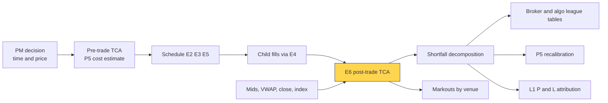

# Transaction cost analysis

> **TL;DR**
>
> - Transaction cost analysis (TCA) is variance analysis for trading: pre-trade forecasts cost and picks the strategy; post-trade measures, attributes and recalibrates.
> - The benchmark decides the verdict. Implementation shortfall vs the decision price (Perold 1988) captures everything; VWAP is easy to beat by trading with the market and can hide large costs.
> - Decompose shortfall into delay, spread, market move, impact and timing, opportunity cost and fees, each with an owner.
> - One order is mostly noise: per-order standard deviations of 50–150 bps against broker differences of a few bps mean hundreds to thousands of orders per comparison. Randomize allocation (algo wheels) and market-adjust.

**Level:** Core · **Pipeline stage:** execution · **Last verified:** 2026-11

| Field | Value |
|---|---|
| Purpose (the question it answers) | What did execution cost, against which benchmark, why, and which broker or algo does it better? |
| Inputs → Outputs | parent orders, timestamped fills with venues, mids, VWAPs, closes, index returns, fees → shortfall components, benchmark slippages, markouts, league tables with error bars |
| Used by strategies | [Cross-sectional alpha](../../02-strategies/d-mid-frequency-alpha/cross-sectional-alpha-and-neutralization.md) · [Factor-residual](../../02-strategies/c-statistical-arbitrage/factor-residual-mean-reversion.md) · [Reversal](../../02-strategies/c-statistical-arbitrage/short-term-cross-sectional-reversal.md) · [ML short-horizon](../../02-strategies/c-statistical-arbitrage/ml-driven-short-horizon-alpha.md) · [Stat arb](../../02-strategies/c-statistical-arbitrage/stat-arb-overview-and-history.md) · [Momentum](../../02-strategies/e-risk-premia-and-factors/momentum.md) · [Factor investing](../../02-strategies/e-risk-premia-and-factors/factor-investing-fundamentals.md) · [Fundamental signals](../../02-strategies/d-mid-frequency-alpha/fundamental-quant-signals.md) · [Flow-driven](../../02-strategies/d-mid-frequency-alpha/flow-driven-strategies.md) · [Event-driven](../../02-strategies/d-mid-frequency-alpha/earnings-and-event-driven.md) · [Trend following](../../02-strategies/g-futures-and-macro-context/trend-following-and-ctas.md) |
| Latency / compute regime | overnight batch (seconds per day of fills); live dashboards for orders in flight |
| Key parameters | benchmark (arrival mid at order receipt); market adjustment β × index; markout horizons 1 s–1 day; 300–3,000 orders per comparison; participation-weighted price at 10–20% |
| Main failure modes | benchmark gaming; ignoring unfilled shares; bad timestamps; small samples; hard orders routed to the best broker |
| Lab | [Lab 17](https://github.com/FrankHuang94/quant_trading_claude/tree/main/labs/17-vwap-twap-pov) |

## Intuition

Budget vs actual: the [cost model](../d-portfolio-construction/transaction-cost-and-impact-models.md) estimate is the budget; post-trade TCA is the variance bridge. Perold compares the **paper portfolio** (every share at the decision price, no costs) with the **real** one. The gap is the [implementation shortfall](../../09-reference/glossary.md#implementation-shortfall); TCA splits it and asks: skill, market or noise?

## Where it sits in the pipeline



## The algorithm

1. **Stamp** decision, arrival (order reaches the algo), every fill (time, price, size, venue, mid) and the end.
2. **Shortfall** = paper minus real P&L, split into delay, spread, drift, opportunity and fees.
3. **Market-adjust** the drift: subtract β × index return over the order's life.
4. **Benchmarks**: also report slippage vs interval [VWAP](../../09-reference/glossary.md#vwap), the close and a participation-weighted price (VWAP over the window a 15% participation rate would need; Kissell 2014).
5. **[Markouts](../../09-reference/glossary.md#markout)** per fill at 1 s, 1 min, 5 min and the close, by venue and order type.
6. **Aggregate** notional-weighted by broker, algo, urgency and size bucket, with standard errors, and compare to the pre-trade estimate.

```python
import numpy as np

def is_decomposition(side, order_qty, decision_px, arrival_px, fills, end_px,
                     fees=0.0, beta=1.0, index_ret=0.0):
    """Implementation shortfall of one parent order (Perold 1988), bps of decision notional.
    side: +1 buy, -1 sell. fills: list of (qty > 0, fill_px, mid_at_fill).
    end_px: values unfilled shares (close or cancel time). index_ret: market
    return from arrival to the last fill. Positive numbers are costs."""
    q, px, mid = (np.array(col, float) for col in zip(*fills))
    filled = q.sum()
    delay = side * filled * (arrival_px - decision_px)       # waited before starting
    spread = side * (q * (px - mid)).sum()                   # paid vs mid at each fill
    drift = side * (q * (mid - arrival_px)).sum()            # mid moved while we traded
    market = side * filled * arrival_px * beta * index_ret   # drift the market explains
    parts = dict(delay=delay, spread=spread, market=market,
                 impact_timing=drift - market,               # our impact plus timing/alpha
                 opportunity=side * (order_qty - filled) * (end_px - decision_px),
                 fees=fees)
    bps = {k: 1e4 * v / (order_qty * decision_px) for k, v in parts.items()}
    bps["total"] = sum(bps.values())                         # = paper P&L - real P&L
    return bps

def vwap_slippage_bps(side, fills, interval_vwap):
    """Slippage vs interval VWAP of the filled part: easy to look good on."""
    q, px, _ = (np.array(col, float) for col in zip(*fills))
    return 1e4 * side * ((q * px).sum() / q.sum() - interval_vwap) / interval_vwap

def orders_needed(sd_bps=60.0, diff_bps=5.0, z_alpha=1.96, z_power=0.84):
    """Orders per arm to detect a mean cost difference (two-sample test)."""
    return int(np.ceil(2 * (z_alpha + z_power) ** 2 * (sd_bps / diff_bps) ** 2))
```

## Worked example with numbers

*Illustrative.* The PM decides to buy 100,000 shares at yesterday's close, \$50.00 (\$5M; 1 bp = \$500). The algo starts at \$50.10, fills 80,000 at an average \$50.25 when the mid averaged \$50.23, and stops at a participation cap. The close is \$50.60. Commissions are \$800. The market (β = 1) rose 0.10% while the order worked.

| Component | Calculation | $ | bps |
|---|---|---|---|
| Delay | 80,000 × (50.10 − 50.00) | 8,000 | 16.0 |
| Spread | 80,000 × (50.25 − 50.23) | 1,600 | 3.2 |
| Market | 80,000 × 50.10 × 0.10% | 4,008 | 8.0 |
| Impact and timing | 80,000 × 0.13 − 4,008 | 6,392 | 12.8 |
| Opportunity | 20,000 × (50.60 − 50.00) | 12,000 | 24.0 |
| Fees | | 800 | 1.6 |
| **Total** | | **32,800** | **65.6** |

Check: paper P&L = 100,000 × 0.60 = \$60,000; real = 80,000 × 0.35 − 800 = \$27,200; gap \$32,800.

Interval VWAP was \$50.28, so a VWAP report says the algo **beat its benchmark by 6 bps**. Shortfall says 65.6 bps went missing, most of it from *not finishing*. Owners: the desk (delay), the algo (spread and impact, 16 bps), the participation cap (opportunity).

## Key parameters and how practitioners tune them

- **Benchmark**: arrival mid for alpha-driven orders; the close for index funds; VWAP only for genuinely passive orders.
- **Market adjustment**: β × index or sector ETF return; cuts noise without bias.
- **Sample size**: per-order standard deviation σ, difference δ: n ≈ 2(1.96 + 0.84)²(σ/δ)² per arm. At σ = 60 bps, δ = 5 bps: **about 2,260 orders each**; at δ = 10 bps, about 570 `[Estimate]`.
- **Peer universes**: other managers' orders of similar size and liquidity. ANcerno (formerly Abel Noser) data underpin academic studies `[Verified]` (Bucci et al.), but peers' urgency differs.

## Textbook version vs what firms actually do

- **Textbook**: Perold's shortfall `[Verified]` ([Perold 1988](https://doi.org/10.3905/jpm.1988.409150)).
- **Practice**: brokers lead with VWAP slippage; buy-side quants anchor on market-adjusted arrival `[Lore]`.
- **Noise**: in [Lab 16](https://github.com/FrankHuang94/quant_trading_claude/tree/main/labs/16-almgren-chriss-frontier), TWAP beat a risk-averse schedule on 61% of single orders even though the risk-averse schedule had far lower risk (synthetic lab result).
- **Algo wheels** randomize orders across brokers within a bucket, so "best broker gets the hardest orders" stops biasing the league table `[Lore]`.
- **US rules**: FINRA Rule 5310 requires firms without order-by-order review to run "regular and rigorous" reviews, at least quarterly, by security and order type `[Verified]`. Amended Rule 605 reports add realized spreads; compliance began 2026-08-01 `[Verified]`.
- **EU comparison**: MiFID II's firm-level "top five venues" reports (RTS 28) were deleted in the 2024 review as hardly read; ESMA told national regulators to deprioritize them in February 2024, as it had for venue reports (RTS 27) after February 2023 `[Verified]`. The UK dropped RTS 28 from December 2021 `[Reported]`.

## How to tell if it's working

- Realized ÷ pre-trade estimate ≈ 1 per bucket, with error bars.
- Components sum to the books (zero residual).
- Rankings that survive a bootstrap and a second period.
- Markouts on passive fills not systematically negative at 1 minute.

## Failure modes and pitfalls

- **Benchmark gaming**: VWAP algos look good by trading with the market.
- **Dropping cancelled shares** removes opportunity cost, often the biggest line.
- **Timestamps**: decision time recorded late hides delay cost.
- **Selection bias**: urgent orders go to trusted brokers, who then look expensive.

## How practitioners talk about it

- "We beat VWAP but lost to arrival." → traded with the market, paid for it.
- "Delay ate 15 bps before the algo started." → the desk, not the broker.
- "What's the standard error on that league table?" → probably noise.
- "Put it on the wheel." → randomized broker allocation.
- "Five-minute markouts are negative." → passive fills are adversely selected.

## Questions you could ask a quant about this

1. Which benchmark is official, and who chose it?
2. How do you charge unfilled shares?
3. How many orders before you trust a broker comparison?
4. Do you market-adjust?
5. 🔒 How do realized costs feed back into your cost model and alpha haircuts?

## Go deeper

<details markdown="1">
<summary>Math: the shortfall identity and why single orders are noise</summary>

For a buy of $X$ shares decided at $P_d$, fills $q_j$ at $p_j$ with mids $m_j$, arrival $P_0$, unfilled shares valued at $P_e$, fees $F$:

$$
IS = \sum_j q_j (p_j - P_d) + (X - \textstyle\sum_j q_j)(P_e - P_d) + F ,
$$

$$
\sum_j q_j (p_j - P_d) = \underbrace{\textstyle\sum_j q_j (p_j - m_j)}_{\text{spread}} + \underbrace{\textstyle\sum_j q_j (m_j - P_0)}_{\text{drift}} + \underbrace{(\textstyle\sum_j q_j)(P_0 - P_d)}_{\text{delay}} .
$$

Price noise for a steady schedule over $T$ days: $\mathrm{sd}(IS) \approx \sigma\sqrt{T/3}$, about 115 bps for a full day at 2% daily volatility, 64 bps for two hours. Detecting a difference $\delta$ needs $n \approx 2(z_{\alpha/2} + z_\beta)^2\,\mathrm{sd}^2/\delta^2$ orders per arm.

</details>

## Related pages

- [Transaction cost and impact models](../d-portfolio-construction/transaction-cost-and-impact-models.md)
- [Implementation shortfall and Almgren-Chriss](implementation-shortfall-and-almgren-chriss.md)
- [VWAP, TWAP and POV](vwap-twap-pov.md)
- [Live monitoring and P&L attribution](../g-live-trading/live-monitoring-and-pnl-attribution.md)
- [Venues and retail flow](../../01-market-structure/venues-and-retail-flow.md)
- [Walkthrough: executing a \$500M buy order](../h-end-to-end-walkthroughs/walkthrough-institutional-execution.md)

## Sources

- [Verified] Perold, A. F. (1988). "The implementation shortfall: Paper versus reality." *Journal of Portfolio Management* 14(3), 4–9. <https://doi.org/10.3905/jpm.1988.409150> (accessed 2026-11)
- [Verified] FINRA (n.d.). Rule 5310, "Best Execution and Interpositioning." <https://www.finra.org/rules-guidance/rulebooks/finra-rules/5310> (accessed 2026-11)
- [Verified] SEC (2024-03-06). "SEC Adopts Amendments to Enhance Disclosure of Order Execution Information," press release 2024-32. <https://www.sec.gov/news/press-release/2024-32> (accessed 2026-11)
- [Verified] Federal Register (2025-10-02). "Disclosure of Order Execution Information; Extension of Compliance Date" (to August 1, 2026), doc. 2025-19316. <https://public-inspection.federalregister.gov/2025-19316.pdf> (accessed 2026-11)
- [Verified] ESMA (2024-02-13). "Deprioritisation of supervisory actions on the obligation to publish RTS 28 reports in light of the agreement on the MiFID II/MiFIR review," ESMA35-335435667-5871 (copy). <https://www.dirittobancario.it/wp-content/uploads/2024/02/ESMA-Dichiarazione-pubblica-13-febbraio-2024-n.-335435669-5871.pdf> (accessed 2026-11)
- [Reported] DLA Piper (2024-02-20). "ESMA publishes statement on reporting requirements under RTS 28 of MiFID II." <https://www.dlapiper.com/insights/publications/2024/02/esma-publishes-statement-on-reporting-requirements-under-rts-28-of-mifid-ii> (accessed 2026-11)
- [Reported] FinanceFeeds (n.d.). "A deeper look into RTS 27 and 28 abandonment by ESMA and FCA." <https://financefeeds.com/a-deeper-look-into-rts-27-and-28-abandonment-by-esma-and-fca/> (accessed 2026-11)
- [Verified] Bucci, F., Benzaquen, M., Lillo, F. & Bouchaud, J.-P. (2019). "Crossover from linear to square-root market impact" (uses ANcerno institutional trade data). *Physical Review Letters* 122, 108302. <https://doi.org/10.1103/PhysRevLett.122.108302> (accessed 2026-11)
- [Reported] Kissell, R. (2014). *The Science of Algorithmic Trading and Portfolio Management*. Academic Press (chapter 1, "Algorithmic Trading"). <https://doi.org/10.1016/B978-0-12-401689-7.00001-5> (accessed 2026-11)
