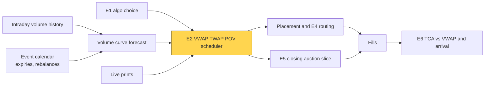
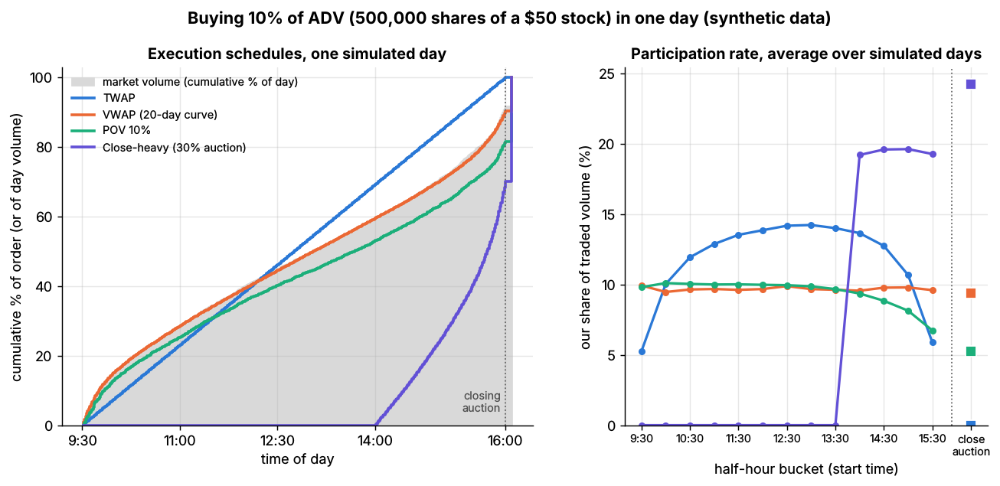
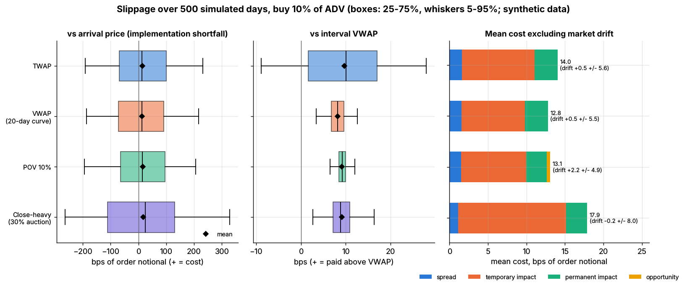

# VWAP, TWAP and POV

> **TL;DR**
>
> - Three answers to "how much now?" for a low-urgency order: TWAP slices by the clock, VWAP by a forecast volume curve, POV by live volume.
> - US volume is U-shaped by time of day; the closing auction alone took a record 9.4% of notional in Q2 2024 `[Reported]`. A VWAP engine is mostly a volume forecaster.
> - [Lab 17](https://github.com/FrankHuang94/quant_trading_claude/tree/main/labs/17-vwap-twap-pov) (synthetic, 10% of ADV in a day): expected cost VWAP 12.8 bps, POV 13.1, TWAP 14.0.
> - The VWAP benchmark is easy to hit and hides about a third of the true cost. POV finished the order on only 61% of days.
> - Production versions add limit prices, participation caps, passive posting and intraday curve updates.

**Level:** Core · **Pipeline stage:** execution · **Last verified:** 2026-11

| Field | Value |
|---|---|
| Purpose (the question it answers) | How many shares should a non-urgent order trade in each interval of the day? |
| Inputs → Outputs | quantity, start and end, 20–60 days of intraday volume, live volume, limits → shares per bin, fills, slippage vs interval VWAP and arrival |
| Used by strategies | [Cross-sectional alpha](../../02-strategies/d-mid-frequency-alpha/cross-sectional-alpha-and-neutralization.md) · [Factor investing](../../02-strategies/e-risk-premia-and-factors/factor-investing-fundamentals.md) · [Value, quality, low vol](../../02-strategies/e-risk-premia-and-factors/value-quality-low-vol.md) · [Momentum](../../02-strategies/e-risk-premia-and-factors/momentum.md) · [Fundamental signals](../../02-strategies/d-mid-frequency-alpha/fundamental-quant-signals.md) · [Revisions](../../02-strategies/d-mid-frequency-alpha/analyst-revisions-and-sentiment.md) · [Flow-driven](../../02-strategies/d-mid-frequency-alpha/flow-driven-strategies.md) · [Intraday patterns](../../02-strategies/c-statistical-arbitrage/intraday-patterns-and-seasonality.md) · [Trend following](../../02-strategies/g-futures-and-macro-context/trend-following-and-ctas.md) |
| Latency / compute regime | curve built overnight; schedule checked every bin (1 min); POV reacts each bin |
| Key parameters | curve lookback 20–60 days; POV rate 5–20% `[Lore]`; participation cap (brokers allow up to 50%) `[Verified]`; limit price; auction slice |
| Main failure modes | event days off the curve; POV chasing news volume; non-completion; self-flattering benchmark; predictable slices |
| Lab | [Lab 17](https://github.com/FrankHuang94/quant_trading_claude/tree/main/labs/17-vwap-twap-pov) |

## Intuition

Budgeting analogy: [TWAP](../../09-reference/glossary.md#twap) spreads the order straight-line over the day; [VWAP](../../09-reference/glossary.md#vwap) follows last year's seasonality (the average intraday volume curve); POV spends a fixed share of whatever revenue (volume) actually comes in. Trading in proportion to volume keeps your [participation rate](../../09-reference/glossary.md#participation-rate), and so your impact per share, roughly constant. Under concave impact that is the cheapest way to fill a fixed quantity in a fixed window when you have no view on price.

## Where it sits in the pipeline



## The algorithm

1. **Forecast the curve**: average each past day's normalized volume profile, closing auction as the last bin.
2. **VWAP**: shares per bin proportional to the curve; **TWAP** is a flat curve with nothing in the auction.
3. **POV**: each bin, buy enough that ours ÷ (others + ours) = target rate, using only volume already printed.
4. **Constrain**: limit price, participation cap, minimum and maximum child size.
5. **Measure**: slippage vs interval VWAP and arrival; completion.

```python
import numpy as np

def volume_curve(hist_volumes):
    """Lab 17: mean normalized profile; days x 391 bins (390 minutes + closing auction)."""
    return (hist_volumes / hist_volumes.sum(axis=1, keepdims=True)).mean(axis=0)

def vwap_schedule(volume_curve, qty):
    """Lab 17: shares per bin proportional to the forecast curve. TWAP = flat curve."""
    w = np.asarray(volume_curve, dtype=float)
    cum_target = np.round(qty * np.cumsum(w) / w.sum())   # rounding keeps the total exact
    return np.diff(np.concatenate([[0.0], cum_target]))

def pov_child_order(target_rate, market_volume_so_far, executed_so_far, remaining):
    """Lab 17: ours / (others + ours) = rate  =>  ours = rate / (1 - rate) * others.
    Uses only printed volume, so POV lags volume and cannot promise to finish."""
    target = target_rate / (1.0 - target_rate) * market_volume_so_far
    return float(np.clip(target - executed_so_far, 0.0, remaining))

def child_order_costs_bps(qty, market_volume, half_spread_bps, bought_before, adv, daily_vol,
                          eta=0.15, gamma=0.30, exponent=0.6):
    """Lab 17 stylized costs for a buy (bps): spread, temporary, permanent impact."""
    participation = np.divide(qty, market_volume, out=np.zeros_like(qty, dtype=float),
                              where=market_volume > 0)       # ours per share of others
    temporary = 1e4 * eta * daily_vol * participation ** exponent
    permanent = 1e4 * gamma * daily_vol * bought_before / adv  # lifts all later prices
    spread = np.where(qty > 0, half_spread_bps, 0.0)           # no spread in the auction
    return spread, temporary, permanent

# Not in the lab: a production-style limit price. Bins where the mid is above the
# limit get zero shares; the shortfall rolls forward and may never fill.
def apply_limit(schedule, mids, limit_px):
    return np.where(mids <= limit_px, schedule, 0.0)

# Usage: twap = vwap_schedule(np.r_[np.ones(390), 0.0], qty)   # flat, no auction
```

## Worked example with numbers

*Illustrative, Lab 17's stock.* Buy 500,000 shares (10% of a 5M-share ADV) of a \$50 stock, daily volatility 2%, quoted spread 3 bps.

| Half hour | Others trade | VWAP buys (q/v) | TWAP buys (q/v) |
|---|---|---|---|
| 9:30–10:00 (11% of day) | 550,000 | 55,000 (0.100) | 38,462 (0.070) |
| 12:00–12:30 (4.5%) | 225,000 | 22,500 (0.100) | 38,462 (0.171) |

TWAP's 1,282 shares a minute is 6.5% participation at the open and 14.6% at lunch; VWAP holds 9.1%.

**Temporary impact** is 0.15 × 200 bps × (q/v)^0.6, with q/v our shares per share others trade:

- VWAP: 30 × 0.10^0.6 = 30 × 0.251 = **7.5 bps**.
- TWAP: 6.1 bps at the open, 10.4 at lunch: **8.25 bps** across the two.
- Plus 1.5 bps half-spread and, after 250,000 shares, 0.30 × 200 × 0.05 = **3 bps** permanent impact.

**POV 10%**: others print 12,000 shares, so buy 0.10 ÷ 0.90 × 12,000 = **1,333**. On a day 25% light (3.75M), POV gets 0.111 × 3.75M = 417,000 shares: **83% filled**.

## Key parameters and how practitioners tune them

- **Curve**: 20–60-day profiles by stock or liquidity bucket, special curves for expiries, index rebalances and half-days `[Lore]`.
- **POV rate**: 5–20% `[Lore]`; above 20% impact dominates.
- **Caps**: maximum participation on VWAP (IBKR allows 10–50%) `[Verified]`.
- **Limit price** and the auction slice (see [E5](auction-close-and-dark-liquidity-algos.md)).

## Textbook version vs what firms actually do

- **Benchmark**: VWAP became a cost yardstick in [Berkowitz, Logue and Noser (1988)](https://doi.org/10.1111/j.1540-6261.1988.tb02591.x) `[Verified]`; [Kissell (2014)](https://doi.org/10.1016/B978-0-12-401689-7.00001-5) is the standard practitioner text.
- **Shape**: hourly NYSE volume is U-shaped ([Jain and Joh 1988](https://doi.org/10.2307/2331067)), and discretionary traders cluster ([Admati and Pfleiderer 1988](https://doi.org/10.1093/rfs/1.1.3)) `[Reported]`. The [closing auction](../../09-reference/glossary.md#closing-auction): record 9.4% of notional in Q2 2024 ([NYSE](https://nyse.com/data-insights/nyse-closing-auction-price-discovery-opportunities-reach-new-highs)), about 5–10% of monthly share volume in 2025 `[Reported]`.
- **Slicing theory**: [Konishi (2002)](https://doi.org/10.1016/S1386-4181(01)00023-4) derives the optimal static slice under volume uncertainty; dynamic intraday volume forecasts beat static curves ([Białkowski et al. 2008](https://doi.org/10.1016/j.jbankfin.2007.09.023); [Humphery-Jenner 2011](https://doi.org/10.1016/j.jbankfin.2011.01.028)) `[Reported]`.
- **Products**: IBKR's best-efforts VWAP can avoid taking liquidity and then may not fill; its guaranteed VWAP is discontinued `[Verified]` ([IBKR](https://interactivebrokers.github.io/tws-api/ibalgos.html)). VWAP is used by 81% of long-only desks, POV 74%, TWAP 38% `[Reported]` (The TRADE 2025).
- **Practice**: child orders mostly post passively and step up when behind schedule `[Lore]`; Lab 17 crosses the spread every time.

## How to tell if it's working

- Tracking error vs interval VWAP (curve error vs execution); participation by time of day; completion; slippage vs arrival.

| Lab 17 (synthetic, 500 days) | Expected cost | vs interval VWAP | Shortfall SD | Completion |
|---|---|---|---|---|
| TWAP | 14.0 bps | 9.7 ± 11.2 | 125 | 100% |
| VWAP (20-day curve) | 12.8 | 8.2 ± 3.0 | 122 | 100% |
| VWAP (perfect foresight) | 12.3 | 7.7 ± 0.8 | 123 | 100% |
| POV 10% | 13.1 | 9.1 ± 3.2 | 123 | 93.8% (61% of days) |

Synthetic lab result: stylized impact, every child crosses, volume independent of price. Real 10%-of-ADV days cost nearer 20 bps `[Estimate]` (square-root law).



*Lab 17, synthetic: cumulative fills vs market volume on one day (left); TWAP's participation swings from 5% to 14%, VWAP and POV hold near 10% (right).*



*Lab 17, synthetic: vs interval VWAP every schedule looks tight; vs arrival all are noise-dominated.*

## Failure modes and pitfalls

- **Self-flattering benchmark**: interval VWAP includes your own prints and impact; VWAP showed 8.2 bps against a true 12.8.
- **Event days**: expiries and rebalances break the curve.
- **POV chases volume**: news lifts volume and price together, so POV buys most when it is dearest. On below-median-volume days it filled 88%.
- **Predictability**: identical slices on a fixed clock invite front-running.

## How practitioners talk about it

- "Work it VWAP to the close, 15% cap." → curve schedule with a participation limit.
- "Go 10% of volume, limit 50.25." → POV with a price limit.
- "We were 3 bps behind VWAP, all curve error." → volume forecast missed.
- "Don't VWAP a fast signal." → low urgency only.
- "POV left 80k on the table." → non-completion on a light day.

## Questions you could ask a quant about this

1. How do you forecast the curve on expiry and rebalance days?
2. Do you update the curve intraday?
3. Is VWAP slippage measured against the full day or only your interval?
4. What happens to POV's leftovers at the close?
5. 🔒 How much of your VWAP tracking error is curve error?

## Go deeper

<details markdown="1">
<summary>Math: why VWAP is cost-optimal under power-law impact, and POV's rule</summary>

Fill $Q$ over bins with others' volume $v_i$ and temporary cost per share $\eta\,(q_i/v_i)^{\beta}$:

$$
\min_{q}\ \sum_i \eta\, q_i \left(\frac{q_i}{v_i}\right)^{\beta} \quad \text{s.t.} \quad \sum_i q_i = Q .
$$

The first-order condition $(1+\beta)\,\eta\,(q_i/v_i)^{\beta} = \mu$ makes $q_i/v_i$ constant: trade in proportion to volume. With known volume and no price view, VWAP is optimal; risk aversion or alpha pull toward front-loading ([E3](implementation-shortfall-and-almgren-chriss.md)). POV keeps $q/(q+v) = r$, so $q = \tfrac{r}{1-r}v$: one share per nine at 10%.

</details>

## Related pages

- [Execution algorithms: overview](execution-algorithms-overview.md)
- [Implementation shortfall and Almgren-Chriss](implementation-shortfall-and-almgren-chriss.md)
- [Auction, close and dark-liquidity algos](auction-close-and-dark-liquidity-algos.md)
- [Transaction cost analysis](transaction-cost-analysis.md)
- [Transaction cost and impact models](../d-portfolio-construction/transaction-cost-and-impact-models.md)
- [Intraday patterns and seasonality](../../02-strategies/c-statistical-arbitrage/intraday-patterns-and-seasonality.md)

## Sources

- [Verified] Berkowitz, S. A., Logue, D. E. & Noser, E. A. (1988). "The total cost of transactions on the NYSE." *Journal of Finance* 43(1), 97–112. <https://doi.org/10.1111/j.1540-6261.1988.tb02591.x> (accessed 2026-11)
- [Verified] Kissell, R. (2014). *The Science of Algorithmic Trading and Portfolio Management*. Academic Press. <https://doi.org/10.1016/B978-0-12-401689-7.00001-5> (accessed 2026-11)
- [Verified] Konishi, H. (2002). "Optimal slice of a VWAP trade." *Journal of Financial Markets* 5(2), 197–221. <https://doi.org/10.1016/S1386-4181(01)00023-4> (accessed 2026-11)
- [Reported] Białkowski, J., Darolles, S. & Le Fol, G. (2008). "Improving VWAP strategies: A dynamic volume approach." *Journal of Banking & Finance* 32(9), 1709–1722. <https://doi.org/10.1016/j.jbankfin.2007.09.023> (accessed 2026-11)
- [Reported] Humphery-Jenner, M. L. (2011). "Optimal VWAP trading under noisy conditions." *Journal of Banking & Finance* 35(9), 2319–2329. <https://doi.org/10.1016/j.jbankfin.2011.01.028> (accessed 2026-11)
- [Reported] Jain, P. C. & Joh, G.-H. (1988). "The dependence between hourly prices and trading volume." *Journal of Financial and Quantitative Analysis* 23(3), 269–283. <https://doi.org/10.2307/2331067> (accessed 2026-11)
- [Reported] Admati, A. R. & Pfleiderer, P. (1988). "A theory of intraday patterns: Volume and price variability." *Review of Financial Studies* 1(1), 3–40. <https://doi.org/10.1093/rfs/1.1.3> (accessed 2026-11)
- [Reported] NYSE Research (2024-08-29). "NYSE Closing Auction: price discovery opportunities reach new highs." <https://nyse.com/data-insights/nyse-closing-auction-price-discovery-opportunities-reach-new-highs> (accessed 2026-11)
- [Verified] Interactive Brokers (n.d.). "IB Algos" (TWS API documentation: VWAP, TWAP and Percentage of Volume parameters). <https://interactivebrokers.github.io/tws-api/ibalgos.html> (accessed 2026-11)
- [Reported] The TRADE (2025). "Algorithmic Trading Survey 2025: Long-only" (types of algorithms used, Figure 6). <https://thetradenews.com/wp-content/uploads/2025/04/Algo56-FINAL.pdf> (accessed 2026-11)
