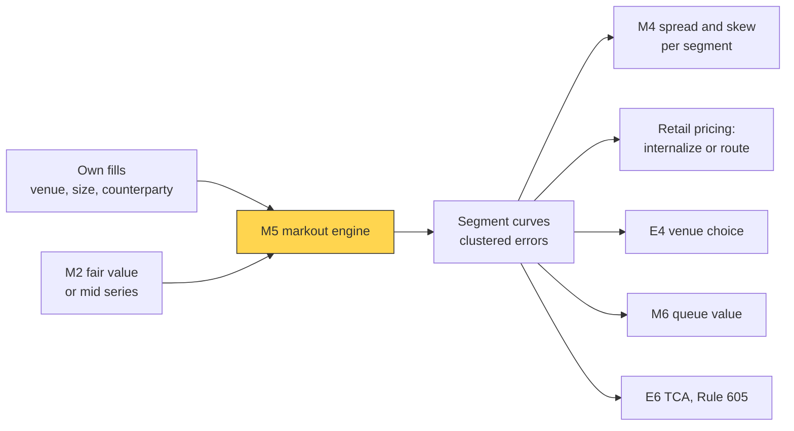
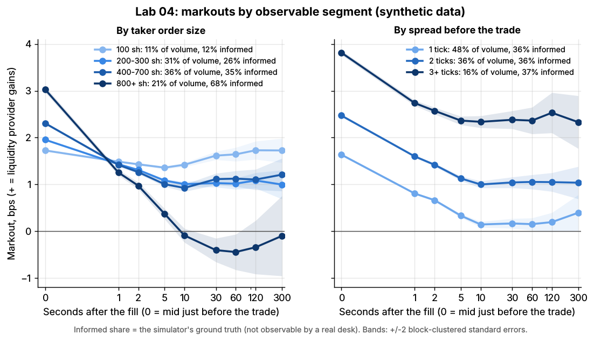

# Adverse selection and markouts

> **TL;DR**
>
> - [Adverse selection](../../09-reference/glossary.md#adverse-selection): whoever chooses to hit your quote knows more, on average. In Glosten-Milgrom the uninformed pay the spread that covers losses to the informed.
> - A [markout](../../09-reference/glossary.md#markout) marks a fill forward: side × (mid at t+h − fill price). At h = 0 it is the spread captured; the fall after that is adverse selection.
> - In Lab 04 (synthetic) informed flow looks profitable at 1 s but ends at −1.46 bps at 60 s; noise ends at +2.13.
> - Segment markouts set spreads and choose flow and venues; Rule 605's realized spread is the public version.

**Level:** Core · **Pipeline stage:** market making · **Last verified:** 2026-11

| Field | Value |
|---|---|
| Purpose (the question it answers) | Which fills made money after the price moved, and which flow is toxic? |
| Inputs → Outputs | own fills with segment tags, a mid or fair-value series → markout curves with standard errors, segment spreads, venue rankings |
| Used by strategies | [Equity market making](../../02-strategies/a-liquidity-provision/equity-market-making.md) · [ETF market making](../../02-strategies/a-liquidity-provision/etf-market-making.md) · [Options market making](../../02-strategies/a-liquidity-provision/options-market-making.md) · [Retail flow internalization](../../02-strategies/a-liquidity-provision/retail-flow-internalization.md) · [Auctions and closing liquidity](../../02-strategies/a-liquidity-provision/auctions-and-closing-liquidity.md) · [Fee-driven strategies](../../02-strategies/b-speed-and-structural/fee-and-microstructure-driven-strategies.md) · [Latency arbitrage](../../02-strategies/b-speed-and-structural/latency-arbitrage.md) |
| Latency / compute regime | warm path: per-fill markouts at 100 ms–60 s; segment curves in an overnight batch |
| Key parameters | horizons 50 ms–5 min; mid or microprice reference; per-share weights; 5–30 min cluster blocks |
| Main failure modes | horizon too short; per-fill averaging; naive standard errors; fees omitted; only fills observed |
| Lab | [Lab 04](https://github.com/FrankHuang94/quant_trading_claude/tree/main/labs/04-markout-analysis) |

## Intuition

Glosten and Milgrom (1985): a dealer cannot tell informed from uninformed takers. Every buy is partly news that value is higher, so the ask is set at expected value *given a buy*; losses to the informed are recovered from the uninformed. Kyle (1985) adds that informed traders hide in noise, moving price in proportion to flow ([order-book signals](order-book-and-trade-flow-signals.md)).

A market maker cannot see who is informed, only what the price did after each fill. A segment whose markouts end below zero knows more than the spread charges.

## Where it sits in the pipeline



## The algorithm

1. Record each passive fill: time, price, side (+1 if our bid was hit), size, segment tags.
2. Markout at horizon h, in bps: side × (mid(t+h) − price) / price × 10⁴; at h = 0, the mid just before the fill.
3. Average per share by segment; cluster standard errors by time block.
4. Read: markout₀ − markout_h is adverse selection; markout_h plus rebates minus fees is what you keep.
5. Act: widen, skew or stop quoting toxic segments; reweight venues.

```python
import numpy as np
import pandas as pd
HORIZONS_S = [0, 1, 2, 5, 10, 30, 60, 120, 300]   # 0 = mid just BEFORE the fill

def markouts(fills, mid_series, horizons=HORIZONS_S):
    # Lab 04: markout_h = side * (mid(t_fill + h) - fill_price) / fill_price * 1e4 (bps)
    # side = +1 our bid was hit (we bought), -1 our offer was lifted. + = we made money.
    t_book = mid_series.index.to_numpy()
    mid = mid_series.ffill().to_numpy()
    t_fill, price, side = (fills[c].to_numpy() for c in ("time", "price", "side"))
    out = {}
    for h in horizons:
        if h == 0:
            j = np.searchsorted(t_book, t_fill, side="left") - 1      # last mid before fill
        else:
            j = np.searchsorted(t_book, t_fill + h, side="right") - 1  # last mid at/before t+h
        out[h] = side * (mid[j] - price) / price * 1e4
    return pd.DataFrame(out, index=fills.index)       # markout_0 = spread captured

def markout_curve(mo, weights, blocks):
    # Share-weighted mean per horizon; standard error clustered by time block
    w = np.asarray(weights, float)
    mean = mo.mul(w, axis=0).sum() / w.sum()
    resid = (mo - mean).mul(w, axis=0)
    by_block = resid.groupby(np.asarray(blocks)).sum()  # fills in a block share one path
    se = np.sqrt((by_block ** 2).sum()) / w.sum()
    return mean, se

def segment_half_spread_bps(curves, horizon=60, fees_bps=0.0, margin_bps=0.2):
    # Not in the lab: break-even half-spread per segment = adverse selection + costs
    return {seg: max(m[0] - m[horizon], 0.0) + fees_bps + margin_bps
            for seg, m in curves.items()}
```

## Worked example with numbers

**One fill** (illustrative). Our bid at 50.00 is hit for 1,000 shares; the mid just before is 50.005.

| Horizon | Mid | Markout, \$/share | bps | \$ on 1,000 shares |
|---|---|---|---|---|
| 0 s | 50.005 | +0.005 | +1.0 | +5 |
| 10 s | 49.995 | −0.005 | −1.0 | −5 |
| 60 s | 49.985 | −0.015 | −3.0 | −15 |

Spread captured \$5, adverse selection \$20, net −\$15: this seller knew something. In [Rule 605](../../09-reference/glossary.md#rule-605) terms the seller's [effective spread](../../09-reference/glossary.md#effective-spread) is 2 × 0.5¢ = 1.0¢, the 60-second [realized spread](../../09-reference/glossary.md#realized-spread) is −3.0¢ (twice our markout), and price impact is the 4.0¢ difference.

**Lab 04's liquidity providers**, synthetic lab result in \$ per day: spread captured +77,818; adverse selection at 60 s −49,723; net +28,096, so they keep 36%. Informed takers cost them 18,106 net; uninformed takers pay them 46,202.

## Key parameters and how practitioners tune them

- **Horizon.** Long enough for informed flow to finish: Lab 04's informed curve crosses zero near 5 s. Amended Rule 605 reports 50 ms, 1 s, 15 s, 1 min and 5 min `[Verified]`.
- **Reference price.** The mid is standard; a [microprice](fair-value-and-microprice.md) cuts short-horizon noise but bakes in your model.
- **Weighting.** Per share: Lab 04's 60-second markout is +0.99 bps per fill, +0.82 per share.
- **Segments.** Broker, venue, size, time of day, [queue position](queue-position-and-order-placement.md); thin segments are shrunk toward pooled estimates `[Lore]`. Add rebates and fees per share.

## Textbook version vs what firms actually do

- **Many speeds.** The models have one informed type; real information decays over milliseconds (latency arbitrage) to hours (sliced parent orders), so desks read whole curves `[Lore]`.
- **Who is toxic.** HFTs' passive trades are adversely selected while their aggressive trades predict seconds ahead (Brogaard, Hendershott and Riordan 2014) `[Verified]`. A large HFT market maker lost on inventory and earned on the spread (Menkveld 2013) `[Verified]`.
- **Retail versus institutional.** Retail flow is benign over seconds, which is what [wholesalers](../../02-strategies/a-liquidity-provision/retail-flow-internalization.md) pay for, but mildly informed over a week (Boehmer et al. 2021) `[Verified]`; wholesalers price identical orders by broker (Schwarz et al. 2025) `[Verified]`.
- **Venues.** Euronext's quants found markouts rise almost linearly with the spread and differ by 0.4–0.8 bps across venues `[Reported]` (exchange research with a commercial interest).

## How to tell if it's working

Curves should be stable across days, and markout plus inventory P&L plus fees should reconcile to booked P&L ([live monitoring](../g-live-trading/live-monitoring-and-pnl-attribution.md)).

Lab 04, synthetic lab result (136,488 passive fills), bps:

| Segment | Volume share | 0 s | 1 s | 60 s |
|---|---|---|---|---|
| Informed takers (ground truth) | 36% | +2.53 | +1.13 | **−1.46** |
| Uninformed takers | 64% | +2.14 | +1.54 | **+2.13** |
| Taker orders of 800+ shares | 21% | +3.03 | +1.25 | −0.45 |

The toy flatters the method: its informed flag is ground truth (desks see only proxies), informed traders send single large orders (real ones slice), and there are no fees or latency. In real liquid large caps adverse selection typically eats most of the gross half-spread `[Lore]`.


*Lab 04, synthetic. Informed flow (orange) looks profitable at 1 s, then settles near −1.4 bps.*



*Lab 04, synthetic. Order size proxies toxicity; spread state here does not.*

## Failure modes and pitfalls

- **Short horizons** hide toxicity, as Lab 04's informed flow shows at 1 s.
- **Naive standard errors:** 0.012 versus 0.026 bps clustered at 10 s in Lab 04; clustering per Petersen (2009) `[Verified]`.
- **Selection:** you see only fills, and changing quotes changes who fills you.

## How practitioners talk about it

- "That broker marks out flat at a minute." → Benign flow, worth paying for.
- "We're getting run over at five seconds." → Informed flow is hitting the quotes.
- "Mark it to micro, not mid." → Less noise at sub-second horizons.
- "One day, one client: cluster it." → Small samples overstate significance.
- "Net of rebate we're flat." → Spread plus rebate just covers adverse selection.

## Questions you could ask a quant about this

1. *Basic:* Which horizons do you mark out at?
2. *Basic:* Mid or fair value as the reference?
3. *Informed:* How do you separate pick-offs from ordinary adverse selection?
4. *Informed:* Do you average per share or per fill?
5. *Sharp:* Which segment did you stop quoting last year? 🔒

## Go deeper

<details markdown="1">
<summary>Math: the Glosten-Milgrom spread and spread decompositions</summary>

Value is $V_H$ or $V_L$ with equal odds, $\Delta = V_H - V_L$, and a share $\pi$ of takers know it. Bayes on a buy gives

$$
\text{ask} = \mathbb{E}[V \mid \text{buy}] = \frac{V_H + V_L}{2} + \pi\,\frac{\Delta}{2}.
$$

Selling at the ask, the dealer marks out $-(1-\pi)\Delta/2$ against the informed and $+\pi\Delta/2$ against the uninformed: zero on average, very different by segment.

For a trade at $P$ with sign $q$ (+1 buyer-initiated) and mids $M_t$, $M_{t+h}$:

$$
\underbrace{2q(P - M_t)}_{\text{effective}} = \underbrace{2q(P - M_{t+h})}_{\text{realized}} + \underbrace{2q(M_{t+h} - M_t)}_{\text{price impact}}.
$$

</details>

## Related pages

- [Retail flow internalization](../../02-strategies/a-liquidity-provision/retail-flow-internalization.md)
- [Queue position and order placement](queue-position-and-order-placement.md)
- [Quoting and inventory control](quoting-and-inventory-control.md)
- [Transaction cost analysis](../e-execution-algorithms/transaction-cost-analysis.md)
- [The limit order book](../../01-market-structure/the-limit-order-book.md)
- [Latency arbitrage](../../02-strategies/b-speed-and-structural/latency-arbitrage.md)

## Sources

- [Verified] Glosten, L. R. & Milgrom, P. R. (1985). "Bid, ask and transaction prices in a specialist market with heterogeneously informed traders." *Journal of Financial Economics* 14(1), 71–100. <https://doi.org/10.1016/0304-405X(85)90044-3> (accessed 2026-11)
- [Verified] Kyle, A. S. (1985). "Continuous auctions and insider trading." *Econometrica* 53(6), 1315–1335. <https://doi.org/10.2307/1913210> (accessed 2026-11)
- [Reported] SEC (2024-03-06). "Disclosure of Order Execution Information," Release No. 34-99679, 89 FR 26428 (amended Rule 605; realized-spread horizons). <https://www.federalregister.gov/documents/2024/04/15/2024-05556/disclosure-of-order-execution-information> (accessed 2026-11)
- [Verified] 17 CFR 242.605, "Disclosure of order execution information" (realized spread at 50 ms, 1 s, 15 s, 1 min and 5 min). eCFR. <https://www.ecfr.gov/current/title-17/section-242.605> (accessed 2026-11)
- [Verified] Brogaard, J., Hendershott, T. & Riordan, R. (2014). "High-Frequency Trading and Price Discovery." *Review of Financial Studies* 27(8), 2267–2306. <https://doi.org/10.1093/rfs/hhu032> (accessed 2026-11)
- [Verified] Menkveld, A. J. (2013). "High frequency trading and the new market makers." *Journal of Financial Markets* 16(4), 712–740. <https://doi.org/10.1016/j.finmar.2013.06.006> (accessed 2026-11)
- [Verified] Boehmer, E., Jones, C. M., Zhang, X. & Zhang, X. (2021). "Tracking Retail Investor Activity." *Journal of Finance* 76(5), 2249–2305. <https://doi.org/10.1111/jofi.13033> (accessed 2026-11)
- [Verified] Schwarz, C., Barber, B. M., Huang, X., Jorion, P. & Odean, T. (2025). "The 'Actual Retail Price' of Equity Trades." *Journal of Finance* 80(5), 2507–2541. <https://doi.org/10.1111/jofi.13467> (accessed 2026-11)
- [Verified] Petersen, M. A. (2009). "Estimating Standard Errors in Finance Panel Data Sets: Comparing Approaches." *Review of Financial Studies* 22(1), 435–480. <https://doi.org/10.1093/rfs/hhn053> (accessed 2026-11)
- [Reported] Besson, P., Compérot, T. & Vialard, V. (2022-02-17). "Better passive posting across Lit venues based on quantitative analysis of Markouts." Euronext quantitative research. <https://www.euronext.com/en/news/better-passive-posting-across-lit-venues-based-quantitative-analysis-markouts-0> (accessed 2026-11)
