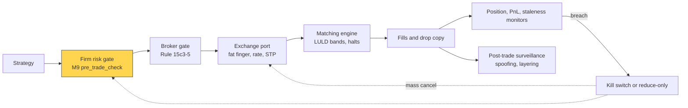
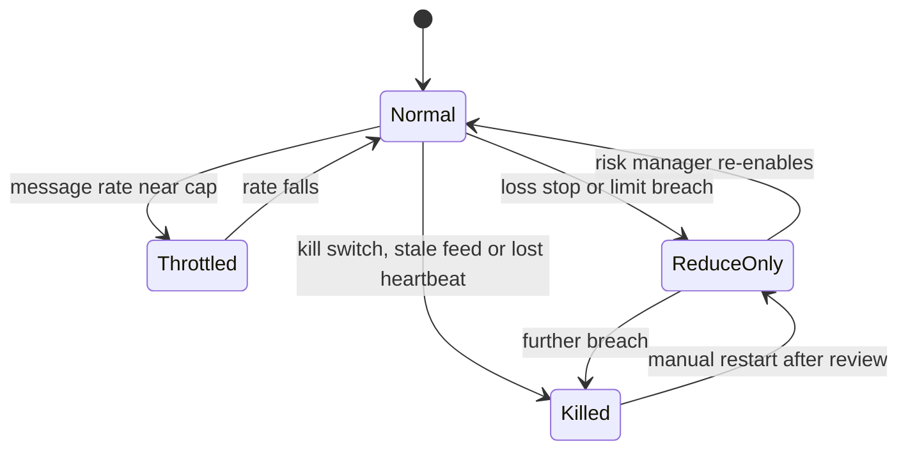

# Algorithmic risk controls

> **TL;DR**
>
> - Controls come in layers (strategy, firm or broker gateway, exchange port, market-wide), each assuming the one before has failed.
> - SEC Rule 15c3-5 (2010) makes broker-dealers with market access automatically reject orders that breach pre-set credit or capital thresholds or price and size limits, or that look duplicative `[Verified]`.
> - Knight Capital, 1 August 2012: 212 retail orders became over 4 million executions in 154 stocks in 45 minutes, and a loss of over $460 million `[Verified]`.
> - Good controls are strict on the way in and generous on the way out: cancels and risk-reducing orders always pass.

**Level:** Core · **Pipeline stage:** market making · **Last verified:** 2026-11

| Field | Value |
|---|---|
| Purpose (the question it answers) | May this order go out now, and should this strategy still be trading at all? |
| Inputs → Outputs | order, positions, open orders, P&L, market state, limits → accept, reject, throttle, reduce-only or kill; audit log |
| Used by strategies | [Equity market making](../../02-strategies/a-liquidity-provision/equity-market-making.md) · [ETF market making](../../02-strategies/a-liquidity-provision/etf-market-making.md) · [Options market making](../../02-strategies/a-liquidity-provision/options-market-making.md) · [Retail flow internalization](../../02-strategies/a-liquidity-provision/retail-flow-internalization.md) · [Auctions and closing liquidity](../../02-strategies/a-liquidity-provision/auctions-and-closing-liquidity.md) · [Latency arbitrage](../../02-strategies/b-speed-and-structural/latency-arbitrage.md) · [Lead-lag arbitrage](../../02-strategies/b-speed-and-structural/lead-lag-and-cross-asset-arbitrage.md) · [ETF and index arbitrage](../../02-strategies/b-speed-and-structural/etf-and-index-arbitrage.md) · [Fee-driven strategies](../../02-strategies/b-speed-and-structural/fee-and-microstructure-driven-strategies.md) · [ML short-horizon alpha](../../02-strategies/c-statistical-arbitrage/ml-driven-short-horizon-alpha.md) |
| Latency / compute regime | inline, ns–µs per order; P&L and staleness checks every ms–s; surveillance end of day |
| Key parameters | collar 1–5% from reference `[Lore]`; max order size (Cboe default 25,000 shares `[Verified]`); message rate (Cboe default 5,000/s per port `[Verified]`); position, notional and loss limits |
| Main failure modes | limits that only alert; account-level instead of firm-wide limits; false kills; a kill that strands hedges |
| Lab | — |

## Intuition

This is SOX for orders: pre-trade checks are preventive controls, monitors and surveillance detective, the [kill switch](../../09-reference/glossary.md#kill-switch) corrective, and the CEO certifies them annually. The difference is speed: a runaway algorithm can lose the firm's capital before anyone picks up a phone, so controls must be automatic, inline and independent of the strategy code.

## Where it sits in the pipeline



For a market maker that is its own broker-dealer, the first two gates are one.

## The algorithm

1. **Regulatory:** restricted list, halts, short-sale rules.
2. **Data sanity:** a stale reference price means no order.
3. **Price collar:** reject a buy more than *x*% above the reference (NBBO mid or own fair value), or a sell that far below; respect the [LULD](../../09-reference/glossary.md#limit-up-limit-down-luld) bands.
4. **Size ("fat finger"):** maximum shares and notional per order.
5. **Duplicates and rate:** repeated identical orders; a token-bucket message limit.
6. **Exposure:** worst case if every open order on that side fills; gross notional against a capital threshold.
7. **Modes:** a loss stop switches to reduce-only; a kill cancels everything. Cancels never pass through the gate.

```python
def pre_trade_check(order, state, limits):
    """Return (ok, reason). Runs inline before every new or replace; cancels skip it.
    order.side: +1 buy, -1 sell. M1's pre_trade_ok(o, s.limits) wraps this. Illustrative."""
    sym, side, qty, px = order.symbol, order.side, order.qty, order.px
    if state.mode == "killed":
        return False, "kill switch"
    if sym in limits.restricted or state.halted.get(sym, False):
        return False, "restricted or halted"                # regulatory, 15c3-5(c)(2)
    ref = state.ref_price(sym)                               # NBBO mid or own fair value
    if ref is None or state.now - state.last_md_time[sym] > limits.max_md_age_s:
        return False, "stale market data"
    if side * (px - ref) / ref > limits.collar_pct:          # buy far above or sell far below ref
        return False, "price collar"                         # erroneous order, 15c3-5(c)(1)(ii)
    lo, hi = state.luld_band(sym)
    if not lo <= px <= hi:
        return False, "outside LULD band"
    if qty > limits.max_order_qty or qty * px > limits.max_order_notional:
        return False, "fat finger"
    if state.recent_identical(order, window_s=1.0) >= limits.max_duplicates:
        return False, "duplicative orders"
    if not state.rate_bucket.take(1):                        # token bucket, messages per second
        return False, "message rate"
    pos = state.position[sym]
    reduces = abs(pos + side * qty) < abs(pos)
    if state.daily_pnl < -limits.max_daily_loss:
        state.mode = "reduce_only"                           # loss stop: no new risk
    if state.mode == "reduce_only" and not reduces:
        return False, "reduce-only mode"
    worst = pos + side * (qty + state.open_qty(sym, side))  # if every open order this side fills
    if abs(worst) > limits.max_position[sym] and not reduces:
        return False, "position limit"
    gross = state.gross_notional + state.open_notional() + qty * px
    if gross > limits.max_gross_notional and not reduces:
        return False, "capital threshold"                    # credit or capital, 15c3-5(c)(1)(i)
    return True, "ok"
```

## Worked example with numbers

Illustrative: XYZ quoted $50.00 × $50.02 (reference $50.01); collar 2%; maximum 5,000 shares or $250,000 per order; position limit ±10,000; position +8,000 with 3,000 shares of open buys; 5% LULD bands around $50.00, so $47.50–$52.50.

| Order | Check | Result |
|---|---|---|
| Buy 1,000 @ 50.01 | worst case 8,000 + 3,000 + 1,000 = 12,000 > 10,000 | reject: position |
| Sell 2,000 @ 50.02 | position falls to 6,000 | accept, even in reduce-only |
| Buy 500 @ 51.50 | (51.50 − 50.01) ÷ 50.01 = 2.98% > 2% | reject: collar (inside LULD, so the market would accept it) |
| Buy 50,000 @ 50.01 | 50,000 > 5,000 shares; $2.5M > $250k | reject: fat finger |

**Knight's arithmetic** `[Estimate]`. Final positions of $3.5 billion long and $3.15 billion short are $6.65 billion gross built in 2,700 seconds, about $2.5 million a second. A $50 million firm-wide gross cap would have tripped after about 20 seconds (50 ÷ 2.46). The loss was about $1.16 per share traded ($460M ÷ 397M shares).



## Key parameters and how practitioners tune them

- **Nesting:** strategy limits sit inside desk, firm, broker and exchange limits, so the innermost fires first `[Lore]`.
- **Calibration:** normal usage plus headroom; warn near 80%, stop at 100% `[Lore]`.
- **Collars:** wider for cheap or volatile names, and checked against own fair value because the NBBO can be stale.
- **Loss stop:** at 3 daily standard deviations it fires falsely on Φ(−3) ≈ 0.13% of days, about once in three years `[Estimate]`.
- **Repeat executions:** FIA recommends disabling a strategy after a set number of automatic fill-and-re-enter cycles `[Verified]`.

## Textbook version vs what firms actually do

- **The rule:** 15c3-5 also requires pre-order regulatory checks, authorized-only access, immediate post-trade reports to surveillance, direct and exclusive broker control, and a CEO-certified annual review `[Verified]`.
- **Knight's findings:** the SEC's first market-access case found no check comparing orders leaving the router with those entering it, an account limit not linked to any automated firm-wide control, and reliance on people instead of automated alerts; penalty $12 million `[Verified]`. A repurposed flag had woken dead code on one of eight servers missed in a deployment `[Verified]`.
- **Exchange ports:** Cboe offers fat-finger rejection through the NBBO, notional cutoffs, duplicate-order protection, [cancel-on-disconnect](../../09-reference/glossary.md#cancel-on-disconnect) and [self-trade prevention](../../09-reference/glossary.md#self-trade-prevention) `[Verified]`.
- **Market-wide:** LULD bands are 5% for Tier 1 stocks above $3 (10% for Tier 2); a 15-second limit state becomes a 5-minute pause `[Verified]`. [Circuit breakers](../../09-reference/glossary.md#market-wide-circuit-breaker) halt everything for 15 minutes on S&P 500 falls of 7% or 13% before 3:25 p.m., and for the day at 20%; Level 1 fired four times in March 2020 `[Verified]`. Regular-hours trades inside the bands are generally not bustable as clearly erroneous, so a firm keeps its mistakes `[Verified]`.
- **Surveillance:** [spoofing](../../09-reference/glossary.md#spoofing) and [layering](../../09-reference/glossary.md#layering) post orders meant to be cancelled to push the price, then trade the other way. FINRA Rule 5210 bans them `[Verified]`; in 2019 a jury found Avalon FA liable for layering and cross-market manipulation that made over $25 million `[Verified]`. Intent is invisible pre-trade, so detection is post-trade `[Lore]`.

## How to tell if it's working

- Rejects by reason: low but not zero; zero means limits never bind `[Lore]`.
- Kill-switch drills, timed from trigger to confirmed cancels.
- Drop-copy reconciliation with zero breaks (FIA) `[Verified]`.

## Failure modes and pitfalls

- **Alert-only limits:** Knight's 97 pre-open warning emails went unread `[Verified]`.
- **Kills that strand hedges:** half-hedged books; hence reduce-only mode.
- **Stale references:** collars block everything, or pass junk.
- **Bypass paths:** a "temporary" manual tool that skips the gate.
- **Self-surveillance:** a market maker's heavy cancelling can resemble layering.

## How practitioners talk about it

- "We're reduce-only on that book." → it may only shrink positions.
- "The collar's bouncing everything." → the reference price broke.
- "Hit the big red button." → kill switch.
- "COD saved us when the line dropped." → cancel-on-disconnect pulled resting orders.
- "We tripped the gross cap." → the firm-wide notional limit fired.

## Questions you could ask a quant about this

1. *Basic:* Which checks run before every order, and where?
2. *Basic:* What happens to resting orders if a connection drops?
3. *Informed:* Are limits firm-wide or per account?
4. *Sharp:* How does a kill avoid leaving you half-hedged?
5. *Sharp:* What are your actual collar and loss-stop levels? 🔒

## Go deeper

<details markdown="1">
<summary>Worst-case exposure, rate limits and false-kill odds</summary>

Worst-case position on side $s = \pm 1$, with open quantity $Q_s$ and new order $x$:

$$
q^{\text{wc}} = q + s\,(Q_s + x).
$$

A token bucket of capacity $b$ and refill rate $r$ allows bursts of $b$ messages and a sustained $r$ per second. A loss stop at $k$ daily standard deviations fires falsely once every $1/\Phi(-k)$ days.

</details>

## Related pages

- [Anatomy of an HFT trading loop](anatomy-of-an-hft-trading-loop.md)
- [Live monitoring and P&L attribution](../g-live-trading/live-monitoring-and-pnl-attribution.md)
- [Risk management at quant firms](../../06-risk-and-regulation/risk-management-at-quant-firms.md)
- [Rules that shape strategies](../../06-risk-and-regulation/rules-that-shape-strategies.md)
- [Strategy failure gallery](../../02-strategies/h-cross-cutting/strategy-failure-gallery.md)
- [Order types and auctions](../../01-market-structure/order-types-and-auctions.md)

## Sources

- [Verified] 17 CFR 240.15c3-5, "Risk management controls for brokers or dealers with market access." Legal Information Institute. <https://www.law.cornell.edu/cfr/text/17/240.15c3-5> (accessed 2026-11)
- [Verified] U.S. SEC (2010-11-03). "Risk Management Controls for Brokers or Dealers with Market Access," Release No. 34-63241. <https://www.sec.gov/rules/final/2010/34-63241.pdf> (accessed 2026-11)
- [Verified] U.S. SEC (2013-10-16). *In the Matter of Knight Capital Americas LLC*, Release No. 34-70694. <https://www.sec.gov/litigation/admin/2013/34-70694.pdf> (accessed 2026-11)
- [Reported] WilmerHale (2013). "Knight Capital settles Rule 15c3-5 violations with SEC, agrees to pay $12 million." <https://www.wilmerhale.com/insights/client-alerts/knight-capital-settles-rule-15c3-5-violations-with-sec-agrees-to-pay-12-million> (accessed 2026-11)
- [Verified] Cboe (2026-10-05). "Cboe Titanium U.S. Equities BOE Specification," version 2.4.58 (port attributes). <https://cdn.cboe.com/resources/techspec/technical-specifications-cboe-titanium-u-s-equities-boe-specification.md> (accessed 2026-11)
- [Verified] LULD Plan Participants. "Limit Up Limit Down: overview and price bands." <https://www.luldplan.com/> (accessed 2026-11)
- [Verified] Nasdaq Trader. "Market Wide Circuit Breaker." <https://www.nasdaqtrader.com/trader.aspx?id=CircuitBreaker> (accessed 2026-11)
- [Verified] Optiver. "5 things you should know about market-wide circuit breakers." <https://www.optiver.com/insights/explainers/5-things-you-should-know-about-market-wide-circuit-breakers/> (accessed 2026-11)
- [Verified] FINRA. Rule 11892, "Clearly Erroneous Transactions in Exchange-Listed Securities." <https://www.finra.org/rules-guidance/rulebooks/finra-rules/11892> (accessed 2026-11)
- [Verified] FIA (2024-07). "Best Practices for Automated Trading Risk Controls and System Safeguards." <https://fia.org/sites/default/files/2024-07/FIA_WP_AUTOMATED%20TRADING%20RISK%20CONTROLS_FINAL_0.pdf> (accessed 2026-11)
- [Verified] FINRA (2015-03). Regulatory Notice 15-09, "Effective Supervision and Control Practices for Firms Engaging in Algorithmic Trading Strategies." <https://www.finra.org/rules-guidance/notices/15-09> (accessed 2026-11)
- [Verified] U.S. SEC (2019-11-13). Press release 2019-205: jury verdict against Avalon FA for layering and cross-market manipulation. <https://www.sec.gov/news/press-release/2019-205> (accessed 2026-11)
- [Verified] Cook, C. (2017). "When a Microsecond Is an Eternity: High Performance Trading Systems in C++." CppCon 2017 (Optiver). <https://isocpp.org/blog/2018/09/cppcon-2017-when-a-microsecond-is-an-eternity-high-performance-trading-syst> (accessed 2026-11)
