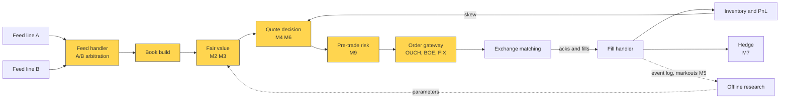
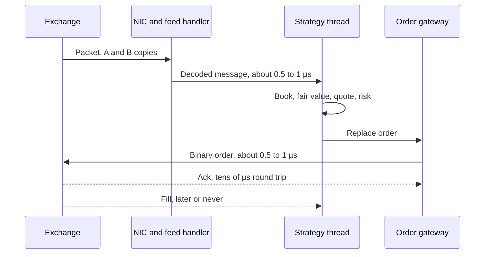

# Anatomy of an HFT trading loop

> **TL;DR**
>
> - A market maker's system is one event loop: packet in, book update, fair value, quote decision, risk check, order out. Acks and fills return later and update inventory and hedges.
> - [Tick-to-trade](../../09-reference/glossary.md#tick-to-trade) is about 2.5 µs in very good software and tens of nanoseconds on FPGAs `[Verified]`. Rank in a microsecond race matters more than absolute speed.
> - Models are fit offline and pushed in as parameters; the hot path only does arithmetic and lookups.
> - The core is built single-threaded and deterministic, so a recorded day replays to identical orders.

**Level:** Core · **Pipeline stage:** market making · **Last verified:** 2026-11

| Field | Value |
|---|---|
| Purpose (the question it answers) | What happens between a packet arriving and an order leaving, and how fast? |
| Inputs → Outputs | binary exchange feeds, own acks and fills, offline parameters, limits → order messages, hedges, positions, a replayable event log |
| Used by strategies | [Equity market making](../../02-strategies/a-liquidity-provision/equity-market-making.md) · [ETF market making](../../02-strategies/a-liquidity-provision/etf-market-making.md) · [Options market making](../../02-strategies/a-liquidity-provision/options-market-making.md) · [Retail flow internalization](../../02-strategies/a-liquidity-provision/retail-flow-internalization.md) · [Latency arbitrage](../../02-strategies/b-speed-and-structural/latency-arbitrage.md) · [Lead-lag arbitrage](../../02-strategies/b-speed-and-structural/lead-lag-and-cross-asset-arbitrage.md) · [ETF and index arbitrage](../../02-strategies/b-speed-and-structural/etf-and-index-arbitrage.md) · [Fee-driven strategies](../../02-strategies/b-speed-and-structural/fee-and-microstructure-driven-strategies.md) |
| Latency / compute regime | ns–µs per event; exchange round trip tens of µs |
| Key parameters | per-stage budget at p50 and p99; requote hysteresis of about a tick `[Lore]`; venue message caps (Cboe default 5,000/s per port `[Verified]`) |
| Main failure modes | tail latency in bursts; stale book after packet loss; unacked order state; runaway loops; research ≠ production code |
| Lab | [Lab 01](https://github.com/FrankHuang94/quant_trading_claude/tree/main/labs/01-matching-engine-order-book) |

## Intuition

Think of a spinal reflex: the hand leaves the stove before the brain hears about it, because the brain set the reflex in advance. Research is the brain, fitting weights and limits offline; the live loop is the reflex. Speed matters because quoting is a race: when news moves fair value, the market maker's cancel competes with rivals' orders to hit its stale quote. In London Stock Exchange data the modal race was won by 5–10 µs `[Verified]`, so a loop 3 µs slower than a rival's leaks its edge.

## Where it sits in the pipeline

This is [pipeline 1](../there-is-no-single-algorithm.md#1-the-hft-electronic-market-maker-loop) from the inside. Highlighted nodes are the hot path; dotted arrows run off it.



## The algorithm

1. **Feed handler.** Exchanges multicast binary, order-by-order feeds: Nasdaq TotalView-ITCH 5.0 (nanosecond timestamps, a 36-byte Add Order message) or Cboe PITCH `[Verified]`. Each is sent on lines A and B; keep whichever copy of each sequence number arrives first. If both miss a packet, the book is stale until recovered by retransmission or snapshot `[Verified]`; quotes are pulled meanwhile.
2. **Book build.** Apply adds, executions and cancels to a per-venue order book; order-level detail makes [queue position](queue-position-and-order-placement.md) trackable.
3. **Fair value.** [Microprice](../../09-reference/glossary.md#microprice) plus flow and lead-lag terms ([M2](fair-value-and-microprice.md), [M3](order-book-and-trade-flow-signals.md)).
4. **Quote.** Skew a [reservation price](../../09-reference/glossary.md#reservation-price) against inventory ([M4](quoting-and-inventory-control.md)); requote only past a threshold, to keep queue priority.
5. **Risk gate** ([M9](algorithmic-risk-controls.md)), then **order entry** in the venue's binary protocol (Nasdaq OUCH, Cboe BOE) or FIX.
6. **Acks and fills** advance each order's state machine. Inventory changes on fills, never on sends; [hedges](hedging-algorithms.md) follow.
7. **Log** everything with hardware timestamps for markouts, P&L and refits.

```python
# One symbol, one thread, one pinned core. Production is C++ or FPGA logic: no locks, no heap
# allocation, no system calls. Same names as pipeline 1 in "There is no single algorithm".
def on_packet(pkt, s):                             # lines A and B deliver identical sequenced copies
    if pkt.seq < s.next_seq:
        return                                     # duplicate from the slower line: drop it
    if pkt.seq > s.next_seq:                       # gap (after a brief wait for the other line)
        s.book_stale = True
        s.gateway.cancel_all(s.symbol)             # pull quotes first, recover second
        s.recovery.request(s.next_seq, pkt.seq)    # retransmission or snapshot (cold path)
        return
    s.next_seq = pkt.seq + 1
    for msg in decode(pkt):                        # fixed byte offsets, no text parsing
        on_market_data(msg, s)

def on_market_data(msg, s):
    book = s.book.apply(msg)                       # 1. add / execute / cancel / replace
    if s.book_stale or s.halted:
        return
    fv = microprice(book) + s.signals.predict_ticks(book, msg) * s.tick   # 2. fair value (M2, M3)
    r = fv - s.inventory * s.gamma * s.sigma**2 * s.horizon              # 3. inventory skew (M4)
    half = max(s.min_half_spread, s.half_spread(book, s.toxicity))
    targets = (("buy", floor_to_tick(r - half, s.tick)), ("sell", ceil_to_tick(r + half, s.tick)))
    for side, px in targets:
        live = s.live[side]
        if live is not None and abs(live.px - px) < s.requote_ticks * s.tick:
            continue                               # small move: keep the order and its queue spot (M6)
        o = Order(side, px, size=s.clip_for(side, s.inventory))
        if pre_trade_ok(o, s.limits):              # 4. inline risk gate (M9)
            s.gateway.replace(live, o)             # 5. binary OUCH / BOE message out
        s.log.record(msg, o, s.clock.hw_now())     # warm path: copied to a logger thread

def on_ack(ack, s):
    s.orders.transition(ack.order_id, ack.state)   # pending -> live -> pending-cancel -> done

def on_fill(fill, s):
    s.inventory += fill.signed_qty                 # 6. position first
    s.markouts.track(fill, horizons_s=[0.1, 1, 10])     # adverse selection (M5), warm path
    h = s.hedger.order_for(fill, s.inventory)      # 7. e.g. offset an ETF fill with futures (M7)
    if h is not None and pre_trade_ok(h, s.limits):
        s.gateway.send(h)
```

[Lab 01](https://github.com/FrankHuang94/quant_trading_claude/tree/main/labs/01-matching-engine-order-book) builds the matching engine and book this loop assumes.

## Worked example with numbers

**Latency budget** (illustrative, colocated; stage splits `[Estimate]`, totals sourced):

| Stage | Very good software | FPGA |
|---|---|---|
| Wire to user space, decode | 0.5–1 µs | a few to tens of ns |
| Book, fair value, quote, risk | 0.3–1 µs | ns (precomputed lookup) |
| Encode, back to the wire | 0.5–1 µs | a few to tens of ns |
| **Tick-to-trade** | **~2.5 µs** (Cook 2017) `[Verified]` | **13.9 ns**, 2024 STAC-T0, network I/O only `[Verified]` |
| Exchange round trip | sub-40 µs (Nasdaq's older claim) `[Verified]` | same |

Every firm pays the exchange round trip, so it rarely decides who is first. Physics counts: a 100-byte frame takes 80 ns to serialize at 10 Gb/s.

**Burst** (illustrative). An E-mini tick moves fair value in 500 correlated symbols. At 1 µs per symbol on one core, the 500th quote updates 500 µs later, long after rivals hit it. Across 16 cores (about 31 symbols each) the last update leaves after about 31 µs. Hence sharding, largest-exposure-first requoting, and measuring the tail rather than the average.



## Key parameters and how practitioners tune them

- **Requote threshold:** too small burns messages and queue spots; too large leaves stale quotes. Tuned on [markouts](../../09-reference/glossary.md#markout) `[Lore]`.
- **Gap policy:** Optiver's Carl Cook: if anything looks wrong, pull all orders, then ask questions `[Verified]`.
- **Sharding:** an ETF and its hedges on one core, so one thread sees both books `[Lore]`.
- **Message budget:** above a port's per-second cap, Cboe rejects new orders `[Verified]`.

## Textbook version vs what firms actually do

- **Textbook:** [Avellaneda-Stoikov](../../09-reference/glossary.md#avellaneda-stoikov-model) quoting assumes instant, continuous reaction. **Practice:** discrete events, queues and a race.
- **Hot path:** Cook (2017) says it runs about 0.01% of the time; a frequent dummy pass through the whole system keeps caches and branch predictors warm `[Verified]`.
- **Slow models, fast triggers:** a 2026 Optiver deep dive describes slow models arming fast triggers, and some loops living on one FPGA or ASIC with precomputed responses `[Reported]`.
- **Determinism:** LMAX runs its trading platform's business logic on one thread at about 6 million orders per second and rebuilds state by replaying its input journal `[Verified]`. Trading firms use the same pattern `[Lore]`.

## How to tell if it's working

- Switch-timestamped tick-to-trade at p50, p99 and p99.9, especially at the open.
- Cancels rejected as "already filled" count lost races `[Lore]`; [markouts](adverse-selection-and-markouts.md) price them.
- Yesterday's captured packets replay to production's orders byte for byte.
- Gap counts per line; order state reconciled to the exchange drop copy.

## Failure modes and pitfalls

- **Tail latency** (page faults, interrupts, noisy neighbours) loses races when markets are busiest.
- **Stale book** after packet loss: quoting prices that no longer exist.
- **In-flight state:** mishandled unacked orders cause double hedges.
- **Runaway loops:** Knight Capital's 2012 router sent child orders without counting fills ([M9](algorithmic-risk-controls.md)).

## How practitioners talk about it

- "What's our wire-to-wire at p99 on the open?" → tail latency in the busiest minutes.
- "B line's flapping; we're on A alone." → one multicast copy drops packets; no redundancy.
- "We gapped on EDGX and pulled." → a missed sequence number triggered cancels.
- "Replay doesn't match prod." → something nondeterministic leaked into the logic.
- "We lose the ES trigger by two micros." → a rival reacts faster to futures.

## Questions you could ask a quant about this

1. *Basic:* Which stages run in software and which in hardware?
2. *Basic:* What happens when you miss a packet?
3. *Informed:* Can you replay a day and get byte-identical orders?
4. *Sharp:* What is your p99 tick-to-trade at the open? 🔒
5. *Sharp:* On which triggers are you first, and how do you know? 🔒

## Go deeper

<details markdown="1">
<summary>Latency arithmetic and burst queueing</summary>

Serialization takes $t = 8B/R$ for $B$ bytes at rate $R$. With $N$ symbols to requote, work $w$ each and $k$ cores, the last update leaves after

$$
T_{\text{last}} \approx \lceil N/k \rceil \, w .
$$

With utilization $\rho = \lambda w$, an M/M/1 queue's mean time in system is

$$
\frac{w}{1-\rho},
$$

ten times the service time at $\rho = 0.9$, which is why systems are sized for bursts.

</details>

## Related pages

- [There is no single algorithm](../there-is-no-single-algorithm.md)
- [Fair value and microprice](fair-value-and-microprice.md)
- [Algorithmic risk controls](algorithmic-risk-controls.md)
- [NBBO and market data](../../01-market-structure/nbbo-and-market-data.md)
- [The limit order book](../../01-market-structure/the-limit-order-book.md)
- [Latency arbitrage](../../02-strategies/b-speed-and-structural/latency-arbitrage.md)
- [Colocation, networks and the speed of light](../../05-infrastructure/colocation-networks-and-the-speed-of-light.md)

## Sources

- [Verified] Nasdaq. "Nasdaq TotalView-ITCH 5.0" (feed specification). <https://www.nasdaqtrader.com/content/technicalsupport/specifications/dataproducts/NQTVITCHspecification.pdf> (accessed 2026-11)
- [Verified] Cboe (2026). "Cboe Titanium U.S. Equities/Options Multicast PITCH Specification: feed connectivity requirements." <https://www.cboe.com/document/tech-spec/content/technical-specifications/cboe-titanium-u.s.-equitiesoptions-multicast-pitch-specification/introduction/feed-connectivity-requirements> (accessed 2026-11)
- [Verified] Cboe (2026-10-05). "Cboe Titanium U.S. Equities BOE Specification," version 2.4.58. <https://cdn.cboe.com/resources/techspec/technical-specifications-cboe-titanium-u-s-equities-boe-specification.md> (accessed 2026-11)
- [Verified] Nasdaq Trader. "OUCH Measurements of Order Latency" (INET performance page, undated). <https://www.nasdaqtrader.com/snippets/inet2.html> (accessed 2026-11)
- [Verified] Cook, C. (2017). "When a Microsecond Is an Eternity: High Performance Trading Systems in C++." CppCon 2017 (Optiver). <https://isocpp.org/blog/2018/09/cppcon-2017-when-a-microsecond-is-an-eternity-high-performance-trading-syst> (accessed 2026-11)
- [Verified] STAC (2024-06-25). "STAC-T0 results with an Exegy/AMD FPGA solution" (vendor-commissioned benchmark). <https://stacresearch.com/node/48577> (accessed 2026-11)
- [Verified] Aquilina, M., Budish, E. & O'Neill, P. (2022). "Quantifying the High-Frequency Trading 'Arms Race'." *Quarterly Journal of Economics* 137(1), 493–564. <https://www.nber.org/papers/w29011> (accessed 2026-11)
- [Verified] Fowler, M. (2011-07-12). "The LMAX Architecture." <https://martinfowler.com/articles/lmax.html> (accessed 2026-11)
- [Reported] Orosz, G., Klaric, I. & Spevack, J. (2026-08-11). "Software engineering at a proprietary trading company: Optiver." *The Pragmatic Engineer*. <https://newsletter.pragmaticengineer.com/p/optiver> (accessed 2026-11)
