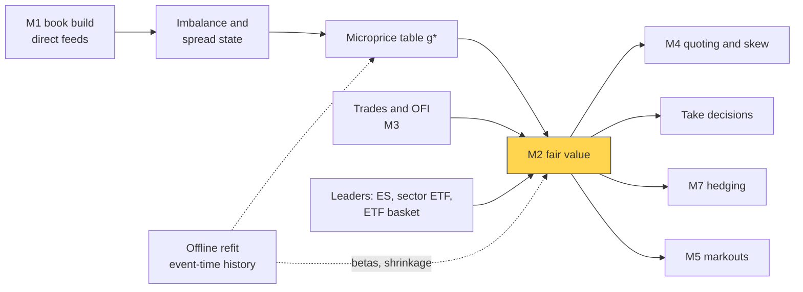
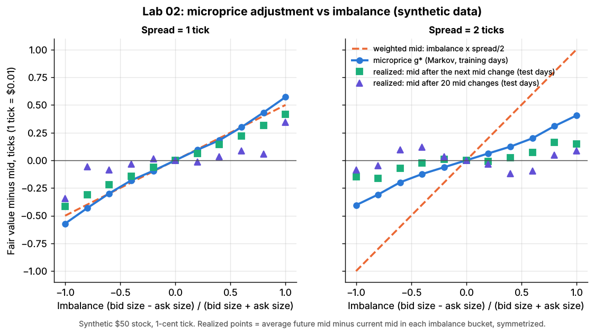
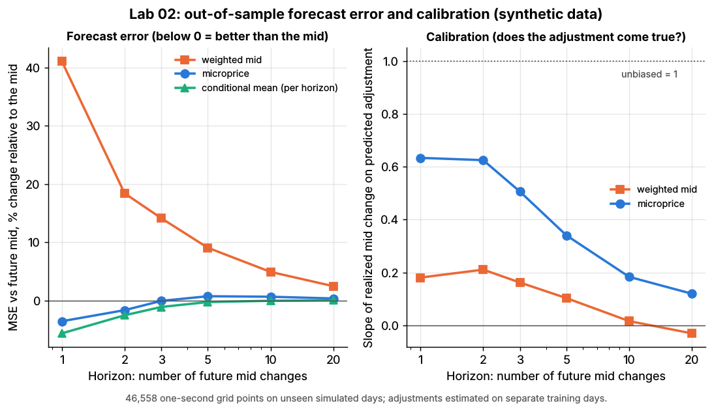

# Fair value and microprice

> **TL;DR**
>
> - [Fair value](../../09-reference/glossary.md#fair-value) is what a market maker quotes around: the mid adjusted for imbalance, flow and related instruments, over a few price changes.
> - The weighted mid leans toward the thin side by imbalance × half-spread; Stoikov's (2018) [microprice](../../09-reference/glossary.md#microprice) learns how much of that lean comes true.
> - In Lab 02 (synthetic) the microprice cuts next-move forecast error only 3.5% versus the mid; the weighted mid is 41% worse. Past ~5 seconds nothing book-based beats the mid.
> - The book is not the information: real fair values add flow and futures or ETF leads, each shrunk.

**Level:** Core · **Pipeline stage:** market making · **Last verified:** 2026-11

| Field | Value |
|---|---|
| Purpose (the question it answers) | Where is the price really, over the next few price changes? |
| Inputs → Outputs | top of book, trades, leaders (ES, sector ETF, basket), offline tables → fair value for quoting, taking, hedging and markouts |
| Used by strategies | [Equity market making](../../02-strategies/a-liquidity-provision/equity-market-making.md) · [ETF market making](../../02-strategies/a-liquidity-provision/etf-market-making.md) · [Options market making](../../02-strategies/a-liquidity-provision/options-market-making.md) · [Retail flow internalization](../../02-strategies/a-liquidity-provision/retail-flow-internalization.md) · [Latency arbitrage](../../02-strategies/b-speed-and-structural/latency-arbitrage.md) · [Lead-lag arbitrage](../../02-strategies/b-speed-and-structural/lead-lag-and-cross-asset-arbitrage.md) · [ETF and index arbitrage](../../02-strategies/b-speed-and-structural/etf-and-index-arbitrage.md) · [Fee-driven strategies](../../02-strategies/b-speed-and-structural/fee-and-microstructure-driven-strategies.md) |
| Latency / compute regime | µs: one table lookup per book update; tables refit overnight (seconds of batch) |
| Key parameters | imbalance buckets 5–20 (Lab 02: 11); spreads 1–3 ticks; horizon 1–3 mid changes; leader shrinkage 0.3–0.7 `[Lore]` |
| Main failure modes | wide-spread over-reaction; transient moves; stale leaders; wrong horizon; bait size |
| Lab | [Lab 02](https://github.com/FrankHuang94/quant_trading_claude/tree/main/labs/02-microprice-fair-value) |

## Intuition

With 4,500 shares bid at 50.00 and 500 offered at 50.01, the next tick is more likely up: 500 shares get eaten faster ([the limit order book](../../01-market-structure/the-limit-order-book.md)). How far above the mid is fair? The weighted mid answers mechanically, in proportion to [order-book imbalance](../../09-reference/glossary.md#order-book-imbalance). The microprice answers empirically: from this state, where did the mid go? Stoikov defines it as the limit of expected future mids, a martingale by construction `[Verified]`.

When E-mini futures tick up, every S&P 500 name's fair value moves before its book does ([lead-lag](../../09-reference/glossary.md#lead-lag)). Quotes then sit at fair value ∓ a half-spread, skewed for inventory ([M4](quoting-and-inventory-control.md)).

## Where it sits in the pipeline



## The algorithm

1. Per book update: imbalance $I = (Q_b - Q_a)/(Q_b + Q_a)$ and spread; discretize into a state.
2. Offline, in event time, count transitions: $Q$ (mid unchanged), $R$ (mid moved), $r$ (mean move). Sum the expected change over the next mid move and every later one, $g^* = \sum_i B^i G^1$, mirroring each book so it converges.
3. Online: fair value = mid + $g^*$[state] × tick + flow and leader terms, weighted by regression at the consumer's horizon.

```python
import numpy as np
N_IMB, MAX_SPREAD_TICKS = 11, 3     # Lab 02: 11 imbalance buckets x spreads of 1-3 ticks

def weighted_mid(bid, ask, bid_size, ask_size):
    # = mid + imbalance * spread / 2: leans toward the side with LESS size
    return (bid * ask_size + ask * bid_size) / (bid_size + ask_size)

def book_state(imbalance, spread_ticks, n_imb=N_IMB, max_spread_ticks=MAX_SPREAD_TICKS):
    half = (n_imb - 1) // 2                  # imbalance = (Qb - Qa) / (Qb + Qa), in [-1, 1]
    bucket = np.rint(np.asarray(imbalance) * half).astype(int) + half
    spread = np.rint(np.asarray(spread_ticks)).astype(int)
    ok = (spread >= 1) & (spread <= max_spread_ticks)
    return np.where(ok, (spread - 1) * n_imb + bucket, -1)      # -1: fall back to the mid

def estimate_microprice_adjustment(state, mid_ticks, n_imb=N_IMB,
                                   max_spread_ticks=MAX_SPREAD_TICKS, max_iter=200, tol=1e-6):
    # Offline, event time: consecutive book updates are transitions (Stoikov 2018)
    s, s_next, dm = state[:-1], state[1:], np.diff(mid_ticks)
    mirror = lambda x: (x // n_imb) * n_imb + (n_imb - 1 - x % n_imb)   # flip imbalance
    s, s_next, dm = np.r_[s, mirror(s)], np.r_[s_next, mirror(s_next)], np.r_[dm, -dm]
    n = n_imb * max_spread_ticks
    count = np.maximum(np.bincount(s, minlength=n), 1).astype(float)
    moved = dm != 0
    Q, R = np.zeros((n, n)), np.zeros((n, n))
    np.add.at(Q, (s[~moved], s_next[~moved]), 1.0)   # book changed, mid did not
    np.add.at(R, (s[moved], s_next[moved]), 1.0)     # mid moved; s_next = state after it
    Q, R = Q / count[:, None], R / count[:, None]
    r = np.bincount(s, weights=dm, minlength=n) / count     # mean mid move per update
    inv = np.linalg.inv(np.eye(n) - Q)
    G1, B = inv @ r, inv @ R      # change up to the next mid move; state right after it
    g, term = G1.copy(), G1.copy()
    for _ in range(max_iter - 1):              # g* = G1 + B G1 + B^2 G1 + ...
        term = B @ term
        g += term
        if np.max(np.abs(term)) < tol:
            break
    return g.reshape(max_spread_ticks, n_imb)  # ticks; row = spread - 1, col = bucket

def fair_value(mid, state, g_star, tick, extra_ticks=0.0):
    # Online. extra_ticks = flow (M3) and leader terms, each pre-shrunk. Not in the lab.
    adj = g_star.ravel()[state] if state >= 0 else 0.0
    return mid + (adj + extra_ticks) * tick
```



*Lab 02, synthetic. At 2 ticks wide the weighted mid (dashed) leans 2.6 times further than the microprice (blue); realized moves are smaller still.*

## Worked example with numbers

Illustrative book, 1-cent tick; $g^*$ from Lab 02's fitted table (synthetic).

| | 1-tick spread | 2-tick spread |
|---|---|---|
| Bid / ask (sizes) | 50.00 / 50.01 (4,500 / 500) | 50.00 / 50.02 (4,500 / 500) |
| Imbalance $I$ | 4,000 / 5,000 = 0.8 | 0.8 |
| Weighted mid | 50.005 + 0.8 × 0.005 = **50.0090** | 50.010 + 0.8 × 0.010 = **50.0180** |
| Microprice | 50.005 + 0.432 × 0.01 = **50.0093** | 50.010 + 0.309 × 0.01 = **50.0131** |

At two ticks a weighted-mid desk thinks a new 50.01 bid is 0.8 ticks cheap; the microprice says 0.31. Lab 02's test days realized 0.16 ticks by the next change: a fivefold overstatement.

**Adding a leader** (illustrative). ES ticks up 0.25 points at 6,000 (+4.17 bps). With beta 1.2 shrunk by 0.5, fair value rises 0.5 × 1.2 × 4.17 = 2.5 bps = \$0.0125, to 50.0218: through the 50.01 offer. The engine cancels its own offer and may lift rivals' stale ones ([latency arbitrage](../../02-strategies/b-speed-and-structural/latency-arbitrage.md)).

## Key parameters and how practitioners tune them

- **Tick regime.** Queue imbalance predicts much better in large-tick stocks than small-tick ones (Gould and Bonart 2016) `[Verified]`; see [tick-constrained stocks](../../09-reference/glossary.md#tick-constrained-stock).
- **Horizon.** Fit weights at the consumer's horizon: one second ahead, Lab 02's microprice is worse than the mid (+0.5% MSE).

## Textbook version vs what firms actually do

- **Reference price.** Avellaneda and Stoikov (2008) quote around a Brownian mid `[Verified]`; desks substitute their own fair value ("theo") `[Lore]`.
- **Inputs.** On 115 Nasdaq stocks, models fed order flow beat models fed raw book states, with an effective horizon of about two price changes (Kolm, Turiel and Westray 2023) `[Verified]`.
- **Futures lead.** E-mini futures carry most S&P 500 price discovery (Hasbrouck 2003) `[Verified]`; lagged cross-asset flow also helps, briefly (Cont, Cucuringu and Zhang 2023) `[Verified]`.
- **ETF basket.** The public iNAV is slow and not required by Rule 6c-11 `[Verified]`; desks value baskets themselves ([ETF, futures and options linkages](../../01-market-structure/etf-futures-options-linkages.md)).

## How to tell if it's working

Score against the future mid at the consumer's horizon, check calibration (realized on predicted move; slope 1 = unbiased) and [markouts](adverse-selection-and-markouts.md) of fills it called cheap.

Lab 02, synthetic lab result (46,558 test snapshots), MSE change versus the mid:

| Horizon | Weighted mid | Microprice | Best book-state forecast |
|---|---|---|---|
| Next mid change | +41.2% | **−3.5%** | −5.6% |
| 10 s | +6.6% | +0.7% | −0.1% |
| 60 s | +0.9% | +0.1% | +0.1% |

Calibration falls from 0.63 at the next move to 0.12 after 20. Why so modest:

- **Weak by design.** Real large-tick books carry a stronger imbalance signal than the toy.
- **Not Markov.** Simulated liquidity providers refill depleted queues toward a slow hidden belief, so moves partly revert.
- **Information is elsewhere.** The latent value's correlation with the microprice adjustment is +0.0006; informed traders reveal it through trades ([M3](order-book-and-trade-flow-signals.md)).



*Lab 02, synthetic. Left: MSE change versus the mid by horizon. Right: calibration slope.*

## Failure modes and pitfalls

- **Wide spreads:** Lab 02's weighted mid is 61% worse than the mid at 2 ticks.
- **Broken leaders:** stale feeds, halts, single-stock news.
- **Bait size:** spoofed size tilts imbalance; desks discount size that rarely trades `[Lore]`.

## How practitioners talk about it

- "We quote off micro, not mid." → Fair value includes the imbalance adjustment.
- "Weighted mid is fine one tick wide, dangerous at three." → It over-reacts at wide spreads.
- "Theo's through the offer, lift it." → Fair value is above the ask: take.
- "Shrink the ES term at the open." → The leader beta is unstable then.
- "What horizon is that theo for?" → Fair value only means something at a horizon.

## Questions you could ask a quant about this

1. *Basic:* Do you quote around the mid or your own fair value?
2. *Basic:* Which input moves it most: book, trades or futures?
3. *Informed:* Is your horizon in clock time or price changes?
4. *Informed:* How do you value a basket with halted names?
5. *Sharp:* How much markout improvement came from fair value rather than quoting? 🔒

## Go deeper

<details markdown="1">
<summary>Math: weighted mid, microprice recursion, horizon decay</summary>

With bid $P_b$, ask $P_a$, sizes $Q_b, Q_a$, mid $M$, spread $S$:

$$
W = \frac{P_b Q_a + P_a Q_b}{Q_a + Q_b} = M + I\,\frac{S}{2}.
$$

With $\tau_k$ the time of the $k$-th mid change:

$$
P^{\text{micro}}_t = \lim_{k\to\infty} \mathbb{E}\big[M_{\tau_k} \mid I_t, S_t\big] = M_t + g^*(I_t, S_t),
\qquad G^{k+1} = G^1 + B\,G^k .
$$

Estimation inverts a 33 × 33 matrix; online cost is one lookup.

**Horizon decay** `[Estimate]`: Lab 02's best book forecast removes 5.6% × 0.375 ≈ 0.021 ticks² at the next mid change; the mid's 60-second MSE is 23.9 ticks², so the same gain is under 0.1%.

</details>

## Related pages

- [Anatomy of an HFT trading loop](anatomy-of-an-hft-trading-loop.md)
- [Order-book and trade-flow signals](order-book-and-trade-flow-signals.md)
- [Quoting and inventory control](quoting-and-inventory-control.md)
- [Lead-lag and cross-asset arbitrage](../../02-strategies/b-speed-and-structural/lead-lag-and-cross-asset-arbitrage.md)
- [Equity market making](../../02-strategies/a-liquidity-provision/equity-market-making.md)

## Sources

- [Verified] Stoikov, S. (2018). "The micro-price: a high-frequency estimator of future prices." *Quantitative Finance* 18(12), 1959–1966. <https://doi.org/10.1080/14697688.2018.1489139> (accessed 2026-11)
- [Verified] Gould, M. D. & Bonart, J. (2016). "Queue imbalance as a one-tick-ahead price predictor in a limit order book." *Market Microstructure and Liquidity* 2(2), 1650006. <https://doi.org/10.1142/S2382626616500064> (accessed 2026-11)
- [Verified] Avellaneda, M. & Stoikov, S. (2008). "High-frequency trading in a limit order book." *Quantitative Finance* 8(3), 217–224. <https://doi.org/10.1080/14697680701381228> (accessed 2026-11)
- [Verified] Hasbrouck, J. (2003). "Intraday Price Formation in U.S. Equity Index Markets." *Journal of Finance* 58(6), 2375–2400. <https://doi.org/10.1046/j.1540-6261.2003.00609.x> (accessed 2026-11)
- [Verified] Kolm, P. N., Turiel, J. & Westray, N. (2023). "Deep order flow imbalance: Extracting alpha at multiple horizons from the limit order book." *Mathematical Finance* 33(4), 1044–1081. <https://doi.org/10.1111/mafi.12413> (accessed 2026-11)
- [Verified] Cont, R., Cucuringu, M. & Zhang, C. (2023). "Cross-impact of order flow imbalance in equity markets." *Quantitative Finance* 23(10), 1373–1393. <https://doi.org/10.1080/14697688.2023.2236159> (accessed 2026-11)
- [Verified] Cont, R., Kukanov, A. & Stoikov, S. (2014). "The price impact of order book events." *Journal of Financial Econometrics* 12(1), 47–88. <https://doi.org/10.1093/jjfinec/nbt003> (accessed 2026-11)
- [Verified] SEC (2019-09-25). "Exchange-Traded Funds." Final rule, Release No. 33-10695 (Rule 6c-11). <https://www.sec.gov/rules/final/2019/33-10695.pdf> (accessed 2026-11)
