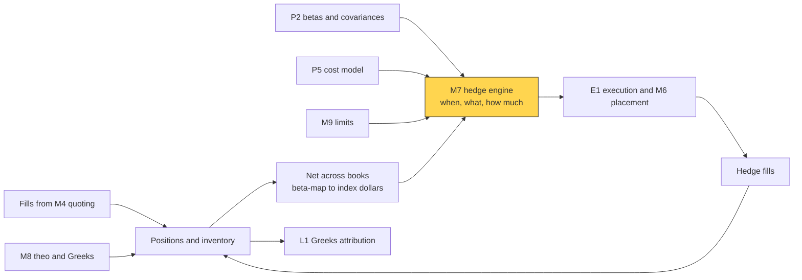
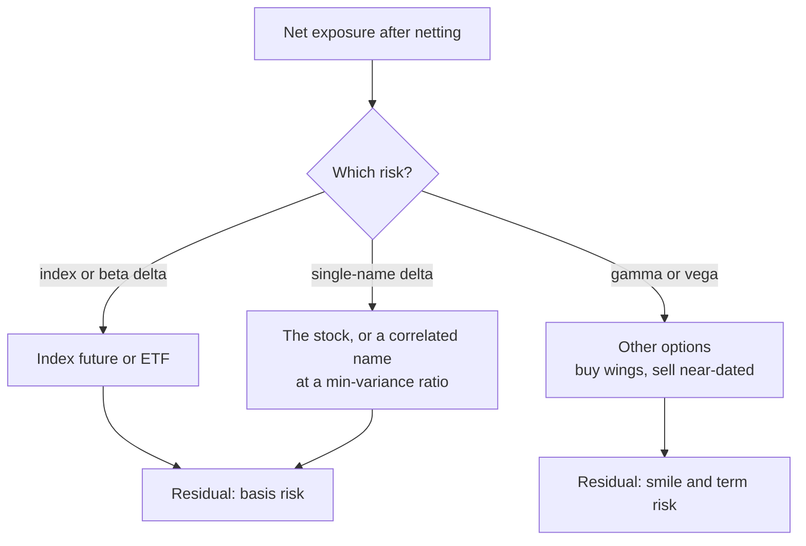
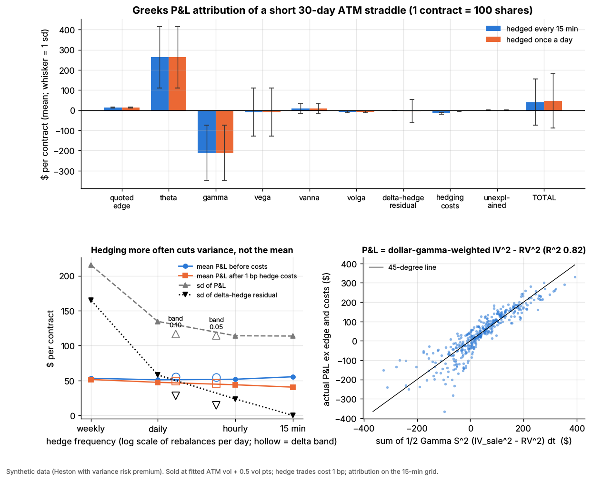

# Hedging algorithms

> **TL;DR**
>
> - Hedging buys lower P&L variance with trading costs. More frequent rebalancing shrinks hedge-error variance but, before costs, not expected P&L.
> - Timing rules: a clock, a band on net delta, or a utility-optimal band (Whalley–Wilmott).
> - Net across books, then hedge in the cheapest correlated instrument at a minimum-variance ratio; only options hedge gamma and vega.
> - Lab 06 (synthetic): residual sd ∝ rebalances^−0.56; 15-minute hedging costs more than the quoted edge.

**Level:** Core · **Pipeline stage:** market making · **Last verified:** 2026-11

| Field | Value |
|---|---|
| Purpose (the question it answers) | Which risk do I lay off, in what instrument, how much and when, given that hedging costs money? |
| Inputs → Outputs | net Greeks and inventory, betas, instrument costs, limits → hedge orders; residual-risk and cost reports |
| Used by strategies | [Options market making](../../02-strategies/a-liquidity-provision/options-market-making.md) · [Equity market making](../../02-strategies/a-liquidity-provision/equity-market-making.md) · [ETF market making](../../02-strategies/a-liquidity-provision/etf-market-making.md) · [Retail flow internalization](../../02-strategies/a-liquidity-provision/retail-flow-internalization.md) · [Auctions and closing liquidity](../../02-strategies/a-liquidity-provision/auctions-and-closing-liquidity.md) · [Lead-lag and cross-asset arbitrage](../../02-strategies/b-speed-and-structural/lead-lag-and-cross-asset-arbitrage.md) · [ETF and index arbitrage](../../02-strategies/b-speed-and-structural/etf-and-index-arbitrage.md) · [Volatility risk premium and vol arb](../../02-strategies/f-volatility-and-derivatives/volatility-risk-premium-and-vol-arb.md) · [Dispersion and correlation trading](../../02-strategies/f-volatility-and-derivatives/dispersion-and-correlation-trading.md) · [Pairs trading](../../02-strategies/c-statistical-arbitrage/pairs-trading-and-cointegration.md) |
| Latency / compute regime | µs–ms auto-hedging on fills and ticks; hedge ratios and vega rebalancing overnight |
| Key parameters | delta band ±0.02–0.10 per share `[Lore]`; clock 15 min–1 day; cost 0.2–2 bp per trade; beta lookback 60–250 days |
| Main failure modes | costs above edge; gaps; basis risk; stale ratios; hedging gross instead of net |
| Lab | [Lab 06](https://github.com/FrankHuang94/quant_trading_claude/tree/main/labs/06-options-mm-delta-hedging) |

## Intuition

In accounting terms, hedging is a cost center: costs are a recurring expense, residual risk is earnings volatility. A [delta-hedged](../../09-reference/glossary.md#delta-hedging) short option earns theta and pays [gamma](../../09-reference/glossary.md#gamma), ½ΓS²(σ²_implied − σ²_realized) per unit time: the [variance risk premium](../../09-reference/glossary.md#variance-risk-premium) bet (Bakshi & Kapadia 2003). Hedging strips out direction and leaves that bet. The stale hedge between rebalances leaves a mean-zero residual whose sd falls like 1/√N in N rebalances (Boyle & Emanuel 1980); costs grow like √N. With a thin edge, costs win early.

A clock trades when nothing happened; a band trades when delta has drifted. For an equity or ETF market maker, [inventory](../../09-reference/glossary.md#inventory-risk) is the delta, a future or ETF the hedge, and the band how much to warehouse ([M4](quoting-and-inventory-control.md)).

## Where it sits in the pipeline



## The algorithm

1. **Net** across books: delta per underlying, beta-weighted index dollars, vega by expiry.
2. **Map** each exposure to the cheapest instrument per unit of variance removed; size proxies at the minimum-variance [hedge ratio](../../09-reference/glossary.md#hedge-ratio).
3. **When:** on a clock, or when net delta leaves ±band.
4. **How much:** back to zero (Lab 06) or only to the band edge, optimal with proportional costs ([Whalley & Wilmott 1999](https://doi.org/10.1017/S095679259900368X)).
5. **Execute and attribute:** passive when there is time; compare cost with variance removed.



```python
import numpy as np

def delta_hedge_pnl(spot, position_delta, rebalance_every=1, band=None, cost_bps=1.0,
                    to_edge=False):
    """Lab 06's hedger on one path (the lab vectorizes over trades). spot, position_delta:
    arrays on one grid (n + 1 points); delta in shares per share of underlying.
    Time-based: rebalance every k steps. Move-based: only when |net delta| > band.
    to_edge (not in the lab): trade only back to the band edge (Whalley & Wilmott);
    the lab, like most simple hedgers, trades back to zero net delta."""
    n = len(spot) - 1
    held, traded_usd, n_reb = 0.0, 0.0, 0
    shares = np.zeros(n)
    for i in range(n):
        net = held + position_delta[i]                  # stock hedge + option delta
        if band is None:
            rebalance = i % rebalance_every == 0
        else:
            rebalance = abs(net) > band or i == 0
        if rebalance:
            target = -position_delta[i]                 # flatten net delta
            if to_edge and band is not None and i > 0:
                target += np.sign(net) * band           # ...or stop at the band edge
            traded_usd += abs(target - held) * spot[i]
            held, n_reb = target, n_reb + 1
        shares[i] = held                                # shares held over step i
    traded_usd += abs(held) * spot[n]                   # unwind at expiry
    return {"shares": shares, "hedge_pnl": np.sum(shares * np.diff(spot)),
            "costs": traded_usd * cost_bps / 1e4, "n_rebalances": n_reb}

def ww_half_band(gamma, spot, cost_frac, risk_aversion, tau=0.0, r=0.0):
    """Whalley-Wilmott (1997) half-width of the no-trade band around the BS delta."""
    return (1.5 * np.exp(-r * tau) * cost_frac * spot * gamma ** 2 / risk_aversion) ** (1 / 3)

def min_variance_ratio(r_asset, r_hedge):
    """Hedge units per unit of asset (Ederington 1979): slope of asset on hedge returns."""
    c = np.cov(r_asset, r_hedge)
    return c[0, 1] / c[1, 1]
```

## Worked example with numbers

**A. What each rebalance buys** (Lab 06, synthetic lab result, \$ per short straddle contract):

| Change | Extra hedging cost | Change in P&L sd |
|---|---|---|
| Daily → hourly | 7.90 − 3.60 = +\$4.30 | 134.6 → 114.1: −\$20.5 |
| Hourly → every 15 min | 14.86 − 7.90 = +\$6.96 | 114.1 → 113.7: −\$0.4 |
| Hourly → ±0.10 band | 5.85 − 7.90 = −\$2.05 | 114.1 → 116.8: +\$2.7 |

The first \$4.30 removes \$4.8 of sd per dollar; the next \$6.96, 6 cents per dollar. The band saves 16% of the \$13.06 edge for \$2.7 of sd.

**B. Cross-hedge** (*illustrative*). An ETF market maker, long \$10M of a sector ETF (vol 25%), hedges with E-mini S&P 500 futures (vol 18%, correlation 0.85).

- Ratio = 0.85 × 25 / 18 = 1.18: short \$11.8M of futures, 39 contracts at \$300,000 each (6,000 × \$50).
- Residual vol = 25% × √(1 − 0.85²) = 13.2%; one-day sd falls from \$157,000 to \$83,000.
- Cost: half the 0.25-point tick is 0.21 bp, about \$246, against \$1,500 to sell the basket at 1.5 bp.

The 13.2% left is [basis](../../09-reference/glossary.md#basis) risk: sector moves the future does not carry.

## Key parameters and how practitioners tune them

- **Band width:** tuned on the cost–variance frontier by replay `[Lore]`. Whalley–Wilmott scale it as cost^(1/3) × Γ^(2/3): doubling cost widens it 26%.
- **Backstop:** bands plus a daily flatten `[Lore]`.
- **Hedge ratios:** 60–250 days, exponentially weighted, shrunk toward 1 `[Lore]`.
- **Instrument:** cheapest all-in cost per unit of variance removed; E-minis trade nearly 23 hours `[Verified]`.
- **Gamma and vega:** limits by expiry; when they bind, trade options `[Lore]`.

## Textbook version vs what firms actually do

- **Textbook:** continuous, costless hedging. **Practice:** discrete hedging error ([Boyle & Emanuel 1980](https://doi.org/10.1016/0304-405X(80)90003-3)) and cost-adjusted vol ([Leland 1985](https://doi.org/10.1111/j.1540-6261.1985.tb02383.x)) `[Verified]`.
- **Utility bands:** [Whalley & Wilmott (1997)](https://doi.org/10.1111/1467-9965.00034) give the band in closed form; their 1999 sequel trades to an interior point when costs are fixed `[Verified]`. Desks often set bands by judgment `[Lore]`.
- **Machine learning:** [Deep hedging](https://doi.org/10.1080/14697688.2019.1571683) learns cost-aware hedges `[Verified]`; a 2026 preprint finds the Whalley–Wilmott band too narrow at large costs `[Reported]`.
- **Netting:** wholesalers net opposite retail flow before hedging `[Lore]` ([retail flow](../../02-strategies/a-liquidity-provision/retail-flow-internalization.md)).
- **Minimum variance:** the ratio is a regression slope ([Ederington 1979](https://doi.org/10.1111/j.1540-6261.1979.tb02077.x)) `[Verified]`.
- **Feedback:** whether dealer gamma hedging amplifies moves is contested ([linkages](../../01-market-structure/etf-futures-options-linkages.md)) `[Reported]`.

## How to tell if it's working

- [P&L attribution](../../09-reference/glossary.md#pl-attribution) ([L1](../g-live-trading/live-monitoring-and-pnl-attribution.md)): residual mean near zero, costs below edge, small "unexplained".
- Hedge effectiveness, 1 − Var(hedged)/Var(unhedged), near ρ².

**Lab 06** (synthetic lab result, mean \$ per contract): theta +262.6 and gamma −210.8 net to +51.8, dollar-gamma-weighted implied minus realized variance. Hedging every 15 minutes costs \$14.9, more than the \$13.1 edge (total +\$40.5); daily hedging costs \$3.6 but leaves a residual with sd \$58 (total +\$47.4). Residual sd scales with rebalances^−0.56 (theory −0.5); total sd floors near \$114, vol risk no delta hedge removes.

The lab is cleaner than reality: no jumps, a flat 1 bp cost, marks from the true model. Even so, 35% of daily-hedged trades lose. Real index hedges cost nearer 0.2 bp `[Estimate]`; real short-gamma books lose most in a few gap days `[Lore]`.



*Lab 06, synthetic: Greeks attribution (top); hedge frequency moves P&L sd, not the mean (bottom left); P&L tracks dollar-gamma-weighted implied minus realized variance, R² 0.82 (bottom right).*

## Failure modes and pitfalls

- **Overhedging:** costs exceed edge.
- **Gaps:** earnings and overnight moves; no frequency helps.
- **Basis:** proxies decorrelate in stress.
- **Stale ratios:** betas fitted in calm fail in crises.
- **Gross, not net:** paying the spread twice.
- **Pin risk:** near expiry, delta flips at the strike.

## How practitioners talk about it

- "Hedge to the edge, not the middle." → trade back only to the band.
- "Long \$12M of beta; sell 40 minis." → beta-weighted delta into E-minis.
- "Don't chase gamma on a chop day." → widen the band.
- "The hedge ate the edge." → costs exceeded quoted edge.
- "Basis blew out." → the proxy hedge failed.

## Questions you could ask a quant about this

1. Clock or band?
2. Back to zero, or to the edge?
3. Futures, ETF or basket for index delta?
4. How do you net across desks?
5. When do you hedge gamma and vega with options?
6. 🔒 What does hedging cost as a share of edge, by product?

## Go deeper

<details markdown="1">
<summary>Math: discrete hedging, costs, bands and hedge ratios</summary>

Theta plus gamma per step ($r = 0$, position gamma $\Gamma$):

$$
\tfrac12\,\Gamma S^2\left(\left(\tfrac{dS}{S}\right)^2 - \sigma_{\text{impl}}^2\,dt\right).
$$

Residual $\sum (h + \Delta)\,dS$, with $h + \Delta \approx \Gamma\,(S_t - S_{\text{last}})$: mean zero, sd $\propto N^{-1/2}$. Each rebalance trades about $|\Gamma|\,\sigma S\sqrt{T/N}$ shares, so costs grow like $\sqrt N$.

Whalley–Wilmott half-band, cost fraction $\lambda$, risk aversion $\gamma$:

$$
h = \left(\frac{3\,e^{-r(T-t)}\,\lambda\,S\,\Gamma^2}{2\gamma}\right)^{1/3}.
$$

</details>

## Related pages

- [Options market making](../../02-strategies/a-liquidity-provision/options-market-making.md)
- [Options pricing and vol surfaces](options-pricing-and-vol-surfaces-for-mm.md)
- [Quoting and inventory control](quoting-and-inventory-control.md)
- [Live monitoring and P&L attribution](../g-live-trading/live-monitoring-and-pnl-attribution.md)
- [ETF, futures and options linkages](../../01-market-structure/etf-futures-options-linkages.md)

## Sources

- [Verified] Boyle, P. P. & Emanuel, D. (1980). "Discretely adjusted option hedges." *Journal of Financial Economics* 8(3), 259–282. <https://doi.org/10.1016/0304-405X(80)90003-3> (accessed 2026-11)
- [Verified] Leland, H. E. (1985). "Option pricing and replication with transactions costs." *Journal of Finance* 40(5), 1283–1301. <https://doi.org/10.1111/j.1540-6261.1985.tb02383.x> (accessed 2026-11)
- [Verified] Whalley, A. E. & Wilmott, P. (1997). "An asymptotic analysis of an optimal hedging model for option pricing with transaction costs." *Mathematical Finance* 7(3), 307–324. <https://doi.org/10.1111/1467-9965.00034> (accessed 2026-11)
- [Verified] Whalley, A. E. & Wilmott, P. (1999). "Optimal hedging of options with small but arbitrary transaction cost structure." *European Journal of Applied Mathematics* 10(2), 117–139. <https://doi.org/10.1017/S095679259900368X> (accessed 2026-11)
- [Verified] Ederington, L. H. (1979). "The hedging performance of the new futures markets." *Journal of Finance* 34(1), 157–170. <https://doi.org/10.1111/j.1540-6261.1979.tb02077.x> (accessed 2026-11)
- [Verified] Buehler, H., Gonon, L., Teichmann, J. & Wood, B. (2019). "Deep hedging." *Quantitative Finance* 19(8), 1271–1291. <https://doi.org/10.1080/14697688.2019.1571683> (accessed 2026-11)
- [Reported] Arzel, J. & Lehdili, N. (2026). "Bridging Stochastic Control and Deep Hedging: Structural Priors for No-Transaction Band Networks." arXiv:2603.29994 (preprint). <https://arxiv.org/abs/2603.29994> (accessed 2026-11)
- [Verified] Bakshi, G. & Kapadia, N. (2003). "Delta-hedged gains and the negative market volatility risk premium." *Review of Financial Studies* 16(2), 527–566. <https://doi.org/10.1093/rfs/hhg002> (accessed 2026-11)
- [Verified] CME Group. "E-mini S&P 500 Futures: Contract Specifications." <https://www.cmegroup.com/markets/equities/sp/e-mini-sandp500.contractSpecs.html> (accessed 2026-11)
