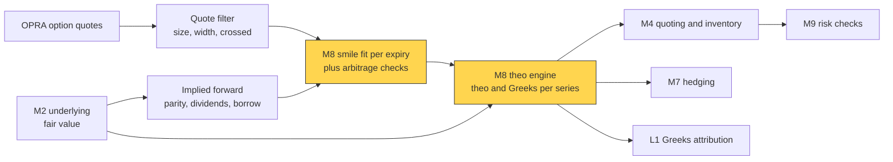
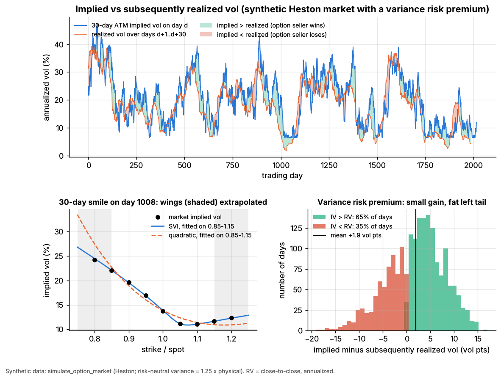

# Options pricing and vol surfaces for market making

> **TL;DR**
>
> - Black–Scholes is the quoting language, not the model: prices become [implied volatility](../../09-reference/glossary.md#implied-volatility), one scale for every strike and expiry.
> - The model is the [volatility surface](../../09-reference/glossary.md#volatility-surface): a smooth smile per expiry (SVI, spline, SABR) fitted to filtered quotes and checked for static arbitrage.
> - Two speeds: refit every second to minute; reprice thousands of series on every underlying tick, under a sticky-strike or sticky-delta rule.
> - In Lab 06 (synthetic), a parabola misses the wings by 1.25 vol points, SVI by 0.12.

**Level:** Deep dive · **Pipeline stage:** market making · **Last verified:** 2026-11

| Field | Value |
|---|---|
| Purpose (the question it answers) | What is every listed option worth now, consistently across the chain, and how does that move with spot? |
| Inputs → Outputs | option quotes, underlying fair value, rates, dividends, borrow → forward and smile per expiry; theo, vol and Greeks per series |
| Used by strategies | [Options market making](../../02-strategies/a-liquidity-provision/options-market-making.md) · [Volatility risk premium and vol arb](../../02-strategies/f-volatility-and-derivatives/volatility-risk-premium-and-vol-arb.md) · [Dispersion and correlation trading](../../02-strategies/f-volatility-and-derivatives/dispersion-and-correlation-trading.md) |
| Latency / compute regime | refit every 1–60 s (ms per expiry); theo updates per underlying tick (µs) |
| Key parameters | SVI (5 per expiry) or spline (9–15 nodes); vega or 1/spread weights; quote filters; refit cadence; spot-vol rule |
| Main failure modes | wrong forward; wing extrapolation; stale quotes; arbitrage; wrong smile dynamics |
| Lab | [Lab 06](https://github.com/FrankHuang94/quant_trading_claude/tree/main/labs/06-options-mm-delta-hedging) |

## Intuition

\$2.29 for a 30-day call is cheap or rich only relative to strike, expiry and spot. Implied vol compares across the chain, converts to risk through [vega](../../09-reference/glossary.md#vega), and is how traders quote ("I'll pay 20.1").

Equity smiles slope down: since 1987, out-of-the-money index puts carry higher vols than calls (Derman 1999). Vols also vary by expiry: the term structure. A market maker needs an arbitrage-free value for every series, including strikes with no usable quote. So it fits a surface σ(k, T) in log-moneyness k = ln(K/F) and sets theo = Black–Scholes(F, K, T, σ(k, T)). [Quoting](quoting-and-inventory-control.md) skews around theo.

## Where it sits in the pipeline



## The algorithm

1. **Forward.** [Put-call parity](../../09-reference/glossary.md#put-call-parity) near the money gives F = K + e^{rT}(C − P), absorbing dividends and [borrow](../../09-reference/glossary.md#hard-to-borrow). American single-stock prices are first converted to European with a tree or the Barone-Adesi–Whaley approximation `[Lore]`.
2. **Filter.** Out-of-the-money options only; drop crossed, stale, small or very wide quotes.
3. **Fit** each expiry in total variance w = σ²T. SVI's wings are linear in k, as Lee's (2004) moment formula requires. Weight by vega or 1/spread.
4. **Check** calendar (w non-decreasing in T) and butterfly (non-negative density) arbitrage.
5. **Move.** Between refits, slide smiles with spot; reprice everything.

```python
import numpy as np

def svi_total_variance(p, k):
    """Raw SVI (Gatheral 2004): total implied variance w = sigma^2 T at log-moneyness k."""
    a, b, rho, m, s = p
    return a + b * (rho * (k - m) + np.sqrt((k - m) ** 2 + s ** 2))

def fit_smile(log_moneyness, implied_vol, T, method="svi", weights=None):
    """Lab 06's fit_smile: returns k -> implied vol for one expiry.
    weights (e.g. vega / bid-ask spread) are an addition; the lab fits unweighted."""
    k, iv = np.asarray(log_moneyness, float), np.asarray(implied_vol, float)
    ok = np.isfinite(iv)                                  # no time value -> no vol
    k, iv = k[ok], iv[ok]
    wt = np.ones_like(iv) if weights is None else np.asarray(weights, float)[ok]
    if method == "quadratic":                             # local fit: fine ATM, wrong wings
        c2, c1, c0 = np.polyfit(k, iv, 2, w=np.sqrt(wt))
        return lambda x: c0 + c1 * x + c2 * x ** 2
    q2, q1, q0 = np.polyfit(k, iv ** 2 * T, 2)            # start: parabola in total variance
    b0 = max(0.2 * q2, abs(q1) / 0.9, 1e-4)               # with m = 0, s = 0.1
    x0 = [q0 - 0.1 * b0, b0, np.clip(q1 / b0, -0.9, 0.9), 0.0, 0.1]
    bounds = ([-1.0, 0.0, -0.999, -1.0, 1e-3], [1.0, 5.0, 0.999, 1.0, 2.0])  # b >= 0, |rho| < 1
    def resid(p):                                         # fit in vol space
        w = np.maximum(svi_total_variance(p, k), 1e-10)
        return np.sqrt(wt) * (np.sqrt(w / T) - iv)
    p = least_squares(resid, x0, bounds=bounds).x         # scipy.optimize, as in the lab
    return lambda x: np.sqrt(np.maximum(svi_total_variance(p, x), 1e-10) / T)

def calendar_arbitrage(w_near, w_far):
    """Same k grid, two expiries: total variance must not fall with maturity."""
    return np.any(w_far < w_near - 1e-12)

def theo_vol(K, F_now, F_fit, smile, rule="sticky_strike"):
    """Vol for strike K after the forward moves from F_fit (last refit) to F_now."""
    if rule == "sticky_strike":                           # vol pinned to the strike
        return smile(np.log(K / F_fit))
    return smile(np.log(K / F_now))                       # sticky delta: smile slides with spot
```

## Worked example with numbers

*Illustrative.* Spot = forward = \$100, zero rates, 30 days (T = 0.0822). Smile: σ(K) = 20% − 0.40 × ln(K/F).

| Step | Calculation | Result |
|---|---|---|
| 100-strike call at 20% | Black–Scholes | \$2.287; vega \$11.43 per vol point per contract |
| Spot to \$98, sticky strike | vol stays 20.00% | theo \$1.403 |
| Spot to \$98, sticky delta | 2.02% out of the money: 20 − 0.4 × 2.02 = 19.19% | theo \$1.318 |
| Gap | \$0.086 × 100 shares | **\$8.57 per contract** |

That 0.8-vol-point gap exceeds a 0.5-point edge (\$5.30 at the new vega). The hedge moves too: under sticky delta the strike's vol rises 0.40/S = 0.004 per \$1, so delta is 0.511 + 11.43 × 0.004 = 0.557 (vega per share per unit of vol is also 11.43). On 1,000 contracts the extra hedge is 4,573 shares, about \$457,000 ([hedging algorithms](hedging-algorithms.md)).

## Key parameters and how practitioners tune them

- **Model.** SVI or SSVI for indices `[Lore]`; one vendor platform fits splines with separate put and call wing slopes `[Verified]`; SABR in rates.
- **Filters.** The same guide drops strikes quoted wider than 2.5–3 times the at-the-money width and republishes at most once a second, at least once a minute `[Verified]`.
- **Spot-vol rule.** Sticky strike in range-bound markets, sticky delta in trending ones (Derman 1999) `[Verified]`; Bergomi's skew stickiness ratio spans both `[Reported]`.
- **Events.** Earnings variance is carved out as a one-day jump `[Lore]`.

## Textbook version vs what firms actually do

- **Textbook:** one model prices the chain. **Practice:** a surface fitted slice by slice; models for exotics and sanity checks `[Lore]`. SVI came from Merrill Lynch ([Gatheral 2004](https://jgatheral.github.io/assets/slides/madrid2004.pdf)) `[Verified]`; Gatheral's book (2006) is the reference.
- **Arbitrage-free?** Not automatically: [Gatheral & Jacquier (2014)](https://doi.org/10.1080/14697688.2013.819986) give conditions for SVI surfaces; [Martini & Mingone](https://arxiv.org/abs/2005.03340) characterize butterfly-free slices `[Verified]`.
- **Dynamics.** Hagan et al. (2002) built SABR because local vol moves the smile the wrong way with spot `[Verified]`.
- **Scale.** 15.2 billion US option contracts traded in 2025 `[Verified]`; OPRA plans for 13.6 million messages per 100 ms by July 2026 `[Verified]`. Traders who time fills against fair value pay effective spreads under 40% of conventional measures ([Muravyev & Pearson 2020](https://doi.org/10.1093/rfs/hhaa010)) `[Verified]`.
- **American exercise.** Many holders skip optimal pre-dividend call exercise; professionals capture the value ([Pool, Stoll & Whaley 2008](https://doi.org/10.1016/j.finmar.2007.09.001)) `[Reported]`.

## How to tell if it's working

- Fitted vols inside bid-ask on liquid strikes; residuals in vega dollars; stable parameters; no arbitrage flags.
- [Markouts](../../09-reference/glossary.md#markout) of fills against theo ([M5](adverse-selection-and-markouts.md)); small "unexplained" in Greeks attribution ([L1](../g-live-trading/live-monitoring-and-pnl-attribution.md)).

**Lab 06**, synthetic lab result (fit on strikes 0.85–1.15 of spot, predict 0.80 and 1.20):

| Fit | In-sample RMSE | Wing error, mean abs | Wing error, max |
|---|---|---|---|
| Quadratic | 0.50 vol pts | 1.25 | 4.7 |
| Raw SVI | 0.035 | 0.12 | 0.35 |

Quotes come from the generating Heston model, without bid-ask or stale prints, so fits look far cleaner than live ones; what transfers is that a parabola is local. Implied ran 1.9 points above realized (20.3% vs 18.4%); the real VIX has averaged about 4 points above realized since 1990 `[Reported]`.



*Lab 06, synthetic: implied vs subsequently realized vol (top); SVI and a parabola extrapolated to the shaded wings (bottom left); implied minus realized (bottom right).*

## Failure modes and pitfalls

- **Wrong forward:** a stale dividend or borrow squeeze looks like skew.
- **Wings:** parabolas bend the wrong way.
- **Garbage quotes** at the open and in fast markets.
- **Wrong dynamics:** leaves hidden vanna.
- **0DTE and events:** 0DTE was a record 66.2% of SPX volume in July 2026 `[Verified]`.

## How practitioners talk about it

- "Puts are a vol over the fit." → market vol 1 point above the surface.
- "We're sticky strike; it's chopping." → strike vols unchanged as spot moves.
- "Parity forward's 20 cents under our div model." → market implies more dividend or costlier borrow.
- "Take earnings out first." → strip event variance.
- "Theo ticks with the future." → two-speed loop.

## Questions you could ask a quant about this

1. Do you fit in vol or price, and how do you weight strikes?
2. Dividend-model forward or parity forward?
3. How often do you refit, and what moves theos in between?
4. Which spot-vol rule do your deltas assume, and how do you test it?
5. 🔒 What is your wing model?

## Go deeper

<details markdown="1">
<summary>Math: SVI, static arbitrage, smile-adjusted delta</summary>

Raw SVI with wing slopes $b(1 \pm \rho)$, bounded by Lee: $\limsup_{|k|\to\infty} w/|k| \le 2$.

$$
w(k) = a + b\left(\rho (k-m) + \sqrt{(k-m)^2 + s^2}\right)
$$

No butterfly arbitrage iff (Durrleman)

$$
g(k) = \left(1 - \frac{k\,w'}{2w}\right)^2 - \frac{w'^2}{4}\left(\frac{1}{w} + \frac{1}{4}\right) + \frac{w''}{2} \ge 0;
$$

no calendar arbitrage iff $\partial_T w \ge 0$. Smile-adjusted delta, vega $\mathcal{V}$:

$$
\Delta = \Delta_{BS} + \mathcal{V}\,\partial \sigma(K; S)/\partial S,
$$

zero under sticky strike; $-f'(k)/S$ times vega under sticky moneyness $\sigma = f(\ln(K/S))$. Between refits, $\text{theo} + \Delta\,dS + \tfrac12\Gamma\,dS^2$ costs a few multiply-adds per series.

</details>

## Related pages

- [Options market making](../../02-strategies/a-liquidity-provision/options-market-making.md)
- [Hedging algorithms](hedging-algorithms.md)
- [Fair value and microprice](fair-value-and-microprice.md)
- [ETF, futures and options linkages](../../01-market-structure/etf-futures-options-linkages.md)
- [Walkthrough: an options market maker](../h-end-to-end-walkthroughs/walkthrough-options-market-maker.md)

## Sources

- [Verified] Gatheral, J. (2004-05-26). "A parsimonious arbitrage-free implied volatility parameterization with application to the valuation of volatility derivatives." Presentation, Global Derivatives & Risk Management, Madrid. <https://jgatheral.github.io/assets/slides/madrid2004.pdf> (accessed 2026-11)
- [Verified] Gatheral, J. (2006). *The Volatility Surface: A Practitioner's Guide*. Wiley. <https://doi.org/10.1002/9781119202073> (accessed 2026-11)
- [Verified] Gatheral, J. & Jacquier, A. (2014). "Arbitrage-free SVI volatility surfaces." *Quantitative Finance* 14(1), 59–71. <https://doi.org/10.1080/14697688.2013.819986> (accessed 2026-11)
- [Verified] Martini, C. & Mingone, A. (2020). "No arbitrage SVI." arXiv:2005.03340. <https://arxiv.org/abs/2005.03340> (accessed 2026-11)
- [Verified] Lee, R. W. (2004). "The moment formula for implied volatility at extreme strikes." *Mathematical Finance* 14(3), 469–480. <https://doi.org/10.1111/j.0960-1627.2004.00200.x> (accessed 2026-11)
- [Verified] Hagan, P. S., Kumar, D., Lesniewski, A. S. & Woodward, D. E. (2002). "Managing smile risk." *Wilmott Magazine*, 84–108. <https://wilmott.com/?p=3482> (accessed 2026-11)
- [Verified] Derman, E. (1999). "Regimes of volatility." *Risk*, April 1999 (also Goldman Sachs Quantitative Strategies Research Notes, January 1999). <https://emanuelderman.com/regimes-of-volatility/> (accessed 2026-11)
- [Reported] Bergomi, L. (2016). *Stochastic Volatility Modeling*. Chapman & Hall/CRC (skew stickiness ratio). <https://doi.org/10.1201/b19649> (accessed 2026-11)
- [Verified] Muravyev, D. & Pearson, N. D. (2020). "Options trading costs are lower than you think." *Review of Financial Studies* 33(11), 4973–5014. <https://doi.org/10.1093/rfs/hhaa010> (accessed 2026-11)
- [Verified] Pool, V. K., Stoll, H. R. & Whaley, R. E. (2008). "Failure to exercise call options: An anomaly and a trading game." *Journal of Financial Markets* 11(1), 1–35. <https://doi.org/10.1016/j.finmar.2007.09.001> (accessed 2026-11)
- [Verified] Barone-Adesi, G. & Whaley, R. E. (1987). "Efficient analytic approximation of American option values." *Journal of Finance* 42(2), 301–320. <https://doi.org/10.1111/j.1540-6261.1987.tb02569.x> (accessed 2026-11)
- [Verified] nth Moment LLC / Vela (now Exegy) (2020-10-12). "Dynamic Skew App User Guide," v4.48 (vendor documentation for the Metro options platform). <https://www.exegy.com/wp-content/uploads/2021/11/DynamicSkewApp_UserGuide.pdf> (accessed 2026-11)
- [Verified] SIAC for the OPRA Participants (2025-09-15). "Revised OPRA Capacity Projections." <https://cdn.opraplan.com/documents/notices/OPRA_Capacity_Projections_Update_0925.pdf> (accessed 2026-11)
- [Verified] Cboe, Schwartz, H. (2026-01-22). "The State of the Options Industry: 2025." <https://www.cboe.com/insights/posts/the-state-of-the-options-industry-2025> (accessed 2026-11)
- [Verified] Cboe (2026-08). "Market Metrics That Matter: Derivatives July 2026 Volume Highlights." <https://www.cboe.com/insights/posts/market-metrics-that-matter-derivatives-july-2026-volume-highlights> (accessed 2026-11)
- [Reported] CFA Institute Enterprising Investor (2024-07-31). "How well does the market predict volatility?" <https://blogs.cfainstitute.org/blog/2024/07/31/how-well-does-the-market-predict-volatility> (accessed 2026-11)
