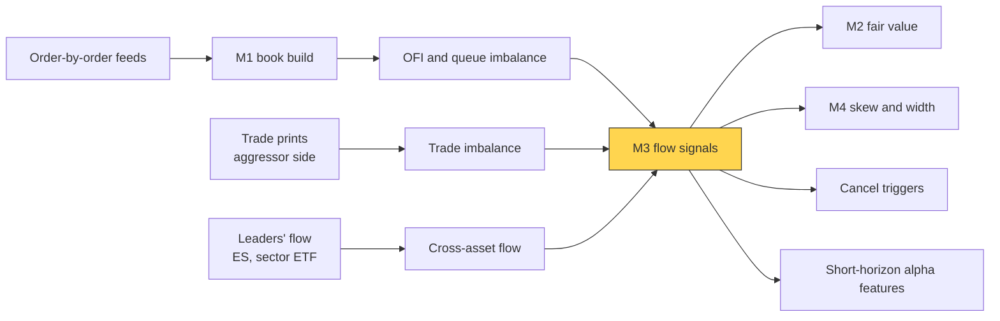
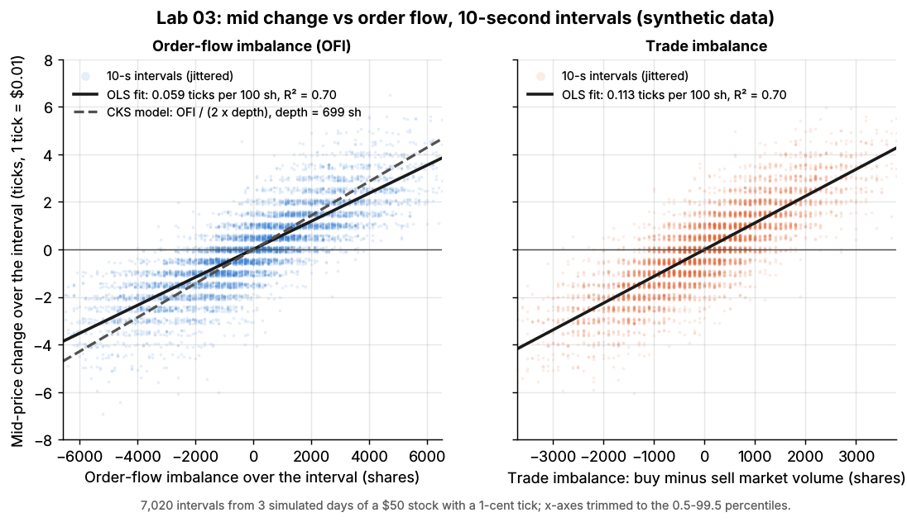
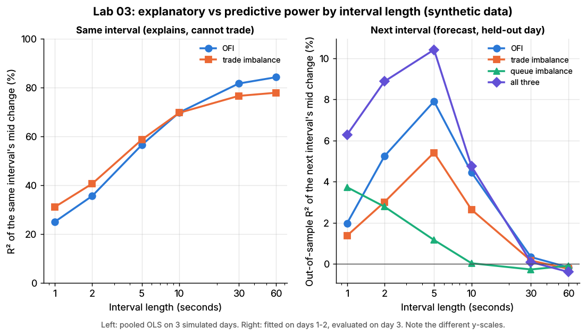

# Order-book and trade-flow signals

> **TL;DR**
>
> - Four families: queue imbalance, order-flow imbalance (OFI), trade imbalance and cross-asset flow. VPIN is a contested toxicity gauge.
> - Cont, Kukanov and Stoikov (2014): over 10-second intervals the mid change ≈ OFI ÷ (2 × depth). In 50 NYSE stocks OFI explained 65% of price variance, trade imbalance 32% `[Verified]`.
> - Explaining is not predicting: in Lab 03 (synthetic) OFI explains 70% of the same 10-second move but 4.5% of the next one.
> - Takers rarely monetize it: Lab 03's taker loses 1.44 ticks per round trip. Market makers use it free, to skew and cancel.

**Level:** Core · **Pipeline stage:** market making · **Last verified:** 2026-11

| Field | Value |
|---|---|
| Purpose (the question it answers) | Which way is the next tick, and is the flow hitting me informed? |
| Inputs → Outputs | book updates, signed trades, depth, leaders' flow → OFI, queue and trade imbalance, impact slopes for fair value, skew and cancels |
| Used by strategies | [Equity market making](../../02-strategies/a-liquidity-provision/equity-market-making.md) · [ETF market making](../../02-strategies/a-liquidity-provision/etf-market-making.md) · [Retail flow internalization](../../02-strategies/a-liquidity-provision/retail-flow-internalization.md) · [Latency arbitrage](../../02-strategies/b-speed-and-structural/latency-arbitrage.md) · [Lead-lag arbitrage](../../02-strategies/b-speed-and-structural/lead-lag-and-cross-asset-arbitrage.md) · [Fee-driven strategies](../../02-strategies/b-speed-and-structural/fee-and-microstructure-driven-strategies.md) · [Intraday patterns](../../02-strategies/c-statistical-arbitrage/intraday-patterns-and-seasonality.md) · [ML short-horizon alpha](../../02-strategies/c-statistical-arbitrage/ml-driven-short-horizon-alpha.md) |
| Latency / compute regime | ns–µs running sums per event; windows 100 ms–60 s; coefficients refit daily |
| Key parameters | window or half-life 1–10 s (CKS: 10 s); book levels 1–5; depth normalization; trade-sign rule |
| Main failure modes | same-interval fit taken as a forecast; overlapping-window t-stats; spoofed or hidden size; taker costs |
| Lab | [Lab 03](https://github.com/FrankHuang94/quant_trading_claude/tree/main/labs/03-order-flow-imbalance) |

## Intuition

The mid moves when a queue at the touch runs out; a new bid, a cancelled offer or a market buy all push it up. [Order-flow imbalance](../../09-reference/glossary.md#order-flow-imbalance-ofi) (OFI) is that bookkeeping. A thin book moves more per share, so impact scales with 1/depth: [Kyle's lambda](../../09-reference/glossary.md#kyles-lambda) at the touch. Trades are only part of the flow; most quote changes are limit orders and cancels that never trade, which is why OFI beats trade imbalance on real data.

## Where it sits in the pipeline



## The algorithm

1. Per top-of-book update, the CKS contribution: at an unchanged bid, the change in bid size; if the bid ticks up, the whole new queue; if down, minus the old one. The ask mirrors, sign flipped.
2. Sum over intervals (or decay) to get OFI; record average depth.
3. Trade imbalance (buyer- minus seller-initiated volume) and end-of-interval queue imbalance.
4. Explain: regress the mid change on OFI. Predict: regress the *next* interval's change and score on held-out days.

```python
import numpy as np
# Lab 03 sign convention: positive OFI = net buying pressure at the touch

def ofi_contributions(bid, ask, bid_size, ask_size):
    # CKS (2014) e_n of each top-of-book update n vs n-1, in shares
    b0, b1, a0, a1 = bid[:-1], bid[1:], ask[:-1], ask[1:]
    qb0, qb1, qa0, qa1 = bid_size[:-1], bid_size[1:], ask_size[:-1], ask_size[1:]
    e = (b1 >= b0) * qb1 - (b1 <= b0) * qb0 - (a1 <= a0) * qa1 + (a1 >= a0) * qa0
    return np.concatenate([[0.0], e])             # first update has no predecessor

def compute_ofi(time, bid, ask, bid_size, ask_size, mid, interval=10.0, tick=0.01):
    # Lab 03 takes a quotes DataFrame; plain arrays here, one row per book update
    e = ofi_contributions(bid, ask, bid_size, ask_size)
    n = int(np.ceil(time[-1] / interval))
    k = np.minimum((time // interval).astype(int), n - 1)        # interval of each update
    ofi = np.bincount(k, weights=e, minlength=n)
    depth = np.bincount(k, weights=0.5 * (bid_size + ask_size), minlength=n)
    depth /= np.maximum(np.bincount(k, minlength=n), 1)          # CKS average depth
    last = np.searchsorted(time, np.arange(n + 1) * interval, side="right") - 1
    mid_change = np.diff(mid[np.maximum(last, 0)] / tick)         # ticks
    return ofi, mid_change, depth

def trade_imbalance(trade_time, size, side, interval, n_intervals):
    # Lab 03 takes a trades DataFrame; side +1 buyer-, -1 seller-initiated
    k = np.minimum((trade_time // interval).astype(int), n_intervals - 1)
    return np.bincount(k, weights=size * side, minlength=n_intervals)

def fit_and_forecast(X_train, y_next_train, X_test):
    # Predictive use: NEXT interval's mid change on [ofi, trade_imb, queue_imb] (OLS)
    A = np.column_stack([np.ones(len(X_train)), X_train])
    coef, *_ = np.linalg.lstsq(A, y_next_train, rcond=None)
    return np.column_stack([np.ones(len(X_test)), X_test]) @ coef
```

## Worked example with numbers

Illustrative. Start: bid 50.00 × 800, ask 50.01 × 600.

| Event | Contribution (shares) |
|---|---|
| New 300-share bid at 50.00 | +300 (bid size 800 → 1,100) |
| Market buy for 600 clears the ask; next ask 50.02 × 900 | +600 (old ask queue gone) |
| 400 bid shares cancelled | −400 |
| New 200-share bid at 50.01 (bid ticks up) | +200 (whole new queue) |
| **OFI** | **+700** |

Trade imbalance is only +600. With average depth near 700, CKS predicts 700 ÷ (2 × 700) = 0.5 ticks (Lab 03's fitted constant gives 0.41). The mid actually rose a full tick: single intervals are noisy.

**Can a taker trade it?** Lab 03's 10-second forecast earns +0.32 ticks mid to mid. Crossing the 0.88-tick half-spread to enter leaves −0.56 ticks; crossing again to exit, −1.44 ticks per round trip (synthetic lab result).

## Key parameters and how practitioners tune them

- **Window.** CKS used 10-second intervals; desks typically use event-time decayed sums matched to the forecast horizon `[Lore]`.
- **Levels.** Adding deeper levels improves fit (Xu, Gould and Howison 2018) `[Verified]`.
- **Trade sign.** Use the feed's aggressor flag; otherwise the Lee and Ready (1991) quote and tick rules `[Verified]`.

## Textbook version vs what firms actually do

- **Linear impact.** CKS find the OFI relation linear, depth-scaled and stable across stocks; the volume relation is noisier `[Verified]`. Desks feed OFI to nonlinear models `[Lore]`; in research, order-flow inputs beat raw book states, over about two price changes (Kolm, Turiel and Westray 2023) `[Verified]`.
- **Trade flow.** Kyle (1985) prices impact per unit of signed volume `[Verified]`. Order signs are long-memory because large orders are sliced (Lillo and Farmer 2004) `[Verified]`, so trade imbalance persists.
- **Cross-asset.** Lagged cross-asset OFI helps briefly (Cont, Cucuringu and Zhang 2023) `[Verified]`; HFT trade direction tracks book imbalance and predicts seconds ahead (Brogaard, Hendershott and Riordan 2014) `[Verified]`.
- **VPIN (contested).** Easley, López de Prado and O'Hara (2012) proposed volume-bucketed imbalance as a toxicity gauge `[Verified]`. Andersen and Bondarenko (2014) found it a poor volatility predictor that peaked after, not before, the Flash Crash, its power mostly a mechanical link to trading intensity `[Verified]`; the authors' rejoinder disputes this `[Verified]`. Desks lean on their own [markouts](adverse-selection-and-markouts.md) `[Lore]`.

## How to tell if it's working

Keep explanatory and predictive R² apart; judge a maker's signal by markouts.

Lab 03, synthetic lab result (three simulated days):

| Interval | R², same interval (OFI) | Out-of-sample R², next interval (all three signals) |
|---|---|---|
| 1 s | 25% | 6.3% |
| 5 s | 57% | **10.4%** |
| 10 s | **70%** | 4.7% |
| 30 s | 82% | 0.1% |

The depth law holds: across 39 half-hours the slope of log impact on log depth is −1.01 (s.e. 0.18; model −1). The toy exaggerates twice: trade imbalance matches OFI (CKS found 32% versus 65%) because simulated liquidity providers requote after every market order, and the 5-second predictability peak comes from their 20-second belief lag. Real predictability is shorter and weaker after fees and latency. Same-interval fit is partly mechanical: CKS's R² fell to 35–60% without price-changing events `[Verified]`.



*Lab 03, synthetic. 10-second mid changes against OFI (with the CKS line) and trade imbalance.*



*Lab 03, synthetic. Note the different y-scales: explaining is easy, predicting is not.*

## Failure modes and pitfalls

- **Look-ahead:** "forecasting" interval t with interval t's own OFI.
- **Overlapping windows** inflate t-stats.
- **Spoofed, hidden and odd-lot size** distort imbalance.
- **Fragmentation:** per-venue and consolidated OFI disagree.

## How practitioners talk about it

- "OFI's ripping; lean the offer." → Skew quotes on flow rather than take.
- "Great R², but it's contemporaneous." → It explains, it cannot be traded.
- "The signal's real; it just doesn't pay the spread." → Predicted move < half-spread.
- "VPIN spiked." "Check volume first." → VPIN largely tracks trading intensity.
- "Normalize by depth or the betas won't travel." → Impact per share scales with 1/depth.

## Questions you could ask a quant about this

1. *Basic:* Per venue or consolidated book?
2. *Basic:* Book imbalance or trades: which matters more?
3. *Informed:* What is your flow signal's half-life in price changes?
4. *Informed:* How do you guard against spoofed size?
5. *Sharp:* Do you ever take on flow, or only skew? 🔒

## Go deeper

<details markdown="1">
<summary>Math: OFI, the depth law, Kyle's lambda and VPIN</summary>

CKS contribution of update $n$ (bid $P^B$, size $q^B$; ask $P^A$, size $q^A$):

$$
e_n = \mathbb{1}\{P^B_n \ge P^B_{n-1}\} q^B_n - \mathbb{1}\{P^B_n \le P^B_{n-1}\} q^B_{n-1} - \mathbb{1}\{P^A_n \le P^A_{n-1}\} q^A_n + \mathbb{1}\{P^A_n \ge P^A_{n-1}\} q^A_{n-1}
$$

If every level holds $D$ shares, removing $D$ moves one side a tick and the mid half a tick, so $\Delta \text{mid} \approx \mathrm{OFI}/(2D)$ ticks.

Kyle: price moves $\lambda(x+u)$ with $\lambda = \tfrac{1}{2}\sqrt{\Sigma_0}/\sigma_u$.

VPIN over $n$ volume buckets of size $V$, with bulk classification $V^B_\tau = V\,\Phi(\Delta P_\tau/\sigma_{\Delta P})$:

$$
\mathrm{VPIN} = \frac{\sum_{\tau=1}^{n} \lvert V^S_\tau - V^B_\tau \rvert}{nV}.
$$

</details>

## Related pages

- [Fair value and microprice](fair-value-and-microprice.md)
- [Adverse selection and markouts](adverse-selection-and-markouts.md)
- [The limit order book](../../01-market-structure/the-limit-order-book.md)
- [Transaction cost and impact models](../d-portfolio-construction/transaction-cost-and-impact-models.md)
- [ML-driven short-horizon alpha](../../02-strategies/c-statistical-arbitrage/ml-driven-short-horizon-alpha.md)

## Sources

- [Verified] Cont, R., Kukanov, A. & Stoikov, S. (2014). "The price impact of order book events." *Journal of Financial Econometrics* 12(1), 47–88. <https://doi.org/10.1093/jjfinec/nbt003> (accessed 2026-11)
- [Verified] Kyle, A. S. (1985). "Continuous auctions and insider trading." *Econometrica* 53(6), 1315–1335. <https://doi.org/10.2307/1913210> (accessed 2026-11)
- [Verified] Lee, C. M. C. & Ready, M. J. (1991). "Inferring Trade Direction from Intraday Data." *Journal of Finance* 46(2), 733–746. <https://doi.org/10.1111/j.1540-6261.1991.tb02683.x> (accessed 2026-11)
- [Verified] Easley, D., López de Prado, M. & O'Hara, M. (2012). "Flow Toxicity and Liquidity in a High-frequency World." *Review of Financial Studies* 25(5), 1457–1493. <https://doi.org/10.1093/rfs/hhs053> (accessed 2026-11)
- [Verified] Andersen, T. G. & Bondarenko, O. (2014). "VPIN and the flash crash." *Journal of Financial Markets* 17, 1–46. <https://doi.org/10.1016/j.finmar.2013.05.005> (accessed 2026-11)
- [Verified] Easley, D., López de Prado, M. & O'Hara, M. (2014). "VPIN and the Flash Crash: A rejoinder." *Journal of Financial Markets* 17, 47–52. <https://doi.org/10.1016/j.finmar.2013.06.007> (accessed 2026-11)
- [Verified] Xu, K., Gould, M. D. & Howison, S. D. (2018). "Multi-Level Order-Flow Imbalance in a Limit Order Book." *Market Microstructure and Liquidity* 4(3–4), 1950011. <https://doi.org/10.1142/S2382626619500114> (accessed 2026-11)
- [Verified] Cont, R., Cucuringu, M. & Zhang, C. (2023). "Cross-impact of order flow imbalance in equity markets." *Quantitative Finance* 23(10), 1373–1393. <https://doi.org/10.1080/14697688.2023.2236159> (accessed 2026-11)
- [Verified] Kolm, P. N., Turiel, J. & Westray, N. (2023). "Deep order flow imbalance: Extracting alpha at multiple horizons from the limit order book." *Mathematical Finance* 33(4), 1044–1081. <https://doi.org/10.1111/mafi.12413> (accessed 2026-11)
- [Verified] Lillo, F. & Farmer, J. D. (2004). "The Long Memory of the Efficient Market." *Studies in Nonlinear Dynamics & Econometrics* 8(3). <https://doi.org/10.2202/1558-3708.1226> (accessed 2026-11)
- [Verified] Brogaard, J., Hendershott, T. & Riordan, R. (2014). "High-Frequency Trading and Price Discovery." *Review of Financial Studies* 27(8), 2267–2306. <https://doi.org/10.1093/rfs/hhu032> (accessed 2026-11)
