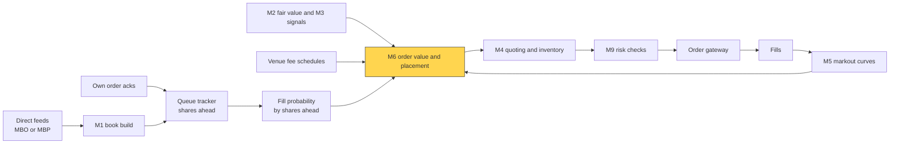
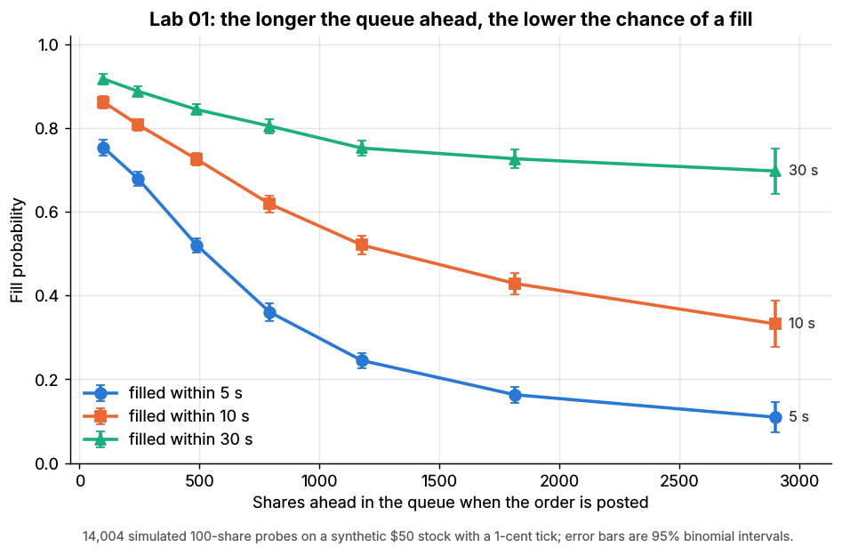
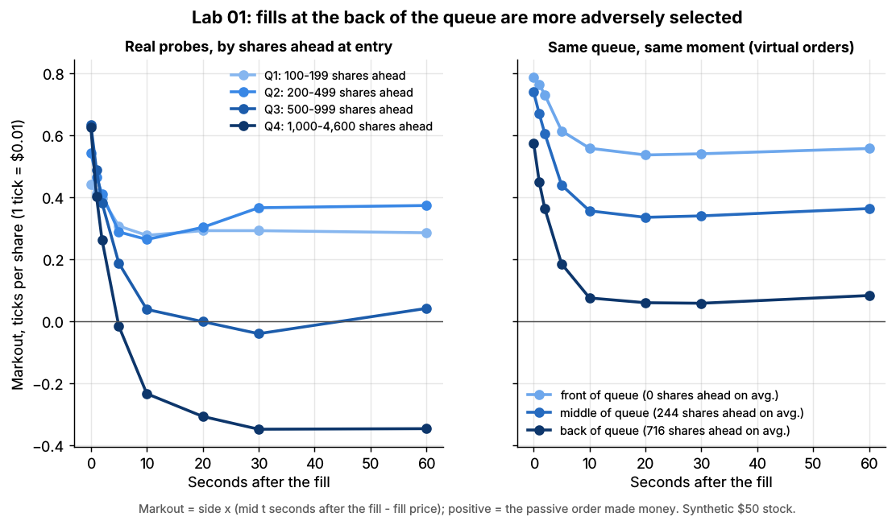

# Queue position and order placement

> **TL;DR**
>
> - A resting order is worth P(fill) × (half-spread + rebate + markout). Both terms worsen with every share queued ahead of you.
> - In large-tick stocks priority is worth about half a tick: \$0.56 per 100 shares in [Lab 01](https://github.com/FrankHuang94/quant_trading_claude/tree/main/labs/01-matching-engine-order-book) (synthetic), above a market maker's net margin.
> - Position is estimated: exact with order-level feeds, a guess about cancels with level-only feeds.
> - Placement compares expected values: stay, join elsewhere, improve, step back, take, or pay an inverted venue for priority.

**Level:** Deep dive · **Pipeline stage:** market making · **Last verified:** 2026-11

| Field | Value |
|---|---|
| Purpose (the question it answers) | Where am I in the queue, what is my order worth, and should I keep it, move it or take? |
| Inputs → Outputs | order-level (MBO) or level (MBP) feeds, own acks, fees, fill and markout history → shares ahead, P(fill), order value, placement action |
| Used by strategies | [Equity market making](../../02-strategies/a-liquidity-provision/equity-market-making.md) · [ETF market making](../../02-strategies/a-liquidity-provision/etf-market-making.md) · [Options market making](../../02-strategies/a-liquidity-provision/options-market-making.md) · [Fee- and microstructure-driven](../../02-strategies/b-speed-and-structural/fee-and-microstructure-driven-strategies.md) · [ML short-horizon](../../02-strategies/c-statistical-arbitrage/ml-driven-short-horizon-alpha.md) · [Reversal](../../02-strategies/c-statistical-arbitrage/short-term-cross-sectional-reversal.md) |
| Latency / compute regime | microseconds per book event at your price; fill and markout curves refit overnight |
| Key parameters | fill horizon 1–60 s; cancel model f (zero, log, identity); markout horizon 1–30 s; replace hysteresis 0.01–0.05 ticks |
| Main failure modes | optimistic cancel attribution; hidden size ahead; ack latency; amending away priority; stale fill curves |
| Lab | [Lab 01](https://github.com/FrankHuang94/quant_trading_claude/tree/main/labs/01-matching-engine-order-book) |

## Intuition

A resting limit order is an option written to the market. Flow that reaches the back of a long queue is disproportionately informed: it had to chew through everyone ahead first. In [tick-constrained](../../09-reference/glossary.md#tick-constrained-stock) names the price cannot improve, so firms compete on [queue position](../../09-reference/glossary.md#queue-position), speed and fees. In small-tick names, with spreads several ticks wide, you buy priority by improving the price instead. [The limit order book](../../01-market-structure/the-limit-order-book.md) shows the arithmetic; this card is the machinery.

## Where it sits in the pipeline



## The algorithm

1. **Seed.** Order-level feeds (Nasdaq TotalView-ITCH tags every add, execution and cancel with an order number) give the displayed shares ahead exactly. Level-only feeds: start from the level's size at the ack.
2. **Update.** Trades come off the front. With level data, assign a fraction p of each cancel to the queue ahead (Rigtorp 2013).
3. **Fill probability** from your own history, by shares ahead.
4. **Value** = P(fill) × (markout + rebate), with the markout measured from fill price to the mid h seconds later, half-spread included.
5. **Place.** Move (another venue, a better price in small-tick names, one level back, or take) only if the gain beats lost priority.

```python
import numpy as np

def on_fill(fill, v):
    """Lab 01's queue rule with order-level data. v: our order {side: +1 buy / -1 sell,
    price, size, ahead_ids (orders resting ahead when we joined), traded, filled}."""
    hits_my_side = fill.taker_side == -v["side"]          # sells hit bids, buys lift asks
    at_or_through = fill.price <= v["price"] if v["side"] == 1 else fill.price >= v["price"]
    if hits_my_side and at_or_through and fill.maker_id not in v["ahead_ids"]:
        v["traded"] += fill.size        # everything ahead is gone: this volume reaches us
        if v["traded"] >= v["size"]:
            v["filled"], v["fill_time"] = True, fill.time

def update_shares_ahead(ahead, level_size, my_size, dq, is_trade, f=np.log1p):
    """Level-only (MBP) feeds; not in the lab (Rigtorp 2013). dq < 0: level shrank.
    f = identity: cancels pro rata; f = np.log1p: tilted to the back;
    f = np.zeros_like: risk-averse, every cancel is behind us."""
    if is_trade:
        return max(ahead + dq, 0.0)     # trades always come off the front
    behind = max(level_size - my_size - ahead, 0.0)
    denom = f(ahead) + f(behind)
    p_ahead = f(ahead) / denom if denom > 0 else 0.0
    return max(ahead + p_ahead * dq, 0.0)

def order_value_ticks(p_fill, markout_ticks, rebate_ticks=0.0):
    """Lab 01: value = P(fill) x mean markout of fills; unfilled orders earn 0.
    markout = side x (mid(t_fill + h) - fill price) / tick, half-spread included.
    Rebate (+) or maker fee (-) per fill is added here; the lab has no fees."""
    return p_fill * (markout_ticks + rebate_ticks)

def place(options, hysteresis_ticks=0.02):
    """options: {action: (p_fill, markout_ticks, rebate_ticks)}, including "stay"."""
    ev = {a: order_value_ticks(*o) for a, o in options.items()}
    best = max(ev, key=ev.get)
    if best != "stay" and ev[best] - ev["stay"] < hysteresis_ticks:
        return "stay", ev               # any move resets priority: demand a margin
    return best, ev
```

## Worked example with numbers

*Illustrative.* You join a \$19.99 bid with 500 shares behind 4,000; 1,500 join behind you. A 1,000-share sell prints, leaving 3,000 ahead. Then the level shrinks by 1,200 with no print: cancels.

| Cancel model | Share of the 1,200 assumed ahead | Shares ahead after |
|---|---|---|
| Risk-averse, f = 0 | 0% | 3,000 |
| Log, f = ln(1 + x): 8.01 ÷ (8.01 + 7.31) | 52% | 2,373 |
| Pro rata, f = x: 3,000 ÷ 4,500 | 67% | 2,200 |

On Lab 01's curve: 10-second fill probability about 43% vs 33% (synthetic).

**Buying priority.** Lab 01's quartile results plus illustrative fees: a 0.29¢ maker rebate, or a 0.15¢ maker fee on an [inverted venue](../../09-reference/glossary.md#inverted-venue), which takers sweep first because it pays them.

| Per share posted (ticks) | Back of the queue, maker-taker | Front of the queue, inverted |
|---|---|---|
| P(fill within 60 s) | 0.82 | 0.94 |
| Markout at 30 s, half-spread included | −0.35 | +0.29 |
| Rebate (+) or fee (−) per fill | +0.29 | −0.15 |
| **Expected value** | 0.82 × (−0.06) = **−0.05** | 0.94 × 0.14 = **+0.13** |

A 0.44-tick fee swing buys 0.64 ticks of markout: +0.18 ticks net.

**Why half a cent matters.** The market maker's income statement in [fees, rebates and ticks](../../01-market-structure/fees-rebates-and-ticks.md) nets 0.16¢ a share; a 0.56¢ priority gap is 3.5 times that. Posting 20M shares a day from the back instead of the front costs about \$112,000 a day `[Estimate]` (illustrative volume).

## Key parameters and how practitioners tune them

- **Cancel model f:** fit on your own orders, matching predicted to realized fills `[Reported]` (Rigtorp). Backtesters default to risk-averse `[Verified]` ([hftbacktest](https://hftbacktest.readthedocs.io/en/latest/order_fill.html)).
- **Horizons:** fill horizon near the signal's half-life; markouts long enough to catch informed sweeps (10–30 s in Lab 01).
- **Hysteresis:** repricing or adding size resets priority; reducing size keeps it.
- **Tick regime:** Lab 01's spread sat at one tick 54% of the time (synthetic), a large-tick name.

## Textbook version vs what firms actually do

- **Textbook:** Poisson queues make fill probability a first-passage problem `[Verified]` ([Cont, Stoikov & Talreja 2010](https://doi.org/10.1287/opre.1090.0780)). Moallemi and Yuan value large-tick queue positions, adverse selection included, at the order of the spread `[Reported]` (per Huang et al.).
- **Speed buys the queue:** when the tick binds, providers compete on speed ("queue rationing") `[Verified]` ([Yao & Ye 2018](https://doi.org/10.1093/rfs/hhy002)). Desks race to be first on a new level `[Lore]`.
- **Inverted venues sell priority** around binding ticks `[Verified]` ([Comerton-Forde, Grégoire & Zhong 2019](https://doi.org/10.1016/j.jfineco.2019.03.005)); their share in the 2016 Tick Size Pilot's trade-at group rose from 15% to 28% `[Reported]`.
- **Pro-rata markets** (some options and futures) reward size, not speed `[Lore]`.
- **Regulation:** a half-penny tick, deferred to November 2027 `[Verified]`, would shorten queues `[Estimate]`.

## How to tell if it's working

- **Calibration:** predicted vs realized fills by shares-ahead bucket. Backtest fills above live fills mean an optimistic cancel model.
- **Markouts by position:** if back-of-queue fills do not look worse, the position estimate is noise.
- **Lab 01** (synthetic lab result), 14,004 probes: 10-second fill rate 86% (front quartile) vs 47% (back); 10-second [markouts](../../09-reference/glossary.md#markout) +0.28 vs −0.23 ticks; front vs back of the *same* queue +0.56 vs +0.08 ticks.



*Lab 01, synthetic: fill probability falls as shares ahead rise.*



*Lab 01, synthetic: back-of-queue fills give back the half-spread within about 10 s.*

## Failure modes and pitfalls

- **Invisible size:** odd lots and reserve refills distort the count.
- **Ack latency:** the level grows while your order travels.
- **Self-inflicted resets:** a "refresh" cancel-and-replace sends you to the back.
- **Stationarity:** fill curves shift around news, the open and the close.
- **Message limits:** constant re-placement breaches order-to-trade limits.

## How practitioners talk about it

- "We're 3k deep on BYX, 40k on the maker venue." → shares ahead, by venue.
- "Back-of-queue fills are toxic." → they come just before the level breaks.
- "Don't refresh it, you'll lose your spot." → amending resets priority.
- "Pay the inverted fee to jump the line." → buying priority with the maker fee.
- "The sim assumes pro-rata cancels; live looks risk-averse." → backtest overstates fills.

## Questions you could ask a quant about this

1. Which venues give you order-level data?
2. How do you attribute cancels on level-only feeds?
3. How much worse are back-of-queue markouts?
4. When is an inverted venue's fee worth paying?
5. 🔒 What priority value do you assign per venue?

## Go deeper

<details markdown="1">
<summary>Math: fill probability, order value and cancel attribution</summary>

With $A$ shares ahead, size $q$, traded volume $N(t)$ and cancels ahead $C(t)$:

$$
P_{\text{fill}}(h) = \Pr\big[N(h) + C(h) \ge A + q\big].
$$

For a buy with half-spread $s/2$ and rebate $r$:

$$
V = P_{\text{fill}}(h)\,\Big(\tfrac{s}{2} + r + \mathbb{E}\big[m_{t+h} - m_t \mid \text{fill}, A\big]\Big),
$$

Queue value is $V(0) - V(A)$. Level-only feeds, cancel $\Delta Q < 0$, $B$ shares behind:

$$
\hat A \leftarrow \max\!\Big(\hat A + \frac{f(\hat A)}{f(\hat A) + f(B)}\,\Delta Q,\ 0\Big).
$$

Cost: O(1) per event per order.

</details>

## Related pages

- [The limit order book](../../01-market-structure/the-limit-order-book.md)
- [Fees, rebates and ticks](../../01-market-structure/fees-rebates-and-ticks.md)
- [Fee-driven strategies](../../02-strategies/b-speed-and-structural/fee-and-microstructure-driven-strategies.md)
- [Quoting and inventory control](quoting-and-inventory-control.md)
- [Adverse selection and markouts](adverse-selection-and-markouts.md)
- [Backtesting engines](../c-validation-and-backtesting/backtesting-engines.md)
- [Smart order routing](../e-execution-algorithms/smart-order-routing.md)

## Sources

- [Verified] Moallemi, C. C. & Yuan, K. (2016). "A Model for Queue Position Valuation in a Limit Order Book." Columbia Business School Research Paper 17-70, SSRN. <https://doi.org/10.2139/ssrn.2996221> (accessed 2026-11)
- [Reported] Huang, W., Pulido, S., Rosenbaum, M., Saliba, P. & Sfendourakis, E. (2025). "From Glosten-Milgrom to the whole limit order book and applications to financial regulation." arXiv:1902.10743v2 (summarizes Moallemi and Yuan's queue values). <https://arxiv.org/abs/1902.10743> (accessed 2026-11)
- [Verified] Cont, R., Stoikov, S. & Talreja, R. (2010). "A stochastic model for order book dynamics." *Operations Research* 58(3), 549–563. <https://doi.org/10.1287/opre.1090.0780> (accessed 2026-11)
- [Verified] Yao, C. & Ye, M. (2018). "Why Trading Speed Matters: A Tale of Queue Rationing under Price Controls." *Review of Financial Studies* 31(6), 2157–2183. <https://doi.org/10.1093/rfs/hhy002> (accessed 2026-11)
- [Verified] Comerton-Forde, C., Grégoire, V. & Zhong, Z. (2019). "Inverted fee structures, tick size, and market quality." *Journal of Financial Economics* 134(1), 141–164. <https://doi.org/10.1016/j.jfineco.2019.03.005> (accessed 2026-11)
- [Reported] Rigtorp, E. (2013-06-08). "Estimating order queue position" (practitioner blog). <https://rigtorp.se/2013/06/08/estimating-order-queue-position.html> (accessed 2026-11)
- [Verified] hftbacktest documentation (n.d.). "Order Fill: queue models (RiskAverseQueueModel, ProbQueueModel)." <https://hftbacktest.readthedocs.io/en/latest/order_fill.html> (accessed 2026-11)
- [Verified] Nasdaq (n.d.). "Nasdaq TotalView-ITCH 5.0" specification (order reference numbers on add, execute, cancel and delete messages). <https://www.nasdaqtrader.com/content/technicalsupport/specifications/dataproducts/NQTVITCHspecification.pdf> (accessed 2026-11)
- [Verified] SEC (2026-06-11). Order granting temporary exemptive relief (Rules 610(c) and 612 compliance to November 2027), Release No. 34-105656. <https://www.sec.gov/files/rules/exorders/2026/34-105656.pdf> (accessed 2026-11)
