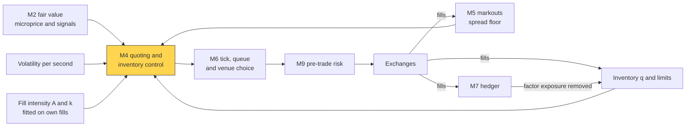
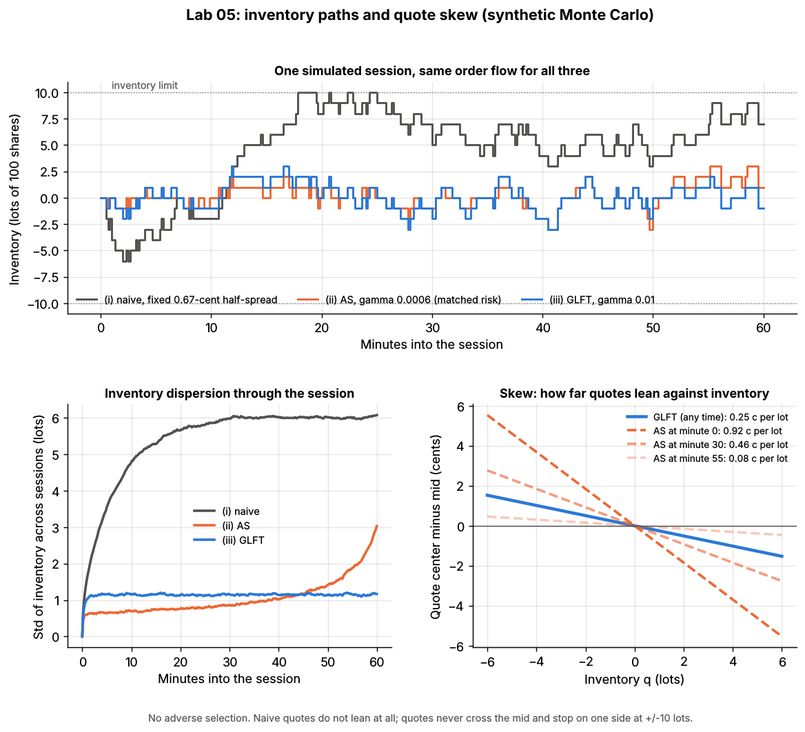
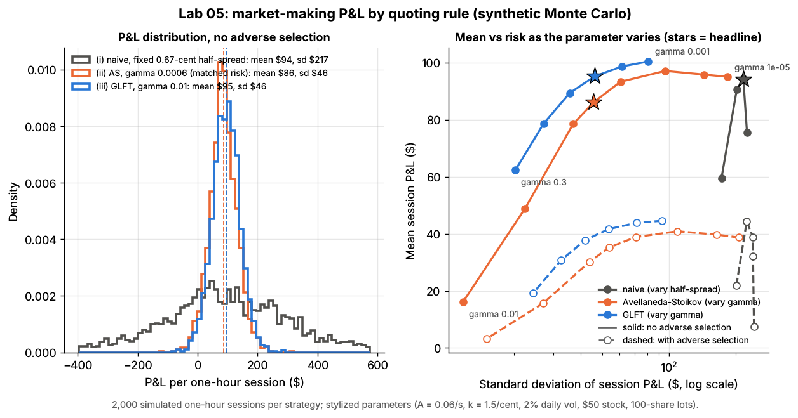

# Quoting and inventory control

> **TL;DR**
>
> - A market maker earns the distance between its quotes and fair value on each fill and loses when leftover inventory moves against it. Quoting control sets where quotes are centered and how wide they are.
> - Avellaneda & Stoikov (2008): center on a [reservation price](../../09-reference/glossary.md#reservation-price) $r = s - q\gamma\sigma^2(T-t)$ that leans against inventory $q$.
> - Guéant, Lehalle & Fernandez-Tapia (2013): closed-form, clock-free quotes with inventory limits, leaning a constant amount per lot.
> - Lab 05 (synthetic): GLFT earns what naive quoting earns (\$95 vs \$94 an hour) at a fifth of the risk. Adverse selection cuts it to \$42; cancelling stale quotes faster recovers \$68; widening barely helps.
> - Practice: fair value and an adverse-selection floor matter more than the formula `[Lore]`.

**Level:** Core · **Pipeline stage:** market making · **Last verified:** 2026-11

| Field | Value |
|---|---|
| Purpose (the question it answers) | Given fair value, inventory and fill rates, where should I bid and offer now? |
| Inputs → Outputs | fair value ([M2](fair-value-and-microprice.md)), volatility σ, fill parameters A and k, inventory and limits, expected [markout](../../09-reference/glossary.md#markout) ([M5](adverse-selection-and-markouts.md)), tick, fees → bid and ask (or none) and sizes |
| Used by strategies | [Equity market making](../../02-strategies/a-liquidity-provision/equity-market-making.md) · [ETF market making](../../02-strategies/a-liquidity-provision/etf-market-making.md) · [Options market making](../../02-strategies/a-liquidity-provision/options-market-making.md) · [Retail flow internalization](../../02-strategies/a-liquidity-provision/retail-flow-internalization.md) · [Auctions and closing liquidity](../../02-strategies/a-liquidity-provision/auctions-and-closing-liquidity.md) · [Fee- and microstructure-driven strategies](../../02-strategies/b-speed-and-structural/fee-and-microstructure-driven-strategies.md) |
| Latency / compute regime | microseconds per requote (a lookup table by inventory); parameters refit intraday or overnight |
| Key parameters | γ from a target inventory half-life of seconds to minutes `[Lore]`; σ per second; A, k from own fills; per-name limit of hundreds to thousands of shares `[Lore]`; floor = markout + fees |
| Main failure modes | bad A and k; literal AS with a long horizon; skew lagging informed flow; sub-tick leans; per-name skew on factor risk |
| Lab | [Lab 05](https://github.com/FrankHuang94/quant_trading_claude/tree/main/labs/05-avellaneda-stoikov-glft-quoting) |

## Intuition

Tight quotes fill often, but every fill leaves the dealer long or short, and [inventory risk](../../09-reference/glossary.md#inventory-risk) is an unhedged bet on the next move. A shop overstocked on umbrellas marks them down and offers suppliers less. A market maker long 3,000 shares lowers both quotes, so its offer is lifted more and its bid hit less: that lean is **skew**. **Width** sets how much each fill earns versus how often it happens. The lean grows with inventory × variance × expected holding time.

## Where it sits in the pipeline



## The algorithm

1. **Center** on fair value: the mid in the models, a [microprice](../../09-reference/glossary.md#microprice) plus signals in practice ([M2](fair-value-and-microprice.md)).
2. **Fill model:** a quote $\delta$ from fair value fills at Poisson rate $\lambda(\delta) = A e^{-k\delta}$.
3. **Quote.** [Avellaneda-Stoikov](../../09-reference/glossary.md#avellaneda-stoikov-model): reservation price plus total spread. [GLFT](../../09-reference/glossary.md#glft-model): a distance per side, with no bid at $+q_{max}$ and no ask at $-q_{max}$.
4. **Practitioner layer** (not in the lab): floor at markout plus fees, snap to the tick, requote only on about a tick of change to keep [queue position](../../09-reference/glossary.md#queue-position) ([M6](queue-position-and-order-placement.md)).
5. **On fills:** update $q$, book the income-statement lines, send factor exposure to the hedger ([M7](hedging-algorithms.md)).

```python
import numpy as np
# Lab 05 units: prices in cents/share, q in lots of 100 shares, gamma in 1/$, k in 1/cent, A in fills/s.
# The lab clips distances at 0 (quotes never cross the mid) and applies a hard limit to every rule.

def as_quotes(mid, q, t, gamma, sigma, k, T):
    """Avellaneda & Stoikov (2008): lean the center against inventory, widen with risk."""
    tau = T - t
    reservation = mid - q * gamma * sigma**2 * tau                        # long (q > 0) -> both quotes lower
    spread = gamma * sigma**2 * tau + (2.0 / gamma) * np.log1p(gamma / k)
    return reservation - spread / 2, reservation + spread / 2            # bid, ask

def glft_quotes(q, gamma, sigma, A, k, q_max=np.inf):
    """Gueant, Lehalle & Fernandez-Tapia (2013): stationary distances from the mid."""
    base = np.log1p(gamma / k) / gamma                                     # fill-rate term
    c = np.sqrt(sigma**2 * gamma / (2 * k * A) * np.exp((1 + k / gamma) * np.log1p(gamma / k)))
    d_bid = base + (2 * q + 1) / 2 * c                                     # lean c per lot of inventory
    d_ask = base - (2 * q - 1) / 2 * c
    return np.where(q >= q_max, np.inf, d_bid), np.where(q <= -q_max, np.inf, d_ask)  # inf = no quote

def step_pnl(q_before, bought, sold, d_bid, d_ask, jump, diffusion):
    """Income-statement lines for one step ($): fills first, then the mid moves."""
    spread = bought * d_bid + sold * d_ask                                 # distance from mid earned
    adverse = (bought - sold) * jump                                       # move right after the fill
    inventory = q_before * jump + (q_before + bought - sold) * diffusion   # holding inventory
    return spread, adverse, inventory

# Practitioner wrapper: NOT in the lab (it has no tick, fees or markout floor). Illustrative.
def quote(fair, q, p, tick=1.0):
    d_bid, d_ask = glft_quotes(q, p.gamma, p.sigma, p.A, p.k, p.q_max)
    floor = p.exp_markout + p.fee_net_of_rebate                            # never quote inside expected toxicity
    d_bid, d_ask = np.maximum(d_bid, floor), np.maximum(d_ask, floor)
    bid = np.floor((fair - d_bid) / tick) * tick                            # snap outward to the grid
    ask = np.ceil((fair + d_ask) / tick) * tick
    return bid, ask
```



*Lab 05, synthetic. Naive inventory wanders to the limit. GLFT leans a constant 0.25 cents per lot; AS leans 0.92 at the open and 0.08 at minute 55, so its inventory drifts late.*

## Worked example with numbers

Lab 05's illustrative parameters: \$50 stock, σ = 0.654 cents/√s (σ² = 0.4274), A = 0.06/s, k = 1.5 per cent, γ = 0.01 per \$; 1 cent × 1 lot (100 shares) = \$1.

| Step | Calculation | Result |
|---|---|---|
| Fill-rate term | (1/γ) ln(1 + γ/k) = 100 × ln(1.00667) | 0.664 cents |
| Lean per lot c | √(0.4274 × 0.01 ÷ 0.18 × 1.00667^151) = √(0.02374 × 2.727) | 0.254 cents |
| Flat: each side | 0.664 + c/2; fills 0.06 e^(−1.19) | 0.792 cents; 66 an hour |
| Long 3 lots: bid | 0.664 + 3.5c; fills 0.06 e^(−2.33) | 1.555 cents (\$49.9845); one per 172 s |
| Long 3 lots: ask | 0.664 − 2.5c; fills 0.06 e^(−0.04) | 0.028 cents (\$50.0003); one per 17 s |

Long 300 shares, the center sits 3c = 0.76 cents below the mid and the dealer sells ten times as fast as it buys. Width stays 2 × 0.664 + c = 1.58 cents at any inventory: GLFT skews, it does not widen. Flat spread income is 2 × 0.0183 × 0.792 = \$0.029 a second, about \$104 an hour (the simulation captured \$96).

AS with the same γ and an hour left leans γσ²(T − t) = 0.01 × 0.4274 × 3,600 = 15.4 cents per lot, 60 times more. AS equals GLFT only at T − t = c/(γσ²) = 59.5 s.

## Key parameters and how practitioners tune them

- **γ.** Nobody knows their utility. Desks pick γ to hit an inventory half-life (say 30–120 s) or an inventory standard-deviation cap `[Lore]`.
- **A, k.** Bucket time quoted by distance from fair value, count fills, fit by Poisson regression (Go deeper). Refit by time of day and volatility. Your quotes choose which fills you see; in one-tick names queue position beats distance ([M6](queue-position-and-order-placement.md)).
- **σ.** Per-second realized volatility of the microprice; a spike raises lean and width together.
- **Limits and floor.** Inventory caps are enforced again in [M9](algorithmic-risk-controls.md); the floor comes from markouts ([M5](adverse-selection-and-markouts.md)).
- **Horizon.** With AS, roll a horizon of tens of seconds to minutes, never the time to the close.

## Textbook version vs what firms actually do

- **Lineage.** Ho & Stoll (1981) is the classic dealer model of prices shading with inventory `[Verified]`. AS moved it to the limit order book `[Verified]`; GLFT bounded inventory and found the stationary solution `[Verified]`; Guéant (2017) extends it to several assets `[Verified]`. [Cartea, Jaimungal & Penalva (2015)](https://www.cambridge.org/9781107091146), chapter 10, is the textbook, including quoting at the touch and adverse selection `[Verified]`.
- **Fair value, not mid.** Desks center on a microprice (Stoikov 2018) or a forecast `[Verified]`; Cartea, Jaimungal & Ricci (2014) put alpha and adverse selection into the quoting problem `[Verified]`. The forecast often moves quotes more than inventory does `[Lore]`.
- **Linear skew in ticks:** fair value − β·q, β a fraction of a tick per 100 shares scaled by volatility, then a floor and the grid `[Lore]`. GLFT justifies the linear, clock-free form.
- **Ticks bind.** In [tick-constrained](../../09-reference/glossary.md#tick-constrained-stock) names skew becomes which side you show and how much size `[Lore]`.
- **Offload and hedge.** Menkveld's HFT market maker was passive on 78% of trades yet offloaded positions on the incumbent exchange `[Verified]`. Factor exposure goes to futures and ETFs, leaving skew for stock-specific inventory `[Lore]`.
- **Real intermediaries lean.** NYSE specialist price pressure averaged 0.49% with a 0.92-day half-life (Hendershott & Menkveld 2014) `[Verified]`; spreads widened when specialists held large positions or lost money (Comerton-Forde et al. 2010) `[Verified]`.

## How to tell if it's working

- Inventory P&L averaging near zero; persistently negative means the lean is too slow or fair value lags.
- Inventory half-life, time at the limit, end-of-day inventory.
- Inventory-increasing fills should not mark out worse than inventory-reducing ones.

Lab 05, synthetic lab result (2,000 one-hour sessions, one stock, no ticks, fees or rivals):

| Rule | Mean \$/hour | Sd \$/hour | Sharpe-like (per hour) | Fills/hour | Inventory sd (lots) |
|---|---|---|---|---|---|
| Naive, 0.67-cent half-spread | 94 | 217 | 0.43 | 151 | 5.5 |
| AS, γ = 0.0006 (matched risk) | 86 | 46 | 1.88 | 131 | 1.2 |
| GLFT, γ = 0.01 | 95 | 46 | 2.06 | 143 | 1.1 |
| GLFT with adverse selection | 42 | 53 | 0.78 | 180 | 1.2 |
| … widened 0.25 cents (best widening) | 44 | 53 | 0.83 | 130 | 1.2 |
| … cancelling half of stale quotes | 68 | 52 | 1.32 | 161 | 1.2 |

Naive's mean has a \$5 standard error, so the means tie; the risk ranking holds across seeds. Do not annualize: a dealer with no rivals, fees or latency flatters every ratio. Real Sharpe ratios are measured daily on capital ([equity market making](../../02-strategies/a-liquidity-provision/equity-market-making.md#evidence)).



*Lab 05, synthetic. Left: model sessions cluster near \$90; naive ones range from −\$400 to +\$600. Right: GLFT beats AS at every risk level; adverse selection (dashed) halves everyone.*

## Failure modes and pitfalls

- **Literal AS, long horizon:** with γ = 0.01 it quotes about 17 cents wide, fills 19 times an hour and earns \$16 (Lab 05).
- **Bad fill model:** lean scales as $1/\sqrt{kA}$; overstate A fourfold and you lean half as hard.
- **Inventory is information:** repeated bid fills often mean fair value is falling; inventory-only skew reacts late.
- **Widening is blunt:** widening by the measured 0.44-cent markout earned \$40.5 vs \$41.7 (Lab 05); speed helps more.
- **One factor, many names:** long 200 stocks into a sell-off is one bet.
- **Sub-tick leans** do nothing unless expressed through size or side.

## How practitioners talk about it

- "We lean a quarter tick per hundred." → center moves 0.25 tick per 100 shares.
- "We're full; pull the bid." → at the long limit, stop bidding.
- "Skew, don't widen." → move the center for inventory; keep width for toxicity.
- "What's the half-life on inventory?" → seconds until a position halves.
- "Our floor is markout plus fees." → minimum distance from fair value.
- "Hedge the beta, skew the residual." → futures take factor risk; quotes lean on stock-specific inventory.

## Questions you could ask a quant about this

1. *Basic:* Do you skew on price, size, or by dropping a side?
2. *Basic:* How do you set risk aversion?
3. *Informed:* How do you fit fill intensity when your quotes decide which fills you see?
4. *Informed:* When do you hedge instead of skewing?
5. *Sharp:* Do inventory-increasing fills mark out worse?
6. *Sharp:* 🔒 Your skew per 100 shares and inventory half-life by liquidity bucket?

## Go deeper

<details markdown="1">
<summary>Math: AS and GLFT formulas, and fitting A and k</summary>

Mid $dS_t = \sigma\,dW_t$; quotes $S_t \mp \delta$ fill at rate $A e^{-k\delta}$; the dealer maximizes $\mathbb{E}[-\exp(-\gamma(X_T + q_T S_T))]$. AS obtain

$$
r_t = S_t - q\gamma\sigma^2(T-t), \qquad
\delta^a + \delta^b = \gamma\sigma^2(T-t) + \frac{2}{\gamma}\ln\!\left(1+\frac{\gamma}{k}\right).
$$

The second term tends to $2/k$ as $\gamma \to 0$: the risk-neutral $1/k$ per side. GLFT bound $|q| \le Q$, reduce the HJB equation to linear ODEs, and far from $T$ get

$$
\delta^{b,a}(q) \approx \frac{1}{\gamma}\ln\!\left(1+\frac{\gamma}{k}\right) \pm \frac{2q \pm 1}{2}\,c,
\qquad
c = \sqrt{\frac{\sigma^2\gamma}{2kA}\left(1+\frac{\gamma}{k}\right)^{1+k/\gamma}},
$$

(upper signs for the bid), that is, AS with $T-t$ fixed at $\tau^* = c/(\gamma\sigma^2)$. AS motivate the exponential intensity from power-law order sizes with log price impact. To fit it, with $T_j$ seconds quoted at distance $\delta_j$ and $N_j$ fills, maximize

$$
\ell(A,k) = \sum_j \big[N_j(\ln A - k\delta_j) - T_j A e^{-k\delta_j}\big].
$$

</details>

## Related pages

- [Equity market making](../../02-strategies/a-liquidity-provision/equity-market-making.md)
- [M2 Fair value and microprice](fair-value-and-microprice.md) · [M5 Adverse selection and markouts](adverse-selection-and-markouts.md)
- [M6 Queue position and order placement](queue-position-and-order-placement.md) · [M7 Hedging algorithms](hedging-algorithms.md)
- [M1 Anatomy of an HFT trading loop](anatomy-of-an-hft-trading-loop.md)
- [Fees, rebates and ticks](../../01-market-structure/fees-rebates-and-ticks.md)
- [Walkthrough: a day at an ETF market maker](../h-end-to-end-walkthroughs/walkthrough-etf-market-maker.md)

## Sources

- [Verified] Avellaneda, M. & Stoikov, S. (2008). "High-frequency trading in a limit order book." *Quantitative Finance* 8(3), 217–224. <https://doi.org/10.1080/14697680701381228> (accessed 2026-11)
- [Verified] Guéant, O., Lehalle, C.-A. & Fernandez-Tapia, J. (2013). "Dealing with the inventory risk: a solution to the market making problem." *Mathematics and Financial Economics* 7(4), 477–507. <https://doi.org/10.1007/s11579-012-0087-0> (accessed 2026-11)
- [Verified] Guéant, O. (2017). "Optimal market making." *Applied Mathematical Finance* 24(2), 112–154. <https://doi.org/10.1080/1350486X.2017.1342552> (accessed 2026-11)
- [Verified] Ho, T. & Stoll, H. R. (1981). "Optimal dealer pricing under transactions and return uncertainty." *Journal of Financial Economics* 9(1), 47–73. <https://doi.org/10.1016/0304-405X(81)90020-9> (accessed 2026-11)
- [Verified] Cartea, Á., Jaimungal, S. & Penalva, J. (2015). *Algorithmic and High-Frequency Trading*. Cambridge University Press (ch. 10, market making). <https://www.cambridge.org/9781107091146> (accessed 2026-11)
- [Verified] Cartea, Á., Jaimungal, S. & Ricci, J. (2014). "Buy Low, Sell High: A High Frequency Trading Perspective." *SIAM Journal on Financial Mathematics* 5(1), 415–444. <https://doi.org/10.1137/130911196> (accessed 2026-11)
- [Verified] Stoikov, S. (2018). "The micro-price: a high-frequency estimator of future prices." *Quantitative Finance* 18(12), 1959–1966. <https://doi.org/10.1080/14697688.2018.1489139> (accessed 2026-11)
- [Verified] Hendershott, T. & Menkveld, A. J. (2014). "Price pressures." *Journal of Financial Economics* 114(3), 405–423. <https://doi.org/10.1016/j.jfineco.2014.08.001> (accessed 2026-11)
- [Verified] Comerton-Forde, C., Hendershott, T., Jones, C. M., Moulton, P. C. & Seasholes, M. S. (2010). "Time Variation in Liquidity: The Role of Market-Maker Inventories and Revenues." *Journal of Finance* 65(1), 295–331. <https://doi.org/10.1111/j.1540-6261.2009.01530.x> (accessed 2026-11)
- [Verified] Menkveld, A. J. (2013). "High frequency trading and the new market makers." *Journal of Financial Markets* 16(4), 712–740. <https://doi.org/10.1016/j.finmar.2013.06.006> (accessed 2026-11)
