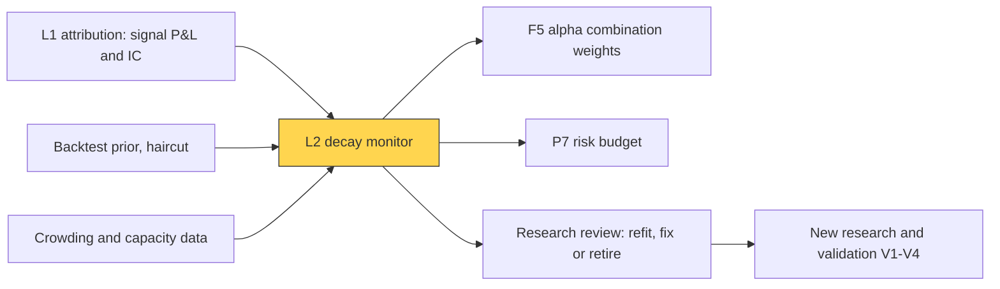
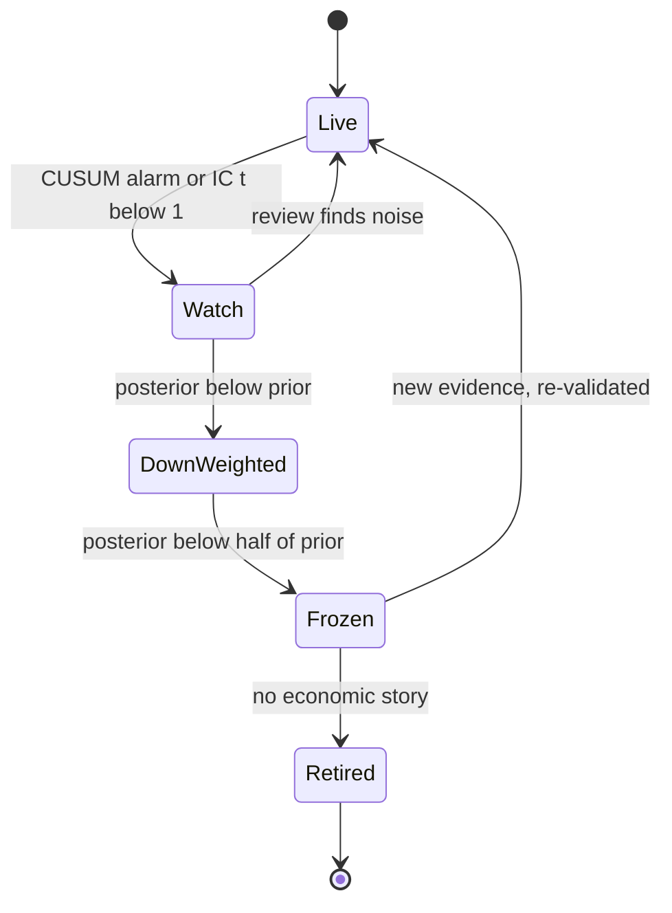

# Alpha decay detection and model retirement

> **TL;DR**
>
> - Alphas decay through publication, crowding, capacity and market-structure change. Across 97 published predictors, returns fell ~26% out of sample and ~58% after publication (McLean & Pontiff 2016).
> - Telling decay from bad luck is slow: SE(Sharpe) ≈ $\sqrt{(1 + SR^2/2)/T}$ with SR and $T$ in the same units, about $1/\sqrt{\text{years}}$ for daily data. Separating Sharpe 1.0 from 0 at two standard errors takes about four years.
> - Monitors stack weak evidence: rolling IC t-stats, a CUSUM alarm on signal P&L, a Bayesian Sharpe posterior, crowding and capacity checks.
> - Retirement is staged (watch, down-weight, freeze, retire), and alarms trigger a human review, not an automatic kill.

**Level:** Core · **Pipeline stage:** live · **Last verified:** 2026-11

| Field | Value |
|---|---|
| Purpose (the question it answers) | Has this signal stopped working or is it having a bad run, and how much capital should it keep? |
| Inputs → Outputs | daily signal P&L and IC, backtest prior, ex-ante risk, crowding and cost data → alarm state, posterior Sharpe, weight multiplier, review ticket |
| Used by strategies | [Cross-sectional alpha](../../02-strategies/d-mid-frequency-alpha/cross-sectional-alpha-and-neutralization.md) · [Fundamental quant signals](../../02-strategies/d-mid-frequency-alpha/fundamental-quant-signals.md) · [Analyst revisions](../../02-strategies/d-mid-frequency-alpha/analyst-revisions-and-sentiment.md) · [Alternative data](../../02-strategies/d-mid-frequency-alpha/alternative-data.md) · [NLP and LLM signals](../../02-strategies/d-mid-frequency-alpha/nlp-and-llm-signals.md) · [ML-driven short-horizon alpha](../../02-strategies/c-statistical-arbitrage/ml-driven-short-horizon-alpha.md) · [Short-term reversal](../../02-strategies/c-statistical-arbitrage/short-term-cross-sectional-reversal.md) · [Momentum](../../02-strategies/e-risk-premia-and-factors/momentum.md) · [Factor timing and crowding](../../02-strategies/e-risk-premia-and-factors/factor-timing-crowding-and-quant-winters.md) |
| Latency / compute regime | overnight batch after attribution; milliseconds per signal, minutes for thousands of signals |
| Key parameters | backtest haircut 30–60%; prior SD 0.3–0.7 Sharpe; IC window 63–252 days; CUSUM slack $k$ = half the shift to detect, threshold $h$ for a 3–5 year false-alarm interval |
| Main failure modes | killing good signals at drawdown lows; detecting too late; false alarms across many signals; cost or data errors mistaken for decay |
| Lab | — |

## Intuition

Think of a goodwill impairment test. A signal was booked at its backtested value; each period, live evidence tests whether the carrying value is impaired. The catch: the evidence is so noisy that one bad year is weak proof, yet waiting for proof means funding a dead signal for years. Good monitors balance the two errors explicitly, like a credit watch list.

## Where it sits in the pipeline



## The algorithm

1. Each night take the signal's standalone P&L and its [information coefficient](../../09-reference/glossary.md#information-coefficient-ic) from [attribution](live-monitoring-and-pnl-attribution.md).
2. **Rolling IC t-stat** over 63–252 days: mean IC ÷ (SD of IC ÷ √n). Below 2 is not significant; persistently below 1 puts the signal on watch.
3. **[CUSUM](../../09-reference/glossary.md#cusum)** (Page 1954) on standardized P&L shortfall: $S_t = \max(0, S_{t-1} - z_t - k)$; alarm when $S_t > h$. It accumulates only persistent underperformance and forgets isolated bad days.
4. **Bayesian Sharpe**: shrink the live [Sharpe ratio](../../09-reference/glossary.md#sharpe-ratio) toward a haircut prior, weighting each by its precision.
5. **Diagnose the cause**: crowding, capacity (costs rising with AUM), or publication.
6. **Act**: posterior ÷ prior scales the weight the combiner gives the signal; alarms open a review.

```python
import numpy as np

def decay_monitor(daily_pnl, daily_ic, vol_daily, sr_prior=1.0, prior_sd=0.5,
                  shift_sr=1.0, h=25.0, ic_window=126):
    """Nightly decay monitor for one signal (arrays, one entry per day).
    daily_pnl: standalone signal P&L from attribution; vol_daily: ex-ante daily P&L sigma
    sr_prior: annual Sharpe believed at launch, already haircut from the backtest
    shift_sr: Sharpe drop we want to catch (1.0 = alpha gone)
    h: CUSUM threshold in daily-sigma units (25 ~ one false alarm per 5 years)"""
    mu0 = sr_prior * vol_daily / np.sqrt(252)        # expected daily P&L if alpha is intact
    k = 0.5 * shift_sr / np.sqrt(252)                # slack = half the shift, in sigma units
    S, rows = 0.0, []
    for t in range(len(daily_pnl)):
        z = (daily_pnl[t] - mu0) / vol_daily         # standardized surprise vs expectation
        S = max(0.0, S - z - k)                      # lower CUSUM: grows on persistent shortfall
        alarm = S > h

        ic = daily_ic[max(0, t - ic_window + 1): t + 1]
        ic_t = ic.mean() / (ic.std(ddof=1) / np.sqrt(len(ic))) if len(ic) > 20 else np.nan

        n = t + 1                                    # Bayesian update of the annual Sharpe
        sr_hat = np.mean(daily_pnl[:n]) / vol_daily * np.sqrt(252)
        se2 = (1 + (sr_hat / np.sqrt(252)) ** 2 / 2) * 252 / n   # Lo (2002), iid, annualized
        w = (1 / prior_sd**2) / (1 / prior_sd**2 + 1 / se2)       # weight on the prior
        sr_post = w * sr_prior + (1 - w) * sr_hat

        weight_mult = float(np.clip(sr_post / sr_prior, 0.0, 1.0))  # sent to the combiner
        rows.append((t, S, alarm, ic_t, sr_post, weight_mult))
        if alarm:
            S = 0.0                                  # human review opens; restart the count
    return rows
```

## Worked example with numbers

**How long until a drop is statistically visible?** With daily data, SE(annual Sharpe) ≈ $\sqrt{1/T}$ for $T$ years. A two-standard-error gap needs $T = (2/\Delta SR)^2$:

| Sharpe before → after | Drop | Years to a 2-SE gap |
|---|---|---|
| 1.0 → 0 | 1.0 | (2/1)² = 4.0 |
| 3.0 → 1.5 | 1.5 | (2/1.5)² = 1.8 |
| 8.0 → 4.0 | 4.0 | (2/4)² = 0.25 (≈ 3 months) |

The absolute drop is what matters, so a high-Sharpe market maker sees decay in weeks while a monthly factor book needs years.

**Bayesian update** (illustrative). Prior N(1.0, 0.5²), so prior precision 4. One live year at Sharpe −0.2 has variance ≈ 1/1 (precision 1): posterior = (4 × 1.0 + 1 × −0.2) ÷ 5 = **0.76**. Two such years (precision 2): (4 − 0.4) ÷ 6 = **0.60**. Three: (4 − 0.6) ÷ 7 = **0.49**. The weight multiplier falls to 0.76, 0.60, 0.49.

**CUSUM**, $k$ = 0.5/√252 = 0.0315, $h$ = 25. A −1.5σ day adds 1.5 + 0.063 − 0.0315 ≈ 1.53 to $S$. In 300 simulated Gaussian paths per case `[Estimate]`: mean time to a false alarm with Sharpe intact ≈ 5.1 years; mean time to alarm after Sharpe falls to 0 ≈ 1.6 years, to −0.5 ≈ 1.2 years, to 0.5 ≈ 2.7 years.

## Key parameters and how practitioners tune them

- **Prior haircut**: start from a backtest Sharpe cut by 30–60%, in line with the out-of-sample evidence below `[Estimate]`.
- **Threshold $h$**: set from the false-alarm interval you can afford. With 200 signals and one false alarm per signal per 5 years, expect ~40 reviews a year `[Estimate]`, which is why alarms open reviews instead of killing signals.
- **Stages** (illustrative): watch on alarm or IC t-stat below 1; down-weight by posterior ÷ prior; freeze capital below 0.5; retire after a review finds no economic story.



## Textbook version vs what firms actually do

- **Publication decay**: McLean & Pontiff (2016) find returns of 97 predictors fall ~26% out of sample (an upper bound on data mining) and ~58% post-publication, so at least ~32% (58 − 26) reflects publication-informed trading `[Verified]`.
- **Out-of-sample decay**: Falck, Rej & Thesmar (2022) find 72 published strategies keep about half their in-sample performance; publication date predicts decay best, and overfitting proxies add roughly 15% explanatory power `[Verified]`.
- **Crowding**: Lou & Polk's comomentum (excess return correlation among momentum stocks) flags crowding; when high, momentum returns tend to revert `[Verified]`. Desks also watch short interest in the short leg and holdings overlap `[Lore]`.
- **Capacity decay** is yours alone: gross alpha holds, net falls as impact rises with size ([cost models](../d-portfolio-construction/transaction-cost-and-impact-models.md)) `[Estimate]`. Plot gross and net bps against AUM.
- **Textbook**: test "Sharpe = 0". **Practice**: tests lack power, so firms shrink and down-weight gradually `[Lore]`.

## How to tell if it's working

- Realized false-alarm rate matches the designed interval.
- Retired signals, paper-traded afterwards, earn about zero; if they keep earning, the monitor is too trigger-happy `[Lore]`.
- Posterior Sharpe predicts next year's realized Sharpe better than the backtest does.

## Failure modes and pitfalls

- **Pro-cyclical retirement**: killing a factor at the bottom of a crowding drawdown locks in the loss ([quant winters](../../02-strategies/e-risk-premia-and-factors/factor-timing-crowding-and-quant-winters.md)).
- **Regime vs decay**: a signal dormant in one [regime](../b-forecasting-models/regime-detection.md) looks dead.
- **Autocorrelated P&L** (overlapping holding periods) shrinks the true sample; use effective $T$.
- **Re-launching variants** of a retired idea is multiple testing in disguise ([V4](../c-validation-and-backtesting/overfitting-and-multiple-testing.md)).

## How practitioners talk about it

- "It's in the penalty box." → down-weighted pending review.
- "Is that decay or a drawdown?" → structural loss or bad luck?
- "CUSUM tripped on the revisions sleeve." → persistent shortfall alarm fired.
- "Comomentum is spiking." → crowded trade; unwind risk rising.
- "The alpha's fine; we're too big for it." → capacity decay.

## Questions you could ask a quant about this

1. What haircut do you apply to backtest Sharpe before going live?
2. How many years of live data before you trust a signal's Sharpe?
3. Do alarms trigger automatic de-risking or a review?
4. How do you separate capacity decay from alpha decay?
5. 🔒 Which crowding indicators actually led your drawdowns?

## Go deeper

<details markdown="1">
<summary>Math: Sharpe standard error, Bayesian update, CUSUM run lengths</summary>

For iid returns, per-period Sharpe $s$, $n$ periods (Lo 2002):

$$
\operatorname{Var}(\hat s) \approx \frac{1 + s^2/2}{n}.
$$

With $q$ periods a year ($n = qT$): $\operatorname{Var}(\widehat{SR}) \approx (1 + SR^2/2q)/T$; for daily data the $SR^2$ term is negligible. Fat tails and autocorrelation raise it (Bailey & López de Prado 2012).

Prior $N(\mu_0, \tau^2)$, estimate variance $\sigma^2/T$:

$$
\mu_{\text{post}} = \frac{\mu_0/\tau^2 + \widehat{SR}\,T/\sigma^2}{1/\tau^2 + T/\sigma^2}.
$$

A standard approximation for Gaussian CUSUM ($b = h + 1.166$) gives mean run length $(e^{2kb} - 2kb - 1)/2k^2$ ≈ 1,285 days here, matching the simulation.

</details>

## Related pages

- [Evaluating signals](../a-data-and-signals/evaluating-signals.md)
- [Overfitting and multiple testing](../c-validation-and-backtesting/overfitting-and-multiple-testing.md)
- [Alpha combination and ensembling](../b-forecasting-models/alpha-combination-and-ensembling.md)
- [Live monitoring and P&L attribution](live-monitoring-and-pnl-attribution.md)
- [Factor timing, crowding and quant winters](../../02-strategies/e-risk-premia-and-factors/factor-timing-crowding-and-quant-winters.md)

## Sources

- [Verified] McLean, R. D. & Pontiff, J. (2016). "Does academic research destroy stock return predictability?" *Journal of Finance* 71(1), 5–32. <https://doi.org/10.1111/jofi.12365> (accessed 2026-11)
- [Verified] Falck, A., Rej, A. & Thesmar, D. (2022). "When do systematic strategies decay?" *Quantitative Finance* 22(11), 1955–1969. <https://doi.org/10.1080/14697688.2022.2098810> (accessed 2026-11)
- [Verified] Falck, A., Rej, A. & Thesmar, D. (2021). "Why and how systematic strategies decay." arXiv:2105.01380. <https://arxiv.org/abs/2105.01380> (accessed 2026-11)
- [Verified] Lo, A. W. (2002). "The statistics of Sharpe ratios." *Financial Analysts Journal* 58(4), 36–52. <https://rpc.cfainstitute.org/research/financial-analysts-journal/2002/the-statistics-of-sharpe-ratios> (accessed 2026-11)
- [Verified] Bailey, D. H. & López de Prado, M. (2012). "The Sharpe ratio efficient frontier." *Journal of Risk* 15(2). <https://www.risk.net/journal-risk/2223785/sharpe-ratio-efficient-frontier> (accessed 2026-11)
- [Verified] Page, E. S. (1954). "Continuous inspection schemes." *Biometrika* 41(1/2), 100–115. <https://doi.org/10.1093/biomet/41.1-2.100> (accessed 2026-11)
- [Verified] Lou, D. & Polk, C. (2022). "Comomentum: Inferring arbitrage activity from return correlations." *Review of Financial Studies* 35(7), 3272–3302. <https://doi.org/10.1093/rfs/hhab117> (accessed 2026-11)
