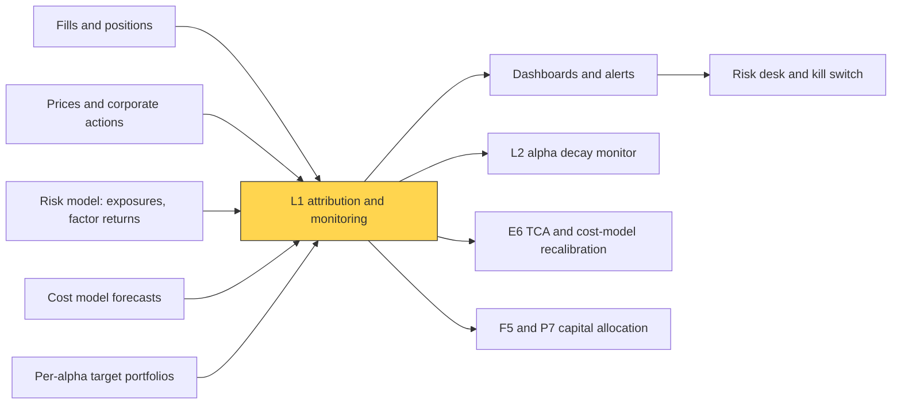
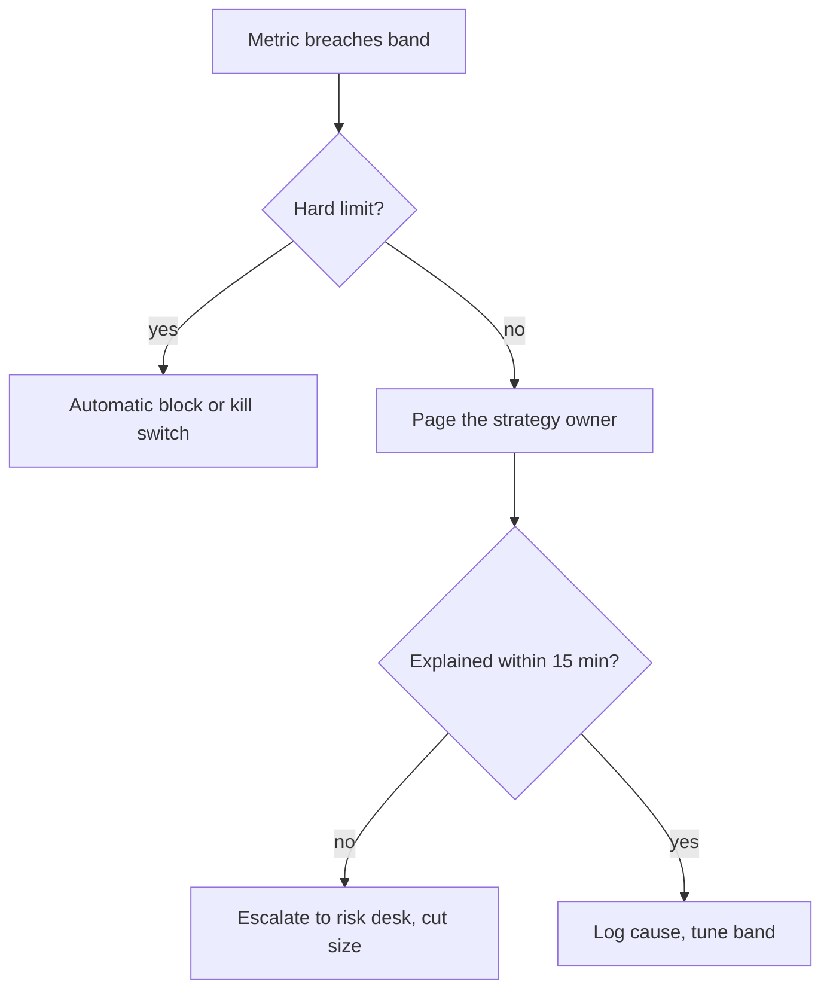

# Live monitoring and P&L attribution

> **TL;DR**
>
> - Attribution splits P&L into lines with an owner and an expected value: factor vs specific (alpha), holding vs trading, cost vs the cost model, and each alpha sleeve's share.
> - Quant equity book: P&L = Σ (dollar factor exposure × factor return) + specific P&L + trading P&L. Alpha should appear in the specific line.
> - Market maker: the same idea as an income statement: spread capture + rebates − adverse selection ± inventory − hedging costs − fees.
> - Monitoring adds exposures, limits, fill rates, latency and drift, wired to alerts someone acts on.

**Level:** Core · **Pipeline stage:** live · **Last verified:** 2026-11

| Field | Value |
|---|---|
| Purpose (the question it answers) | Did the book make money for the reasons the model says, and is anything drifting or about to break? |
| Inputs → Outputs | positions, fills, prices, risk-model exposures and factor returns, cost forecasts, sleeve targets → P&L by factor, specific, trading, cost and sleeve; dashboards and alerts |
| Used by strategies | [Equity market making](../../02-strategies/a-liquidity-provision/equity-market-making.md) · [ETF market making](../../02-strategies/a-liquidity-provision/etf-market-making.md) · [Options market making](../../02-strategies/a-liquidity-provision/options-market-making.md) · [Retail flow internalization](../../02-strategies/a-liquidity-provision/retail-flow-internalization.md) · [Cross-sectional alpha](../../02-strategies/d-mid-frequency-alpha/cross-sectional-alpha-and-neutralization.md) · [Factor-residual mean reversion](../../02-strategies/c-statistical-arbitrage/factor-residual-mean-reversion.md) · [ML-driven short-horizon alpha](../../02-strategies/c-statistical-arbitrage/ml-driven-short-horizon-alpha.md) · [Stat arb overview](../../02-strategies/c-statistical-arbitrage/stat-arb-overview-and-history.md) |
| Latency / compute regime | real time for marks and limits (sub-second at a market maker); end-of-day batch attribution (seconds for 3,000 names × 60–80 factors) |
| Key parameters | risk model (≈ 10 styles + 50–70 industries); markout horizons 1 s–5 min; alert bands (P&L beyond 3σ of ex-ante risk, slippage > 1.5–2× model, limit usage > 80%) |
| Main failure modes | bad marks; attribution model ≠ optimizer's; naive sleeve splits; ignored alerts |
| Lab | — |

## Intuition

Think segment reporting plus budget-vs-actual variance analysis. Each line has a budget: [specific return](../../09-reference/glossary.md#specific-return) P&L should be positive on average (the alpha), factor P&L near zero in a neutral book, costs close to the [cost model](../d-portfolio-construction/transaction-cost-and-impact-models.md). The variance says where to look: beta, a style tilt, stock picks or the trading itself.

## Where it sits in the pipeline



## The algorithm

1. **Reconcile.** P&L from positions and cash must match the books to the dollar; a residual is a data problem.
2. **Holding P&L** = prior-close dollars × today's return: the no-trade P&L.
3. **Factor split.** With $r_i = \sum_k X_{ik} f_k + u_i$ from the [risk model](../d-portfolio-construction/risk-models.md), dollar [factor exposure](../../09-reference/glossary.md#factor-exposure) $E_k = \sum_i h_i X_{ik}$ earns $E_k f_k$; the rest, $\sum_i h_i u_i$, is specific P&L.
4. **Trading P&L** = total − holding. Split into slippage vs arrival ([implementation shortfall](../../09-reference/glossary.md#implementation-shortfall)) and post-arrival drift; compare slippage with the model.
5. **Per-alpha.** Run each sleeve's paper portfolio through steps 2–4; the gap to the real book is a netting line.
6. **Link days** so monthly lines still sum; alert on lines outside their bands.

```python
import numpy as np

def factor_attribution(h_start, h_end, px_prev, px_close, fills, X, f, model_cost_bps):
    """One day's attribution for an equity book; all money in $.
    h_start, h_end: shares at prior close / today's close, shape (N,)
    fills: list of (i, signed_shares, fill_px, arrival_px)
    X: (N, K) risk-model exposures; f: (K,) today's factor returns
    model_cost_bps: (N,) pre-trade cost forecast. Fees, rebates, borrow booked separately."""
    r = px_close / px_prev - 1.0                     # total stock returns
    dollars = h_start * px_prev                      # $ held at the start of the day
    holding_pnl = dollars * r                        # P&L had we not traded

    exposure = X.T @ dollars                         # $ exposure per factor, (K,)
    factor_pnl = exposure * f                        # P&L per factor, (K,)
    u = r - X @ f                                    # specific (residual) returns
    specific_pnl = dollars * u                       # per-stock alpha P&L, (N,)

    trading, slip, slip_model = 0.0, 0.0, 0.0
    for i, q, fill_px, arrival_px in fills:
        trading += q * (px_close[i] - fill_px)       # fill marked to the close
        slip += -q * (fill_px - arrival_px)          # vs arrival; negative = cost
        slip_model += -abs(q) * arrival_px * model_cost_bps[i] / 1e4

    total = holding_pnl.sum() + trading
    cash_spent = sum(q * p for _, q, p, _ in fills)
    books = h_end @ px_close - h_start @ px_prev - cash_spent
    assert abs(total - books) < 1e-6 * max(1.0, abs(books)), "unexplained P&L: fix data"
    return {
        "factor": factor_pnl,                        # should be ~0 on average if neutral
        "specific": specific_pnl.sum(),              # the alpha line
        "trading": trading,
        "slippage_vs_arrival": slip,
        "slippage_vs_model": slip - slip_model,      # > 0: cheaper than the model said
        "after_arrival_drift": trading - slip,       # timing, not execution quality
        "total": total,
    }
```

## Worked example with numbers

*Illustrative.* One factor (beta). Long \$10M of A (beta 1.2), short \$10M of B (beta 0.8). Factor return −2.0%; A returns −1.5%, B −3.0%.

- Dollar beta 10 × 1.2 − 10 × 0.8 = +\$4M → factor P&L = **−\$80,000**.
- $u_A$ = −1.5% + 2.4% = +0.9% → +\$90,000; $u_B$ = −3.0% + 1.6% = −1.4%, short earns +\$140,000 → specific **+\$230,000**.
- Holding: −\$150,000 + \$300,000 = +\$150,000 = −80,000 + 230,000 ✓.

The book also bought 50,000 A: arrival \$99.80, average fill \$99.86, close \$98.50.

- Trading P&L = 50,000 × (98.50 − 99.86) = **−\$68,000**.
- Slippage vs arrival = −50,000 × 0.06 = −\$3,000 (6 bps); the model said 8 bps (−\$3,992), so execution beat it by \$992.
- The other −\$65,000 is A falling after arrival: a timing question, not execution.

Total +\$82,000. The alpha made \$230,000; an unintended beta tilt cost \$80,000. Fix the hedge, not the alpha.

A market maker's day as an income statement:

| Line | $ (illustrative) | Measured as |
|---|---|---|
| Spread capture | +120,000 | signed qty × (mid at fill − fill price) |
| Rebates net of take fees | +35,000 | fee schedule × volume |
| Adverse selection | −85,000 | [markout](../../09-reference/glossary.md#markout): qty × (mid +1 min − mid at fill) |
| Inventory P&L | −10,000 | drift beyond the markout horizon |
| Hedging costs | −15,000 | hedge slippage and fees |
| Clearing and regulatory fees | −8,000 | per share and notional |
| **Net trading income** | **+37,000** | |

Watch [adverse selection](../../09-reference/glossary.md#adverse-selection) ÷ spread capture (here 71%).

## Key parameters and how practitioners tune them

- **Risk model**: use the optimizer's, or "factor P&L" stops meaning "risk we chose or failed to hedge".
- **Markout horizons**: 1 s, 10 s, 1 min, 5 min; the curve's shape matters more than one point ([M5](../f-market-making-and-hft-algorithms/adverse-selection-and-markouts.md)).
- **Alert bands**: scale to ex-ante risk; warn near 80% of a limit, hard stop at 100% `[Lore]`.
- **Dashboards**: factor and sector exposures, limit usage, fill rates, order-to-ack latency (p50/p99), live vs training forecast distribution (drift), each with an owner.



## Textbook version vs what firms actually do

- **Textbook**: Brinson sector attribution vs a benchmark. **Practice**: factor attribution off the risk model; vendor tools report factor contributions, specific return and trading impact `[Verified]` ([MSCI](https://www.msci.com/downloads/web/msci-com/data-and-analytics/portfolio-management/MSCI%20MAC%20Performance%20Attribution%20Factsheet.pdf)).
- **Holding vs trading** is Perold's paper-vs-real portfolio gap (1988) `[Verified]`.
- **Linking**: daily lines do not sum to compounded returns; Menchero (2004) finds one linking method meets all his criteria `[Verified]`.
- **Market makers**: Menkveld's study of one HFT market maker found ≈ €1.55 per trade from the spread against ≈ €0.68 of positioning losses, ≈ €0.88 overall `[Verified]` (working-paper figures).
- **Monitoring**: before Knight Capital's 2012 loss, 97 automated emails flagged an error pre-open, but were not designed as alerts and went unread; the SEC's first market access rule case followed (\$12M penalty) `[Verified]`.

## How to tell if it's working

- Reconciliation residual is zero daily.
- Factor P&L averages near zero in a neutral book; a persistent sign is an unhedged bet.
- Realized ÷ forecast slippage ≈ 1.0 over 20 days ([TCA](../e-execution-algorithms/transaction-cost-analysis.md)).
- Daily P&L ÷ ex-ante σ has standard deviation 0.8–1.2 `[Estimate]`; otherwise suspect the risk model.
- Specific-P&L Sharpe tracks the haircut backtest; slides go to [alpha decay detection](alpha-decay-detection-and-model-retirement.md).

## Failure modes and pitfalls

- **Bad marks**: stale closes or missed splits book phantom specific P&L.
- **Leakage**: an alpha with a momentum tilt shows as factor P&L; hedging it away hedges away alpha.
- **Pro-rata sleeves**: sleeves wanting +\$6M and −\$2M; pro-rating the +\$4M net misstates both.
- **Alert fatigue**: amber lights train people to ignore red ones.

## How practitioners talk about it

- "Specific was +2.3 bps; we gave it back on beta." → the alpha worked, the hedge didn't.
- "What's the unexplained?" → reconciliation residual; nonzero means bad data.
- "Slippage ran 1.4× model." → costs above forecast.
- "Markouts go negative at ten seconds." → informed flow is picking us off.
- "Momentum ate us on the attribution." → a style factor dominated.

## Questions you could ask a quant about this

1. Is your attribution model the optimizer's risk model?
2. What share of P&L variance is factor vs specific?
3. How do you split P&L across alphas in a netted book?
4. Which alert last fired, and what changed afterwards?
5. 🔒 What markout horizon defines "toxic" for you?

## Go deeper

<details markdown="1">
<summary>Math: factor attribution and the market-maker identity</summary>

Holdings $h$ (dollars), exposures $X$, regression factor returns $f$:

$$
h^\top r = (X^\top h)^\top f + h^\top u .
$$

One fill of signed size $q$ at price $p$; mid $m_t$ at fill, $m_{t+\tau}$ at the markout horizon, $m_T$ at the close:

$$
q(m_T - p) = \underbrace{q(m_t - p)}_{\text{spread}} + \underbrace{q(m_{t+\tau} - m_t)}_{\text{adverse sel.}} + \underbrace{q(m_T - m_{t+\tau})}_{\text{inventory}} .
$$

Cost is $O(NK)$ per day.

</details>

## Related pages

- [Transaction cost analysis](../e-execution-algorithms/transaction-cost-analysis.md)
- [Risk models](../d-portfolio-construction/risk-models.md)
- [Adverse selection and markouts](../f-market-making-and-hft-algorithms/adverse-selection-and-markouts.md)
- [Algorithmic risk controls](../f-market-making-and-hft-algorithms/algorithmic-risk-controls.md)
- [Walkthrough: a mid-frequency stat-arb book](../h-end-to-end-walkthroughs/walkthrough-mid-frequency-stat-arb.md)
- [Risk management at quant firms](../../06-risk-and-regulation/risk-management-at-quant-firms.md)

## Sources

- [Verified] Perold, A. F. (1988). "The implementation shortfall: Paper versus reality." *Journal of Portfolio Management* 14(3), 4–9. <https://www.proquest.com/docview/195579087> (accessed 2026-11)
- [Verified] Menchero, J. (2004). "Multiperiod arithmetic attribution." *Financial Analysts Journal* 60(4), 76–91. <https://doi.org/10.2469/faj.v60.n4.2638> (accessed 2026-11)
- [Verified] Menkveld, A. J. (2013). "High frequency trading and the new market makers." *Journal of Financial Markets* 16(4), 712–740. <https://doi.org/10.1016/j.finmar.2013.06.006> (accessed 2026-11)
- [Verified] Menkveld, A. J. (2011). "High frequency trading and the new-market makers." Tinbergen Institute Discussion Paper 11-076/2. <https://tinbergen.nl/discussion-paper/5443/11-076-2-high-frequency-trading-and-the-new-market-makers> (accessed 2026-11)
- [Verified] MSCI (n.d.). "MSCI MAC Performance Attribution Factsheet." <https://www.msci.com/downloads/web/msci-com/data-and-analytics/portfolio-management/MSCI%20MAC%20Performance%20Attribution%20Factsheet.pdf> (accessed 2026-11)
- [Verified] U.S. SEC (2013-10-16). "SEC charges Knight Capital with violations of market access rule." Press release 2013-222. <https://www.sec.gov/news/press-release/2013-222> (accessed 2026-11)
- [Reported] WilmerHale (2013). "Knight Capital settles Rule 15c3-5 violations with SEC, agrees to pay \$12 million." <https://www.wilmerhale.com/insights/client-alerts/knight-capital-settles-rule-15c3-5-violations-with-sec-agrees-to-pay-12-million> (accessed 2026-11)
