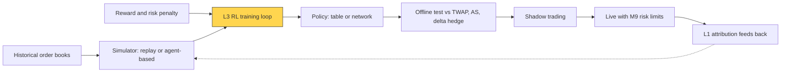
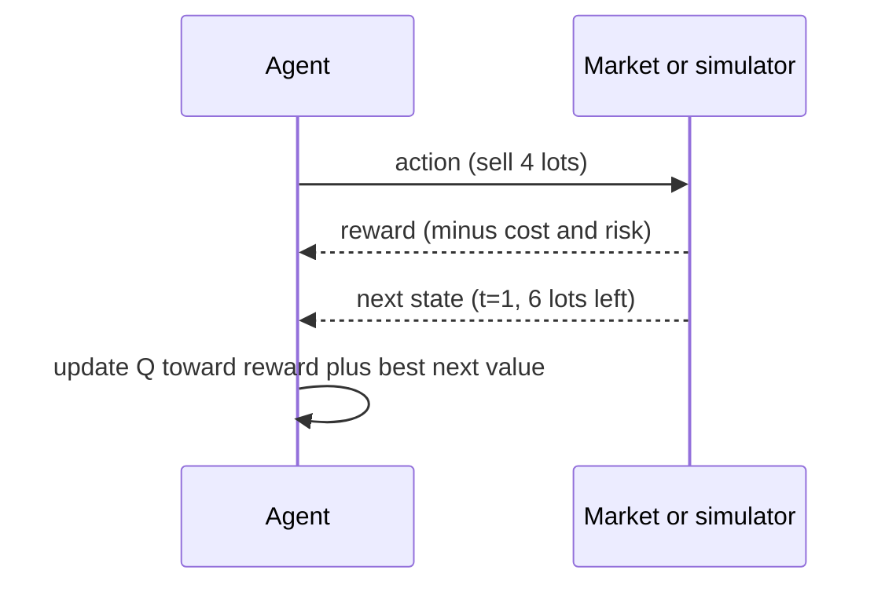

# Reinforcement learning in trading

> **TL;DR**
>
> - Reinforcement learning (RL) learns a policy (state → action) that maximizes cumulative reward when today's action changes tomorrow's state. Execution, market making and hedging fit because inventory carries over.
> - Key evidence: Nevmyvaka, Feng & Kearns (2006) on execution, Spooner et al. (2018) on market making, Buehler et al. (2019) on deep hedging. Most results beat simple baselines, not production algos.
> - Hard because markets are non-stationary, simulators cannot show how the market reacts to you, agents exploit simulator flaws, and there is one history to learn from.
> - Reported production use is mainly bank execution (J.P. Morgan's LOXM, 2017); deep hedging came from J.P. Morgan researchers. RL as a quant-fund profit engine is lore.

**Level:** Deep dive · **Pipeline stage:** live · **Last verified:** 2026-11

| Field | Value |
|---|---|
| Purpose (the question it answers) | Which actions (trade size, quote placement, hedge size) maximize reward when each action changes the next state? |
| Inputs → Outputs | state features (time left, inventory, spread, imbalance), a simulator or replay, a reward → a policy (table or network), tested against model-based baselines |
| Used by strategies | [Equity market making](../../02-strategies/a-liquidity-provision/equity-market-making.md) · [Options market making](../../02-strategies/a-liquidity-provision/options-market-making.md) · [ML-driven short-horizon alpha](../../02-strategies/c-statistical-arbitrage/ml-driven-short-horizon-alpha.md) |
| Latency / compute regime | training offline (CPU-hours to GPU-days); inference µs–ms (table lookup or small network); decisions every 1–60 s for execution |
| Key parameters | discount γ 1.0 (finite-horizon execution) to 0.99–0.999 (market making); learning rate 0.01–0.1; exploration ε 0.05–0.2, decaying; 5–20 buckets per state variable; inventory or risk penalty; 10⁴–10⁷ episodes |
| Main failure modes | overfitting the simulator; reward hacking; regime change; costly live exploration; opaque policies |
| Lab | — |

## Intuition

Supervised learning predicts; [RL](../../09-reference/glossary.md#reinforcement-learning) decides. A price forecast does not say how fast to sell 10,000 shares, because selling moves the price and what you still hold shapes the next choice. That is dynamic programming, as in real-options valuation, except RL learns the transitions by trial and error. The problem is framed as a [Markov decision process](../../09-reference/glossary.md#markov-decision-process-mdp):

| Problem | State | Action | Reward | Baseline to beat |
|---|---|---|---|---|
| Execution | time left, shares left, spread, imbalance | child size or limit-price offset | −slippage vs arrival mid × shares; penalty for leftovers | [TWAP](../../09-reference/glossary.md#twap), [Almgren-Chriss](../e-execution-algorithms/implementation-shortfall-and-almgren-chriss.md) |
| Market making | inventory, spread, microprice signal, volatility | bid and ask offsets, size | spread P&L + inventory mark − inventory penalty | [Avellaneda-Stoikov quotes](../f-market-making-and-hft-algorithms/quoting-and-inventory-control.md) |
| Hedging | position Greeks, time to expiry, cost | hedge trade size | −risk measure of hedging error − costs | [delta hedge with bands](../f-market-making-and-hft-algorithms/hedging-algorithms.md) |

## Where it sits in the pipeline



## The algorithm

Tabular [Q-learning](../../09-reference/glossary.md#q-learning) for a toy liquidation:

1. Discretize state: step $t$ and lots left.
2. Keep a table $Q(s, a)$: total reward expected from action $a$ in state $s$, then acting well.
3. Each step, mostly take the best-looking action, sometimes a random one (ε-greedy exploration).
4. Observe reward $r$ and next state $s'$; nudge $Q(s,a)$ toward $r + \max_{a'} Q(s', a')$.
5. Repeat for many episodes; the greedy policy is the argmax of each row.

```python
import numpy as np

def q_learning_execution(n_lots=10, lot=1_000, T=5, max_sell=4, half_spread=0.01,
                         eta=1e-6, sigma=0.10, risk_aversion=2e-5,
                         alpha=0.1, eps=0.1, n_episodes=50_000, seed=0):
    """Tabular Q-learning: sell n_lots * lot shares within T steps.
    State = (step t, lots left); action = lots to sell now (0..max_sell).
    Reward = -(half-spread + linear temporary impact) - variance penalty on unsold shares.
    Simplified: price noise enters only via the risk penalty, so rewards are
    deterministic; a real study replays historical order books instead."""
    rng = np.random.default_rng(seed)
    Q = np.zeros((T + 1, n_lots + 1, max_sell + 1))   # Q[t, lots_left, action]

    def step(t, inv, a):
        a = inv if t == T - 1 else min(a, inv)        # last step: must sell what is left
        q = a * lot                                   # shares sold now
        cost = q * (half_spread + eta * q)            # spread + impact ($)
        risk = risk_aversion * ((inv - a) * lot * sigma) ** 2   # $ penalty for holding risk
        return -(cost + risk), inv - a

    for _ in range(n_episodes):
        inv = n_lots
        for t in range(T):
            if inv == 0:
                break
            explore = rng.random() < eps              # epsilon-greedy exploration
            a = int(rng.integers(max_sell + 1)) if explore else int(Q[t, inv].argmax())
            r, nxt = step(t, inv, a)
            target = r + (Q[t + 1, nxt].max() if nxt > 0 else 0.0)  # gamma = 1
            Q[t, inv, a] += alpha * (target - Q[t, inv, a])         # TD update
            inv = nxt
    return Q, Q.argmax(axis=2)                        # policy: lots to sell per (t, lots_left)
```

## Worked example with numbers

*Illustrative.* Sell 10,000 shares in 5 steps; half-spread $0.01; impact $0.001 per 1,000 shares sold in a step; σ = $0.10 per share per step; risk aversion 2 × 10⁻⁵ per dollar.

- **All at once**: 10,000 × (0.01 + 0.01) = **$200**, no risk penalty.
- **TWAP** (2,000 per step): cost 5 × 2,000 × 0.012 = $120; risk 2 × 10⁻⁵ × (800² + 600² + 400² + 200²) = $24; total **$144**.
- **Learned 4-2-2-1-1** (thousands): cost 56 + 24 + 24 + 11 + 11 = $126; risk 2 × 10⁻⁵ × (600² + 400² + 200² + 100²) = $11.4; total **$137.4**, the brute-force optimum.

One update by hand: from $Q = 0$, selling 4 lots at $t=0$ gives $r$ = −(56 + 2 × 10⁻⁵ × 600²) = −63.2; next-state values are still 0, so $Q$ ← 0 + 0.1 × (−63.2 − 0) = **−6.32**. After convergence that entry reaches −137.4, the full cost-to-go.

The toy front-loads, as Almgren-Chriss does in closed form. RL earns its keep only when the state carries information the closed form ignores, such as spread and imbalance.

## Key parameters and how practitioners tune them

- **Reward design** matters most: raw P&L teaches the agent to gamble on inventory; add inventory and leftover penalties.
- **State size**: 10 variables × 10 buckets is 10¹⁰ cells, so real work uses function approximation (tile coding, neural networks).
- **Data split by time**, with the test period after training, as in [time-series cross-validation](../c-validation-and-backtesting/time-series-cross-validation.md).



## Textbook version vs what firms actually do

- **Execution**: Nevmyvaka, Feng & Kearns used 1.5 years of millisecond NASDAQ order-book data (12 months train, 6 test); state was time and inventory left plus market variables, action the limit price; they report substantial gains over baselines `[Verified]`, roughly 27–36% over submit-and-leave per a course summary `[Reported]`. Ning, Lin & Jaimungal's double deep Q-network beat TWAP on most of nine stocks `[Verified]`.
- **Market making**: Spooner et al.'s temporal-difference agent, trained in a limit-order-book simulator with a reward shaped to control inventory risk, beat simple benchmarks and an online-learning method `[Verified]`.
- **Hedging**: Buehler et al.'s deep hedging minimizes a convex risk measure and beat the complete-market hedge under transaction costs in a Heston model; two authors were at J.P. Morgan `[Verified]`.
- **Production**: the FT reported in 2017 that J.P. Morgan's LOXM used deep RL trained on historic and simulated trades in European equity algos, constrained while it learned; performance claims are the bank's `[Reported]`. RL quoting at HFT firms has no public evidence `[Lore]`.

## How to tell if it's working

- It beats the model-based baseline out of sample, after costs, with confidence intervals.
- The policy is sane: sells faster with more inventory and less time; skews quotes against inventory.
- Simulated fill rates and slippage match shadow trading; a gap means the simulator is being gamed.

## Failure modes and pitfalls

- **Simulator fidelity**: replayed history cannot react to your orders. Agent-based simulators such as ABIDES try to `[Verified]`, but calibration is hard.
- **Reward hacking**: agents find simulator artifacts, e.g. assuming a fill whenever price touches the order `[Lore]`.
- **Non-stationarity**: tick sizes, fees and competitors change; old policies degrade ([alpha decay](alpha-decay-detection-and-model-retirement.md)).
- **Sample efficiency**: one history; a daily policy sees 252 decisions a year, and live exploration costs real money.

For the wider literature, see the survey by Hambly, Xu & Yang (2023) `[Verified]`.

## How practitioners talk about it

- "It's just DP with a learned model." → RL as approximate dynamic programming.
- "What's the reward?" → the first question; most bugs live there.
- "It learned the simulator, not the market." → overfit to simulator artifacts.
- "Does it beat Almgren-Chriss net of costs?" → the right baseline.

## Questions you could ask a quant about this

1. Which baseline does it beat, by how many bps out of sample?
2. Replay or agent-based simulation? How is impact modeled?
3. Did the agent ever game the reward?
4. What triggers retraining?
5. 🔒 Which decisions in your stack are learned policies vs closed-form rules?

## Go deeper

<details markdown="1">
<summary>Math: Bellman equation, Q-learning, deep hedging objective</summary>

Optimal action values satisfy

$$
Q^*(s,a) = \mathbb{E}\left[r + \gamma \max_{a'} Q^*(s', a') \mid s, a\right],
$$

which Q-learning approximates stochastically; tabular memory is $O(|S||A|)$.

Deep hedging chooses hedge ratios $\delta_t$ from a network to minimize a convex risk measure $\rho$ of the hedged payoff $Z$:

$$
\min_{\delta} \; \rho\left(-Z + \sum_t \delta_t (S_{t+1} - S_t) - C_T(\delta)\right),
$$

with $C_T$ the transaction costs.

</details>

## Related pages

- [Implementation shortfall and Almgren-Chriss](../e-execution-algorithms/implementation-shortfall-and-almgren-chriss.md)
- [Quoting and inventory control](../f-market-making-and-hft-algorithms/quoting-and-inventory-control.md)
- [Hedging algorithms](../f-market-making-and-hft-algorithms/hedging-algorithms.md)
- [Neural nets and sequence models](../b-forecasting-models/neural-nets-and-sequence-models.md)
- [Backtest pitfalls](../c-validation-and-backtesting/backtest-pitfalls.md)

## Sources

- [Verified] Nevmyvaka, Y., Feng, Y. & Kearns, M. (2006). "Reinforcement learning for optimized trade execution." *Proceedings of ICML 2006*, 673–680. <https://doi.org/10.1145/1143844.1143929> (accessed 2026-11)
- [Reported] University of Waterloo CS885 course presentation (2020). "Reinforcement learning for optimized trade execution" (summary of Nevmyvaka et al.). <https://cs.uwaterloo.ca/~ppoupart/teaching/cs885-spring20/slides/cs885-reinforcement-learning-for-optimized-trade-execution.pdf> (accessed 2026-11)
- [Verified] Spooner, T., Fearnley, J., Savani, R. & Koukorinis, A. (2018). "Market making via reinforcement learning." *Proceedings of AAMAS 2018*. <https://arxiv.org/abs/1804.04216> (accessed 2026-11)
- [Verified] Buehler, H., Gonon, L., Teichmann, J. & Wood, B. (2019). "Deep hedging." *Quantitative Finance* 19(8), 1271–1291. <https://doi.org/10.1080/14697688.2019.1571683> (accessed 2026-11)
- [Verified] Ning, B., Lin, F. H. T. & Jaimungal, S. (2021). "Double deep Q-learning for optimal execution." *Applied Mathematical Finance* 28(4), 361–380. <https://doi.org/10.1080/1350486X.2022.2077783> (accessed 2026-11)
- [Verified] Hambly, B., Xu, R. & Yang, H. (2023). "Recent advances in reinforcement learning in finance." *Mathematical Finance* 33(3), 437–503. <https://doi.org/10.1111/mafi.12382> (accessed 2026-11)
- [Verified] Byrd, D., Hybinette, M. & Balch, T. H. (2020). "ABIDES: Towards high-fidelity multi-agent market simulation." *Proceedings of SIGSIM-PADS '20*, 11–22. <https://doi.org/10.1145/3384441.3395986> (accessed 2026-11)
- [Reported] Financial Times (2017-07). "JPMorgan develops robot to execute trades." <https://www.ft.com/content/16b8ffb6-7161-11e7-aca6-c6bd07df1a3c> (accessed 2026-11)
- [Reported] Markets Media (2017-07-31). Coverage of J.P. Morgan's planned global LOXM rollout, citing the FT. <https://marketsmedia.com/j-p-morgan-ai-trading-global> (accessed 2026-11)
