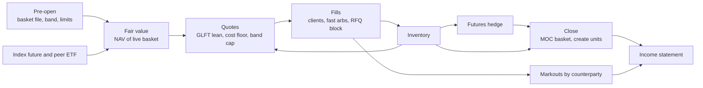
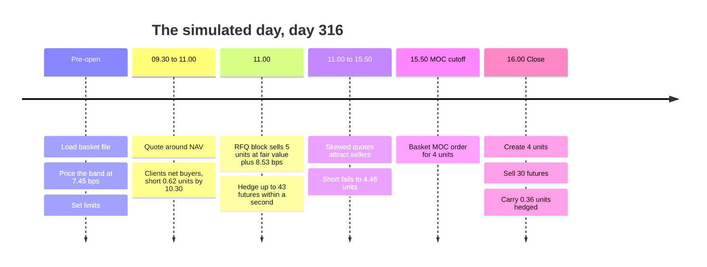
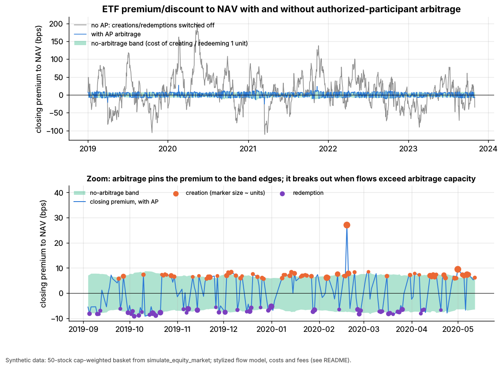
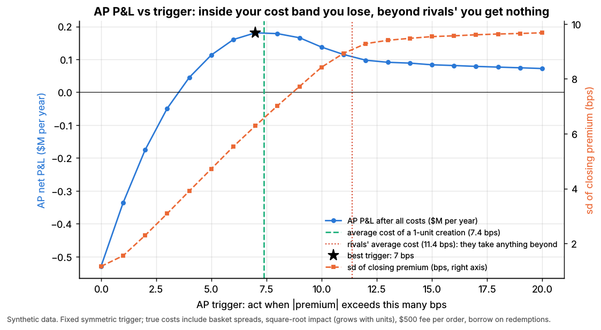
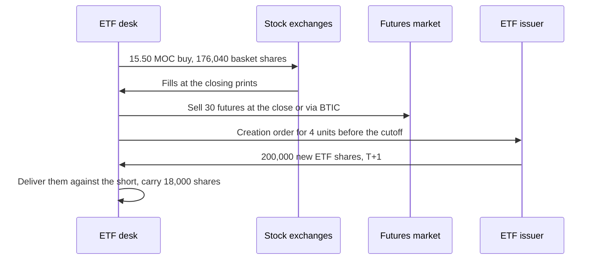
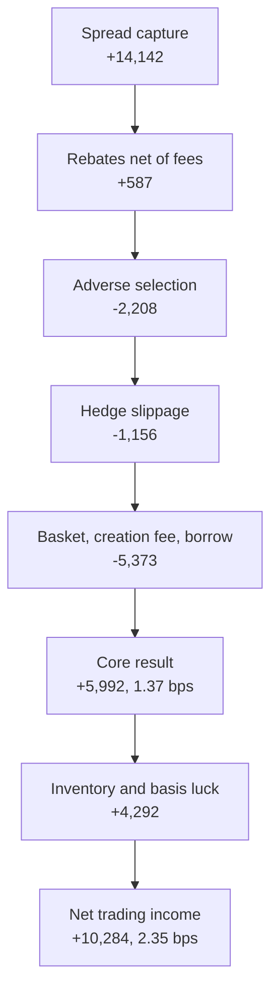

# Walkthrough: a day at an ETF market maker

> **TL;DR**
>
> - One simulated day for the market maker and authorized participant of a 50-stock US equity ETF: quote around fair value, hedge fills with futures, create whole units at the close.
> - The quote is hedge cost plus expected adverse selection plus a lean. The lean comes from the risk left *after* the futures hedge: 0.10 bp per creation unit, against 0.70 bp unhedged.
> - Net trading income was \$10,284, or 2.35 bps of \$43.8M of ETF traded (synthetic lab result). Spread earned \$14,142; pick-offs, hedging, the basket and fees took most of it back; a lucky \$4,292 basis gain made up the rest.
> - The raw markout on a hedged block is mostly market noise: +20 bps at 60 s, −34 bps by the close. Measured against the futures hedge it stays near +8 to +11 bps, close to the spread charged.
> - Creating 4 units cost 6.1 bps each, against about 7.6 bps to buy back from rivals. A pure-arbitrage check at the closing premium of 0.45 bp adds nothing: arbitrage starts at 7.45 bps.

**Level:** Core · **Read time:** ~13 min · **Last verified:** 2026-11

## Cast and setup

**The firm** is the lead market maker and an [authorized participant](../../09-reference/glossary.md#authorized-participant) (AP) in Lab 07's synthetic fund: the 50 largest names of a simulated 200-stock market, 50,000 ETF shares per [creation unit](../../09-reference/glossary.md#creation-unit). It quotes on exchange, answers a block request for quote (RFQ), hedges with an index future and settles its net position through [creation and redemption](../../09-reference/glossary.md#creation-and-redemption).

**The day** is day 316 of Lab 07's five-year world (seed 7): the first day after day 300 that was calm, rose modestly (index +26.6 bps) and had an ETF-versus-index basis move under 5 bps, so the income statement shows the business rather than one basis swing. Intraday paths are Brownian, bridged to the simulator's closes, with market-wide news jumps about once a minute.

| Assumption (illustrative) | Value |
|---|---|
| ETF NAV at yesterday's close; unit value | \$43.92; \$2.20M |
| Hedges | future on all 200 names (\$50 × 6,000, 0.25-point tick, \$1 a contract); peer ETF on the top 100 |
| Client flow | 500-share Poisson fills at 0.07·e^(−0.67·δ) per second per side (δ in bps); buys 1.2×, sells 0.8× |
| Fast arbitrageurs | hit a stale quote for 2,000 shares when news jumps through it; we cancel half in time |
| RFQ block | client buys 250,000 shares (5 units) at 11:00 |
| Fees | maker rebate \$0.0020 and closing-auction fee \$0.0010 a share `[Estimate]`; SEC Section 31 fee \$20.60 per million sold `[Verified]` |

The script [`labs/walkthroughs/etf-market-maker.py`](https://github.com/FrankHuang94/quant_trading_claude/blob/main/labs/walkthroughs/etf-market-maker.py) (deterministic, about 1 s) chains the labs' core functions and writes `etf-market-maker.json`: `nav`, `no_arbitrage_band` and `arb_decision` from [Lab 07](https://github.com/FrankHuang94/quant_trading_claude/tree/main/labs/07-etf-nav-arbitrage); `glft_quotes` and `step_pnl` from [Lab 05](https://github.com/FrankHuang94/quant_trading_claude/tree/main/labs/05-avellaneda-stoikov-glft-quoting); `markouts` from [Lab 04](https://github.com/FrankHuang94/quant_trading_claude/tree/main/labs/04-markout-analysis); the microprice table of [Lab 02](https://github.com/FrankHuang94/quant_trading_claude/tree/main/labs/02-microprice-fair-value). Every dollar figure is a synthetic lab result for one stylized fund with no competing quoters: it shows mechanisms and proportions, not a real desk's profit.



## Pre-open: basket, creation unit, borrow and limits

Before 9:30 the desk loads the basket file: shares of each stock per unit plus a \$1,823 cash component; the top ten names are 36.5% of the fund. From yesterday's closing data, Lab 07's `no_arbitrage_band` prices the band:

| Cost of creating one unit | bps |
|---|---|
| ETF half-spread | 1.49 |
| Basket half-spreads, cap-weighted | 1.73 |
| Basket impact (square-root law) | 1.95 |
| Creation fee (\$500 per order) | 2.28 |
| **Create bound** (the redeem bound adds 0.07 bp of borrow) | **7.45** (7.52) |

That is close to Lab 07's five-year average of 7.38 bps; in stress the band reached 14.86 bps (synthetic lab result). The fee is Lab 07's stylized \$500. SPY's real fee is the lower of \$3,000 or 10 bps of a unit, per participant per day `[Verified]`.

**Borrow.** Bona fide market making is exempt from the Reg SHO [locate](../../09-reference/glossary.md#locate) requirement `[Verified]`, so the desk can sell ETF shares it does not own ([shorting and settlement](../../01-market-structure/shorting-financing-and-settlement.md)). Overnight shorts pay an assumed 30 bps a year; redemptions borrow the basket at Lab 07's 25 bps.

**Limits** ([M9 risk controls](../f-market-making-and-hft-algorithms/algorithmic-risk-controls.md)): ±10 units of ETF (\$22M, Lab 07's balance-sheet cap), 100 futures, ±\$500k of residual delta after hedging, 1 unit carried overnight, and a loss stop to reduce-only. Peak use today: 5.67 units, 43 contracts, \$150k.



## Fair value from the basket, futures and a peer ETF

[Fair value](../../09-reference/glossary.md#fair-value) is Lab 07's `nav()` on live constituent prices each second: \$43.924 at the open, \$44.040 at the close (+26.4 bps). Two outside instruments show where the basket is heading and what can hedge it, with [hedge ratios](../../09-reference/glossary.md#hedge-ratio) from the previous 250 days:

| Daily, last 250 days | Beta to ETF | Correlation | Residual vol (bps/day) |
|---|---|---|---|
| Index future (all 200 names) | 1.034 | 0.989 | 18.7 |
| Peer ETF (top 100 names) | 1.022 | 0.995 | 12.2 |
| ETF alone, unhedged | | | 126.5 |

The peer ETF tracks the fund better because it holds the same big names; the future is far cheaper to trade. One-minute correlations during the day were similar (0.983 and 0.993).

The order book adds little at the basket level. In Lab 02's fitted table, a name at a one-tick spread with imbalance +0.6 has a [microprice](../../09-reference/glossary.md#microprice) 0.299 ticks above its mid. If all 50 names showed that at once, NAV would rise 0.60 bp; with random imbalances the errors diversify to 0.11 bp. Lab 02's microprice beat the mid by only 3.55% on next-move error (synthetic lab result).

What matters is speed. The day had 410 news jumps, averaging 1.52 bps of fair value and reaching 11.5 bps. In real markets news usually shows up in the future first ([linkages](../../01-market-structure/etf-futures-options-linkages.md)); in the toy it moves everything at once. Either way, any quote not yet moved is a free option for [latency arbitrage](../../02-strategies/b-speed-and-structural/latency-arbitrage.md). [M2](../f-market-making-and-hft-algorithms/fair-value-and-microprice.md) covers blending leads into one number.

```python
fv = nav(px_basket_now, basket_shares, cash_per_unit)        # Lab 07 nav(): $ per ETF share
g = g_table[book_state(imbalance, spread_ticks)]             # Lab 02 microprice, ticks per name
fv_micro = nav(px_basket_now + g * 0.01, basket_shares, cash_per_unit)   # about +0.1 bp
```

## Quoting: width from hedge cost, skew from inventory

The desk quotes with Lab 05's `glft_quotes`, in bps of fair value, with 500-share lots ([M4](../f-market-making-and-hft-algorithms/quoting-and-inventory-control.md)). Fill parameters A = 0.07 per second and k = 0.67 per bp give a half-spread of 1.49 bps when flat, which is Lab 07's assumed ETF half-spread of 1.5 bps.

The key choice is σ, because the lean per lot scales with it. This desk hedges every fill, so its inventory risk is the leftover basis: 18.7 bps a day, 0.12 bp per √second. With γ = 2.5 × 10⁻⁶ per bp-lot the lean is **0.10 bp per unit**. With the ETF's full 126.5 bps it would be 0.70 bp, and a five-unit block would push quotes 3.5 bps off NAV for no reason. Hedge first, then skew what is left.

Two clamps sit on the formula. A **floor** of 0.98 bp (0.48 bp for futures in and out plus 0.5 bp of expected adverse selection) stops quoting inside costs. A **cap** at the band: nobody pays more than the create cost, because rival APs would create and undercut.

```python
d_bid, d_ask = glft_quotes(q_lots, gamma=2.5e-6, sigma=0.1225, A=0.07, k=0.67, q_max=1000)  # Lab 05
d_bid = min(max(d_bid, 0.48 + 0.5), redeem_cost_bps)     # floor: hedge cost + expected markout
d_ask = min(max(d_ask, 0.48 + 0.5), create_cost_bps)     # cap: the creation band (7.45 bps)
bid, ask = fv * (1 - d_bid / 1e4), fv * (1 + d_ask / 1e4)
```

The **RFQ** at 11:00 is priced from costs: futures in and out 0.48 bp, plus the basket and fee for five units from `no_arbitrage_band(n_units=5)` (1.73 half-spreads, 4.36 impact, 0.46 fee), plus a 1.5 bp margin: fair value + 8.53 bps. The [ETF market making](../../02-strategies/a-liquidity-provision/etf-market-making.md) dossier's example used 8 bps.

## Fills and inventory

| Counterparty | Fills | Shares | Net, from our side |
|---|---|---|---|
| Uninformed clients | 1,158 | 587,000 | we sold 2,000 |
| Fast arbitrageurs | 81 | 162,000 | we bought 34,000 |
| RFQ block | 1 | 250,000 | we sold 250,000 |

| Time | 10:30 | 11:00, after block | 13:00 | 15:00 | 15:50 | 16:00 |
|---|---|---|---|---|---|---|
| ETF inventory (units) | −0.62 | −5.67 | −5.50 | −4.49 | −4.46 | −4.36 |
| Futures held | 5 | 43 | 42 | 34 | 34 | 3 after close |

After the block the quotes sat about 0.55 bp above fair value, so sellers came to the desk and buyers went to rivals. That worked off 1.3 units by the close for nothing beyond the screen spread. The ETF's quoted mid stayed 0.45–0.55 bp above NAV all afternoon, well inside the band. Lab 07 leaves this intraday quoting out: with only end-of-day arbitrage its closing premium has a 6.7 bp standard deviation, against 45.7 bps with none (synthetic lab result).



*Lab 07, synthetic data: end-of-day arbitrage pins the premium to the band edges. Intraday quoting, as in this walkthrough, keeps it well inside.*

## Hedging: futures vs basket vs peer ETF

For the block, the desk compares three hedges held five hours to the close: round-trip cost plus the leftover [basis](../../09-reference/glossary.md#basis) risk, charged at the quotes' γ, about 1.1 × 10⁻⁶ per dollar ([M7](../f-market-making-and-hft-algorithms/hedging-algorithms.md)):

| Hedge for \$11.0M short | Cost (bps) | Cost (\$) | Basis sd to close (\$) | Cost + ½γ·sd² (\$) |
|---|---|---|---|---|
| Index future | 0.48 | 531 | 18,051 | **716** |
| Peer ETF | 1.60 | 1,757 | 11,758 | 1,836 |
| Basket now | 6.09 | 6,687 | 0 | 6,687 |

Futures win; a desk roughly 11 times as risk-averse would pick the peer ETF. The basket is the hedge of last resort, bought only to create. Rebalancing whenever the hedge was a whole contract off target took 119 trades and 185 contracts. The short ETF lost \$41,492 in the rally and the futures made \$45,784: a \$4,292 basis gain, well inside the \$18,051 standard deviation. Luck, not skill.

## The create/redeem decision at the close

MOC orders must be in by 3:50 p.m. on NYSE and 3:55 p.m. on Nasdaq `[Verified]` ([E5](../e-execution-algorithms/auction-close-and-dark-liquidity-algos.md)). At the cutoff the desk was short 4.46 units. Units are whole, and each has three possible exits:

| Option, per unit | Cost |
|---|---|
| Create: buy the basket MOC, pay the fee (4 units) | 1.78 half-spread + 3.75 impact + 0.57 fee = **6.09 bps** |
| Buy back on screen: rivals price size off their own band | ~7.62 bps `[Estimate]` |
| Carry overnight, futures-hedged | 0.08 bp of borrow a day, plus overnight basis and gap risk; capped at 1 unit |

The desk creates 4 units and carries 0.36 unit (18,000 shares) hedged with 3 futures. Lab 07's `arb_decision` then asks whether the premium alone justifies *extra* units: at 0.45 bp, far inside the 7.45 bp bound, it does not.

```python
extra = arb_decision(premium_bps=0.45, create_cost_bps=7.45, redeem_cost_bps=7.52,
                     impact_bps_per_unit=2.0, max_units=10)       # Lab 07 -> 0 units
n_create = int(np.floor(units_short))                             # 4.36 -> 4 whole units
create_cost = no_arbitrage_band(w, hs, vol, adv, unit_value, n_units=4,
                                etf_half_spread_bps=0.0)[0]       # ETF already sold: 6.09 bps
```

Lab 07's curve shows why the arbitrage trigger sits at the band. A fixed trigger at 0 bps loses \$0.53M a year. The best fixed trigger, 7 bps, earns \$0.18M, and the cost-aware rule earns \$0.21M, 2.8 bps per unit (synthetic lab result). See [ETF and index arbitrage](../../02-strategies/b-speed-and-structural/etf-and-index-arbitrage.md).



*Lab 07, synthetic data: arbitraging inside your own cost band loses money; P&L peaks near the one-unit cost.*

## Markouts: adverse selection by counterparty

Lab 04's `markouts` marks every fill forward against fair value (a [markout](../../09-reference/glossary.md#markout)). The table covers fills with a full 300 s ahead, in bps, weighted by shares ([M5](../f-market-making-and-hft-algorithms/adverse-selection-and-markouts.md)):

| Segment | Shares | 0 s | 1 s | 60 s | 300 s | s.e. at 60 s |
|---|---|---|---|---|---|---|
| Uninformed clients | 576,500 | +1.48 | +1.47 | +1.60 | +2.12 | 0.16 |
| Fast arbitrageurs | 158,000 | +1.39 | −1.80 | −1.97 | −1.96 | 0.53 |
| All screen fills | 734,500 | +1.46 | +0.77 | +0.84 | +1.24 | 0.20 |

The arbitrageurs were 22% of screen volume. Their markouts turn negative within a second and stay there, like Lab 04's informed flow (−1.46 bps at 60 s); Lab 05 showed faster cancels beat widening against [adverse selection](../../09-reference/glossary.md#adverse-selection). Skew has a hidden cost: the side you lean toward sits closer to fair value and gets picked off more (arbitrageurs sold the desk a net 34,000 shares).

Mark a hedged trade against its hedge. The block's raw markout was +8.5 bps at once, +20.5 at 60 s, +31.8 at 300 s and −33.7 by the close: the ETF fell, then rallied 42 bps. Net of 1.034 × the future's move it reads +8.8, +8.1 and +10.8 bps: the desk kept the spread, and the flow showed no information. One block is one draw, so it says little about that client.


*Lab 04, synthetic data: informed flow looks profitable at 1 s and loses by 10 s; uninformed flow stays positive.*

## The closing auction

The desk sends a market-on-close ([MOC](../../09-reference/glossary.md#market-on-close-moc)) order for 4 units of basket: 176,040 shares, \$8.80M across 50 names. If each [closing auction](../../09-reference/glossary.md#closing-auction) trades 10% of daily volume, that is 1.8% of auction volume cap-weighted and 4.5% at most, too small to set the print. It sells 30 futures at the close; CME's Basis Trade at Index Close (BTIC) prices futures at the official index close plus an agreed basis, matching the MOC prints `[Verified]`.



## P&L / cost attribution

Lab 05's `step_pnl` splits the ETF leg into spread, adverse-selection and inventory lines every second. The script checks that all lines sum exactly to cash plus positions marked at the closing NAV and futures price ([L1](../g-live-trading/live-monitoring-and-pnl-attribution.md), [P&L attribution](../../09-reference/glossary.md#pl-attribution)).

| Line (synthetic lab result) | \$ | bps of \$43.83M ETF traded |
|---|---|---|
| Spread capture, screen | +4,792 | +1.09 |
| Spread capture, RFQ block | +9,350 | +2.13 |
| Rebates net of fees (rebates +1,498; futures −185, MOC −176, Section 31 −550) | +587 | +0.13 |
| Adverse selection (moves right after fills) | −2,208 | −0.50 |
| Inventory P&L net of hedge (ETF −41,492; futures +45,784) | +4,292 | +0.98 |
| Hedge slippage (futures half-ticks) | −1,156 | −0.26 |
| Basket execution at the close | −4,866 | −1.11 |
| Creation fee | −500 | −0.11 |
| Financing and borrow | −7 | −0.00 |
| **Net trading income** | **+10,284** | **+2.35** |



Excluding basis luck, the desk kept 1.37 bps of ETF traded, about 1 bp of the \$108M traded across all legs. Flow Traders' 2025 net trading income was about 2.5 bps of its €1,940bn of ETP value traded `[Reported]`. Any match is coincidence: the toy has no rival quoters, a known closing print and Brownian basis. One client's block produced two thirds of spread revenue and paid for the basket: one ticket and one creation instead of 500 screen fills.

## What would be different in real life

- **Competition.** Here the desk is the only quoter and RFQ dealer. Real RFQs go to several dealers, and winning margins are thinner `[Lore]`.
- **One risk book.** Real desks quote thousands of ETFs and net factor risk before hedging ([equity market making](../../02-strategies/a-liquidity-provision/equity-market-making.md)).
- **Ticks.** At \$44 a one-cent tick is 2.3 bps, so a 1.49 bp half-spread is not quotable: join a queue or improve a full tick.
- **Harder fair values.** Bond and international baskets are stale or shut and small caps illiquid; such funds' premiums are far wider (Petajisto 2017) `[Verified]`.
- **Tails.** Basis here is Brownian. On 24 August 2015 there were 1,278 LULD halts, 1,058 in 327 ETPs `[Verified]`, and desks could not price baskets `[Reported]` ([failure gallery](../../02-strategies/h-cross-cutting/strategy-failure-gallery.md)).
- **The print.** The toy knows the close. Real MOC orders face imbalances and prints that move against the hedge; the auction charges impact, not Lab 07's half-spread.
- **Fund terms.** Fees, order cutoffs, cash or custom baskets (Rule 6c-11) and settlement fails differ by fund `[Verified]`.
- **Below the line.** Capital, clearing, data and staff are missing; in the dossier's illustrative split they take about 60% of net trading income.

## Related pages

- Dossiers: [ETF market making](../../02-strategies/a-liquidity-provision/etf-market-making.md) · [ETF and index arbitrage](../../02-strategies/b-speed-and-structural/etf-and-index-arbitrage.md) · [Equity market making](../../02-strategies/a-liquidity-provision/equity-market-making.md) · [Auctions and closing liquidity](../../02-strategies/a-liquidity-provision/auctions-and-closing-liquidity.md)
- Cards: [M1 Anatomy of an HFT trading loop](../f-market-making-and-hft-algorithms/anatomy-of-an-hft-trading-loop.md) · [M2 Fair value and microprice](../f-market-making-and-hft-algorithms/fair-value-and-microprice.md) · [M4 Quoting and inventory control](../f-market-making-and-hft-algorithms/quoting-and-inventory-control.md) · [M5 Adverse selection and markouts](../f-market-making-and-hft-algorithms/adverse-selection-and-markouts.md) · [M7 Hedging algorithms](../f-market-making-and-hft-algorithms/hedging-algorithms.md) · [M9 Algorithmic risk controls](../f-market-making-and-hft-algorithms/algorithmic-risk-controls.md) · [P5 Transaction cost and impact models](../d-portfolio-construction/transaction-cost-and-impact-models.md) · [E5 Auction, close and dark-liquidity algos](../e-execution-algorithms/auction-close-and-dark-liquidity-algos.md) · [L1 Live monitoring and P&L attribution](../g-live-trading/live-monitoring-and-pnl-attribution.md)
- Market structure: [ETF, futures and options linkages](../../01-market-structure/etf-futures-options-linkages.md) · [Fees, rebates and ticks](../../01-market-structure/fees-rebates-and-ticks.md) · [Shorting, financing and settlement](../../01-market-structure/shorting-financing-and-settlement.md)
- Next walkthrough: [a day at an options market maker](walkthrough-options-market-maker.md)

## Sources

- [Verified] Guéant, O., Lehalle, C.-A. & Fernandez-Tapia, J. (2013). "Dealing with the inventory risk: a solution to the market making problem." *Mathematics and Financial Economics* 7(4), 477–507. <https://doi.org/10.1007/s11579-012-0087-0> (accessed 2026-11)
- [Verified] Avellaneda, M. & Stoikov, S. (2008). "High-frequency trading in a limit order book." *Quantitative Finance* 8(3), 217–224. <https://doi.org/10.1080/14697680701381228> (accessed 2026-11)
- [Verified] Stoikov, S. (2018). "The micro-price: a high-frequency estimator of future prices." *Quantitative Finance* 18(12), 1959–1966. <https://doi.org/10.1080/14697688.2018.1489139> (accessed 2026-11)
- [Verified] Glosten, L. R. & Milgrom, P. R. (1985). "Bid, ask and transaction prices in a specialist market with heterogeneously informed traders." *Journal of Financial Economics* 14(1), 71–100. <https://doi.org/10.1016/0304-405X(85)90044-3> (accessed 2026-11)
- [Verified] Petajisto, A. (2017). "Inefficiencies in the pricing of exchange-traded funds." *Financial Analysts Journal* 73(1), 24–54. <https://doi.org/10.2469/faj.v73.n1.7> (accessed 2026-11)
- [Verified] Tóth, B., Lempérière, Y., Deremble, C., de Lataillade, J., Kockelkoren, J. & Bouchaud, J.-P. (2011). "Anomalous price impact and the critical nature of liquidity in financial markets." *Physical Review X* 1, 021006. <https://doi.org/10.1103/PhysRevX.1.021006> (accessed 2026-11)
- [Verified] SEC (2019-09-25). "Exchange-Traded Funds." Final rule, Release No. 33-10695 (Rule 6c-11). <https://www.sec.gov/rules/final/2019/33-10695.pdf> (accessed 2026-11)
- [Verified] SPDR S&P 500 ETF Trust (2024). Form N-30D annual report (creation unit size and transaction fee). <https://www.sec.gov/Archives/edgar/data/884394/000119312524266771/d814670dn30d.htm> (accessed 2026-11)
- [Verified] 17 CFR 242.203, "Borrowing and delivery requirements" (Reg SHO locate rule). eCFR. <https://www.ecfr.gov/current/title-17/section-242.203> (accessed 2026-11)
- [Verified] CME Group. "About BTIC and BTIC+ trading." <https://www.cmegroup.com/education/articles-and-reports/about-btic-and-btic-plus-trading.html> (accessed 2026-11)
- [Verified] CME Group. "E-mini S&P 500 Futures: Contract Specifications." <https://www.cmegroup.com/markets/equities/sp/e-mini-sandp500.contractSpecs.html> (accessed 2026-11)
- [Verified] NYSE (n.d.). "NYSE Auctions: Closing Process Fact Sheet." <https://www.nyse.com/publicdocs/nyse/NYSE_Auctions_Closing_Process_Fact_Sheet.pdf> (accessed 2026-11)
- [Verified] Nasdaq (n.d.). "Opening and Closing Cross Quick Guide." <https://www.nasdaqtrader.com/content/technicalsupport/specifications/TradingProducts/openclosequickguide.pdf> (accessed 2026-11)
- [Verified] SEC Staff (2015-12). "Research Note: Equity Market Volatility on August 24, 2015." <https://www.sec.gov/marketstructure/research/equity_market_volatility.pdf> (accessed 2026-11)
- [Reported] Flow Traders (2026-02-12). "Flow Traders 4Q and FY 2025 Results." Company release; figures via press coverage. <https://flowtraders.com/news/flow-traders-4q-fy-2025-results/> (accessed 2026-11)
