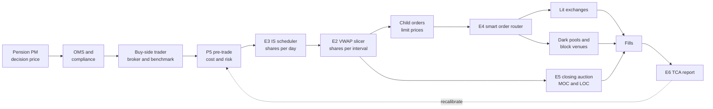
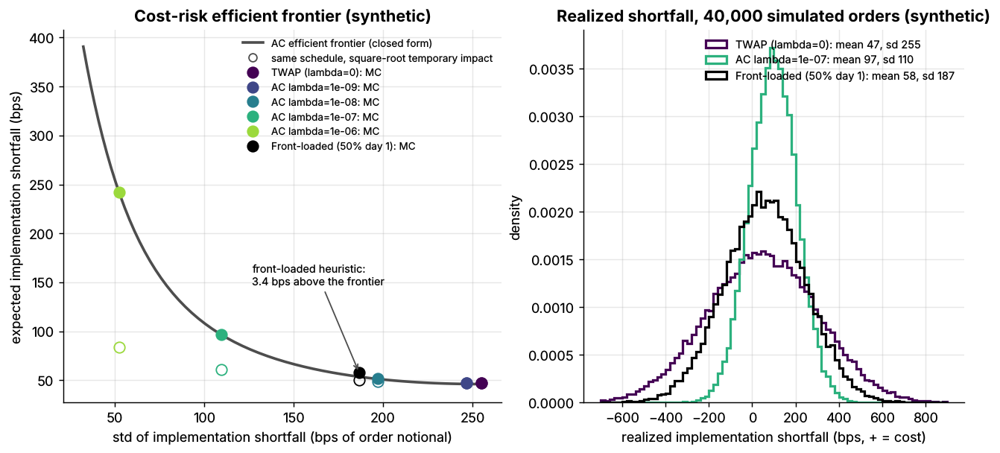
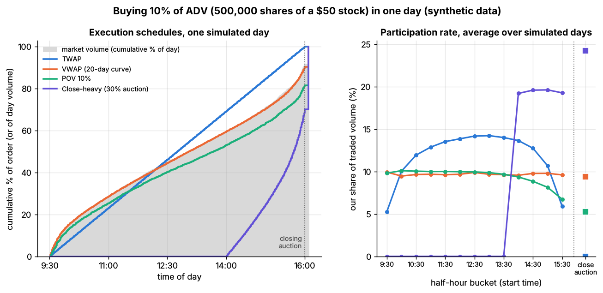
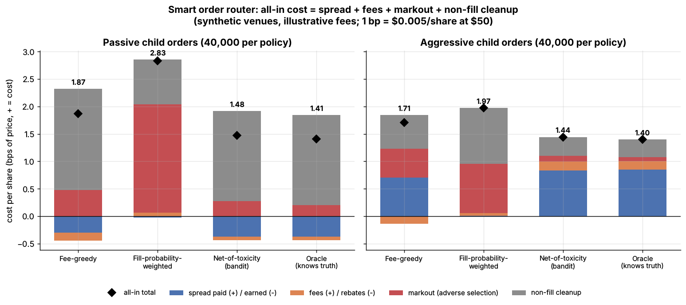
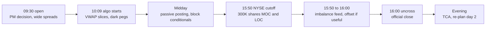
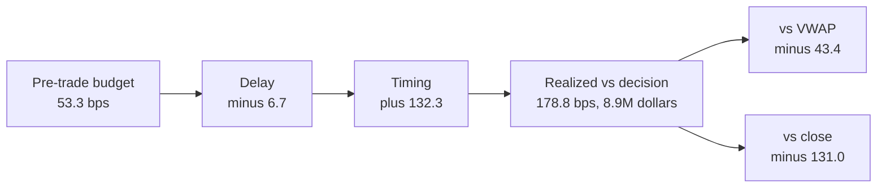
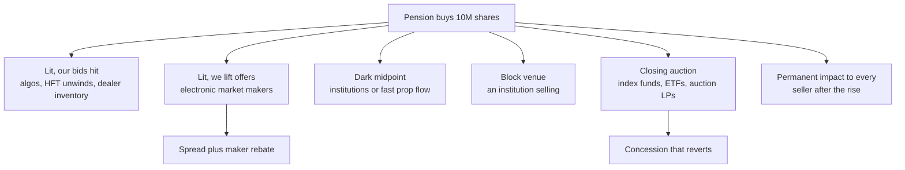

# Walkthrough: executing a \$500M buy order

> **TL;DR**
>
> - A \$500M buy is half a day's volume in a \$1B-ADV large cap. The square-root law and [Lab 16](https://github.com/FrankHuang94/quant_trading_claude/tree/main/labs/16-almgren-chriss-frontier) agree on about 46–47 bps (\$2.3M) of expected cost over five even days. The price risk is five times larger: a 254 bps (\$12.7M) standard deviation.
> - An Almgren-Chriss schedule with λ = 10⁻⁸ buys 37% on day 1. It costs 5.3 bps (\$263K) more and cuts the standard deviation by \$2.9M. Faster schedules break a 25% participation cap.
> - Each day's quota follows the volume curve as thousands of child orders. A markout-aware router pays 1.44–1.48 bps all-in, against 1.71–1.87 for fee-greedy routing (Lab 18). The close is capped at 15% of the expected print.
> - In a 75th-percentile simulated week the order cost 178.8 bps (\$8.9M) against the decision price, 132 bps of it timing. The same fills "beat" VWAP by 43 bps and the close by 131 bps.
> - Every basis point is someone's revenue: market makers, liquidity providers, venues, the broker. The 25 bps of permanent impact goes to whoever sold after the rise.

**Level:** Core · **Read time:** ~13 min · **Last verified:** 2026-11

## Cast and setup

**Scenario (illustrative).** A US public pension fund raises its weight in one US large cap by \$500M: a [parent order](../../09-reference/glossary.md#parent-order) for 10M shares at \$50. The stock trades 20M shares (\$1B) a day, so the order is **50% of ADV**. Volatility is 2% a day; the quoted spread averages 3 bps.

**Where the numbers come from.** The calibration is [Lab 16](https://github.com/FrankHuang94/quant_trading_claude/tree/main/labs/16-almgren-chriss-frontier)'s: temporary impact η = 5×10⁻⁸, permanent impact γ = 2.5×10⁻⁸, half-spread 1.5 bps, five days in 50 intervals of about 39 minutes. **Lab 16 simulates a sell; this page mirrors it for a buy:** fills at S + ε + η·rate, and each share bought lifts the price by γ. Expected cost and variance are unchanged; a buy on price path z costs what the lab's sell costs on −z. The helper script [`labs/walkthroughs/institutional-execution.py`](https://github.com/FrankHuang94/quant_trading_claude/tree/main/labs/walkthroughs) (seed 7, under 1 s) asserts this, reuses Lab 16's functions and price paths, and computes every derived number below. [Lab 17](https://github.com/FrankHuang94/quant_trading_claude/tree/main/labs/17-vwap-twap-pov) supplies intraday schedule costs and [Lab 18](https://github.com/FrankHuang94/quant_trading_claude/tree/main/labs/18-smart-order-router) venue costs. Costs are in bps of the order (1 bp = \$50,000); `+` = cost. All are synthetic lab results.



## 1. The decision and the hand-off

The portfolio manager's decision timestamps the **decision price**, the benchmark in [implementation shortfall](../../09-reference/glossary.md#implementation-shortfall) ([Perold 1988](https://doi.org/10.3905/jpm.1988.409150)). After compliance in the OMS, the buy-side trader chooses between an **agency algo** (the broker works the order for a commission; the pension keeps the price risk), a **principal risk bid** (a dealer sells all 10M shares at once and carries the risk) and a **block search**.

The model gives a floor for a risk bid `[Estimate]`. A dealer using it with λ = 10⁻⁸ (see below) needs at least its certainty-equivalent cost, E + λ·Var. With Var = (\$9.84M)², λ·Var = \$0.97M = 19.4 bps, so the floor is 51.3 + 19.4 ≈ **71 bps** before margin. The pension goes agency, benchmarked to arrival.

The decision comes at the 9:30 open; the algo starts one interval (39 minutes) later. Meanwhile the simulated price slipped from \$50.034 to the \$50.00 [arrival price](../../09-reference/glossary.md#arrival-price): **delay** is −6.7 bps, a \$336K gain. Here that is luck; in practice slow workflows leak money, and [TCA](../e-execution-algorithms/transaction-cost-analysis.md) charges delay to the desk.

## 2. Pre-trade: what does 50% of ADV cost?

The [cost model](../d-portfolio-construction/transaction-cost-and-impact-models.md) prices [market impact](../../09-reference/glossary.md#market-impact) with the [square-root law](../../09-reference/glossary.md#square-root-law): peak impact ≈ Y·σ·√(Q/V) `[Verified]` ([Tóth et al. 2011](https://doi.org/10.1103/PhysRevX.1.021006)).

- Peak impact = 0.5 × 200 bps × √0.5 = **70.7 bps**.
- At a steady rate the average fill pays about two-thirds of the peak: **47.1 bps (\$2.36M)**.
- With Y = 1, the top of the 0.5–1 range desks quote `[Lore]`, it doubles to 94 bps.

```python
import numpy as np

def pretrade_sqrt_bps(q_shares, adv_shares, sigma_daily, Y=0.5):
    """Square-root law, as in the P5 card: peak and average-fill impact, bps."""
    peak = 1e4 * Y * sigma_daily * np.sqrt(q_shares / adv_shares)
    return peak, 2 / 3 * peak          # steady-rate fills pay ~2/3 of the peak

pretrade_sqrt_bps(10e6, 20e6, 0.02)    # -> (70.7, 47.1)
```

Lab 16's linear model gives nearly the same for an even five-day schedule: **46.0 bps (\$2.3M)** = 25.0 permanent + 19.5 temporary + 1.5 spread. The permanent line is why five days cost more than five separate one-day orders. Each day's buying (10% of ADV) lifts the price 10 bps, so days 1–5 start 0, 10, 20, 30 and 40 bps up: 20 bps carried on average, plus 5 within the day.

Risk dominates: the even schedule's standard deviation is **254 bps (\$12.7M)**, more than five times its expected cost.

## 3. Schedule choice: IS, VWAP, POV or the close

| Schedule (Lab 16, mirrored) | Expected cost | Std dev | Peak rate | Day 1 | If impact is square-root |
|---|---|---|---|---|---|
| Even (TWAP; VWAP in clock time) | 46.0 bps, \$2.30M | 254 bps | 10% of ADV | 10% | 46.9 bps |
| IS, λ = 10⁻⁸ (half-life 1.5 d) | 51.3 bps, \$2.56M | 197 bps | 22.6% | 18.7% | 48.6 bps |
| IS, λ = 10⁻⁷ (half-life 0.48 d) | 96.1 bps, \$4.81M | 110 bps | 66.7% | 38.0% | 60.8 bps |
| IS, λ = 10⁻⁶ | 241.8 bps | 52 bps | 181% | 49.4% | 83.9 bps |

Lab 16 has no intraday volume pattern, so its [TWAP](../../09-reference/glossary.md#twap) is uniform in volume time: a multi-day [VWAP](../../09-reference/glossary.md#vwap) in clock time. **POV** at 10% keeps the pace but not the deadline: in Lab 17 it finished on only 61% of days. **Close-only** would mean 2M shares a day, the entire expected print. For an alpha-free rebalance, the real choice is how far up the [Almgren-Chriss](../../09-reference/glossary.md#almgren-chriss-model) frontier to go ([E3](../e-execution-algorithms/implementation-shortfall-and-almgren-chriss.md)).

The desk caps the [participation rate](../../09-reference/glossary.md#participation-rate) of any interval at 25% of ADV, and takes the most risk-averse schedule that fits.

```python
def choose_lambda(X, T, n, sigma, eta, gamma, adv, cap=0.25,
                  grid=(0.0, 1e-9, 1e-8, 1e-7, 1e-6)):
    """Most risk-averse lambda whose peak rate fits the cap. Uses Lab 16's
    ac_trajectory (written for a sell; the buy is its mirror image)."""
    ok = []
    for lam in grid:
        hold = ac_trajectory(X, T, n, sigma, eta, gamma, lam)   # Lab 16
        peak = np.max(-np.diff(hold)) / (T / n) / adv            # share of ADV/day
        if peak <= cap:
            ok.append(lam)
    return max(ok)                                               # -> 1e-8 here
```

The answer is **λ = 10⁻⁸**: 18.7%, 12.2%, 8.2%, 5.9% and 4.9% of ADV on days 1 to 5 (3.74M down to 0.98M shares). It pays \$263K more expected cost to cut the standard deviation from \$12.7M to \$9.8M. Near TWAP the frontier is flat, so the first units of risk reduction are almost free. At λ = 10⁻⁸ the even schedule's certainty-equivalent is 46.0 + 32.3 = 78.3 bps, against 70.6 bps for the chosen one.



*Lab 16, synthetic: the frontier traced by λ. Open circles: the same schedules under square-root impact.*

**Within each day**, the quota follows a 20-day volume curve. Lab 17's one-day buy of 10% of ADV costs 12.8 bps with VWAP, 14.0 with TWAP, 13.1 with POV and 17.9 close-heavy. Its impact depends on participation, not dollars, so its \$25M order in a \$250M-ADV stock maps onto one 10%-of-ADV day here. The levels do not transfer: for such a day Lab 16 charges 26.5 bps (20 temporary + 5 permanent + 1.5 spread) and the square-root law about 22.6, and Lab 17 carries no impact from earlier days. Use Lab 17 for **differences**: VWAP saves 1.3 bps over TWAP; close-heavy costs 5.1 bps more.



*Lab 17, synthetic: execution against the volume curve (left); participation by half-hour and at the close (right).*

## 4. Child orders and limit prices

Day 1's first interval asks for **452,658 shares (\$22.6M) in about 39 minutes**: at an illustrative 250 shares per child, about 1,800 child orders (40,000 for the whole parent). Each child carries a limit price. On schedule, it posts at the bid or rests at the midpoint. When the order falls behind by more than a tolerance, it crosses the spread, but never a blown-out one. Sizes and timing are randomized, because a metronome is easy to detect.

```python
def child_order(behind_shares, tolerance, bid, ask, mid, max_cross_bps=5.0):
    """Illustrative slice logic (not in a lab): passive unless behind schedule."""
    if behind_shares > tolerance:                        # catch up: take liquidity
        limit = min(ask, mid * (1 + max_cross_bps / 1e4))   # never chase a wide spread
        return {"side": "buy", "type": "marketable_limit", "limit": limit}
    if behind_shares > 0:                                # slightly behind: midpoint, dark
        return {"side": "buy", "type": "midpoint_peg", "min_qty": 500}
    return {"side": "buy", "type": "limit", "limit": bid, "post_only": True}
```

## 5. Venue choice: the smart order router

Each child goes to the [smart order router](../e-execution-algorithms/smart-order-routing.md). It minimizes all-in cost: spread, plus the [maker-taker](../../09-reference/glossary.md#maker-taker) fee or rebate, plus the [markout](../../09-reference/glossary.md#markout) after the fill, plus the cost of cleaning up children that do not fill. Lab 18's all-in costs per child, in bps:

| Router policy | Passive | Aggressive | Extra cost on this order vs the bandit |
|---|---|---|---|
| Fee-greedy | 1.87 | 1.71 | \$19.8K (passive) / \$13.1K (aggressive) |
| Fill-probability-weighted | 2.83 | 1.97 | \$67.8K / \$26.4K |
| Net-of-toxicity (bandit) | 1.48 | 1.44 | — |
| Oracle | 1.41 | 1.40 | — |

Scaling assumes every share routes in that mode: (1.87 − 1.48) bp × \$500M = \$19.8K, small next to \$2.56M of impact. Lab 18's spread is one tick (2 bps), Lab 16's 3 bps on average; the bandit's 1.44–1.48 bps matches Lab 16's 1.5 bps spread line, so the budget assumes competent routing. One parent is about one Lab 18 run (40,000 children), and separating venues 0.5 bp apart takes about 770 fills each: one order cannot audit many venues.



*Lab 18, synthetic: pricing toxicity beats chasing rebates or fills.*

## 6. Dark vs lit

A [midpoint peg](../../09-reference/glossary.md#midpoint-peg) in a [dark pool](../../09-reference/glossary.md#dark-pool) saves the 1.5 bps half-spread if it fills, and in Lab 18 that "if" dominates. The natural pool fills 20% of passive orders (markout 0.4 bp), the [toxic](../../09-reference/glossary.md#flow-toxicity) one 70% (markout 3.0 bps). Both all-in costs, 2.20 and 2.95 bps, exceed the best lit venue's 1.27. The bigger prize is a block: a [conditional order](../../09-reference/glossary.md#conditional-order) at a venue such as Cboe BIDS `[Verified]` meeting an active manager selling 500,000 shares (2.5% of ADV). Through the lit book that block would carry about 0.5 × 200 × √0.025 ≈ 16 bps of peak impact `[Estimate]`.

Going dark risks [information leakage](../../09-reference/glossary.md#information-leakage). IOC "pings" find resting orders, so the algo sets minimum fill sizes, caps dark exposure and scores pools by markouts ([E5](../e-execution-algorithms/auction-close-and-dark-liquidity-algos.md)). Operators have misused order information: Barclays (\$70M) and Credit Suisse (\$84.3M) settled dark-pool charges in 2016, ITG (\$20.3M) in 2015 `[Verified]`. Urgency moves traders down a pecking order from midpoint dark pools to other dark venues to lit `[Verified]` ([Menkveld, Yueshen & Zhu 2017](https://doi.org/10.1016/j.jfineco.2017.03.004)).

## 7. The close



The [closing auction](../../09-reference/glossary.md#closing-auction) carries about 9% of US notional, with a record 9.44% in Q2 2024 and about 20% on rebalance days `[Reported]`. Lab 17 assumes 10%: here, a 2M-share (\$100M) expected print. The E5 rule sends the close's slice of the volume curve (10% of the day's quota) to the auction, capped at 15% of the forecast print.

```python
def size_close_order(day_quota, auction_forecast, close_frac=0.10, max_auction_pct=0.15):
    """E5 card rule: the close's slice of the volume curve, never > 15% of the print."""
    return min(close_frac * day_quota, max_auction_pct * auction_forecast)
```

Day 1 wants 374K shares and is capped at **300K**; days 2–5 send 244K, 164K, 119K and 98K: **926K shares (\$46.3M, 9.3% of the order)**. Lab 17's close-heavy recipe (30% of a day's order, about 23% of the print) cost 5.1 bps more than VWAP, yet looked perfect against the close (0.0 ± 48 bps) because its own demand set that price. Here, 30% of day 1 would be 56% of the print.

[Market-on-close](../../09-reference/glossary.md#market-on-close-moc) and LOC orders are due by 3:50 p.m. (NYSE) or 3:55 p.m. (Nasdaq); NYSE bars cancels after 3:58 p.m. `[Verified]`. Later orders must offset the published [imbalance](../../09-reference/glossary.md#auction-imbalance). A sell imbalance (say, an index deletion) lets us buy more at a concession; a buy imbalance means our MOC pays up.

## 8. The TCA report

The helper script takes the 75th-percentile week of Lab 16's 40,000 simulated weeks (path 32,529); one week in four is worse. The algo finished as planned. The stock closed days 1–5 at \$50.71, \$51.45, \$51.75, \$51.74 and \$51.59.

| Component (vs decision price \$50.034) | bps | \$ | Owner |
|---|---|---|---|
| Delay | −6.7 | −335,947 | desk |
| Spread and venue | 1.5 | 75,000 | router |
| Temporary impact | 24.7 | 1,238,088 | schedule |
| Permanent impact | 25.0 | 1,250,000 | order size |
| Timing (price drift) | 132.3 | 6,618,821 | market |
| Opportunity (unfilled shares) | 0.0 | 0 | — |
| Commission (1¢/share `[Lore]`) | 2.0 | 100,000 | broker |
| **Total** | **178.8** | **8,945,962** | |

No Section 31 fee: the \$20.60-per-million rate (from 2026-04-04) applies to sales only `[Verified]`; a \$500M sale would pay \$10,300.

| Benchmark | Price | Our average fill (\$50.918) against it |
|---|---|---|
| Arrival | \$50.000 | **+183.6 bps (cost)**, 0.67 sd above the 51.3 bps estimate |
| Interval VWAP, all prints | \$51.140 | −43.4 bps ("beat") |
| Day-5 close | \$51.594 | −131.0 bps ("beat") |

All three are arithmetically right; only arrival measures the pension's economic loss, and a front-loaded buyer in a rising week usually beats later prices. Two cautions. Lab 16's impact is deterministic, so "on budget" holds by construction; real TCA estimates impact with a model and calls the market-adjusted residual timing. And on this path an even schedule would have cost 243.7 bps and λ = 10⁻⁷ 105.2, yet across all weeks TWAP beats λ = 10⁻⁷ on 61% of orders. One order cannot rank schedules.



## 9. The counterparties along the way



| Stage | Who sells to the pension | How they get paid |
|---|---|---|
| Passive lit fills | other algos, short-term traders, dealers unloading inventory | they pay us half the spread; we keep the markout |
| Aggressive lit fills | electronic [market makers](../../02-strategies/a-liquidity-provision/equity-market-making.md) | spread plus maker rebate, net of [adverse selection](../../09-reference/glossary.md#adverse-selection) |
| Dark midpoint | natural sellers or fast proprietary flow | half-spread saved for both sides; the pool's per-share fee |
| Block venue | an active manager exiting | both avoid impact; venue fee |
| Closing auction | index funds, ETFs, auction liquidity providers, the NYSE [DMM](../../09-reference/glossary.md#designated-market-maker-dmm) | a concession that reverts quickly `[Verified]` ([Bogousslavsky & Muravyev 2023](https://doi.org/10.1016/j.finmar.2023.100852)) |
| Whole order | the broker | commission; exchanges and ATSs take access fees |

**[HFTs](../../09-reference/glossary.md#high-frequency-trading-hft)** first lean against long institutional orders, then trade with the most informed ones `[Verified]` ([van Kervel & Menkveld 2019](https://doi.org/10.1111/jofi.12759)). In Canadian data, HFT activity goes with higher costs for large informed trades and lower costs for small uninformed ones `[Verified]` ([Korajczyk & Murphy 2019](https://doi.org/10.1093/rfs/hhy079)). **[Wholesalers](../../09-reference/glossary.md#wholesaler)** trade retail flow ([venues and retail flow](../../01-market-structure/venues-and-retail-flow.md)), not the pension; retail selling leaves them long, and they unload on exchanges into bids like ours `[Estimate]`.

## P&L / cost attribution

The pension's cost statement for the order (bps of notional; dollars in thousands):

| Line | Paid to | Budget bps | Budget \$K | Realized bps | Realized \$K |
|---|---|---|---|---|---|
| Spread and venue | market makers, venues | 1.5 | 75 | 1.5 | 75 |
| Temporary impact | liquidity providers | 24.8 | 1,238 | 24.7 | 1,238 |
| Permanent impact | sellers after the rise | 25.0 | 1,250 | 25.0 | 1,250 |
| Commission | broker | 2.0 | 100 | 2.0 | 100 |
| **Controllable cost** | | **53.3** | **2,663** | **53.2** | **2,663** |
| Delay | luck, or the desk | 0 | 0 | −6.7 | −336 |
| Timing | the market | 0 (sd 196.8) | 0 | 132.3 | 6,619 |
| Opportunity | — | 0 | 0 | 0.0 | 0 |
| **Total shortfall** | | **53.3** | **2,663** | **178.8** | **8,946** |

Budget bps use arrival notional, realized bps decision notional; the dollars match exactly.

## What would be different in real life

- **Impact is concave, transient and uncertain.** Fast schedules are cheaper than the linear model says, impact partly decays overnight, and a factor-of-2 error in η moves the whole frontier.
- **Overnight gaps** are missing from the 197 bps, and real IS algos re-solve as prices and fills arrive.
- **Leakage and alpha.** If others detect the order, the price drifts against it and front-loading pays whatever λ is.
- **Volume forecasts.** Most of Lab 17's VWAP tracking error is forecast error; event days break the curve.
- **Rules move.** The \$0.0030 access-fee cap still applies as of 2026-11; the \$0.0010 cap is deferred to November 2027, and repealing Rule 611 was proposed in June 2026 `[Verified]`.
- **TCA statistics.** Telling VWAP from TWAP (1.3 bps) across unrelated orders takes about 77,000 orders (Lab 17), hence market adjustment and randomized algo wheels `[Lore]`.
- **Structure.** Commissions vary (0.5–2¢/share); some pensions use transition managers or split orders across brokers `[Lore]`.

<details markdown="1">
<summary>Math: the buy-side mirror of Almgren-Chriss</summary>

Buy $n_k$ shares in interval $k$ at rate $v_k = n_k/\tau$, with $b_k$ already bought and random price move $D_k$ so far:

$$
IS = \sum_k n_k\,(D_k + \gamma b_k + \epsilon + \eta v_k) = \tfrac12\gamma X^2 + \epsilon X + \tfrac{\tilde\eta}{\tau}\sum_k n_k^2 + \sum_k n_k D_k ,
$$

with $\tilde\eta = \eta - \gamma\tau/2$. The first three terms are Lab 16's $E$; the last has mean zero and variance $\sigma^2\tau\sum_k x_k^2$ ($x_k$ = shares still to buy).

</details>

## Related pages

- [Execution algorithms: overview](../e-execution-algorithms/execution-algorithms-overview.md)
- [VWAP, TWAP and POV](../e-execution-algorithms/vwap-twap-pov.md)
- [Implementation shortfall and Almgren-Chriss](../e-execution-algorithms/implementation-shortfall-and-almgren-chriss.md)
- [Smart order routing](../e-execution-algorithms/smart-order-routing.md)
- [Auction, close and dark-liquidity algos](../e-execution-algorithms/auction-close-and-dark-liquidity-algos.md)
- [Transaction cost analysis](../e-execution-algorithms/transaction-cost-analysis.md)
- [Transaction cost and impact models](../d-portfolio-construction/transaction-cost-and-impact-models.md)
- [Life of a stock order](../../01-market-structure/life-of-a-stock-order.md)
- [Order types and auctions](../../01-market-structure/order-types-and-auctions.md)
- [Venues and retail flow](../../01-market-structure/venues-and-retail-flow.md)
- [Auctions and closing liquidity](../../02-strategies/a-liquidity-provision/auctions-and-closing-liquidity.md)
- [Equity market making](../../02-strategies/a-liquidity-provision/equity-market-making.md)

## Sources

- [Verified] Perold, A. F. (1988). "The implementation shortfall: Paper versus reality." *Journal of Portfolio Management* 14(3), 4–9. <https://doi.org/10.3905/jpm.1988.409150> (accessed 2026-11)
- [Verified] Almgren, R. & Chriss, N. (2000). "Optimal execution of portfolio transactions." *Journal of Risk* 3(2), 5–39 (DOI dated 2001). <https://doi.org/10.21314/JOR.2001.041> (accessed 2026-11)
- [Verified] Tóth, B., Lempérière, Y., Deremble, C., de Lataillade, J., Kockelkoren, J. & Bouchaud, J.-P. (2011). "Anomalous price impact and the critical nature of liquidity in financial markets." *Physical Review X* 1, 021006. <https://doi.org/10.1103/PhysRevX.1.021006> (accessed 2026-11)
- [Verified] van Kervel, V. & Menkveld, A. J. (2019). "High-Frequency Trading around Large Institutional Orders." *Journal of Finance* 74(3), 1091–1137. <https://doi.org/10.1111/jofi.12759> (accessed 2026-11)
- [Verified] Korajczyk, R. A. & Murphy, D. (2019). "High-Frequency Market Making to Large Institutional Trades." *Review of Financial Studies* 32(3), 1034–1067. <https://doi.org/10.1093/rfs/hhy079> (accessed 2026-11)
- [Verified] Bogousslavsky, V. & Muravyev, D. (2023). "Who trades at the close? Implications for price discovery and liquidity." *Journal of Financial Markets* 66, 100852. <https://doi.org/10.1016/j.finmar.2023.100852> (accessed 2026-11)
- [Verified] Menkveld, A. J., Yueshen, B. Z. & Zhu, H. (2017). "Shades of darkness: A pecking order of trading venues." *Journal of Financial Economics* 124(3), 503–534. <https://doi.org/10.1016/j.jfineco.2017.03.004> (accessed 2026-11)
- [Verified] NYSE (n.d.). "NYSE Auctions: Closing Process Fact Sheet." <https://www.nyse.com/publicdocs/nyse/NYSE_Auctions_Closing_Process_Fact_Sheet.pdf> (accessed 2026-11)
- [Verified] Nasdaq (n.d.). "Opening and Closing Cross Quick Guide." <https://www.nasdaqtrader.com/content/technicalsupport/specifications/TradingProducts/openclosequickguide.pdf> (accessed 2026-11)
- [Reported] NYSE Research (2024-08-29). "NYSE Closing Auction: price discovery opportunities reach new highs." <https://nyse.com/data-insights/nyse-closing-auction-price-discovery-opportunities-reach-new-highs> (accessed 2026-11)
- [Reported] BMLL (2024). "Into the Close: Unpacking U.S. Closing Auction Dynamics and the Impact of the Russell Reconstitution." <https://www.bmlltech.com/news/market-insight/into-the-close-unpacking-u-s-closing-auction-dynamics-and-the-impact-of-the-russell-reconstitution> (accessed 2026-11)
- [Verified] Cboe (n.d.). "BIDS Trading." <https://www.cboe.com/markets/bidstrading> (accessed 2026-11)
- [Verified] SEC (2016-01-31). "Barclays, Credit Suisse charged with dark pool violations." Press release 2016-16. <https://www.sec.gov/news/pressrelease/2016-16.html> (accessed 2026-11)
- [Verified] SEC (2015-08-12). "SEC charges ITG with operating secret trading desk and misusing dark pool subscriber trading information." Press release 2015-164. <https://www.sec.gov/news/pressrelease/2015-164.html> (accessed 2026-11)
- [Verified] SEC (2026-02-27). "Order Making Fiscal Year 2026 Annual Adjustments to Transaction Fee Rates," Release No. 34-104909 (\$20.60 per million of covered sales, effective 2026-04-04). <https://public-inspection.federalregister.gov/2026-04233.pdf> (accessed 2026-11)
- [Verified] Federal Register (2026-06-17). "The Trade-Through Rule and Locked and Crossed Markets Provisions of Regulation NMS," Release No. 34-105655, 91 FR 36656. <https://www.federalregister.gov/documents/2026/06/17/2026-12163/the-trade-through-rule-and-locked-and-crossed-markets-provisions-of-regulation-nms> (accessed 2026-11)
- [Verified] SEC (2026-06-11). Order granting temporary exemptive relief (Rules 610(c) and 612 compliance to November 2027), Release No. 34-105656. <https://www.sec.gov/files/rules/exorders/2026/34-105656.pdf> (accessed 2026-11)
