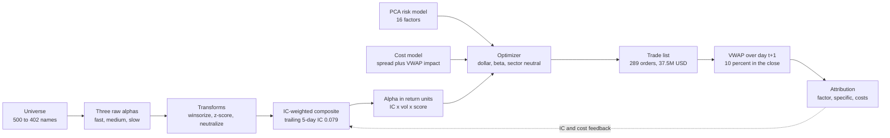
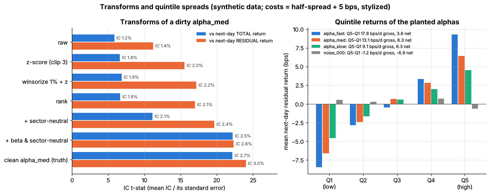
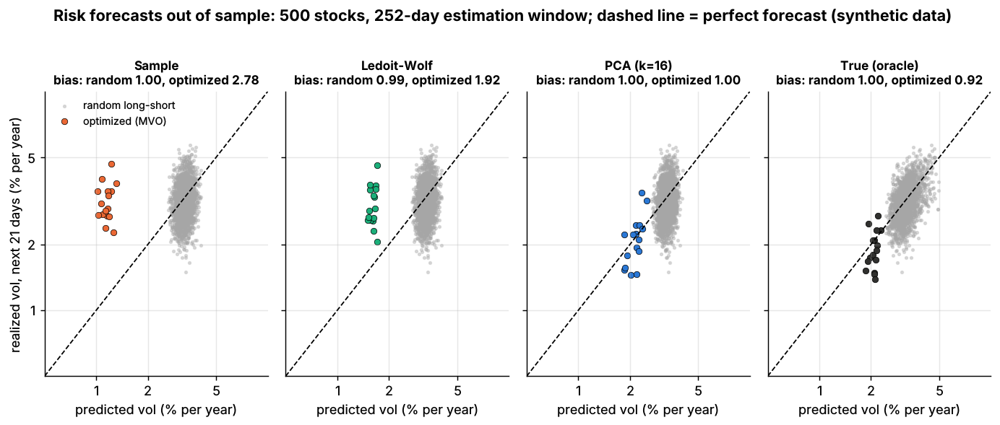
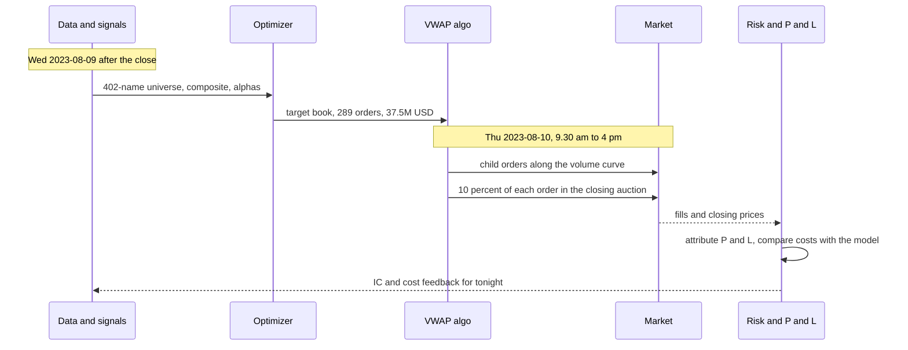
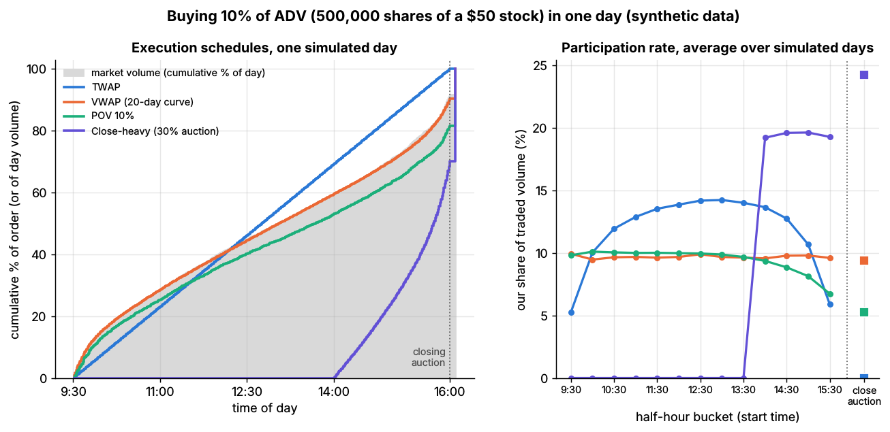
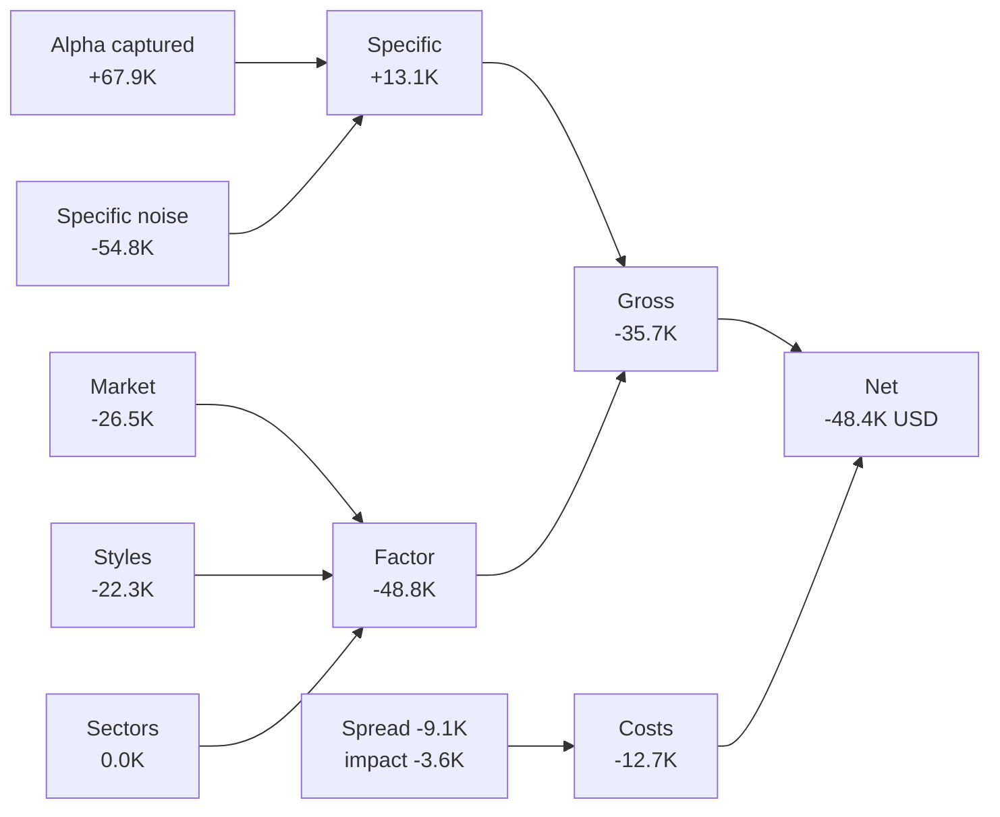
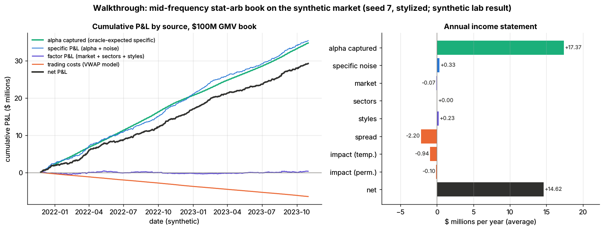

# Walkthrough: a mid-frequency stat-arb book

> **TL;DR**
>
> - One rebalance of a toy \$100M market-neutral US equity book, end to end: liquidity screen → three alphas → winsorize, z-score, neutralize → IC-weighted composite → PCA risk model → cost-aware optimizer → 289 orders → one-day VWAP → next-day attribution.
> - Every number comes from one script that imports the finished labs' core functions (Labs 11, 12, 14 and 17) and runs them on the synthetic market, seed 7.
> - The traded day lost \$48K: \$68K of expected alpha was swamped by \$55K of stock-specific noise, \$49K of factor losses and \$13K of costs. Single days are mostly noise.
> - Over two simulated years the book earned \$17.9M gross and \$14.6M net a year (Sharpe 12.5 and 10.3, a stylized synthetic lab result; real books of this design net roughly 1–2).
> - The lessons survive the stylization: neutralize on the beta you actually trade, judge a risk model on the optimized book, and let costs decide how far to trade.

**Level:** Core · **Read time:** ~14 min · **Last verified:** 2026-11

## Cast and setup

The book is a [statistical arbitrage](../../09-reference/glossary.md#statistical-arbitrage) portfolio of the kind described in [cross-sectional alpha and neutralization](../../02-strategies/d-mid-frequency-alpha/cross-sectional-alpha-and-neutralization.md): many small long and short bets on [residual returns](../../09-reference/glossary.md#residual-return), held for days, [beta-neutral](../../09-reference/glossary.md#beta-neutral) and sector-neutral. Signals are computed after the close of day *t*; orders execute during day *t*+1.

The market is the labs' simulator: 500 stocks, 11 sectors, four style factors, fat tails, volatility regimes and three planted alphas of known strength. The helper script [`labs/walkthroughs/mid-frequency-stat-arb.py`](https://github.com/FrankHuang94/quant_trading_claude/blob/main/labs/walkthroughs/mid-frequency-stat-arb.py) runs the whole pipeline in about 45 seconds and writes every figure quoted here to `mid-frequency-stat-arb.json`.

| Assumption (illustrative) | Value |
|---|---|
| Size | \$50M capital, 100% long and 100% short: \$100M gross market value (GMV) |
| Universe | price ≥ \$5 and 20-day average daily volume (ADV) ≥ \$25M, re-screened daily |
| Position cap | the lesser of \$500K and 1% of ADV |
| Forecast and risk horizon | 5 days; rebalance daily |
| Backtest | 504 daily rebalances, Nov 2021 – Oct 2023 (simulated calendar); earlier years are history |
| Shown in detail | signal date 2023-08-09, trade date 2023-08-10 |



## Stage 1: the universe

A liquidity screen decides what the book may hold. It uses only data known at the close ([point-in-time data](../../09-reference/glossary.md#point-in-time-data); see [D1](../a-data-and-signals/point-in-time-data-and-cleaning.md)): today's trailing ADV, not next month's. On the signal date 402 of 500 names pass; the thinnest survivor trades \$25.1M a day. Over the backtest the universe averages 415 names. A held name that drops out gets a zero cap, so the optimizer sells it.

## Stage 2: three alphas

Each alpha stands in for a family from [feature engineering](../a-data-and-signals/feature-engineering.md): **A1** fast (reversal-like, half-life 2 days), **A2** medium (revisions-like, 10 days) and **A3** slow (quality-like, 60 days). Their planted daily [information coefficients](../../09-reference/glossary.md#information-coefficient-ic) (IC: the cross-sectional correlation of signal with next-day residual return) are 0.04, 0.03 and 0.02.

Research signals never arrive clean, so the script passes each through Lab 11's `make_raw_signal`. That rescales it into arbitrary units and adds a beta tilt (making each signal partly a disguised market bet), a slowly drifting sector tilt and rare huge outliers.

## Stage 3: transforms

Per date, on universe names only, the script applies [Lab 11](https://github.com/FrankHuang94/quant_trading_claude/tree/main/labs/11-signal-transforms-ic)'s core functions ([signal transforms](../a-data-and-signals/signal-transforms.md)):

```python
x = winsorize(raw_t, 0.01)                          # clip at the 1st and 99th percentile first
x = zscore(x)                                       # mean 0, sd 1, clipped at +-3
E = np.column_stack([beta_hat_t, sector_dummies])   # ESTIMATED 252-day beta + 11 sector columns
signal_t = zscore(neutralize(x, E))                 # residual of a per-date regression, re-scaled
```

[Winsorization](../../09-reference/glossary.md#winsorization) before the [z-score](../../09-reference/glossary.md#z-score) stops one bad print from setting everyone's scale. [Neutralization](../../09-reference/glossary.md#neutralization) strips the beta and sector bets. Scored the way [evaluating signals](../a-data-and-signals/evaluating-signals.md) recommends (mean daily IC against next-day total return, all 1,260 days):

| Alpha | Raw | Winsorized + z-score | Neutralized | Neutralized vs residual return | Correlation with true beta, before → after neutralizing |
|---|---|---|---|---|---|
| A1 fast | 0.0172 | 0.0264 | 0.0315 | 0.0369 | 0.46 → 0.13 |
| A2 medium | 0.0150 | 0.0208 | 0.0230 | 0.0263 | 0.43 → 0.13 |
| A3 slow | 0.0082 | 0.0135 | 0.0162 | 0.0191 | 0.43 → 0.12 |

Lab 11 ran the same recipe on the same planted alpha (a different random draw) but neutralized on the *true* beta: IC 0.0123 → 0.0250, IC t-stat 5.8 → 22.2 (synthetic lab result). Here beta is estimated, so A2 reaches only 0.0230 and a 0.13 correlation with true beta survives. You can only neutralize what you can measure. That residue reappears in Stage 9.



*Lab 11: each transform step's IC t-stat against total and residual returns (left); quintile returns of the planted alphas (right). Synthetic data.*

## Stage 4: IC-weighted combination

[Alpha combination](../../09-reference/glossary.md#alpha-combination) ([F5](../b-forecasting-models/alpha-combination-and-ensembling.md)) uses Lab 12's `combine_ic_weighted`: weights proportional to each signal's positive IC. The IC is measured against 5-day residual returns over a trailing 252-day window, using only dates whose 5-day labels are complete, so there is no look-ahead.

```python
ic_trail = ic5.rolling(252).mean().shift(5)                  # labels complete by date t
comp, w = combine_ic_weighted(X_t, ic_trail.loc[t])           # Lab 12: w_k ∝ max(IC_k, 0)
alpha = ic_comp * np.sqrt(5) * sigma_spec * zscore(comp)      # Grinold: IC x volatility x score
```

On the signal date the trailing 5-day ICs are 0.047, 0.057 and 0.040, giving weights of 0.33 (A1), 0.40 (A2) and 0.28 (A3). The composite's own trailing 5-day IC is 0.079. The last line converts a score into an expected 5-day return (Grinold 1994). With a median specific volatility of 1.22% a day, one standard deviation of score is worth 0.079 × √5 × 1.22% ≈ 22 bps; the 5th to 95th percentile of alphas runs from −37 to +41 bps.

IC weighting is near-optimal here because the three alphas are uncorrelated by construction. In [Lab 12](https://github.com/FrankHuang94/quant_trading_claude/tree/main/labs/12-alpha-combination-purged-cv), with a near-duplicate and ten noise signals in the mix, walk-forward rank ICs were 0.082 (IC-weighted), 0.085 (ridge) and 0.087 (oracle weights), and IC weighting put 0.43 of its weight on one alpha and its echo (synthetic lab result). With overlapping alphas, use ridge.

## Stage 5: risk model

The [risk model](../../09-reference/glossary.md#risk-model) ([P1](../d-portfolio-construction/risk-models.md)) is Lab 14's `pca_factor_cov`: the top 16 [principal components](../../09-reference/glossary.md#principal-component-analysis-pca) of a 252-day return window plus a diagonal of specific variances, refreshed every 21 days: a statistical factor model in the tradition of Connor and Korajczyk (1986). With 500 stocks and 252 days the sample covariance is singular; keeping 16 factors and discarding the remaining off-diagonal noise is the shrinkage ([P2](../d-portfolio-construction/covariance-estimation-and-shrinkage.md)). On the signal date the first factor (roughly "the market") explains 24% of total stock variance, and all 16 explain 46%.

Lab 14 shows why the estimator matters. All four estimators forecast random portfolios' risk well, with bias statistics (realized ÷ predicted volatility) of 0.99–1.05. For *optimized* portfolios: sample covariance 2.78, [Ledoit-Wolf](../../09-reference/glossary.md#ledoit-wolf-shrinkage) 1.92, PCA 1.00, true covariance 0.92 (synthetic lab result). The optimizer seeks out the estimate's blind spots (Michaud 1989).



*Lab 14: predicted vs realized volatility for random (grey) and optimized (colored) portfolios under four estimators. Synthetic data.*

## Stage 6: the optimizer

[Mean-variance optimization](../../09-reference/glossary.md#mean-variance-optimization-mvo) ([P3](../d-portfolio-construction/mean-variance-optimization.md)) uses Lab 14's `optimize_portfolio` unchanged. The cost vector comes from the [cost model](../d-portfolio-construction/transaction-cost-and-impact-models.md): half-spread plus the Lab 17 VWAP impact of a typical \$100K trade, per dollar traded.

```python
w = optimize_portfolio(alpha, cov_5d, w_prev, risk_aversion=150,
                       cost=1.0 * cost_per_dollar,             # charged against 5-day alpha
                       beta=beta_hat, sectors=sector_dummies,  # dollar-, beta-, sector-neutral
                       max_weight=np.minimum(0.01, 0.01 * adv / capital),
                       max_gross=2.0)                          # 100/100 of capital = 100M USD GMV
```

The target book on 2023-08-09:

- \$50.0M long in 194 names, \$50.0M short in 189; 93 names sit at their cap.
- Net dollars, estimated-beta exposure and every sector's net exposure are zero to the cent.
- Predicted volatility is \$76.8K a day (1.22% of GMV a year); 97.5% of predicted variance is stock-specific.
- The optimizer expects \$247K of alpha over five days and \$11.3K of trading cost.

Risk aversion 150 was set so that the \$100M gross cap almost binds; the cost multiplier of 1.0 was not tuned. Lab 14's cost test shows what the penalty buys: with none, a biweekly book traded 19.4 times its capital a year and paid 316 bps; a multiplier of 0.25 kept 549 bps of net expected alpha against 493 (synthetic lab result). A sharper alternative is to trade partway toward a forward-looking aim (Gârleanu and Pedersen 2013; [P6](../d-portfolio-construction/multi-period-and-trading-toward-aim.md)).

## Stage 7: the trade list

Target minus yesterday's book is \$37.5M of orders in 289 names: [turnover](../../09-reference/glossary.md#turnover) of 37.5% of GMV in one day. The median order is \$103K, or 0.15% of ADV; the largest is 1.66% of ADV. The five largest each way:

| Side | Ticker | Sector | Score z | 5-day alpha (bps) | Old → new position | Trade | % ADV | VWAP cost (bps) |
|---|---|---|---|---|---|---|---|---|
| Buy | S0323 | Materials | +1.74 | +43.1 | −\$196K → +\$359K | +\$556K | 1.55 | 6.3 |
| Buy | S0001 | Utilities | +1.16 | +18.0 | +\$6K → +\$500K | +\$494K | 0.30 | 2.3 |
| Buy | S0385 | Energy | +0.83 | +15.5 | −\$99K → +\$341K | +\$440K | 1.28 | 7.3 |
| Buy | S0104 | HealthCare | −0.39 | −7.8 | −\$454K → −\$63K | +\$391K | 0.53 | 3.3 |
| Buy | S0198 | Industrials | +1.08 | +25.4 | −\$121K → +\$265K | +\$386K | 0.82 | 3.9 |
| Sell | S0365 | HealthCare | −0.85 | −15.6 | +\$327K → −\$500K | −\$827K | 0.85 | 3.4 |
| Sell | S0051 | InfoTech | −1.51 | −28.4 | +\$338K → −\$354K | −\$692K | 1.66 | 4.7 |
| Sell | S0442 | ConsumerStaples | −0.90 | −15.2 | +\$422K → −\$191K | −\$613K | 0.50 | 3.0 |
| Sell | S0287 | Materials | −1.57 | −38.3 | +\$277K → −\$251K | −\$529K | 0.61 | 3.4 |
| Sell | S0230 | RealEstate | −0.73 | −13.6 | −\$11K → −\$494K | −\$483K | 0.39 | 2.0 |

S0104 is a *buy* of a stock with a negative forecast: its alpha shrank to −7.8 bps, no longer worth a \$454K short, so the optimizer covers most of it. A trade list moves the book toward a new optimum; it is not a list of the day's best ideas. Where a trade opens a position, its 5-day alpha dwarfs its cost (S0323: +43 bps against 6.3).

## Stage 8: execution

Every order goes to a one-day [VWAP](../../09-reference/glossary.md#vwap) ([E2](../e-execution-algorithms/vwap-twap-pov.md)). Lab 17's `vwap_schedule` slices it along the minute volume curve, with 10% in the [closing auction](../../09-reference/glossary.md#closing-auction). Its `child_order_costs_bps` charges half-spread, temporary [market impact](../../09-reference/glossary.md#market-impact) (η = 0.15, power 0.6) and permanent impact (γ = 0.30), a form after Almgren et al. (2005), as stylized in [Lab 17](https://github.com/FrankHuang94/quant_trading_claude/tree/main/labs/17-vwap-twap-pov).



**The largest order** sells 53,960 shares of S0365 (\$827K, 0.845% of ADV, daily volatility 1.79%). Lab 17's perfect-curve VWAP paid 7.79 bps of temporary and 2.96 bps of permanent impact on a 10%-of-ADV order in a 2%-volatility stock (synthetic lab result). Scaled with the model's exponents:

- temporary: 7.79 × (0.845/10)^0.6 × (1.79/2.00) = 1.58 bps (script: 1.53)
- permanent: 2.96 × (0.845/10) × (1.79/2.00) = 0.22 bps (script: 0.22)
- spread: a 1.83 bps half-spread on the 90% traded before the auction = 1.65 bps

Total 3.4 bps, about \$280. For the whole list the VWAP model expects \$12.75K, 13% above the optimizer's linearized \$11.3K: concave impact makes the bigger trades cost more than the \$100K approximation assumes.

**VWAP or [implementation shortfall](../../09-reference/glossary.md#implementation-shortfall) (Perold 1988)?** At 0.15% of ADV, impact is small; the real cost of patience is [alpha decay](../../09-reference/glossary.md#alpha-decay). The script brackets it. Put on at the close of *t* (the labs' usual convention), the new book would earn \$19.7M a year gross. A VWAP over *t*+1, modeled as holding the average of old and new weights, earns \$17.9M; a full day's delay, \$16.0M. Each day of delay costs about \$1.9M a year, most of it from A1, whose predictive power halves every two days against every ten for A2 `[Estimate]`. That argues for a front-loaded [IS schedule](../e-execution-algorithms/implementation-shortfall-and-almgren-chriss.md) on the fast sleeve.



*Lab 17: TWAP, VWAP, POV and close-heavy schedules on one simulated day, and participation by half hour. Synthetic data.*

## Stage 9: next-day P&L attribution

[P&L attribution](../../09-reference/glossary.md#pl-attribution) ([L1](../g-live-trading/live-monitoring-and-pnl-attribution.md)) splits the day with the simulator's true factor exposures, as a fundamental attribution model would. Because the simulator knows each stock's true expected return, specific P&L also splits into alpha and luck:

```python
hold = 0.5 * (w_prev + w)                       # VWAP fills land mid-day on average
factor_pnl = capital * (hold @ B) * f_next      # market, 4 styles, 11 sectors
specific_pnl = capital * hold @ s_next          # = alpha captured + noise
alpha_captured = capital * hold @ E_t[s_next]   # oracle; unknowable in real life
```



Thursday lost \$48.4K. The gross loss of \$35.7K is a half-sigma move against the predicted \$76.8K: the alpha arrived on schedule and noise did the damage. Two factor lines deserve a look. Sector P&L is exactly zero because the sector constraint used the true sector dummies. The market line is not: the book was neutral on *estimated* beta but carried \$3.6M of true beta. Attributing with a different model from the one the optimizer used is what exposes such leaks. Over two years that exposure averaged 3.3% of GMV in absolute terms, and daily P&L correlated 0.45 with the index. On this day the true covariance put risk at \$94.1K, 23% above the PCA forecast.

## Stage 10: two years of the same loop



*The script's 504 daily rebalances: cumulative P&L by source (left) and the average annual income statement (right). Synthetic lab result.*

| Metric (synthetic lab result) | Value |
|---|---|
| Names held | 197 long, 197 short of 415; 88 at cap |
| Traded per day | 36.6% of GMV (92 times a year) |
| Cost per dollar traded | 3.52 bps realized vs 3.03 bps in the optimizer |
| Volatility, % of GMV a year | 1.43 realized vs 1.28 predicted (bias statistic 1.11) |
| Sharpe ratio, gross / net | 12.5 / 10.3 |
| Max drawdown; days positive | \$372K (0.37% of GMV); 74% |
| Composite IC, 1-day / 5-day | 0.046 / 0.074 |

These [Sharpe ratios](../../09-reference/glossary.md#sharpe-ratio) are not a forecast; the [Fundamental Law](../../09-reference/glossary.md#fundamental-law-of-active-management) explains them. An IC of 0.046 across 415 names a day ([breadth](../../09-reference/glossary.md#breadth) 415 × 252 bets a year) gives 0.046 × √(415 × 252) ≈ 15, and constraints, estimation error and the VWAP lag keep about 84% of that, the transfer coefficient of Clarke, de Silva and Thorley (2002) `[Estimate]`. The planted alphas never decay, crowd or break, and nothing is charged for commissions, borrow or bad data. For realistic levels: diversified multi-alpha books are put at gross 1.5–3 and net 1–2 `[Lore]`, and Avellaneda and Lee's PCA-residual strategy earned 1.44 net of 10 bps round-trip costs over 1997–2007, falling to 0.9 in 2003–2007 `[Verified]` ([stat-arb overview](../../02-strategies/c-statistical-arbitrage/stat-arb-overview-and-history.md)).

## P&L / cost attribution

Average year, \$ thousands (synthetic lab result). Subtotals reconcile exactly to the script's totals.

| Line | \$K per year |
|---|---|
| Alpha captured (oracle-expected specific return) | 17,371.7 |
| Specific noise | +329.8 |
| **Specific P&L** | **17,701.5** |
| Market | −74.5 |
| Sectors | 0.0 |
| Styles | +226.2 |
| **Factor P&L** | **+151.7** |
| **Gross trading P&L** (17.9% of GMV) | **17,853.2** |
| Half-spread | −2,197.2 |
| Temporary impact | −935.4 |
| Permanent impact | −102.0 |
| **Modeled trading costs** | **−3,234.6** |
| **Net P&L** (14.6% of GMV) | **14,618.6** |
| *Memo, not in the toy:* commissions at an illustrative 0.5¢ per share on 310M shares | −1,552.1 |
| *Memo, not in the toy:* borrow on \$50M of shorts at 0.25–0.5% a year `[Lore]` | −125 to −250 |

Costs take 18% of gross before commissions, and the half-spread is two-thirds of them because the orders are small.

## What would be different in real life

- **Alphas.** Real books combine hundreds of weaker, correlated signals whose ICs decay after publication and [crowd](../../09-reference/glossary.md#crowding): the August 2007 unwind hit everyone holding the same names (Khandani and Lo 2011; [stat-arb overview](../../02-strategies/c-statistical-arbitrage/stat-arb-overview-and-history.md), [factor-residual mean reversion](../../02-strategies/c-statistical-arbitrage/factor-residual-mean-reversion.md)).
- **Data.** 1,000–3,000 names with corporate actions, delistings and restatements. Point-in-time hygiene ([D1](../a-data-and-signals/point-in-time-data-and-cleaning.md)) is where backtests quietly cheat.
- **Risk model.** Commercial fundamental models carry about 60 industries and 12 styles `[Verified]` ([D3](../a-data-and-signals/signal-transforms.md)), updated daily. The script chose 16 PCA factors because it knew the true count.
- **Beta.** Neutralize and constrain on the same beta, ideally the risk model's, and hedge what is left with index futures.
- **Costs.** Add commissions, fees, borrow and financing ([shorting and financing](../../01-market-structure/shorting-financing-and-settlement.md)). Calibrate impact on your own fills: AQR's live trades cost far less than academic estimates (Frazzini, Israel and Moskowitz 2018) `[Verified]` ([P5](../d-portfolio-construction/transaction-cost-and-impact-models.md)).
- **Execution.** One VWAP order is mostly noise: in Lab 17 a 10%-of-ADV order's shortfall averaged 13.3 bps with a standard deviation of 122 bps (synthetic lab result). Judge algorithms in aggregate ([TCA](../e-execution-algorithms/transaction-cost-analysis.md)).
- **[Capacity](../../09-reference/glossary.md#capacity).** At ten times the size, the same model raises temporary impact per dollar about four-fold (10^0.6) and permanent impact ten-fold `[Estimate]`.

## Related pages

- Cards used: [D1 point-in-time data](../a-data-and-signals/point-in-time-data-and-cleaning.md) · [D2 feature engineering](../a-data-and-signals/feature-engineering.md) · [D3 signal transforms](../a-data-and-signals/signal-transforms.md) · [D4 evaluating signals](../a-data-and-signals/evaluating-signals.md) · [F5 alpha combination](../b-forecasting-models/alpha-combination-and-ensembling.md) · [P1 risk models](../d-portfolio-construction/risk-models.md) · [P2 covariance shrinkage](../d-portfolio-construction/covariance-estimation-and-shrinkage.md) · [P3 mean-variance optimization](../d-portfolio-construction/mean-variance-optimization.md) · [P5 cost and impact models](../d-portfolio-construction/transaction-cost-and-impact-models.md) · [P6 trading toward the aim](../d-portfolio-construction/multi-period-and-trading-toward-aim.md) · [E2 VWAP, TWAP and POV](../e-execution-algorithms/vwap-twap-pov.md) · [E3 implementation shortfall](../e-execution-algorithms/implementation-shortfall-and-almgren-chriss.md) · [L1 live monitoring and attribution](../g-live-trading/live-monitoring-and-pnl-attribution.md)
- Strategies: [cross-sectional alpha and neutralization](../../02-strategies/d-mid-frequency-alpha/cross-sectional-alpha-and-neutralization.md) · [stat arb: overview and history](../../02-strategies/c-statistical-arbitrage/stat-arb-overview-and-history.md) · [factor-residual mean reversion](../../02-strategies/c-statistical-arbitrage/factor-residual-mean-reversion.md)
- Context: [there is no single algorithm](../there-is-no-single-algorithm.md) · [walkthrough: executing a \$500M buy order](walkthrough-institutional-execution.md)

## Sources

- [Verified] Grinold, R. C. (1989). "The Fundamental Law of Active Management." *Journal of Portfolio Management* 15(3), 30–37. <https://doi.org/10.3905/jpm.1989.409211> (accessed 2026-11)
- [Verified] Grinold, R. C. (1994). "Alpha Is Volatility Times IC Times Score." *Journal of Portfolio Management* 20(4), 9–16. <https://doi.org/10.3905/jpm.1994.409482> (accessed 2026-11)
- [Verified] Clarke, R., de Silva, H. & Thorley, S. (2002). "Portfolio Constraints and the Fundamental Law of Active Management." *Financial Analysts Journal* 58(5), 48–66. <https://doi.org/10.2469/faj.v58.n5.2468> (accessed 2026-11)
- [Verified] Connor, G. & Korajczyk, R. A. (1986). "Performance measurement with the arbitrage pricing theory: A new framework for analysis." *Journal of Financial Economics* 15(3), 373–394. <https://doi.org/10.1016/0304-405X(86)90027-9> (accessed 2026-11)
- [Verified] Ledoit, O. & Wolf, M. (2004). "A well-conditioned estimator for large-dimensional covariance matrices." *Journal of Multivariate Analysis* 88(2), 365–411. <https://doi.org/10.1016/S0047-259X(03)00096-4> (accessed 2026-11)
- [Verified] MSCI (2011). "Barra US Equity Model (USE4)" product description (60 industries, 12 style factors). <https://www.msci.com/documents/10199/242721/Barra_US_Equity_Model_USE4.pdf> (accessed 2026-11)
- [Verified] Michaud, R. O. (1989). "The Markowitz Optimization Enigma: Is 'Optimized' Optimal?" *Financial Analysts Journal* 45(1), 31–42. <https://doi.org/10.2469/faj.v45.n1.31> (accessed 2026-11)
- [Reported] Almgren, R., Thum, C., Hauptmann, E. & Li, H. (2005). "Equity market impact" (working title "Direct estimation of equity market impact"). *Risk* 18(7), 57–62. <https://www.risk.net/derivatives/structured-products/1500270/equity-market-impact> (accessed 2026-11)
- [Verified] Perold, A. F. (1988). "The implementation shortfall: Paper versus reality." *Journal of Portfolio Management* 14(3), 4–9. <https://www.proquest.com/docview/195579087> (accessed 2026-11)
- [Verified] Frazzini, A., Israel, R. & Moskowitz, T. J. (2018). "Trading Costs." AQR working paper (SSRN 3229719). <https://www.aqr.com/Insights/Research/Working-Paper/Trading-Costs> (accessed 2026-11)
- [Verified] Avellaneda, M. & Lee, J.-H. (2010). "Statistical arbitrage in the US equities market." *Quantitative Finance* 10(7), 761–782. <https://doi.org/10.1080/14697680903124632> (accessed 2026-11)
- [Verified] Khandani, A. E. & Lo, A. W. (2011). "What happened to the quants in August 2007? Evidence from factors and transactions data." *Journal of Financial Markets* 14(1), 1–46. <https://doi.org/10.1016/j.finmar.2010.07.005> (accessed 2026-11)
- [Verified] Gârleanu, N. & Pedersen, L. H. (2013). "Dynamic Trading with Predictable Returns and Transaction Costs." *Journal of Finance* 68(6), 2309–2340. <https://doi.org/10.1111/jofi.12080> (accessed 2026-11)
