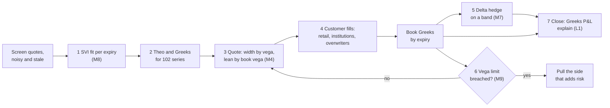
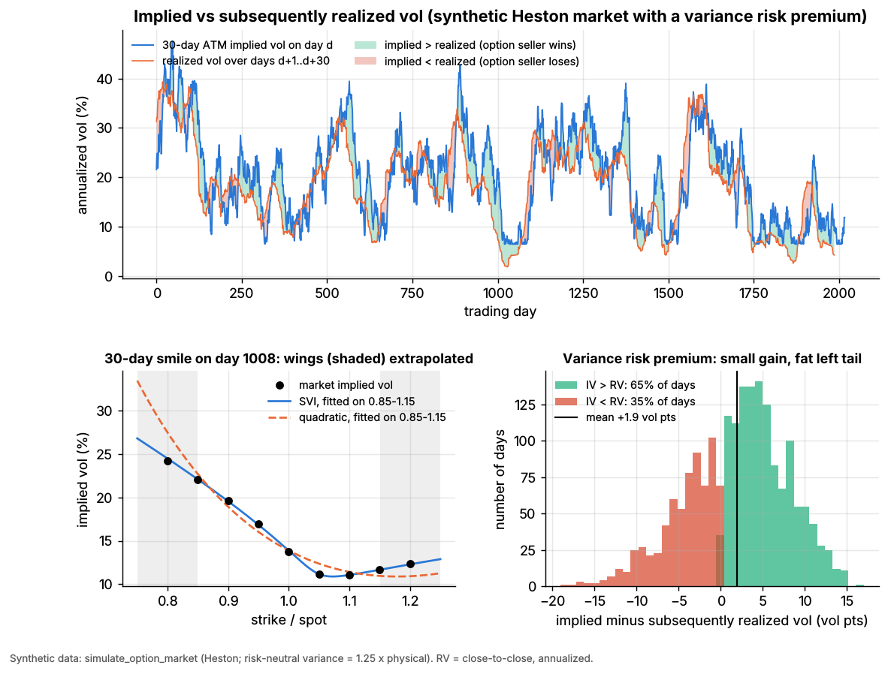
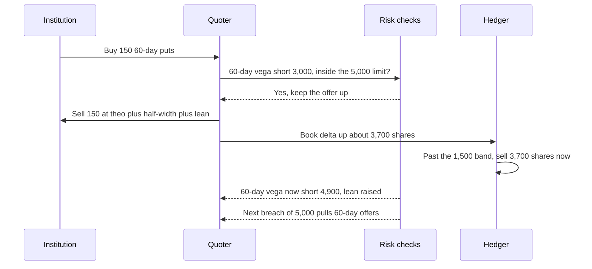
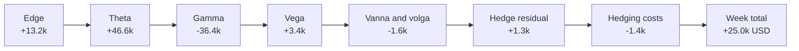
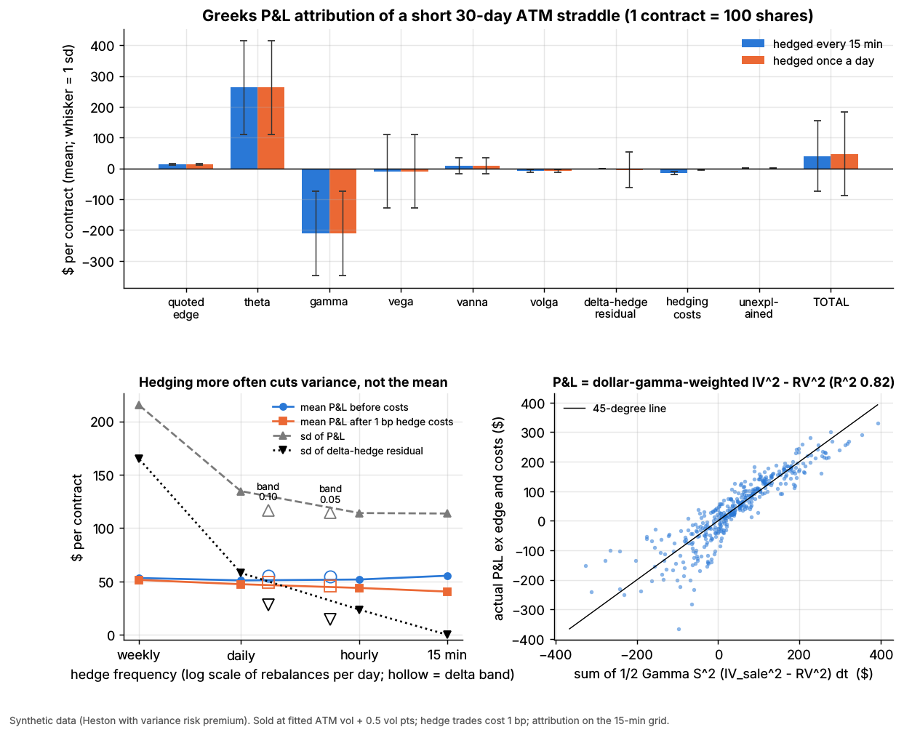

# Walkthrough: an options market maker

> **TL;DR**
>
> - One synthetic week of a toy options book on one liquid stock. The desk refits the [volatility surface](../../09-reference/glossary.md#volatility-surface) hourly from noisy quotes, prices 102 series, leans its quotes against book [vega](../../09-reference/glossary.md#vega), fills 5,277 contracts and delta hedges on a 1,500-share band.
> - The median week as an income statement (synthetic lab result): edge +\$13.2k, theta +\$46.6k, gamma −\$36.4k, vega +\$3.4k, other Greeks −\$1.6k, hedge residual +\$1.3k, hedging costs −\$1.4k. Total +\$25.0k.
> - Edge is the revenue. Theta minus gamma is implied minus realized variance. Vega is a mark that swung −\$24.6k and +\$33.6k on consecutive days. Lab 06's straddle, per contract: edge \$13, theta \$263, gamma −\$211, total \$47.
> - Hedge on fills with a band, not on a clock. Hourly hedging left a weekly residual sd of \$9.4k, the band \$1.5k.
> - Model error is paid for through selection. Theo was 0.33 vol points off when fills arrived, and that cost 40% of the intended edge.

**Level:** Core · **Read time:** ~14 min · **Last verified:** 2026-11

## Cast and setup

The desk makes markets in listed options on XYZ, a synthetic large-cap stock. The market is Lab 06's Heston world (seed 7), where risk-neutral variance is 1.25 times physical variance: a planted [variance risk premium](../../09-reference/glossary.md#variance-risk-premium). The helper script `labs/walkthroughs/options-market-maker.py` runs 12 five-day weeks with [Lab 06](https://github.com/FrankHuang94/quant_trading_claude/tree/main/labs/06-options-mm-delta-hedging)'s core functions `fit_smile`, `delta_hedge_pnl` and `greeks_attribution`, and writes `options-market-maker.json`. The quarter it simulates is a sell-off: XYZ falls from \$100 to about \$80 and 30-day at-the-money implied vol rises from 22% to the mid-30s. We follow week 7, the median week by P&L. Per-contract figures come from Lab 06's `results.json`.

*Assumptions (illustrative, all synthetic):*

| Item | Assumption |
|---|---|
| Listed series | expiries of 10, 30 and 60 trading days at Monday's open; 17 strikes from 80% to 120% of spot; calls and puts: 102 series |
| Screen quotes | true implied vol plus noise with a standard deviation of 0.5 vol points, calls and puts separately |
| Surface | raw SVI per expiry, refit hourly, sticky strike between refits |
| Quote | theo ± 0.5 vol points × vega × (1 + 3\|k\|); lean 0.05 vol points per \$1,000 of book vega in that expiry, capped at 0.5 |
| Limit | \$5,000 of vega per vol point per expiry; past it, the side that adds risk is pulled |
| Flow | 300 retail orders a day (1–10 lots); 2 put-buying institutions and 2 call overwriters a day (50–250 lots). Each customer leans toward the better of our quote and a competitor's centered on true value |
| Hedge | stock, whenever \|book delta\| > 1,500 shares, 1 bp cost (Lab 06) |
| Marks | true model values (Lab 06 convention). Each week starts flat and is marked, not closed, at Friday's close |



## 1. Fit the surface from noisy quotes

Screen quotes are noisy: some are wide, some stale. The desk turns each mid into an [implied volatility](../../09-reference/glossary.md#implied-volatility), then fits one smile per expiry in log-moneyness k = ln(K/F). Raw SVI's wings are linear in k, as Lee's moment formula requires, and Gatheral & Jacquier (2014) give the conditions for an arbitrage-free SVI surface `[Verified]`.

```python
# Hourly refit, one expiry: Lab 06's fit_smile on 17 call and 17 put mids
k = np.log(K / S_now)                                   # 17 listed strikes
iv_quotes = np.concatenate([iv_call_mid, iv_put_mid])   # noisy: sd 0.5 vol pt each
smile = fit_smile(np.concatenate([k, k]), iv_quotes, T, method="svi")
sig_fit = smile(k)                                      # held fixed (sticky strike) until the next refit
```

The numbers (synthetic lab results). A single screen mid was 0.40 vol points from the truth on average. The SVI fit through 34 quotes landed within 0.13 points (0.17 in the wings), because fitting averages the noise away. Lab 06 shows why the functional form matters. A quadratic in k fits nine clean strikes with an RMSE of 0.50 vol points against SVI's 0.035. Fitted on the inner strikes and extrapolated to the wings, the quadratic misses by 1.25 points and SVI by 0.12. Monday's 30-day smile slopes the usual equity way: 40.1% at the \$64.50 strike, 34.2% at the money, 29.0% at \$96.50. See [M8](../f-market-making-and-hft-algorithms/options-pricing-and-vol-surfaces-for-mm.md).



*Lab 06, synthetic. Implied vol sits above subsequently realized vol most of the time: +1.9 vol points on average, on 65% of days. Notice the red episodes where realized overshoots, and the parabola bending away in the shaded wings.*

## 2. Theoretical values for the chain

Theo is Black–Scholes at the fitted vol for each strike. Black–Scholes is the quoting language, not the model. Monday 9:30, spot \$80.36, at the surface's vols (the fit is within about 0.13 points of these):

| Series | Vol | Theo | Delta | Vega per vol point, per contract | Theta per day, per contract |
|---|---|---|---|---|---|
| 30-day \$80.50 call | 34.2% | \$3.71 | 0.52 | \$11.05 | −\$6.29 |
| 60-day \$72.50 put | 35.5% | \$2.24 | −0.25 | \$12.40 | −\$3.67 |
| 10-day \$84.50 call | 34.0% | \$0.74 | 0.24 | \$4.97 | −\$8.43 |

Real desks run two speeds: theos reprice on every underlying tick, and the surface is refit every second to every minute (one vendor platform: at most once a second, at least once a minute) `[Verified]`. The toy refits hourly, holds strike vols fixed in between and has a high vol of vol (0.6), so its theo drifts: 0.13 vol points off at refit, 0.33 when fills arrived. Stage 4 prices that drift.

## 3. Quote: edge, width and skew

Each quote is theo plus or minus a half-width, shifted by a lean against the book's vega in that expiry. The width is set in vol points times vega, because a vol point is the unit of surface uncertainty. It widens with |k| because the wings are less certain.

```python
# Mirrors run_week() in labs/walkthroughs/options-market-maker.py (vega in $ per vol pt per share)
hw_vol = 0.5 * (1 + 3 * abs(np.log(K / S)))                  # vol points, wider in the wings
half = max(0.01, hw_vol * vega)                              # $ per share
lean_vol = np.clip(-book_vega[expiry] / 1000 * 0.05, -0.5, 0.5)   # short vega -> positive lean
bid, ask = theo - half + lean_vol * vega, theo + half + lean_vol * vega
if book_vega[expiry] < -5000: ask = None                     # vega limit: stop selling this expiry
```

*Worked example.* For the 30-day \$80.50 call, the half-width is 0.503 × \$0.1105 = \$0.056, so the market is \$3.65 bid, \$3.77 offered: \$5.56 of edge per contract on either side. Suppose the book is short \$4,861 of 30-day vega, as it was at Wednesday's close. The lean is +0.24 vol points, or +\$0.027, which moves the market to \$3.68 / \$3.79. Customers buying now pay more, and customers selling find a better bid, so flow refills the vega the book lacks. This is the inventory skew of Avellaneda–Stoikov applied to Greeks instead of shares (Stoikov & Sağlam 2009) `[Verified]` ([M4](../f-market-making-and-hft-algorithms/quoting-and-inventory-control.md)). For scale, Lab 06 sells its straddle 0.5 vol points over fitted vol, which is \$13.1 of edge on a \$500 premium.

## 4. Fills: who trades with you

Featured week (synthetic lab result):

| Customer | What they do | Contracts | Edge vs fair mark | Per contract | Vega added (\$ per vol point) |
|---|---|---|---|---|---|
| Retail | 10- and 30-day near-money calls and puts, 75% buys | 4,027 | +\$7,518 | \$1.87 | −8,296 |
| Institutions | buy 30- and 60-day puts 5–15% out of the money | 931 | +\$5,167 | \$5.55 | −9,068 |
| Overwriters | sell 30-day calls 5–10% out of the money | 319 | +\$506 | \$1.59 | +2,818 |
| **Total** | 723 fills | **5,277** | **+\$13,191** | **\$2.50** | **−14,546** |

Over 12 weeks, edge per contract averaged \$1.71 on retail, \$4.22 on institutions and \$3.08 on overwriters. Real flow has the same cast. Retail options trading exceeds 60% of market volume (Bryzgalova, Pavlova & Sikorskaya 2023) `[Verified]`, and 0DTE options were 66.2% of SPX volume in July 2026 `[Verified]`. End users are net long index options, so dealers are paid to warehouse them (Gârleanu, Pedersen & Poteshman 2009) `[Verified]`. Overwriters are the natural sellers that refill the book's vega.

**Winner's curse.** Against its own theo, the desk thought it had earned \$20,660. Against fair marks it earned \$13,191, and over 12 weeks it lost 40% of intended edge (\$18,194 vs \$10,853). Customers trade more when the desk's theo is wrong in their favor. If theo error is e and the half-width is h, the expected edge per order falls from h/2 to h/2 − e²/2h, a loss of (e/h)² of the edge. Fast refits and spot-vol rules are edge protection, not engineering polish ([M5](../f-market-making-and-hft-algorithms/adverse-selection-and-markouts.md)).

*One institutional fill, illustrative:*



## 5. Delta hedging

The hedger runs Lab 06's `delta_hedge_pnl` on the book's share delta. Every 15 minutes, and on every fill, it checks whether |book delta| exceeds 1,500 shares and, if so, trades back to zero. In the featured week that meant 57 rebalances and 182,053 shares (about \$14M) traded, at a cost of \$1,398 at 1 bp. The leftover residual was +\$1,269. [Delta hedging](../../09-reference/glossary.md#delta-hedging) removes direction and leaves the volatility bet. Here is the same book delta path under four policies:

| Policy | Rebalances (featured week) | Costs (featured) | Residual (featured) | 12-week mean cost | 12-week sd of residual |
|---|---|---|---|---|---|
| Every 15 minutes | 130 | \$1,665 | \$0 | \$1,475 | \$0 |
| Hourly | 33 | \$992 | −\$20,405 | \$891 | \$9,389 |
| Daily | 5 | \$644 | −\$61,880 | \$412 | \$20,888 |
| Band, 1,500 shares | 57 | \$1,398 | +\$1,269 | \$1,148 | \$1,542 |

A clock leaves a 200-lot fill unhedged until the next tick of the clock, while the band reacts to the fill itself. Lab 06 isolates the frequency trade-off on one straddle (synthetic lab result). The residual's sd scales like rebalances^−0.56 (theory: −0.5), while the mean P&L before costs stays at \$51–55 under every policy. Hedging every 15 minutes costs \$14.9 per contract, more than the \$13.1 quoted edge. A ±0.10 delta band matches hourly hedging's P&L sd (\$117 vs \$114) with a quarter of the rebalances, as Leland (1985) and Whalley & Wilmott (1997) predict `[Verified]`. The book spends about 11% of its edge on hedging, because fills partly net and its quotes are wider than Lab 06's. See [M7](../f-market-making-and-hft-algorithms/hedging-algorithms.md).

## 6. Vega and gamma across the book

Customers are net buyers, so the book ends every day short options in every expiry:

| Close | Spot | 30-day at-the-money vol | Vega 10-day | Vega 30-day | Vega 60-day | Gamma (shares per \$1) |
|---|---|---|---|---|---|---|
| Mon | \$77.76 | 36.6% | −1,433 | −2,551 | −1,709 | −3,051 |
| Tue | \$77.03 | 36.5% | −1,278 | −3,620 | −1,717 | −3,620 |
| Wed | \$74.22 | 39.9% | −2,981 | −4,861 | −5,551 | −7,862 |
| Thu | \$77.05 | 36.1% | −2,821 | −3,843 | −4,823 | −7,908 |
| Fri | \$78.86 | 36.0% | −2,841 | −3,054 | −5,265 | −8,387 |

Vega is in \$ per vol point. Wednesday's put buying took the 60-day expiry past its \$5,000 limit, and three customer orders were refused that week ([M9](../f-market-making-and-hft-algorithms/algorithmic-risk-controls.md)). Friday's [gamma](../../09-reference/glossary.md#gamma) implies a breakeven move: ½ × 8,387 × ΔS² = \$14,143 (Friday's [theta](../../09-reference/glossary.md#theta)) gives ΔS = \$1.84, or 2.3% a day. That is 37% annualized, close to the 36% implied. The theta–gamma identity in one line.

Does the lean help? Over the same 12 weeks with identical customer orders, leaning cut the sd of weekly P&L from \$18.5k to \$15.6k. It cut average closing vega in the 10- and 30-day expiries by 22% and 14%, and cut limit refusals from 35 a week to 14. Mean P&L fell \$1.8k a week, within noise (each mean has a standard error near \$4.5k). Real desks also trade risk out directly: they buy wings, sell other expiries, or use [complex orders](../../09-reference/glossary.md#complex-order) and other dealers `[Lore]`.

## 7. End-of-day P&L explain

At each close, `greeks_attribution` splits every position's P&L on the 15-minute grid. Positions carried overnight are marked at the open, and new fills book their edge at the trade. The components sum exactly to the mark-to-market change. Featured week, \$ thousands:

| Line | Mon | Tue | Wed | Thu | Fri | Week |
|---|---|---|---|---|---|---|
| Quoted edge | +4.8 | +2.0 | +3.4 | +0.5 | +2.4 | +13.2 |
| Theta | +3.2 | +5.6 | +9.3 | +14.3 | +14.1 | +46.6 |
| Gamma | −2.2 | −4.4 | −6.7 | −12.4 | −10.6 | −36.4 |
| Vega | −3.3 | +2.1 | −24.6 | +33.6 | −4.4 | +3.4 |
| Vanna + volga | −0.1 | −0.1 | −0.1 | −0.6 | −0.7 | −1.6 |
| Delta-hedge residual | +0.6 | +0.4 | +0.7 | −0.4 | 0.0 | +1.3 |
| Hedging costs | −0.1 | −0.2 | −0.3 | −0.4 | −0.5 | −1.4 |
| Unexplained | 0.0 | 0.0 | 0.0 | −0.1 | 0.0 | 0.0 |
| **Total** | **+2.9** | **+5.3** | **−18.2** | **+34.6** | **+0.4** | **+25.0** |

*Columns sum within rounding.*

How a risk manager reads it ([L1](../g-live-trading/live-monitoring-and-pnl-attribution.md)):

1. **Unexplained first.** It came to −\$36 on \$25k, so the Greeks and marks can be trusted. In Lab 06 its sd is \$1.7 per contract, and \$23.8 without the vanna and volga terms.
2. **Edge against costs.** Edge of \$13.2k against \$1.4k of hedging is a healthy flow business. In real life the next check is [markouts](../../09-reference/glossary.md#markout).
3. **Theta plus gamma** is +\$10.2k. Realized vol from 15-minute returns, 33.3%, came in under the ~36% implied. Lab 06 shows the identity exactly: theta + gamma = Σ ½ΓS²(σ²_implied dt − (dS/S)²) (Bakshi & Kapadia 2003) `[Verified]`.
4. **Vega is a mark.** Wednesday's −\$18.2k was a vega loss as implied vol jumped 3.5 points while XYZ fell 3.7%; Thursday reversed it. Over 12 weeks vega averaged +\$6.5k with an sd of \$12.6k. It decides the quarter, not the year.
5. **Stress the tails.** At Friday's Greeks, a 10-point vol spike costs about \$112k, and a 10% gap about ½ × 8,387 × 7.89² ≈ \$261k (Taylor estimates): 6 and 13 average weeks.





*Lab 06, synthetic. Notice that edge is a sliver beside theta and gamma, that hedging more often cuts P&L variance but not its mean, and that each trade's P&L tracks dollar-gamma-weighted implied minus realized variance (R² 0.82).*

## P&L / cost attribution

The same [P&L attribution](../../09-reference/glossary.md#pl-attribution) at three scales, as an income statement (synthetic lab results; each column reconciles to its total):

| Line (accounting analogue) | Lab 06: one straddle, daily hedge (\$ per contract) | Book: featured week (\$) | Book: 12-week mean (\$ per week) |
|---|---|---|---|
| Revenue: quoted edge | +13.1 | +13,191 | +10,853 |
| Premium earned: theta | +262.6 | +46,573 | +30,083 |
| Claims paid: gamma | −210.8 | −36,385 | −23,865 |
| Fair-value marks: vega | −9.5 | +3,368 | +6,479 |
| Fair-value marks: vanna | +7.6 | −1,206 | −1,671 |
| Fair-value marks: volga | −7.6 | −396 | −190 |
| Hedging: delta residual | −4.4 | +1,269 | −794 |
| Hedging: costs | −3.6 | −1,398 | −1,148 |
| Unexplained | −0.0 | −36 | −21 |
| **Net trading income** | **+47.4** | **+24,980** | **+19,726** |

The 12-week mean is \$19.7k a week with an sd of \$15.6k, and 2 of the 12 weeks lose money. That is about \$3.92 per contract and an annualized Sharpe ratio near 9: a synthetic lab result. It is far cleaner than reality, with no fees, no [payment for order flow](../../09-reference/glossary.md#payment-for-order-flow-pfof), no informed flow, no jumps and marks from the true model. The options dossier's illustrative real-world income statement nets about \$0.29 per contract `[Estimate]`. Practitioner lore puts net Sharpe at 3–10 for diversified flow books and 1–3 for books that warehouse vega `[Lore]`.

## What would be different in real life

- **Scale and speed.** Thousands of series across many underlyings, surfaces refit every 1–60 seconds, and smile-adjusted deltas. US options traded 15.2 billion contracts in 2025 `[Verified]`.
- **Informed flow.** The toy's only adverse selection is the winner's curse. Real books also face flow ahead of earnings and news, measured by [markouts](../f-market-making-and-hft-algorithms/adverse-selection-and-markouts.md).
- **Flow costs money.** Options must execute on an exchange. Brokers are paid PFOF, and median effective spreads were 1.9% for equity options in 2025 `[Verified]` (SEC staff).
- **Jumps.** The diffusion has no gaps. Real short-gamma books lose most of their money on a few gap days ([failure gallery](../../02-strategies/h-cross-cutting/strategy-failure-gallery.md)).
- **Hedge costs.** A flat 1 bp here. Index hedges cost nearer 0.2 bp `[Estimate]`, single names more, and spreads widen exactly when gamma needs the most volume.
- **Carry.** Real books hold positions for weeks and face expiry, [pin risk](../../09-reference/glossary.md#pin-risk), early exercise, dividends and borrow.
- **The premium.** The planted VRP is a constant 25% of variance. The real index premium has shrunk toward zero since about 2010 (Dew-Becker & Giglio 2025) `[Verified]` and turns negative in crises ([VRP dossier](../../02-strategies/f-volatility-and-derivatives/volatility-risk-premium-and-vol-arb.md)).
- **Model equals market.** Marks come from the generating model, so "unexplained" stays tiny. Real desks mark to their own fitted surface, and model error leaks into vega and unexplained.

## Related pages

- [Options market making](../../02-strategies/a-liquidity-provision/options-market-making.md) (dossier)
- [Volatility risk premium and vol arb](../../02-strategies/f-volatility-and-derivatives/volatility-risk-premium-and-vol-arb.md)
- [Dispersion and correlation trading](../../02-strategies/f-volatility-and-derivatives/dispersion-and-correlation-trading.md)
- [M8 Options pricing and vol surfaces for market making](../f-market-making-and-hft-algorithms/options-pricing-and-vol-surfaces-for-mm.md)
- [M4 Quoting and inventory control](../f-market-making-and-hft-algorithms/quoting-and-inventory-control.md)
- [M5 Adverse selection and markouts](../f-market-making-and-hft-algorithms/adverse-selection-and-markouts.md)
- [M7 Hedging algorithms](../f-market-making-and-hft-algorithms/hedging-algorithms.md)
- [M9 Algorithmic risk controls](../f-market-making-and-hft-algorithms/algorithmic-risk-controls.md)
- [L1 Live monitoring and P&L attribution](../g-live-trading/live-monitoring-and-pnl-attribution.md)
- [ETF, futures and options linkages](../../01-market-structure/etf-futures-options-linkages.md)
- [There is no single algorithm](../there-is-no-single-algorithm.md)
- [Walkthrough: a day at an ETF market maker](walkthrough-etf-market-maker.md)

## Sources

- [Verified] Gatheral, J. & Jacquier, A. (2014). "Arbitrage-free SVI volatility surfaces." *Quantitative Finance* 14(1), 59–71. <https://doi.org/10.1080/14697688.2013.819986> (accessed 2026-11)
- [Verified] Lee, R. W. (2004). "The moment formula for implied volatility at extreme strikes." *Mathematical Finance* 14(3), 469–480. <https://doi.org/10.1111/j.0960-1627.2004.00200.x> (accessed 2026-11)
- [Verified] Stoikov, S. & Sağlam, M. (2009). "Option market making under inventory risk." *Review of Derivatives Research* 12(1), 55–79. <https://doi.org/10.1007/s11147-009-9036-3> (accessed 2026-11)
- [Verified] Bakshi, G. & Kapadia, N. (2003). "Delta-hedged gains and the negative market volatility risk premium." *Review of Financial Studies* 16(2), 527–566. <https://doi.org/10.1093/rfs/hhg002> (accessed 2026-11)
- [Verified] Leland, H. E. (1985). "Option pricing and replication with transactions costs." *Journal of Finance* 40(5), 1283–1301. <https://doi.org/10.1111/j.1540-6261.1985.tb02383.x> (accessed 2026-11)
- [Verified] Whalley, A. E. & Wilmott, P. (1997). "An asymptotic analysis of an optimal hedging model for option pricing with transaction costs." *Mathematical Finance* 7(3), 307–324. <https://doi.org/10.1111/1467-9965.00034> (accessed 2026-11)
- [Verified] Bryzgalova, S., Pavlova, A. & Sikorskaya, T. (2023). "Retail Trading in Options and the Rise of the Big Three Wholesalers." *Journal of Finance* 78(6), 3465–3514. <https://doi.org/10.1111/jofi.13285> (accessed 2026-11)
- [Verified] Gârleanu, N., Pedersen, L. H. & Poteshman, A. M. (2009). "Demand-Based Option Pricing." *Review of Financial Studies* 22(10), 4259–4299. <https://doi.org/10.1093/rfs/hhp005> (accessed 2026-11)
- [Verified] Dew-Becker, I. & Giglio, S. (2025). "The Decline of the Variance Risk Premium: Evidence from Traded and Synthetic Options." Federal Reserve Bank of Chicago WP 2025-17. <https://doi.org/10.21033/wp-2025-17> (accessed 2026-11)
- [Verified] SEC Division of Trading and Markets, Office of Analytics and Research (2026-04-09). "Roundtable on Options Market Structure: Supporting Data." <https://www.sec.gov/files/roundtable-options-market-structure.pdf> (accessed 2026-11)
- [Verified] Cboe (2026-01-22). "The State of the Options Industry: 2025." <https://www.cboe.com/insights/posts/the-state-of-the-options-industry-2025> (accessed 2026-11)
- [Verified] Cboe (2026-08). "Market Metrics That Matter: Derivatives July 2026 Volume Highlights." <https://www.cboe.com/insights/posts/market-metrics-that-matter-derivatives-july-2026-volume-highlights> (accessed 2026-11)
- [Verified] nth Moment LLC / Vela (now Exegy) (2020-10-12). "Dynamic Skew App User Guide," v4.48. <https://www.exegy.com/wp-content/uploads/2021/11/DynamicSkewApp_UserGuide.pdf> (accessed 2026-11)
