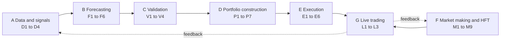

# Algorithms: overview

> **TL;DR**
>
> - This module covers the concrete methods inside a quant firm's pipeline: 39 algorithm cards in seven sections (A–G), three overview pages and four end-to-end walkthroughs (H).
> - Start with [There is no single algorithm](there-is-no-single-algorithm.md), then use the [algorithm map](algorithm-map.md) to find any card by its ID.
> - Every card has the same shape: a header table you can skim in 30 seconds, then intuition, pseudocode of 40 lines or fewer, a worked example, practitioner tweaks, failure modes and questions to ask.
> - Twenty runnable Python labs on synthetic data back the cards. The walkthroughs stitch the cards together using the labs' numbers.

**Level:** Core · **Read time:** ~6 min · **Last verified:** 2026-11

## What this module covers

[Strategies](../02-strategies/index.md) explains what quant firms trade and why it pays. This module explains how they do it. Each card covers one method (a [risk model](../09-reference/glossary.md#risk-model), a [VWAP](../09-reference/glossary.md#vwap) algorithm, a quoting rule) in enough depth that you can follow a quant's description of it, read its pseudocode, and ask where it breaks. Cards link to the strategies that use them, and the [strategy x algorithm matrix](../02-strategies/h-cross-cutting/strategy-x-algorithm-matrix.md) shows the full mapping.

## The eight sections

| Section | Cards | The question it answers |
|---|---|---|
| [A. Data and signals](a-data-and-signals/point-in-time-data-and-cleaning.md) | D1–D4 | Is the data honest, and does this signal predict anything? |
| [B. Forecasting models](b-forecasting-models/linear-models-and-regularization.md) | F1–F6 | How do many signals become one expected return per stock? |
| [C. Validation and backtesting](c-validation-and-backtesting/time-series-cross-validation.md) | V1–V4 | Is the backtest telling the truth? |
| [D. Portfolio construction](d-portfolio-construction/risk-models.md) | P1–P7 | Given forecasts, risk and costs, what should we hold? |
| [E. Execution algorithms](e-execution-algorithms/execution-algorithms-overview.md) | E1–E6 | How do we get there without moving the price? |
| [F. Market making and HFT](f-market-making-and-hft-algorithms/anatomy-of-an-hft-trading-loop.md) | M1–M9 | Where should we quote, and how do we avoid being picked off? |
| [G. Live trading](g-live-trading/live-monitoring-and-pnl-attribution.md) | L1–L3 | Is it still working, and when do we retire it? |
| [H. End-to-end walkthroughs](h-end-to-end-walkthroughs/walkthrough-mid-frequency-stat-arb.md) | 4 walkthroughs | How do the cards fit together on real numbers? |

## How to read an algorithm card

The line under the title gives three labels. **Level** is *Core* (on the main reading path) or *Deep dive* (optional). **Pipeline stage** is one of data, signal, forecast, validation, portfolio, execution, market making or live. **Last verified** is the month of the last fact check. Next comes the header table:

| Field | What it tells you |
|---|---|
| Purpose (the question it answers) | Why the method exists. If you remember one line, remember this one. |
| Inputs → Outputs | What it consumes and produces, which is how it plugs into its neighbours on the [map](algorithm-map.md). |
| Used by strategies | Dossiers that rely on it materially. The matrix is generated from these links. |
| Latency / compute regime | Nanoseconds, microseconds, milliseconds, seconds or overnight batch. This sets the kind of engineering it needs. |
| Key parameters | The knobs and their typical ranges, so you can tell a sensible setting from a strange one. |
| Main failure modes | How it breaks in production. Usually the best thing to talk about. |
| Lab | The runnable lab, or "—". |

The body always runs in the same order. It starts with intuition and a diagram that highlights the card's place in the pipeline. Then come the algorithm itself (plain steps, then commented pseudocode matching the lab code), a worked example with numbers, and how practitioners tune the parameters. The "textbook vs practice" section sources or tags every claim. After that: how to tell whether the method is working, its failure modes, sample practitioner sentences with glosses, and questions to ask, ordered basic to sharp, with 🔒 marking proprietary territory. Math sits in a collapsed block at the end. Confidence tags (`[Verified]`, `[Reported]`, `[Estimate]`, `[Lore]`) are explained on the [home page](../index.md#how-to-read-confidence-tags).

## Labs

Each lab is a short, deterministic Python script on synthetic data, so it shows mechanisms rather than real [alpha](../09-reference/glossary.md#alpha). Its pseudocode in the cards uses the same names and parameters as the lab.

| Lab | Cards it supports | Also supports |
|---|---|---|
| [01 Matching engine and order book](https://github.com/FrankHuang94/quant_trading_claude/tree/main/labs/01-matching-engine-order-book) | [M6](f-market-making-and-hft-algorithms/queue-position-and-order-placement.md) | [The limit order book](../01-market-structure/the-limit-order-book.md) |
| [02 Microprice and fair value](https://github.com/FrankHuang94/quant_trading_claude/tree/main/labs/02-microprice-fair-value) | [M2](f-market-making-and-hft-algorithms/fair-value-and-microprice.md) | — |
| [03 Order-flow imbalance](https://github.com/FrankHuang94/quant_trading_claude/tree/main/labs/03-order-flow-imbalance) | [M3](f-market-making-and-hft-algorithms/order-book-and-trade-flow-signals.md) | — |
| [04 Markout analysis](https://github.com/FrankHuang94/quant_trading_claude/tree/main/labs/04-markout-analysis) | [M5](f-market-making-and-hft-algorithms/adverse-selection-and-markouts.md) | [Equity market making](../02-strategies/a-liquidity-provision/equity-market-making.md) |
| [05 Avellaneda-Stoikov and GLFT quoting](https://github.com/FrankHuang94/quant_trading_claude/tree/main/labs/05-avellaneda-stoikov-glft-quoting) | [M4](f-market-making-and-hft-algorithms/quoting-and-inventory-control.md) | [Equity market making](../02-strategies/a-liquidity-provision/equity-market-making.md) |
| [06 Options MM and delta hedging](https://github.com/FrankHuang94/quant_trading_claude/tree/main/labs/06-options-mm-delta-hedging) | [M8](f-market-making-and-hft-algorithms/options-pricing-and-vol-surfaces-for-mm.md), [M7](f-market-making-and-hft-algorithms/hedging-algorithms.md) | [Options market making](../02-strategies/a-liquidity-provision/options-market-making.md) |
| [07 ETF NAV arbitrage](https://github.com/FrankHuang94/quant_trading_claude/tree/main/labs/07-etf-nav-arbitrage) | — | [ETF market making](../02-strategies/a-liquidity-provision/etf-market-making.md), [ETF and index arbitrage](../02-strategies/b-speed-and-structural/etf-and-index-arbitrage.md) |
| [08 Pairs and cointegration](https://github.com/FrankHuang94/quant_trading_claude/tree/main/labs/08-pairs-cointegration) | — | [Pairs trading](../02-strategies/c-statistical-arbitrage/pairs-trading-and-cointegration.md) |
| [09 PCA residual stat arb](https://github.com/FrankHuang94/quant_trading_claude/tree/main/labs/09-pca-residual-stat-arb) | — | [Factor-residual mean reversion](../02-strategies/c-statistical-arbitrage/factor-residual-mean-reversion.md) |
| [10 Reversal, momentum and costs](https://github.com/FrankHuang94/quant_trading_claude/tree/main/labs/10-reversal-momentum-costs) | — | [Short-term reversal](../02-strategies/c-statistical-arbitrage/short-term-cross-sectional-reversal.md), [Momentum](../02-strategies/e-risk-premia-and-factors/momentum.md) |
| [11 Signal transforms and IC](https://github.com/FrankHuang94/quant_trading_claude/tree/main/labs/11-signal-transforms-ic) | [D3](a-data-and-signals/signal-transforms.md), [D4](a-data-and-signals/evaluating-signals.md) | — |
| [12 Alpha combination and purged CV](https://github.com/FrankHuang94/quant_trading_claude/tree/main/labs/12-alpha-combination-purged-cv) | [F5](b-forecasting-models/alpha-combination-and-ensembling.md), [V1](c-validation-and-backtesting/time-series-cross-validation.md) | — |
| [13 Backtest overfitting: DSR and PBO](https://github.com/FrankHuang94/quant_trading_claude/tree/main/labs/13-backtest-overfitting-dsr-pbo) | [V4](c-validation-and-backtesting/overfitting-and-multiple-testing.md) | — |
| [14 Risk model and MVO](https://github.com/FrankHuang94/quant_trading_claude/tree/main/labs/14-risk-model-mvo) | [P1](d-portfolio-construction/risk-models.md), [P2](d-portfolio-construction/covariance-estimation-and-shrinkage.md), [P3](d-portfolio-construction/mean-variance-optimization.md) | — |
| [15 Trading toward the aim](https://github.com/FrankHuang94/quant_trading_claude/tree/main/labs/15-trading-toward-aim) | [P6](d-portfolio-construction/multi-period-and-trading-toward-aim.md) | — |
| [16 Almgren-Chriss frontier](https://github.com/FrankHuang94/quant_trading_claude/tree/main/labs/16-almgren-chriss-frontier) | [E3](e-execution-algorithms/implementation-shortfall-and-almgren-chriss.md) | — |
| [17 VWAP, TWAP and POV](https://github.com/FrankHuang94/quant_trading_claude/tree/main/labs/17-vwap-twap-pov) | [E2](e-execution-algorithms/vwap-twap-pov.md), [E1](e-execution-algorithms/execution-algorithms-overview.md) | — |
| [18 Smart order router](https://github.com/FrankHuang94/quant_trading_claude/tree/main/labs/18-smart-order-router) | [E4](e-execution-algorithms/smart-order-routing.md) | — |
| [19 Trend following and vol targeting](https://github.com/FrankHuang94/quant_trading_claude/tree/main/labs/19-trend-following-vol-targeting) | [P7](d-portfolio-construction/position-sizing-and-risk-budgeting.md) | [Trend following](../02-strategies/g-futures-and-macro-context/trend-following-and-ctas.md) |
| [20 Index reconstitution event study](https://github.com/FrankHuang94/quant_trading_claude/tree/main/labs/20-index-reconstitution-event-study) | — | [Flow-driven strategies](../02-strategies/d-mid-frequency-alpha/flow-driven-strategies.md) |

## End-to-end walkthroughs

The capstones. Each follows one business through a full cycle with numbers taken from the labs:

- [A mid-frequency stat-arb book](h-end-to-end-walkthroughs/walkthrough-mid-frequency-stat-arb.md): universe → three alphas → IC-weighted combination → risk model → optimizer with costs → VWAP/IS execution → next-day attribution.
- [A day at an ETF market maker](h-end-to-end-walkthroughs/walkthrough-etf-market-maker.md): fair value from basket and futures, quoting, inventory, creation/redemption, hedging, markouts, end-of-day P&L.
- [An options market maker](h-end-to-end-walkthroughs/walkthrough-options-market-maker.md): vol surface → theoretical values → quotes → delta/vega hedging → Greeks P&L attribution.
- [Executing a $500M buy order](h-end-to-end-walkthroughs/walkthrough-institutional-execution.md): schedule choice, child orders, venues, the close, and the TCA report.

## Related pages

- [There is no single algorithm](there-is-no-single-algorithm.md): the five canonical pipelines
- [Algorithm map](algorithm-map.md): all 39 cards on one diagram, with latency regimes
- [Strategies: the map](../02-strategies/index.md)
- [Labs](../labs.md)
- [Questions to ask](../07-conversation-playbook/questions-to-ask.md)

## Sources

- [Verified] López de Prado, M. (2018). *Advances in Financial Machine Learning*. Wiley. <https://www.wiley-vch.de/en/areas-interest/finance-economics-law/advances-in-financial-machine-learning-978-1-119-48208-6> (accessed 2026-11)
- [Verified] Isichenko, M. (2021). *Quantitative Portfolio Management: The Art and Science of Statistical Arbitrage*. Wiley. <https://www.oreilly.com/library/view/-/9781119821328/> (accessed 2026-11)
- [Verified] Kissell, R. (2020). *Algorithmic Trading Methods*, 2nd ed. Academic Press. <https://shop.elsevier.com/books/algorithmic-trading-methods/kissell/978-0-12-815630-8> (accessed 2026-11)
