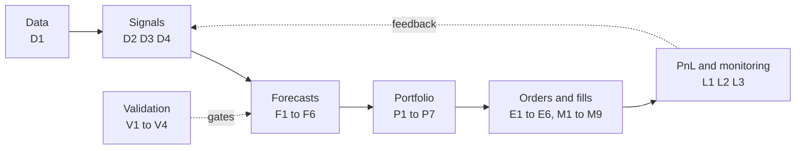
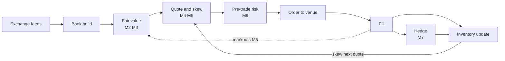
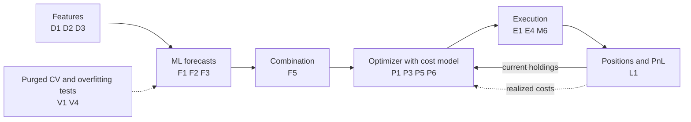
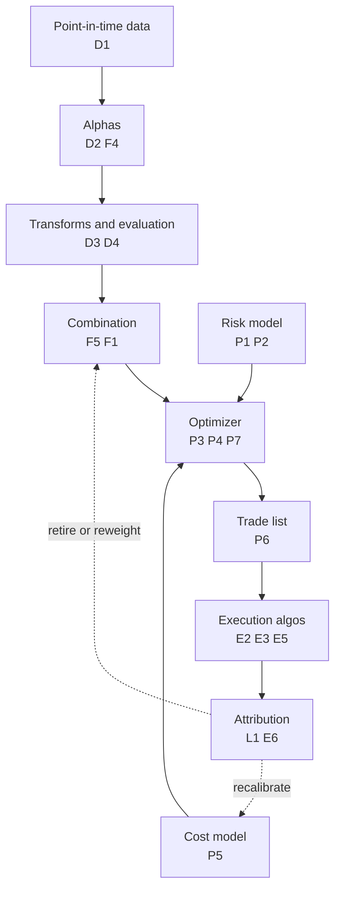
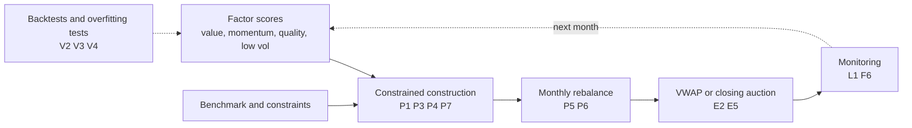
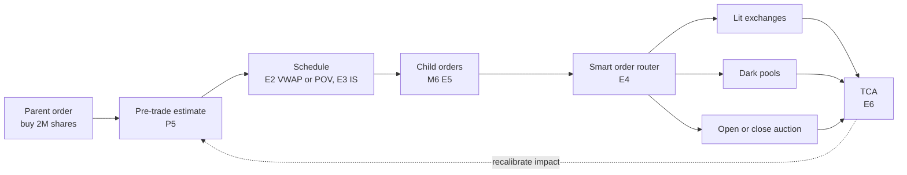

# There is no single algorithm

> **TL;DR**
>
> - "What is their algorithm?" has no one-line answer. A quant firm runs a **pipeline**: dozens of algorithms, each answering one narrow question. What is the fair price right now? What will this stock do relative to its peers? How much risk is this? How do I buy it without moving the price?
> - The horizon sets the pipeline's shape. A market maker's loop closes in microseconds; a factor fund's closes once a month. A different tempo means a different bottleneck and a different place where money is made or lost.
> - Five canonical pipelines cover most US equity quant trading: the HFT market-making loop, short-horizon stat arb, mid-frequency cross-sectional equity, the systematic factor manager, and agency execution.
> - The edge rarely lives in one clever model. It lives in the joints between stages (forecast and cost model, fair value and quoting) and in unglamorous plumbing: point-in-time data, risk controls, feedback from fills.
> - A better question than "what's your algorithm?" is "which stage of your pipeline is the binding constraint?"

**Level:** Core · **Read time:** ~16 min · **Last verified:** 2026-11

## The short answer

Ask a quant "what's your algorithm?" and you will get a polite non-answer. Secrecy is part of the reason, but mostly the question is malformed. A systematic trading business is a production line of many algorithms, owned by different people, each solving a narrow problem, chained so that one stage's output is the next stage's input. Clean data becomes features; features become forecasts; forecasts become target positions; targets become orders; orders become fills; fills become P&L, which is attributed back to the forecasts that caused it.

A semiconductor fab is the right analogy. Nobody asks a foundry for "its process". They ask about lithography, etch, deposition, metrology and yield, because the product comes out of hundreds of steps and yield is multiplicative. Trading pipelines behave the same way. A forecast with real predictive power can be destroyed by a stale risk model, an optimizer that over-trades, or an execution algo that leaks intent. If each of five stages keeps 85% of what the previous stage delivered, only 44% of the original [alpha](../09-reference/glossary.md#alpha) reaches the P&L (0.85⁵ ≈ 0.44; illustrative).



Every pipeline in this KB maps onto these stages, and each stage has its own section of algorithm cards (A to G). The [algorithm map](algorithm-map.md) puts all 39 cards on one diagram. Businesses differ in tempo and in which stage dominates. Below are the five canonical pipelines for US equities. Each gets a diagram, annotated pseudocode, its latency and compute regime, what dominates its P&L, and the cards used at each stage. The pseudocode is deliberately simplified: one function name stands in for a whole subsystem, and every number in it is illustrative.

## 1. The HFT / electronic market-maker loop

An electronic [market maker](../09-reference/glossary.md#market-maker) continuously posts bids and offers in thousands of symbols. It earns the spread from impatient traders while trying not to be run over by informed ones. Strategies that run this loop: [equity market making](../02-strategies/a-liquidity-provision/equity-market-making.md), [ETF market making](../02-strategies/a-liquidity-provision/etf-market-making.md) and [options market making](../02-strategies/a-liquidity-provision/options-market-making.md). The card-level version of this section is [M1 Anatomy of an HFT trading loop](f-market-making-and-hft-algorithms/anatomy-of-an-hft-trading-loop.md).



| Stage | What happens | Cards |
|---|---|---|
| Market data → book build | Decode each exchange's direct feed; rebuild every venue's book; merge into one view | [M1](f-market-making-and-hft-algorithms/anatomy-of-an-hft-trading-loop.md) |
| Fair value | Mid-price tilted by queue imbalance ([microprice](../09-reference/glossary.md#microprice)), plus order-flow and futures/ETF lead-lag signals | [M2](f-market-making-and-hft-algorithms/fair-value-and-microprice.md), [M3](f-market-making-and-hft-algorithms/order-book-and-trade-flow-signals.md) |
| Quote and skew | Center quotes on a [reservation price](../09-reference/glossary.md#reservation-price) shifted against inventory; keep or give up queue position | [M4](f-market-making-and-hft-algorithms/quoting-and-inventory-control.md), [M6](f-market-making-and-hft-algorithms/queue-position-and-order-placement.md), [M8](f-market-making-and-hft-algorithms/options-pricing-and-vol-surfaces-for-mm.md) for options |
| Pre-trade risk | Position, notional, price-collar and message-rate checks before anything leaves | [M9](f-market-making-and-hft-algorithms/algorithmic-risk-controls.md) |
| Order → fill | New / replace / cancel; fills arrive asynchronously | [E4](e-execution-algorithms/smart-order-routing.md) for venue choice |
| Hedge | Offset unwanted risk in a correlated instrument (futures, ETF, basket, underlying) | [M7](f-market-making-and-hft-algorithms/hedging-algorithms.md) |
| Inventory and review | Update position; measure [markouts](../09-reference/glossary.md#markout) to detect [adverse selection](../09-reference/glossary.md#adverse-selection) | [M5](f-market-making-and-hft-algorithms/adverse-selection-and-markouts.md), [L1](g-live-trading/live-monitoring-and-pnl-attribution.md) |

```python
# Event loop of an electronic market maker for ONE symbol (real systems run thousands in parallel).
# Simplified: production code is C++ or FPGA logic, lock-free and allocation-free. Numbers illustrative.
def on_market_data(msg, s):                        # s = per-symbol state, held in memory
    book = s.book.apply(msg)                       # 1. book build: add / cancel / execute at a level
    fv = microprice(book)                          # 2. fair value: mid tilted toward the thin side (M2)
    fv += s.signals.predict_ticks(book, msg) * s.tick   # + order-flow and futures lead-lag (M3)
    q = s.inventory                                # signed shares
    r = fv - q * s.gamma * s.sigma**2 * s.horizon  # 3. reservation price: long -> shade quotes down (M4)
    half = max(s.min_half_spread, s.half_spread(book, s.toxicity))  # widen when flow is toxic (M5)
    bid = floor_to_tick(r - half, s.tick)
    ask = ceil_to_tick(r + half, s.tick)
    for side, px in (("buy", bid), ("sell", ask)):
        if s.live[side] is not None and s.live[side].px == px:
            continue                               # unchanged price: keep the order and its queue spot (M6)
        o = Order(side, px, size=s.clip_for(side, q))   # smaller size on the side that adds inventory
        if pre_trade_ok(o, s.limits):              # 4. position, notional, collar, rate checks (M9)
            s.gateway.replace(s.live[side], o)     # 5. order out; fills come back asynchronously

def on_fill(fill, s):
    s.inventory += fill.signed_qty                 # 6. inventory update
    s.markouts.track(fill, horizons_s=[0.1, 1, 10])     # adverse-selection monitor (M5)
    h = s.hedger.order_for(fill, s.inventory)      # 7. e.g. offset an ETF fill with futures (M7)
    if h is not None and pre_trade_ok(h, s.limits):
        s.gateway.send(h)
```

**Latency and compute regime.** This is the only pipeline where the speed of light and the chip matter. The loop runs in memory on [colocated](../09-reference/glossary.md#colocation) servers. The critical path from an incoming market-data packet to an outgoing order ([tick-to-trade](../09-reference/glossary.md#tick-to-trade)) takes microseconds in optimized software and nanoseconds in [FPGA](../09-reference/glossary.md#fpga) hardware. For scale, an FPGA reference design reached a minimum of 13.9 ns in a STAC-T0 benchmark announced in June 2024 `[Verified]`. That benchmark was vendor-commissioned and measures network I/O only, with no strategy logic. Speed matters because of races. On London Stock Exchange message data, Aquilina, Budish and O'Neill find that the winner of the modal [latency-arbitrage](../09-reference/glossary.md#latency-arbitrage) race beats the first loser by only 5–10 microseconds, and that about a fifth of FTSE 100 trading volume happens in such races `[Verified]`. Model fitting (fair-value weights, fill probabilities) happens offline. The live loop evaluates simple, precomputed models because there is no time budget for anything else.

**What dominates P&L.** Read a market maker's day as an income statement. Revenue is spread capture plus exchange rebates. Cost of goods sold is adverse selection: losses to counterparties who knew more. Below that come inventory gains and losses, then fees and technology. Menkveld's case study of one large HFT market maker in European stocks found gross profit of about €0.88 per trade: €1.55 of spread capture net of fees, less a €0.68 loss on positions `[Verified]` (working-paper figures). The business runs on the law of large numbers, with a tiny edge per trade and an enormous number of trades. Virtu's 2014 IPO filing reported one losing day in 1,238 `[Reported]`. Fair-value accuracy, meaning not getting picked off, matters more than cleverness in the quoting formula. The other big lever is cost per message and per fill.

## 2. Short-horizon stat arb (minutes to days)

A book of hundreds to a few thousand liquid names, usually market- and sector-neutral, rebalanced intraday on forecasts with horizons from about 30 minutes to a few days. Strategies: [ML-driven short-horizon alpha](../02-strategies/c-statistical-arbitrage/ml-driven-short-horizon-alpha.md), [factor-residual mean reversion](../02-strategies/c-statistical-arbitrage/factor-residual-mean-reversion.md), [short-term reversal](../02-strategies/c-statistical-arbitrage/short-term-cross-sectional-reversal.md) and [intraday patterns](../02-strategies/c-statistical-arbitrage/intraday-patterns-and-seasonality.md).



| Stage | What happens | Cards |
|---|---|---|
| Features | Residual returns, order-flow imbalance, volume surprises, time-of-day effects; identical code in backtest and live | [D1](a-data-and-signals/point-in-time-data-and-cleaning.md), [D2](a-data-and-signals/feature-engineering.md), [D3](a-data-and-signals/signal-transforms.md) |
| ML forecast | One model per horizon; regularized linear models and boosted trees are the workhorses | [F1](b-forecasting-models/linear-models-and-regularization.md), [F2](b-forecasting-models/tree-ensembles.md), [F3](b-forecasting-models/neural-nets-and-sequence-models.md) |
| Validation | Purged, embargoed cross-validation; deflate for the number of trials | [V1](c-validation-and-backtesting/time-series-cross-validation.md), [V4](c-validation-and-backtesting/overfitting-and-multiple-testing.md) |
| Combination | Blend horizons and models into one expected return per name | [F5](b-forecasting-models/alpha-combination-and-ensembling.md) |
| Optimizer with cost model | Trade only where expected alpha beats expected cost; trade partway toward target | [P1](d-portfolio-construction/risk-models.md), [P3](d-portfolio-construction/mean-variance-optimization.md), [P5](d-portfolio-construction/transaction-cost-and-impact-models.md), [P6](d-portfolio-construction/multi-period-and-trading-toward-aim.md) |
| Execution | Passive first, cross the spread when alpha is decaying fast | [E1](e-execution-algorithms/execution-algorithms-overview.md), [E4](e-execution-algorithms/smart-order-routing.md), [M6](f-market-making-and-hft-algorithms/queue-position-and-order-placement.md) |

```python
# Intraday stat-arb rebalance, every 5 minutes over ~2,000 liquid US names (illustrative values)
def rebalance(now, w_now, models, risk, cost, nav):
    X = build_features(now)                     # D2: residual returns, imbalance, volume surprise,
                                                #     time of day; same code path as the backtest
    X = X.apply(winsorize, k=4).apply(zscore)   # D3: cross-sectional scaling, outliers clipped
    preds = {h: m.predict(X) for h, m in models.items()}   # F1/F2: one model per horizon (30m, 2h, 1d)
    alpha = sum(wt * preds[h] for h, wt in HORIZON_WEIGHTS.items())  # F5: weights fit out of sample (V1)
    alpha = neutralize(alpha, risk.exposures)   # strip market, sector and style tilts; units: bps

    # P3 + P5 + P6: maximize alpha'w - risk_aversion * risk(w) - cost(w - w_now)
    w_tgt = optimize(alpha_bps=alpha, risk=risk, w0=w_now,
                     cost=lambda dw: cost.half_spread(dw) + cost.impact(dw),  # square-root impact
                     risk_aversion=5.0, max_name=0.004, max_gross=4.0,
                     dollar_neutral=True)
    trades = (w_tgt - w_now) * nav              # dollars per name
    trades[trades.abs() < 5_000] = 0            # no-trade band: small trades cost more than they earn
    for sym, usd in trades.items():
        urgency = alpha_halflife(sym)           # fast-decaying alpha -> cross the spread sooner
        send_to_execution(sym, usd, urgency)    # E1/E4/M6: passive first, take liquidity if urgent
    return w_tgt
```

**Latency and compute regime.** Decisions come every few minutes to an hour, and features update continuously. The optimizer must solve a 1,000–3,000-name problem in seconds. Models retrain offline, nightly or weekly, on CPU or GPU clusters `[Estimate]` (reasoning: a forecast horizon of 30 minutes or more leaves seconds of slack per decision, not microseconds). Latency matters in the execution leg, because passive orders need decent [queue position](../09-reference/glossary.md#queue-position). It does not matter for the forecast.

**What dominates P&L.** A tug-of-war between gross alpha and trading costs. At these horizons a good forecast is worth a few basis points per trade, the same order of magnitude as the half-spread plus [market impact](../09-reference/glossary.md#market-impact). An illustrative case: a forecast of +6 bps over two hours on a large-cap with 150 bps daily volatility. The [square-root law](../09-reference/glossary.md#square-root-law) puts impact at about Y·σ·√(Q/V) `[Verified]` (Tóth et al.). With Y = 0.7 (illustrative), trading 0.1% of daily volume costs about 3.3 bps of impact; trading 1% costs about 10.5 bps. The same signal makes money in small size and loses money in large size. That is why the cost model and the trade-toward-target logic sit at the center of this pipeline. Turnover is high: an average holding period of one to two days means trading roughly 50–100% of the gross book every day `[Estimate]` (turnover ≈ 1 / holding period). Signals of this kind also decay. In Avellaneda and Lee's academic backtest, net of their cost assumption, the PCA-residual strategy earned an average Sharpe of 1.44 over 1997–2007, but only 0.9 over 2003–2007 `[Verified]`.

## 3. Mid-frequency cross-sectional equity (days to weeks)

This is classic quant equity market-neutral. Dozens to hundreds of signals (value, quality, analyst revisions, sentiment, short-term reversal, alternative data) are combined into one forecast per stock. A [risk model](../09-reference/glossary.md#risk-model) and an optimizer then turn those forecasts into a neutral book, rebalanced daily. Strategies: [cross-sectional alpha and neutralization](../02-strategies/d-mid-frequency-alpha/cross-sectional-alpha-and-neutralization.md), [fundamental quant signals](../02-strategies/d-mid-frequency-alpha/fundamental-quant-signals.md), [analyst revisions and sentiment](../02-strategies/d-mid-frequency-alpha/analyst-revisions-and-sentiment.md) and [alternative data](../02-strategies/d-mid-frequency-alpha/alternative-data.md). The [mid-frequency walkthrough](h-end-to-end-walkthroughs/walkthrough-mid-frequency-stat-arb.md) runs this pipeline end to end with numbers.



| Stage | What happens | Cards |
|---|---|---|
| Data | As-of-date fundamentals, prices, estimates; delisted names kept | [D1](a-data-and-signals/point-in-time-data-and-cleaning.md) |
| Alphas | Raw signals from prices, fundamentals, text | [D2](a-data-and-signals/feature-engineering.md), [F4](b-forecasting-models/llms-and-foundation-models-in-quant.md) |
| Transforms | Winsorize, z-score, industry-neutralize; track [information coefficient (IC)](../09-reference/glossary.md#information-coefficient-ic) and decay | [D3](a-data-and-signals/signal-transforms.md), [D4](a-data-and-signals/evaluating-signals.md) |
| Combination | IC-weighted or regression blend, shrunk toward equal weights | [F5](b-forecasting-models/alpha-combination-and-ensembling.md), [F1](b-forecasting-models/linear-models-and-regularization.md) |
| Risk model | Factor exposures, factor covariance, specific risk | [P1](d-portfolio-construction/risk-models.md), [P2](d-portfolio-construction/covariance-estimation-and-shrinkage.md) |
| Optimizer → trade list | Max alpha minus risk minus cost, subject to neutrality and caps | [P3](d-portfolio-construction/mean-variance-optimization.md), [P4](d-portfolio-construction/alternatives-to-mvo.md), [P5](d-portfolio-construction/transaction-cost-and-impact-models.md), [P6](d-portfolio-construction/multi-period-and-trading-toward-aim.md), [P7](d-portfolio-construction/position-sizing-and-risk-budgeting.md) |
| Execution algos | VWAP for most names, IS for urgent ones, part at the close | [E2](e-execution-algorithms/vwap-twap-pov.md), [E3](e-execution-algorithms/implementation-shortfall-and-almgren-chriss.md), [E5](e-execution-algorithms/auction-close-and-dark-liquidity-algos.md) |
| Attribution | Split P&L into factor, specific, cost and unexplained | [L1](g-live-trading/live-monitoring-and-pnl-attribution.md), [E6](e-execution-algorithms/transaction-cost-analysis.md), [L2](g-live-trading/alpha-decay-detection-and-model-retirement.md) |

```python
# Nightly batch for a market-neutral US equity book (~3,000 names); trades go out tomorrow
def nightly_run(d, positions):
    data = load_point_in_time(d)                 # D1: values as known on date d; delisted names kept
    raw = {k: f(data) for k, f in ALPHAS.items()}     # D2/F4: value, quality, revisions, reversal, text
    sig = {k: neutralize(zscore(winsorize(v, 3.0)), data.industry)   # D3: comparable, industry-neutral
           for k, v in raw.items()}
    ic = {k: rolling_ic(sig[k], data.fwd_ret, window=252) for k in sig}   # D4: live track record
    z = combine(sig, weights=ic_weights(ic, shrink=0.5))   # F5: IC-weighted, shrunk toward equal weight
    alpha = IC_COMBINED * data.resid_vol * z     # Grinold's rule: forecast = IC x volatility x score

    B, F, D = risk_model(data)                   # P1/P2: exposures, factor covariance, specific variance
    w = optimize(alpha, B, F, D, w0=positions,
                 risk_aversion=10.0,
                 tcost=impact_model(data.adv, data.vol),            # P5
                 constraints=[beta_neutral(), industry_net(0.01),   # P3/P7: neutral and capped
                              name_cap(0.01), gross_leverage(4.0)])
    trades = shares(w - positions, data.close)
    trades = trades[trades.abs() >= 100]         # drop trades too small to be worth a ticket
    algos = assign_algos(trades, default="VWAP",              # E2: most of the list
                         urgent="IS", close_frac=0.25)        # E3 for fast alpha, E5 for the close
    return trades, algos

def morning_attribution(d):                      # L1/E6: where did yesterday's P&L come from?
    return decompose_pnl(d, parts=["factor", "specific", "trading_cost", "unexplained"])
```

**Latency and compute regime.** Overnight batch. Data land after the close, the pipeline runs in a few hours, and trading happens the next day through VWAP and IS schedules or the closing auction. The heavy compute is in research: thousands of backtests over decades of [point-in-time data](../09-reference/glossary.md#point-in-time-data). Production is light. The optimizer for about 3,000 names with a factor risk model solves in seconds `[Estimate]`. Reasoning: it is a convex quadratic program with about 3,000 variables, and the covariance is factor-structured rather than a dense 3,000 × 3,000 matrix. MSCI's Barra USE4 model, for example, uses 60 industry factors, 12 style factors and one country factor `[Verified]`.

**What dominates P&L.** Breadth of many weak signals. The [fundamental law of active management](../09-reference/glossary.md#fundamental-law-of-active-management) (Grinold and Kahn) says the information ratio is roughly IC × √breadth. Take an IC of 0.02 on 2,000 names re-forecast monthly (illustrative). Breadth is 24,000, and the theoretical IR is 0.02 × 155 ≈ 3.1. Three things then cut it down. Bets are correlated. Constraints dilute the signal: the [transfer coefficient](../09-reference/glossary.md#transfer-coefficient) is often 0.3–0.7 `[Estimate]`. Costs take a further share. A realized net IR of 1–2 is considered strong `[Lore]`. In accounting terms, P&L = unintended factor exposure (should be near zero) + stock-specific alpha − trading costs − financing. The risk model's job is to shrink the first term.

## 4. Systematic factor manager (monthly)

Long-only or long/short portfolios tilted toward documented factors (value, momentum, quality, low volatility), often managed against a benchmark. There are few signals, they are transparent, and capacity is large. Strategies: [factor investing fundamentals](../02-strategies/e-risk-premia-and-factors/factor-investing-fundamentals.md), [momentum](../02-strategies/e-risk-premia-and-factors/momentum.md), [value, quality and low volatility](../02-strategies/e-risk-premia-and-factors/value-quality-low-vol.md) and [factor timing and crowding](../02-strategies/e-risk-premia-and-factors/factor-timing-crowding-and-quant-winters.md).



| Stage | What happens | Cards |
|---|---|---|
| Factor scores | Point-in-time composites per factor, winsorized and z-scored | [D1](a-data-and-signals/point-in-time-data-and-cleaning.md), [D3](a-data-and-signals/signal-transforms.md) |
| Research gate | Long backtests, multiple-testing discipline | [V2](c-validation-and-backtesting/backtesting-engines.md), [V3](c-validation-and-backtesting/backtest-pitfalls.md), [V4](c-validation-and-backtesting/overfitting-and-multiple-testing.md) |
| Constrained construction | Maximize factor exposure within a [tracking error](../09-reference/glossary.md#tracking-error) budget and position limits | [P1](d-portfolio-construction/risk-models.md), [P3](d-portfolio-construction/mean-variance-optimization.md), [P4](d-portfolio-construction/alternatives-to-mvo.md), [P7](d-portfolio-construction/position-sizing-and-risk-budgeting.md) |
| Rebalance | Turnover caps and no-trade bands; simple cost model | [P5](d-portfolio-construction/transaction-cost-and-impact-models.md), [P6](d-portfolio-construction/multi-period-and-trading-toward-aim.md) |
| Execution and monitoring | Multi-day VWAP or the close; regime and exposure monitoring | [E2](e-execution-algorithms/vwap-twap-pov.md), [E5](e-execution-algorithms/auction-close-and-dark-liquidity-algos.md), [L1](g-live-trading/live-monitoring-and-pnl-attribution.md), [F6](b-forecasting-models/regime-detection.md) |

```python
# Monthly rebalance of a long-only multi-factor fund vs a large-cap benchmark (illustrative values)
def monthly_rebalance(d, holdings, bench):
    univ = universe(d, min_mcap=2e9, min_adv_usd=20e6)          # D1: point-in-time, liquid names only
    s = pd.DataFrame({
        "value":    zscore(book_to_price(univ) + earnings_yield(univ)),
        "momentum": zscore(total_return(univ, months=12, skip=1)),   # 12-1 month momentum
        "quality":  zscore(gross_profitability(univ) - accruals(univ)),
        "low_vol":  zscore(-volatility(univ, days=252)),
    }).clip(-3, 3)                                              # D3: winsorized composites
    score = s.mean(axis=1)                                      # equal weights: hard to overfit
    w = optimize_vs_benchmark(                                  # P3/P4: most exposure per unit of risk
        score, bench=bench, w0=holdings,
        tracking_error=0.03,                                    # ~3% active risk budget
        max_active_name=0.015, max_active_sector=0.03,
        turnover_cap=0.20,                                      # P6: one-way monthly turnover limit
        tcost=linear_cost(bps=8))                               # P5: a simple cost model suffices here
    trades = w - holdings
    trades[trades.abs() < 0.0005] = 0                           # no-trade band: skip < 5 bp changes
    return schedule(trades, algo="VWAP", days=2, close_frac=0.3)    # E2/E5
```

**Latency and compute regime.** Rebalancing is monthly or quarterly, often with a no-trade band so that many names go untouched. Production compute is trivial; a single workstation could run it `[Estimate]`. Academic reference portfolios show the cadence: Fama–French size and value portfolios are re-formed once a year at the end of June, and momentum monthly `[Verified]`. The engineering effort goes into data history and into trading large rebalances cheaply.

**What dominates P&L.** The factor premia themselves, which arrive in lumps over years, minus implementation drag: turnover, costs and the dilution forced by tracking-error limits. Multi-year drawdowns come with the territory. Value suffered a deep drawdown in the late 2010s that ended only in late 2020: the HML factor lost about 51% from its December 2016 peak to September 2020 `[Verified]` (our computation from the French Data Library); see the [failure gallery](../02-strategies/h-cross-cutting/strategy-failure-gallery.md). Research discipline is the real edge. Harvey, Liu and Zhu argue that so many factors have been tested that a new one should clear a t-statistic of about 3.0, not the usual 2.0 `[Verified]`.

## 5. Agency execution

A broker's algorithms execute a client's [parent order](../09-reference/glossary.md#parent-order) by slicing it into many [child orders](../09-reference/glossary.md#child-order) over time and across venues. Every institutional investor uses this pipeline, and it forms the execution leg of the other four. The [institutional execution walkthrough](h-end-to-end-walkthroughs/walkthrough-institutional-execution.md) follows a \$500M order through it. Related strategy: [auctions and closing liquidity](../02-strategies/a-liquidity-provision/auctions-and-closing-liquidity.md).



| Stage | What happens | Cards |
|---|---|---|
| Parent order and pre-trade estimate | Expected cost and risk for the size, given volume and volatility | [P5](d-portfolio-construction/transaction-cost-and-impact-models.md), [E1](e-execution-algorithms/execution-algorithms-overview.md) |
| Schedule | [Implementation shortfall](../09-reference/glossary.md#implementation-shortfall) (front-loaded), [VWAP](../09-reference/glossary.md#vwap) (volume curve) or [POV](../09-reference/glossary.md#percentage-of-volume-pov) (fixed participation) | [E2](e-execution-algorithms/vwap-twap-pov.md), [E3](e-execution-algorithms/implementation-shortfall-and-almgren-chriss.md) |
| Child orders | Size, price and post-vs-take for each slice; auction and dark tactics | [M6](f-market-making-and-hft-algorithms/queue-position-and-order-placement.md), [E5](e-execution-algorithms/auction-close-and-dark-liquidity-algos.md) |
| [Smart order routing](../09-reference/glossary.md#smart-order-routing-sor) | Pick venues and order types using fees, fill odds and toxicity | [E4](e-execution-algorithms/smart-order-routing.md) |
| [TCA](../09-reference/glossary.md#transaction-cost-analysis-tca) | Compare fills with arrival, interval VWAP and close; feed the cost model | [E6](e-execution-algorithms/transaction-cost-analysis.md) |

```python
# Agency execution of one parent order, e.g. BUY 2,000,000 shares by today's close (illustrative)
def execute_parent(order, mkt, cost_model):
    est = cost_model.pretrade(order.qty, adv=mkt.adv, vol=mkt.vol)   # P5: expected impact and risk
    if order.algo == "IS":                                  # E3: Almgren-Chriss, front-loaded
        target = ac_schedule(order.qty, horizon=order.horizon, eta=est.eta,
                             sigma=mkt.vol, risk_aversion=order.urgency)
    elif order.algo == "VWAP":                              # E2: follow the expected volume curve
        target = lambda t: order.qty * mkt.volume_profile.cum(t)
    filled = 0
    for t in mkt.clock(step_seconds=15):
        if order.algo == "POV":                             # E2: fixed share of printed volume
            want = order.rate * mkt.volume_since(order.start)   # e.g. rate = 0.10
        else:
            want = target(t)
        need = min(want, order.qty) - filled
        if need <= 0:
            continue
        if order.limit is not None and mkt.ask(t) > order.limit:
            continue                                        # price guard: never chase blindly
        child = make_child(need, passive_frac=0.6,          # M6: post most, take the rest
                           max_show=mkt.median_trade_size)  # small, unremarkable slices
        for venue, qty, px in smart_route(child, mkt.books(t), fees=mkt.fees):  # E4/E5: lit, dark
            filled += send(venue, qty, px)
    return tca(order, filled, benchmarks=["arrival", "interval_vwap", "close"])  # E6
```

**Latency and compute regime.** Mixed. The schedule is computed when the order arrives and re-optimized every few seconds to minutes. The smart order router decides in microseconds to milliseconds. TCA runs after the trade, usually overnight `[Estimate]`.

**What dominates P&L.** For the client, P&L is cost. Implementation shortfall, in Perold's 1988 definition, is the gap between a paper portfolio traded instantly at the decision price and the real one. It breaks into spread, impact, timing drift and the opportunity cost of shares never filled. Almgren and Chriss framed scheduling as a trade-off: trade slowly to cut impact, or fast to cut exposure to price moves. The result is an efficient frontier of schedules `[Verified]`. For the broker, revenue is commission, and algo desks compete on TCA league tables. The edge is less impact and less information leakage than rival algos. The cautionary tale is 6 May 2010. A large seller used an algorithm set to 9% of the previous minute's volume, without regard to price or time, to sell 75,000 E-mini futures contracts (about \$4.1B). As volume exploded during the crash, the algorithm sold faster `[Verified]`. In equities, the same failure is a POV order with no limit price.

## The five pipelines side by side

| Pipeline | Horizon | Decision frequency | Where the edge is | Hardest engineering problem | Typical failure |
|---|---|---|---|---|---|
| HFT / market-making loop | Seconds to minutes of inventory; near flat by the close | Every market-data event; microsecond reaction | Fair-value accuracy, speed, queue position, cost per message | Deterministic low latency across thousands of symbols, with risk checks inline | Picked off on stale quotes; runaway order logic (Knight 2012) |
| Short-horizon stat arb | 30 minutes to a few days | Every few minutes to hourly | Many weak, short-lived signals netted against precise cost estimates | Identical features in research and production; an accurate cost model | Costs overtake decaying alpha; crowded unwinds (August 2007) |
| Mid-frequency cross-sectional | Days to weeks | Daily, overnight batch | Breadth: many signals combined, plus a good risk model and optimizer | Point-in-time data and research tooling that resists overfitting | Factor crowding, look-ahead bias, unmodeled risk such as short squeezes |
| Systematic factor | Months to years | Monthly or quarterly | Cheap, disciplined harvesting of documented premia at large capacity | Trading large rebalances cheaply; turnover control | Multi-year factor drawdowns ("quant winter"); crowding |
| Agency execution | Minutes to days per order | Seconds for the schedule; µs–ms for routing | Lower impact and less leakage than rival algos | Impact and fill-probability models; venue analysis | Price-insensitive schedules in thin markets (May 2010); leakage |

Horizons and decision frequencies are typical orders of magnitude, not firm-specific facts `[Estimate]`. Two failures in the table are documented by regulators. On 1 August 2012, Knight Capital's router generated more than 4 million executions in 154 stocks within 45 minutes, and the firm lost over \$460 million `[Verified]`. Khandani and Lo trace the August 2007 quant losses to rapid unwinding of similar long/short equity portfolios `[Verified]`.

The five pipelines share a spine. Each has a forecast: even an agency algo forecasts volume and short-term price moves. Each has a cost model, a risk limit and a feedback loop from fills back to research. Each also fails in the same quiet way when the research version of a stage drifts from the live version. Since 2011, US broker-dealers with market access must run automated pre-trade risk controls under SEC Rule 15c3-5 `[Verified]`. That is why a risk gate appears in every live pipeline, not only the fast one.

## Questions you could ask a quant about this

1. *Basic:* "Which stage of your pipeline takes most of your research time?" The answer tells you where they believe their edge is.
2. *Basic:* "What's the horizon of your main forecasts, and how often do you rebalance?" This places them among the five pipelines in one sentence.
3. *Informed:* "How do you guarantee that features in the backtest are computed exactly as in production?" Research-to-live drift is the most common silent killer.
4. *Informed:* "Is your cost model calibrated on your own fills, and how often is it refit?" This tests whether the TCA → cost model feedback loop actually exists.
5. *Informed:* "When the optimizer refuses to trade a strong signal, how do you tell whether the risk model or the cost model is responsible?" This shows whether they debug at the joints between stages.
6. *Sharp:* "What fraction of gross alpha survives to net P&L, and which stage leaks the most?" 🔒
7. *Sharp:* "What's your transfer coefficient after constraints?" 🔒
8. *Sharp, market making:* "How do one-second markouts differ by venue and counterparty type, and what does the quoting logic do when they deteriorate?" 🔒
9. *Sharp:* "What test retires a signal, and how many did you retire last year?" 🔒

## Related pages

- [Algorithm map](algorithm-map.md): all 39 cards on one pipeline diagram
- [Algorithms: overview](index.md): how to read a card; labs and walkthroughs
- [M1 Anatomy of an HFT trading loop](f-market-making-and-hft-algorithms/anatomy-of-an-hft-trading-loop.md)
- [P3 Mean-variance optimization](d-portfolio-construction/mean-variance-optimization.md)
- [E1 Execution algorithms overview](e-execution-algorithms/execution-algorithms-overview.md)
- [Walkthrough: a mid-frequency stat-arb book](h-end-to-end-walkthroughs/walkthrough-mid-frequency-stat-arb.md)
- [Strategies: the map](../02-strategies/index.md)
- [The big picture](../00-start-here/the-big-picture.md)

## Sources

- [Verified] Avellaneda, M. & Stoikov, S. (2008). "High-frequency trading in a limit order book." *Quantitative Finance* 8(3), 217–224. <https://doi.org/10.1080/14697680701381228> (accessed 2026-11)
- [Verified] Stoikov, S. (2018). "The micro-price: a high-frequency estimator of future prices." *Quantitative Finance* 18(12), 1959–1966. <https://ideas.repec.org/a/taf/quantf/v18y2018i12p1959-1966.html> (accessed 2026-11)
- [Verified] Menkveld, A. J. (2013). "High frequency trading and the new market makers." *Journal of Financial Markets* 16(4), 712–740 (per-trade figures from the 2011 working paper). <https://papers.ssrn.com/sol3/papers.cfm?abstract_id=1722924> (accessed 2026-11)
- [Verified] Aquilina, M., Budish, E. & O'Neill, P. (2022). "Quantifying the High-Frequency Trading 'Arms Race'." *Quarterly Journal of Economics* 137(1), 493–564. <https://www.nber.org/papers/w29011> (accessed 2026-11)
- [Verified] AMD (2024-06-27). "AMD Sets STAC Benchmark World Record for Fastest Electronic Trade Execution" (STAC-T0, with Exegy; vendor-commissioned benchmark). <https://www.amd.com/en/blogs/2024/amd-sets-stac-benchmark-world-record-for-fastest-e.html> (accessed 2026-11)
- [Reported] Business Insider (2014). Coverage of Virtu Financial's S-1: one losing trading day in 1,238. <https://businessinsider.in/everyones-talking-about-the-high-frequency-trading-firm-that-just-had-1-day-of-trading-losses-in-1238-days/amp_articleshow/31849923.cms> (accessed 2026-11)
- [Verified] Tóth, B., Lempérière, Y., Deremble, C., de Lataillade, J., Kockelkoren, J. & Bouchaud, J.-P. (2011). "Anomalous price impact and the critical nature of liquidity in financial markets." *Physical Review X* 1, 021006. <https://arxiv.org/abs/1105.1694> (accessed 2026-11)
- [Verified] Avellaneda, M. & Lee, J.-H. (2010). "Statistical arbitrage in the US equities market." *Quantitative Finance* 10(7), 761–782. <https://doi.org/10.1080/14697680903124632> (accessed 2026-11)
- [Verified] Khandani, A. E. & Lo, A. W. (2011). "What happened to the quants in August 2007? Evidence from factors and transactions data." *Journal of Financial Markets* 14(1), 1–46. <https://www.nber.org/papers/w14465> (accessed 2026-11)
- [Verified] Grinold, R. C. & Kahn, R. N. (2000). *Active Portfolio Management*, 2nd ed. McGraw-Hill. <https://www.econbiz.de/Record/active-portfolio-management-a-quantitative-approach-for-producing-superior-returns-and-controlling-risk/10004551679> (accessed 2026-11)
- [Verified] MSCI (2011). "Barra US Equity Model (USE4)" model overview. <https://www.msci.com/documents/10199/242721/Barra_US_Equity_Model_USE4.pdf> (accessed 2026-11)
- [Verified] French, K. R. Data Library: portfolio formation details for size, value and momentum. <https://mba.tuck.dartmouth.edu/pages/faculty/ken.french/data_library.html> (accessed 2026-11)
- [Verified] Harvey, C. R., Liu, Y. & Zhu, H. (2016). "...and the Cross-Section of Expected Returns." *Review of Financial Studies* 29(1), 5–68. <https://www.nber.org/papers/w20592> (accessed 2026-11)
- [Verified] Almgren, R. & Chriss, N. (2000). "Optimal execution of portfolio transactions." *Journal of Risk* 3(2), 5–39. <https://doi.org/10.21314/JOR.2001.041> (accessed 2026-11)
- [Verified] U.S. CFTC & SEC (2010-09-30). "Findings Regarding the Market Events of May 6, 2010." <https://www.sec.gov/files/marketevents-report.pdf> (accessed 2026-11)
- [Verified] U.S. SEC (2010-11-03). "Risk Management Controls for Brokers or Dealers with Market Access" (Rule 15c3-5), Release No. 34-63241. <https://www.sec.gov/rules/final/2010/34-63241.pdf> (accessed 2026-11)
- [Verified] U.S. SEC (2013-10-16). Press release 2013-222: Knight Capital Americas charged under the market access rule (Release No. 34-70694). <https://www.sec.gov/news/press-release/2013-222> (accessed 2026-11)
- [Verified] López de Prado, M. (2018). *Advances in Financial Machine Learning*. Wiley. <https://www.wiley-vch.de/en/areas-interest/finance-economics-law/advances-in-financial-machine-learning-978-1-119-48208-6> (accessed 2026-11)
- [Verified] Isichenko, M. (2021). *Quantitative Portfolio Management: The Art and Science of Statistical Arbitrage*. Wiley. <https://www.oreilly.com/library/view/-/9781119821328/> (accessed 2026-11)
- [Verified] Kissell, R. (2020). *Algorithmic Trading Methods*, 2nd ed. Academic Press. <https://shop.elsevier.com/books/algorithmic-trading-methods/kissell/978-0-12-815630-8> (accessed 2026-11)
