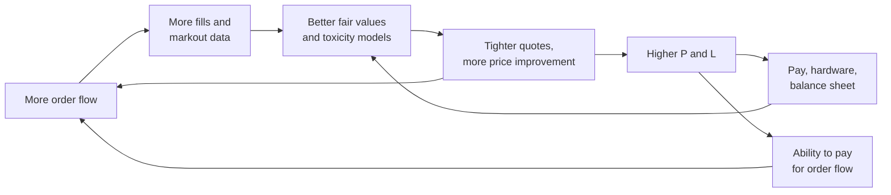

# Competitive dynamics and M&A

> **TL;DR**
>
> - Moats compound: more flow gives more fill data, better prices and more flow. Speed is table stakes; the durable moats are flow data, retail and exchange franchises, balance sheet and risk systems.
> - Consolidation follows the volatility cycle: quiet years pushed weaker firms into sales (GETCO–Knight 2013, Virtu–KCG 2017) `[Reported]`, and NYSE market-maker franchises concentrated.
> - Buyers acquire flow, franchises and client lists, not algorithms. The largest private firms rarely sell; they raise minority equity or bonds instead.
> - Value a market maker on through-the-cycle revenue per day against volatility and volume, then on operating leverage. Citadel Securities' 2022 funding round implied about 3× trailing revenue `[Estimate]`.

**Level:** Deep dive · **Read time:** ~8 min · **Last verified:** 2026-11

## Moats

| Moat | Why it compounds | Durability | Evidence |
|---|---|---|---|
| Speed | wins latency races and avoids stale quotes | low: every upgrade gets copied | races cost global equity trading ~\$5B a year, won by a few firms `[Verified]` |
| Proprietary flow data | every fill and [markout](../09-reference/glossary.md#markout) trains the next fair-value and toxicity model | high: rivals cannot buy it | `[Lore]`; mechanism in [M5](../03-algorithms/f-market-making-and-hft-algorithms/adverse-selection-and-markouts.md) |
| Retail flow contracts | low-toxicity flow; scale lowers cost per order | medium: brokers rebid, rules can change | Citadel Securities and Virtu had over 70% of retail flow in 2019–2022 data `[Reported]` |
| Exchange franchises ([DMM](../09-reference/glossary.md#designated-market-maker-dmm), lead market maker) | allocation privileges and fee benefits | medium-high: few slots | three firms ran ~90% of NYSE listings in early 2016 `[Reported]` |
| Balance sheet | ETF creations, options inventory, risk capacity in stress | high | Jane Street members' equity ~\$29.9B at end-2024 `[Reported]` |
| Talent | pay pools a small entrant cannot match | medium: people move after non-competes | Jane Street's 2025 pay pool ~\$9.38B `[Reported]` |
| Risk systems | the firm survives its worst day | invisible until it fails | Knight lost over \$460M in 2012 `[Verified]` |

## Consolidation and notable deals

Three waves. Low volatility and the arms race cut US-equity HFT revenue from about \$7.2B in 2009 to about \$1.1B in 2016 `[Reported]`, and weaker firms sold. Banks left NYSE designated market making, which concentrated. In the 2020s the leaders grew organically, while brokers bought niche market makers and exchanges bought data and software.

| Date | Buyer | Target | Price | What was bought | Tag |
|---|---|---|---|---|---|
| 2012-12 agreed; KCG formed 2013 | GETCO | Knight Capital | ~\$1.4B | retail flow franchise, after Knight's 2012 loss | `[Reported]` |
| 2014 | IMC | Goldman Sachs' NYSE DMM unit | n/d | DMM franchise | `[Reported]` |
| 2016-01 | GTS | Barclays' NYSE DMM unit | n/d | DMM franchise | `[Reported]` |
| 2016 (closed May) | Citadel Securities | KCG's NYSE DMM unit, ~1,500 issues | n/d | largest NYSE DMM | `[Reported]` |
| 2016-05 | Citadel Securities | Citi's Automated Trading Desk equity assets | n/d | a bank exiting electronic market making | `[Reported]` |
| 2017-04 agreed; closed 2017-07-20 | Virtu | KCG | \$20.00/share, ~\$1.4B cash, funded with \$1.65B debt and \$750M equity | scale, retail flow | `[Verified]` |
| 2017-08 agreed | DRW | RGM Advisors | n/d | ML-driven trading team | `[Reported]` |
| 2018-11 agreed; closed 2019-03-01 | Virtu | ITG | \$30.30/share, ~\$1.0B cash | agency execution, analytics, client list | `[Verified]` |
| 2020-10 agreed; closed 2020-11-18 | Citadel Securities | IMC's NYSE DMM unit, ~500 securities | n/d | DMM consolidation | `[Reported]` |
| 2022-01 | Sequoia and Paradigm | minority stake in Citadel Securities | \$1.15B at ~\$22B valuation | first outside equity | `[Reported]` |
| 2026-02 agreed; closed 2026-08 | Marex | Webb Traders, a European equity derivatives market maker | n/d | a broker adding principal market making | `[Reported]` |
| 2015 | ICE | Interactive Data | \$5.2B | pricing and reference data | `[Reported]` |
| 2021-01-29 | LSEG | Refinitiv | ~\$27B, all-share | data and analytics | `[Reported]` |
| 2023-11-01 | Nasdaq | Adenza | \$10.5B headline; ~\$10.0B at the closing share price | risk and regulatory software | `[Verified]` |

*n/d: terms not disclosed or not found in public sources.*

A corp-dev reading of the table:

1. **Flow and franchises transfer; code does not.** Buyers paid for retail order flow, DMM books and client lists. Acquired technology is usually migrated onto the buyer's stack `[Lore]`.
2. **Sellers sell at the cyclical bottom.** Knight sold after an operational loss; KCG sold in low-volatility 2017 for a 12.7% premium to its prior close `[Reported]`.
3. **The winners stay private.** Citadel Securities took minority equity; Jane Street issues bonds. Listed comparables are few: Virtu and Flow Traders.

## Barriers to entry

- **Regulation and capital:** broker-dealer registration, net capital, and the [market access rule](../09-reference/glossary.md#market-access-rule)'s pre-trade controls ([rules that shape strategies](../06-risk-and-regulation/rules-that-shape-strategies.md)).
- **Fixed technology cost:** colocation, direct feeds and hardware ([colocation and networks](../05-infrastructure/colocation-networks-and-the-speed-of-light.md)).
- **Clearing margin:** volatility spikes raise margin calls exactly when opportunity peaks.
- **Flow access:** the top three firms pay up to ~90% of options PFOF `[Verified]`.

Entry still happens in growing products: Optiver has stepped up competition with Citadel Securities and Susquehanna in US stock options `[Reported]`. Exit happens at the small end: from 2015 to 2021 the number of broker-dealers reporting options market-making revenue fell, mostly among small-capital firms `[Verified]`.

## Valuing a market maker

Treat revenue as a function of volatility and volume, not as a growth line. Virtu's adjusted net trading income ran \$3.9M a day at an average VIX of 15.4 in 2019 and \$9.0M at 29.3 in 2020 `[Verified]` ([economics page](economics-and-revenue-pools.md)). That is about \$0.37M a day per VIX point, but 2024 to 2025 implies about \$0.68M, inflated by record volume `[Estimate]`. Then layer on operating leverage. Illustrative: \$7.0M a day at VIX 15, \$0.35M a day per VIX point, 252 days, costs of 30% of revenue plus \$500M fixed.

| Scenario (illustrative) | VIX | Revenue per day | Annual net revenue | Costs | EBITDA |
|---|---|---|---|---|---|
| Calm | 15 | \$7.0M | \$1.76B | \$1.03B | \$0.73B |
| Normal | 19 | \$8.4M | \$2.12B | \$1.14B | \$0.98B |
| Stressed | 30 | \$12.25M | \$3.09B | \$1.43B | \$1.66B |

VIX doubles from calm to stressed; EBITDA rises 2.3×. Value the normal row and treat stressed years as an option on volatility, not a run rate. Private marks are consistent with that discount: Citadel Securities' ~\$22B valuation in January 2022 was about 3× its reported ~\$7B of 2021 revenue `[Estimate]`.

Diligence questions: revenue by product and top broker contract; losing days; risk limits; key people; regulatory exposure. The half-penny tick and lower access-fee cap are delayed to November 2027 `[Verified]`, and the SEC has proposed repealing the order-protection rule `[Reported]`. Both change per-share economics ([recent changes](../01-market-structure/recent-changes.md)).

## Related pages

- [Economics and revenue pools](economics-and-revenue-pools.md)
- [Taxonomy of quant firms](taxonomy-of-quant-firms.md)
- [Equity market making](../02-strategies/a-liquidity-provision/equity-market-making.md)
- [Retail flow internalization](../02-strategies/a-liquidity-provision/retail-flow-internalization.md)
- [Options market making](../02-strategies/a-liquidity-provision/options-market-making.md)
- [Adverse selection and markouts](../03-algorithms/f-market-making-and-hft-algorithms/adverse-selection-and-markouts.md)
- [Strategy failure gallery](../02-strategies/h-cross-cutting/strategy-failure-gallery.md)

## Sources

- [Reported] Fox Business (2012-12). "Getco to buy Knight Capital in \$1.4 billion deal." <https://www.foxbusiness.com/markets/getco-to-buy-knight-capital-in-1-4-billion-deal> (accessed 2026-11)
- [Reported] Markets Media (2016-02). "Citadel Securities to become #1 designated market maker on NYSE" (KCG DMM unit; GTS and Barclays; three firms' share of listings). <https://www.marketsmedia.com/citadel-securities-to-become-1-designated-market-maker-on-nyse> (accessed 2026-11)
- [Reported] Finance Magnates (2016). "KCG Exits NYSE Designated Market Making with Sale to Citadel Securities." <https://www.financemagnates.com/institutional-forex/exchanges/kcg-exits-nyse-designated-market-making-with-sale-to-citadel-securities> (accessed 2026-11)
- [Reported] Citadel Securities (2016-05-16). "Citadel Securities Acquires Automated Trading Desk Assets from Citi." <https://www.citadelsecurities.com/news-and-insights/citadel-securities-acquires-automated-trading-desk-assets-citi-2/> (accessed 2026-11)
- [Verified] Virtu Financial (2017-04-20). Press release on the KCG acquisition, Form 8-K exhibit 99. *SEC EDGAR*. <https://www.sec.gov/Archives/edgar/data/0001592386/000110465917024722/a17-11616_1ex99d2.htm> (accessed 2026-11)
- [Reported] Bloomberg via BloombergQuint (2017-04-20). "Virtu Agrees to Buy Speed-Trading Rival KCG for \$1.4 Billion" (financing and premium). <https://www.bloombergquint.com/markets/2017/04/20/virtu-said-poised-to-announce-deal-to-acquire-trading-rival-kcg> (accessed 2026-11)
- [Verified] Virtu Financial, Inc. (2019-11). Form 10-Q for the quarter ended 2019-09-30 (KCG and ITG closing dates and terms). *SEC EDGAR*. <https://www.sec.gov/Archives/edgar/data/1592386/000159238619000017/virtufinancial09-30x19.htm> (accessed 2026-11)
- [Reported] Hedgeweek (2017-08). "DRW to acquire RGM Advisors." <https://www.hedgeweek.com/drw-acquire-rgm-advisors/> (accessed 2026-11)
- [Reported] Financial Times, repost by Rosenblatt Securities (2018-01-02). "How high-frequency trading hit a speed bump" (Tabb Group revenue estimates; Teza and DRW deals). <https://rblt.com/news/how-high-frequency-trading-hit-a-speed-bump> (accessed 2026-11)
- [Reported] Finance Magnates (2020-11). "Citadel Securities Acquires IMC's Designated Market Making Unit." <https://www.financemagnates.com/institutional-forex/citadel-securities-acquires-imcs-designated-market-making-unit/> (accessed 2026-11)
- [Reported] The TRADE (2022-01-11). "Citadel Securities receives \$1.15 billion investment from Sequoia and Paradigm." <https://www.thetradenews.com/citadel-securities-receives-1-15-billion-investment-from-sequoia-and-paradigm/> (accessed 2026-11)
- [Reported] Bloomberg (2022-03-15). "Citadel Securities Opens Up After Record \$7 Billion Windfall." <https://www.bloomberg.com/news/articles/2022-03-15/citadel-securities-opens-up-after-record-7-billion-windfall> (accessed 2026-11)
- [Reported] Marex Group (2026-02-06). "Marex Group plc to acquire equity derivatives market maker Webb Traders." <https://www.marex.com/news/2026/02/marex-group-plc-to-acquire-equity-derivatives-market-maker-webb-traders/> (accessed 2026-11)
- [Reported] The TRADE (2026-08). "Marex completes acquisition of Webb Traders." <https://www.thetradenews.com/marex-completes-acquisition-of-webb-traders/> (accessed 2026-11)
- [Reported] GlobalCapital (2015-12). "ICE completes \$5.2bn Interactive Data buyout." <https://www.globalcapital.com/article/28mssyp51jgqspwhj5i0a/derivatives/ice-completes-5-2bn-interactive-data-buyout> (accessed 2026-11)
- [Reported] The TRADE (2021-01-29). "LSEG completes \$27 billion Refinitiv acquisition." <https://www.thetradenews.com/lseg-completes-27-billion-refinitiv-acquisition/> (accessed 2026-11)
- [Verified] Nasdaq, Inc. (2023-11-01). Form 8-K on completion of the Adenza acquisition (mirror). <https://capedge.com/filing/1120193/0001193125-23-270374/NDAQ-8K> (accessed 2026-11)
- [Verified] Aquilina, M., Budish, E. & O'Neill, P. (2022). "Quantifying the High-Frequency Trading 'Arms Race'." *Quarterly Journal of Economics* 137(1), 493–564. <https://doi.org/10.1093/qje/qjab032> (accessed 2026-11)
- [Reported] NBER conference paper (2023), study of US retail wholesaler concentration using 2019–2022 data. <https://conference.nber.org/conf_papers/f187847/f187847.pdf> (accessed 2026-11)
- [Verified] SEC Division of Trading and Markets (2026-04-09). "Roundtable on Options Market Structure: Supporting Data." <https://www.sec.gov/files/roundtable-options-market-structure.pdf> (accessed 2026-11)
- [Reported] Bloomberg Government (2026-05). "Optiver Boosts Stock Option Competition for Citadel, Susquehanna." <https://news.bgov.com/capital-markets/optiver-boosts-stock-option-competition-for-citadel-susquehanna> (accessed 2026-11)
- [Verified] SEC (2026-06-11). Temporary exemptive order delaying Regulation NMS tick-size and access-fee compliance, Release No. 34-105656. <https://www.sec.gov/files/rules/exorders/2026/34-105656.pdf> (accessed 2026-11)
- [Reported] Morrison Foerster (2026-06-12). "SEC proposes landmark rollback of core Regulation NMS provisions." <https://www.mofo.com/resources/insights/260612-sec-proposes-landmark-rollback-of-core-regulation> (accessed 2026-11)
