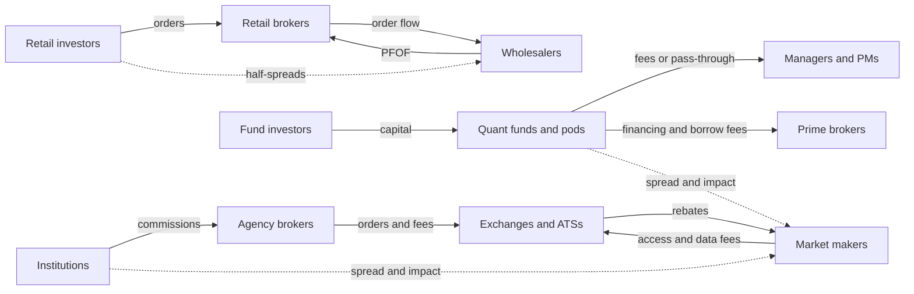

# Economics and revenue pools

> **TL;DR**
>
> - Liquidity businesses earn very large revenue on little capital; fund businesses earn fees on very large capital. Non-bank liquidity providers made about \$114B of trading revenue in 2025 `[Reported]`; hedge funds managed about \$5.15T `[Reported]`.
> - A market maker's revenue is a function of volatility and volume. Virtu's adjusted net trading income was \$3.9M a day in 2019 and \$9.0M a day in 2020 `[Verified]`.
> - Three economic models: **prop** (owners keep the P&L and pay staff from a pool), **fee funds** (the manager's revenue grows with assets even as investors' returns shrink) and **pass-through pods** (investors pay the platform's costs before the performance fee).
> - Capacity limits differ: market making is capped by volume times spread, alpha funds by market impact; risk premia and trend scale to tens or hundreds of billions.

**Level:** Core · **Read time:** ~8 min · **Last verified:** 2026-11

## The revenue pools

The pools below have different scopes, so they are not additive. Treat them as orders of magnitude.

| Pool | Size | Who earns it | What drives it |
|---|---|---|---|
| All non-bank liquidity-provider trading | ~\$114B in 2025, global, all assets: \$84.3B proprietary trading, \$30.2B market making `[Reported]` | Jane Street, Citadel Securities, HRT and peers | volatility, volume, retail activity |
| US equity market making | ~\$1–3B a year net `[Estimate]` (reasoning in the [equity MM dossier](../02-strategies/a-liquidity-provision/equity-market-making.md)) | wholesalers, electronic market makers, [DMMs](../09-reference/glossary.md#designated-market-maker-dmm) | 17.6B shares a day in 2025 `[Reported]` × net capture per share |
| Retail flow bought | over \$4.9B of equity and options [PFOF](../09-reference/glossary.md#payment-for-order-flow-pfof) in 2025 `[Reported]` | paid by [wholesalers](../09-reference/glossary.md#wholesaler) to brokers | retail activity |
| US options market making | ~\$3–9B a year gross `[Estimate]` (reasoning in the [options MM dossier](../02-strategies/a-liquidity-provision/options-market-making.md)) | Citadel Securities, SIG, Optiver, IMC and peers | contract volume, short-dated retail options |
| Hedge fund fees | on ~\$5.15T of capital (end-2025); management fees average ~1.35% plus performance fees `[Reported]` | quant funds and pods take a share | assets × fee rate, plus profits above the high-water mark |
| Managed futures | ~\$354B of assets, Q2 2026 `[Reported]` | [CTAs](../09-reference/glossary.md#commodity-trading-advisor-cta) | trend P&L and inflows |
| Agency commissions | US equity commission wallet just under \$7B in 2025 `[Reported]` | agency brokers, bank algo desks | institutional volume, fee pressure |

Firm anchors for 2025, all global and multi-asset: Jane Street ~\$39.6B of net trading revenue, HRT ~\$12.3B and Citadel Securities ~\$12.2B, from unnamed sources `[Reported]`; Optiver €4.56B of net trading income `[Verified]`; Flow Traders €485.8M at a 41% EBITDA margin `[Verified]`; Virtu \$2.15B of adjusted net trading income (ANTI), \$1.67B of it market making `[Verified]`. 2026 is running hotter: HRT reportedly made about \$17.8B in the first half alone `[Reported]`.

## What drives a market maker's revenue

| Year | Average VIX | Virtu ANTI per day |
|---|---|---|
| 2019 | 15.4 | \$3.9M `[Verified]` |
| 2020 | 29.3 | \$9.0M `[Verified]` |
| 2024 | 15.6 | ~\$6.4M `[Estimate]` (2025 ANTI ÷ 1.34, over 252 days) |
| 2025 | 18.9 | \$8.6M `[Reported]` |

VIX averages are our computation from FRED `[Verified]`. Volatility more than doubled revenue from 2019 to 2020. Yet 2024, at the same VIX as 2019, earned about 1.6× as much. The base had moved: Virtu bought ITG's agency business in 2019, and listed options volume set a record every year from 2020 through 2025 `[Verified]`. 2025 added record equity volume `[Reported]`. Revenue tracks volatility *and* volume, plus structural share. Pools can also collapse: US-equity HFT revenue fell from about \$7.2B in 2009 to about \$1.1B in 2016 (Tabb Group) `[Reported]`.

## Three business models, one income statement

**Prop.** Owners keep all P&L. Costs are part variable (exchange and clearing fees, PFOF, financing) and part fixed (people, technology). Pay comes from a pool: Jane Street's 2025 pool was reportedly \$9.38B `[Reported]`, about 24% of revenue `[Estimate]`.

**Fee fund.** The manager earns a management fee on assets and a performance fee above a high-water mark; investors bear the losses. Renaissance's employee-only Medallion fund charged 5% of assets and at least 36% of gains `[Reported]`; with employees as the investors, those fees mostly recycle money inside the firm `[Estimate]`.

**Pass-through.** Multi-manager platforms charge investors their costs, mostly PM pay, typically 3–10% of net assets, before a performance fee `[Reported]`. Balyasny's flagship reportedly made 15.2% gross and 2.8% net in 2023 `[Reported]` ([how firms combine strategies](../02-strategies/h-cross-cutting/how-firms-combine-strategies.md)).

The comparison below sets Virtu's real 2025 figures against an illustrative quant fund manager with \$10B of assets, a 12% gross return and 1.5%-and-20% fees.

| Line | Prop market maker: Virtu FY2025 (\$M) | Quant fund manager, illustrative (\$M) |
|---|---|---|
| Top line | Total revenues 3,632 `[Verified]` | Fund gross P&L 1,200, owned by investors |
| Direct costs | Exchange, clearing, PFOF, financing ≈ 1,487 `[Estimate]` (difference) | Trading costs, already inside gross P&L |
| Net revenue | ANTI 2,145 `[Verified]` | Fees: 150 management + 20% × 1,050 performance = 360 |
| Operating costs | Pay, data, technology, other ≈ 745 `[Estimate]` | Pay 160, data and compute 60, other 30 |
| Operating profit | Adjusted EBITDA ≈ 1,400, 65% of ANTI `[Reported]` | 110, 31% of fees |
| Who bears losses | Owners and shareholders | Fund investors; the manager loses only fees |
| Bottom line | Net income 912 `[Verified]` | Investors keep 840, 8.4% net |

For a market maker, cost of revenue is what it pays venues, clearers and brokers. For a fund, it is the share of P&L paid to the manager: 30% here. A pass-through pod with a 15% gross return, 6% pass-through and a 20% fee leaves investors 7.2%, so half of gross P&L goes to the platform and its PMs `[Estimate]`.

*Solid arrows are contractual payments; dotted arrows are trading costs that become liquidity providers' revenue.*

## Capacity limits

- **Market making** is capped by volume times net capture per share, not by capital. Growth means new products and regions, which is why equity market makers moved into options, fixed income and crypto `[Lore]`.
- **Alpha strategies** hit [market impact](../09-reference/glossary.md#market-impact): cost per dollar traded rises with size ([P5 card](../03-algorithms/d-portfolio-construction/transaction-cost-and-impact-models.md)), so [capacity](../09-reference/glossary.md#capacity) is where marginal alpha equals marginal cost.
- **Factor and trend** strategies run tens to hundreds of billions because they trade slowly in deep markets.

The fee structure misaligns size. Illustrative: gross alpha 6% minus impact of 1.5% × √(assets ÷ \$1B), less a 1.5% management fee.

| Assets | Investors' net return | Investors' net profit | Management fees |
|---|---|---|---|
| \$1B | 3.0% | \$30M | \$15M |
| \$4B | 1.5% | \$60M | \$60M |
| \$9B | 0.0% | \$0 | \$135M |

Investors' dollar profit peaks at \$4B; the manager's fees keep rising. Berk and Green (2004) model the equilibrium: money flows in until investors' net alpha is competed to zero `[Verified]`. Firms that care about returns per dollar close funds, return capital or, like Medallion, expel outside money.

## Related pages

- [Taxonomy of quant firms](taxonomy-of-quant-firms.md)
- [Competitive dynamics and M&A](competitive-dynamics-and-ma.md)
- [Equity market making](../02-strategies/a-liquidity-provision/equity-market-making.md)
- [Retail flow internalization](../02-strategies/a-liquidity-provision/retail-flow-internalization.md)
- [How quants evaluate a strategy](../02-strategies/how-quants-evaluate-a-strategy.md)
- [Transaction cost and impact models](../03-algorithms/d-portfolio-construction/transaction-cost-and-impact-models.md)
- [The big picture](../00-start-here/the-big-picture.md)

## Sources

- [Verified] Virtu Financial, Inc. (2026-02). Form 10-K for fiscal year 2025 (revenues, adjusted net trading income by segment, net income). *SEC EDGAR*. <https://www.sec.gov/Archives/edgar/data/1592386/000159238626000009/virt-20251231.htm> (accessed 2026-11)
- [Reported] Virtu Financial (2026-01-29). Fourth quarter and full year 2025 results release (ANTI per day, adjusted EBITDA margin). <https://ir.virtu.com/static-files/9eb593ae-ae7d-42bb-baa3-e0cbaa179c6b> (accessed 2026-11)
- [Verified] Virtu Financial, Inc. (2021-02). Form 10-K for fiscal year 2020 (ANTI per day 2019 and 2020). *SEC EDGAR*. <https://www.sec.gov/Archives/edgar/data/1592386/000159238621000005/virt-20201231.htm> (accessed 2026-11)
- [Verified] Federal Reserve Bank of St. Louis. "CBOE Volatility Index: VIX (VIXCLS)," daily (annual averages are our computation). <https://fred.stlouisfed.org/series/VIXCLS> (accessed 2026-11)
- [Reported] Hedgeweek (2026). "Non-bank trading firms surge as Jane Street and Citadel Securities drive record \$114bn revenue pool" (Crisil Coalition Greenwich data). <https://www.hedgeweek.com/non-bank-trading-firms-surge-as-jane-street-and-citadel-securities-drive-record-114bn-revenue-pool/> (accessed 2026-11)
- [Reported] Reuters via MarketScreener (2026-04-24). "Jane Street's \$40 billion trading haul tops rivals, sources say." <https://www.marketscreener.com/news/jane-street-s-40-billion-trading-haul-tops-rivals-sources-say-ce7f59dfdf8ff52d> (accessed 2026-11)
- [Reported] Bloomberg Law (2026-05-01). "Jane Street's Pay Pool More Than Doubled to \$9.4 Billion in 2025." <https://news.bloomberglaw.com/securities-law/jane-streets-pay-pool-more-than-doubled-to-9-4-billion-in-2025> (accessed 2026-11)
- [Reported] Bloomberg (2026-01-13). "Hudson River's 2025 Trading Revenue Set for Record \$12.3 Billion." <https://www.bloomberg.com/news/articles/2026-01-13/hudson-river-s-2025-trading-revenue-set-for-record-12-3-billion> (accessed 2026-11)
- [Reported] Hedgeweek (2026). "Hudson River Trading racks up record \$11.4bn revenue amid market volatility" (citing the Financial Times; first-half 2026 total). <https://hedgeweek.com/news/hudson-river-trading-racks-up-record-11-4bn-revenue-amid-market-volatility> (accessed 2026-11)
- [Reported] Bloomberg (2026-03-24). "Citadel Securities Nets Record \$12 Billion Trading Haul in 2025." <https://www.bloomberg.com/news/articles/2026-03-24/citadel-securities-nets-record-12-billion-trading-haul-in-2025> (accessed 2026-11)
- [Verified] Optiver (2026). "Optiver reports robust financial results for 2025." <https://optiver.com/optiver-reports-robust-financial-results-for-2025> (accessed 2026-11)
- [Verified] Flow Traders (2026-02-12). "Flow Traders 4Q and FY 2025 Results." <https://flowtraders.com/news/flow-traders-4q-fy-2025-results/> (accessed 2026-11)
- [Reported] Global Trading (2025-05-27). "Payments for US retail flow reach record high, led by Citadel Securities and IMC." <https://www.globaltrading.net/?p=38554> (accessed 2026-11)
- [Reported] Hedgeweek (2026). "Global hedge fund assets surpass \$5tn for the first time, says HFR." <https://www.hedgeweek.com/global-hedge-fund-assets-surpass-5tn-for-the-first-time-says-hfr/> (accessed 2026-11)
- [Reported] Hedgeweek (2025-02-12). "Hedge funds charging billions in 'no limit' passthrough fees" (citing Bloomberg). <https://www.hedgeweek.com/hedge-funds-charging-billions-in-no-limit-passthrough-fees/> (accessed 2026-11)
- [Reported] BusinessDay, republishing Bloomberg (2016-12-05). "Inside the world's greatest money-making machine" (Medallion fees). <https://www.businessday.co.za/bd/companies/financial-services/2016-12-05-inside-the-worlds-greatest-money-making-machine/> (accessed 2026-11)
- [Reported] BarclayHedge (ION Analytics). "CTA Industry Assets Under Management" (Q2 2026). <https://ionanalytics.com/barclayhedge/solutions/assets-under-management/cta-industry-assets-under-management/> (accessed 2026-11)
- [Reported] Coalition Greenwich (2025). "U.S. Equity Market Trends 2025: Don't Call It a Comeback." <https://www.greenwich.com/node/158259> (accessed 2026-11)
- [Verified] Cboe Global Markets (2026). "2025 U.S. Equities Year in Review." <https://www.cboe.com/insights/posts/2025-u-s-equities-year-in-review> (accessed 2026-11)
- [Reported] Rosenblatt Securities news repost (2018). "How high-frequency trading hit a speed bump" (Tabb Group revenue estimates). <https://rblt.com/news/how-high-frequency-trading-hit-a-speed-bump> (accessed 2026-11)
- [Verified] OCC (2026-01-05). "OCC Annual 2025 and December 2025 Volume." <https://www.theocc.com/newsroom/views/2026/01-05-occ-annual-2025-and-december-2025-volume> (accessed 2026-11)
- [Verified] Berk, J. B. & Green, R. C. (2004). "Mutual Fund Flows and Performance in Rational Markets." *Journal of Political Economy* 112(6), 1269–1295. <https://doi.org/10.1086/424739> (accessed 2026-11)
