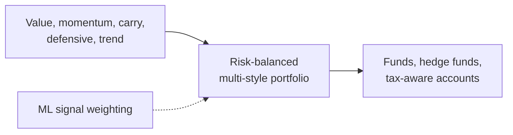

# AQR Capital Management

> **TL;DR**
>
> - The best-known systematic factor manager: value, momentum, carry, defensive and trend signals, diversified across asset classes and published in academic-style research.
> - It survived a 2018–2020 "quant winter" and grew to about \$187B by end-2025, helped by tax-aware long-short accounts.
> - It now leans on machine learning, which it calls evolutionary rather than revolutionary.

**Type:** systematic asset manager and hedge fund · **Last verified:** 2026-11

| Field | Value |
|---|---|
| Type | Systematic manager (mutual funds, hedge funds, separate accounts), Greenwich, CT; founded 1998 `[Verified]` |
| Scale | About \$187B AUM end-2025, vs a \$226B peak in 2018 `[Reported]`; regulatory AUM \$311.7B (Form ADV, Aug 2026) `[Verified]` |
| Horizon | Months for style premia and trend; shorter for some equity signals `[Estimate]` |
| Known strategies | Multi-asset style premia, managed futures, equity market-neutral and long-short, tax-aware long-short `[Reported]` |
| Tech signals | Large trading-cost dataset from own fills `[Verified]`; ML research team `[Reported]` |
| Confidence | High: AQR publishes its methods and fund data |
| Sources | Form ADV; AQR papers and fact sheets; Forbes; Reuters |

## What they do

Cliff Asness, David Kabiller and John Liew founded AQR in 1998; Affiliated Managers Group holds a minority stake `[Verified]`. Products range from mutual funds to hedge funds such as Apex (multi-strategy, +19.6% in 2025), Helix (trend, +18.6%) and Delphi (long-short equity) `[Reported]`. Its fastest growth is Flex, tax-aware long-short accounts for wealthy clients, near a quarter of AUM `[Reported]`.

## Strategy focus and approach

AQR's core is [factor investing](../../02-strategies/e-risk-premia-and-factors/factor-investing-fundamentals.md): rank assets on simple [value](../../02-strategies/e-risk-premia-and-factors/value-quality-low-vol.md), [momentum](../../02-strategies/e-risk-premia-and-factors/momentum.md), [carry](../../02-strategies/g-futures-and-macro-context/carry-and-cross-asset-risk-premia.md) and defensive measures, hold long-short portfolios in many markets, and combine styles for diversification. Asness, Moskowitz and Pedersen (2013) documented value and momentum across eight asset classes `[Verified]`. [Trend following](../../02-strategies/g-futures-and-macro-context/trend-following-and-ctas.md) runs as a separate managed-futures line. Its cost models rest on its own fills: on \$1.7 trillion of trades, costs were an order of magnitude below academic estimates `[Verified]` (see [impact models](../../03-algorithms/d-portfolio-construction/transaction-cost-and-impact-models.md)). Since about 2018 it has added machine learning to weight and interact signals; Brian Kelly now leads that work `[Reported]`.

## Fact vs lore

- **Quant winter.** The Style Premia Alternative Fund lost 12.4%, 8.2% and 22.0% in 2018–2020, then gained 24.8% and 30.6% `[Verified]`. AQR blames widening value spreads, not [crowded](../../09-reference/glossary.md#crowding) exits; that is contested (see [quant winters](../../02-strategies/e-risk-premia-and-factors/factor-timing-crowding-and-quant-winters.md)).
- **ML "virtue of complexity."** Kelly, Malamud and Zhou (2024) argue bigger models forecast returns better `[Verified]`; Nagel (2025) disputes it `[Verified]`. Unresolved.
- **"Just cheap smart beta."** Fair for its style funds; its flagship process adds ML and new data sets `[Reported]`, with details not public.

## Related pages

- [Alpha combination and ensembling](../../03-algorithms/b-forecasting-models/alpha-combination-and-ensembling.md)
- [Strategy failure gallery](../../02-strategies/h-cross-cutting/strategy-failure-gallery.md)
- [Man Group (AHL / Numeric)](man-group.md)

## Sources

- [Verified] AQR Capital Management, LLC (2026-08-27). Form ADV (Item 5.F, Schedule A, Schedule R/AMG ownership). SEC IAPD, CRD 111883. <https://reports.adviserinfo.sec.gov/reports/ADV/111883/PDF/111883.pdf> (accessed 2026-11)
- [Reported] Hyatt, J. (2026). "How 3 billionaire investors used AI to double their fortunes in a year." Forbes (via Forbes Australia). <https://www.forbes.com.au/?p=181182> (accessed 2026-11)
- [Reported] Reuters via Tiger Brokers (2026-01-02). "Top hedge funds led by D.E. Shaw, Bridgewater and Balyasny deliver big gains in 2025." <https://www.itiger.com/news/2600609750> (accessed 2026-11)
- [Verified] AQR Funds. "AQR Style Premia Alternative Fund fact sheet: performance by calendar year (QSPIX), as of 2026-09-30." <https://funds.aqr.com/-/media/Files/Fund-Documents/Fact-Sheet/SPAF.pdf> (accessed 2026-11)
- [Verified] Asness, C. S., Moskowitz, T. J. & Pedersen, L. H. (2013). "Value and Momentum Everywhere." *Journal of Finance* 68(3), 929–985. <https://doi.org/10.1111/jofi.12021> (accessed 2026-11)
- [Verified] Frazzini, A., Israel, R. & Moskowitz, T. J. (2018). "Trading Costs." AQR working paper (SSRN 3229719). <https://www.aqr.com/Insights/Research/Working-Paper/Trading-Costs> (accessed 2026-11)
- [Verified] Kelly, B., Malamud, S. & Zhou, K. (2024). "The Virtue of Complexity in Return Prediction." *Journal of Finance* 79(1), 459–503. <https://doi.org/10.1111/jofi.13298> (accessed 2026-11)
- [Verified] Nagel, S. (2025). "Seemingly Virtuous Complexity in Return Prediction." SSRN working paper. <https://doi.org/10.2139/ssrn.5386615> (accessed 2026-11)
- [Verified] Maloney, T. & Moskowitz, T. (2026-08). "Academic Alpha: A (Re)Introduction to Style Premia Investing." AQR white paper. <https://www.aqr.com/-/media/AQR/Documents/White-Papers/Academic-Alpha-A-Re-Introduction-to-Style-Premia-Investing.pdf> (accessed 2026-11)
