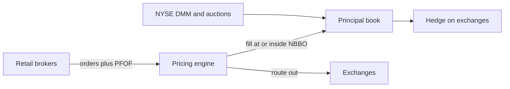

# Citadel Securities

> **TL;DR**
>
> - The largest US retail [wholesaler](../../09-reference/glossary.md#wholesaler): it says it executes about 35% of US-listed retail volume `[Reported]`, and it is the largest NYSE [designated market maker](../../09-reference/glossary.md#designated-market-maker-dmm) `[Verified]`.
> - A separate company from Citadel the hedge fund. Record 2025 trading revenue of about \$12B `[Reported]`.
> - Its edge is flow segmentation plus scale: it prices known retail flow, then hedges the residue on exchanges.

**Type:** wholesaler and electronic market maker · **Last verified:** 2026-11

| Field | Value |
|---|---|
| Type | Private market maker and broker-dealer, separate from the Citadel hedge fund `[Reported]` |
| Scale | ~\$12B net trading revenue in 2025 `[Reported]`; ~35% of US-listed retail volume (firm claim, 1H 2026) `[Reported]` |
| Horizon | Milliseconds to minutes for retail fills; DMM and options books hold longer `[Estimate]` |
| Known strategies | [Retail flow internalization](../../02-strategies/a-liquidity-provision/retail-flow-internalization.md) · [Equity market making](../../02-strategies/a-liquidity-provision/equity-market-making.md) · [Options market making](../../02-strategies/a-liquidity-provision/options-market-making.md) · [Auctions and closing liquidity](../../02-strategies/a-liquidity-provision/auctions-and-closing-liquidity.md) |
| Tech signals | Automated internalization algorithms, described in SEC orders `[Verified]` |
| Confidence | Medium: revenue comes from press; market shares are self-reported |
| Sources | SEC orders, firm releases, Bloomberg (below) |

## What they do

Citadel Securities buys marketable retail orders from brokers, paying [PFOF](../../09-reference/glossary.md#payment-for-order-flow-pfof) in equities and options. It fills them as principal at or inside the NBBO. In 2016 it bought KCG's NYSE DMM unit, giving it the largest floor footprint, about 1,500 issues at the time `[Verified]`. It also quotes on exchanges and makes markets in options, ETFs, Treasuries and FX. In July 2026 it opened an Amsterdam hub for European equity options `[Reported]`.

## Strategy focus and approach

The core is [retail internalization](../../02-strategies/a-liquidity-provision/retail-flow-internalization.md). Each order is priced against a [fair-value model](../../03-algorithms/f-market-making-and-hft-algorithms/fair-value-and-microprice.md), then filled or routed out. Retail flow is less informed than the average exchange order, so filling it inside the spread still pays; [markouts](../../03-algorithms/f-market-making-and-hft-algorithms/adverse-selection-and-markouts.md) by broker segment check that. The DMM franchise adds the opening and [closing auctions](../../09-reference/glossary.md#closing-auction). Options books are run on a [vol surface](../../03-algorithms/f-market-making-and-hft-algorithms/options-pricing-and-vol-surfaces-for-mm.md) and [hedged](../../03-algorithms/f-market-making-and-hft-algorithms/hedging-algorithms.md).

## Fact vs lore

- **Lore:** "PFOF lets Citadel front-run retail." **Fact:** the SEC has sanctioned the firm twice for other conduct. In 2017 it paid \$22.6M because two algorithms did not fill retail orders at the best price they observed or sought, contrary to what it told clients `[Verified]`. In 2023 it paid \$7M after a coding error mis-marked millions of short sales from 2015 to 2020 `[Verified]`. Neither order alleged front-running.
- **Lore:** "Citadel made brokers halt GameStop buying." **Fact:** on 2021-01-27, NSCC called \$6.9B of intraday margin from 36 members, and brokers then restricted buying `[Verified]`.

## Related pages

- [Retail flow internalization](../../02-strategies/a-liquidity-provision/retail-flow-internalization.md) · [Equity market making](../../02-strategies/a-liquidity-provision/equity-market-making.md) · [Options market making](../../02-strategies/a-liquidity-provision/options-market-making.md)
- [Venues and retail flow](../../01-market-structure/venues-and-retail-flow.md) · [Virtu Financial](virtu-financial.md) · [Taxonomy of quant firms](../taxonomy-of-quant-firms.md)

## Sources

- [Reported] Bloomberg (2026-03-24). "Citadel Securities Nets Record \$12 Billion Trading Haul in 2025." <https://www.bloomberg.com/news/articles/2026-03-24/citadel-securities-nets-record-12-billion-trading-haul-in-2025> (accessed 2026-11)
- [Reported] Citadel Securities (2026). "Global Market Intelligence: 1H 2026 Market Structure and Flows" (retail share claim). <https://www.citadelsecurities.com/news-and-insights/global-market-intelligence/1h-2026-market-structure-flows/> (accessed 2026-11)
- [Verified] Citadel Securities (2016-02-05). "Citadel Securities to Become #1 Designated Market Maker on NYSE" (press release). *Markets Media*. <https://www.marketsmedia.com/citadel-securities-to-become-1-designated-market-maker-on-nyse> (accessed 2026-11)
- [Verified] SEC (2017-01). "Citadel Securities Paying \$22 Million for Misleading Clients About Pricing Trades," press release 2017-11. <https://www.sec.gov/newsroom/press-releases/2017-11> (accessed 2026-11)
- [Verified] SEC (2023-09-22). "SEC Charges Citadel Securities for Violating Order Marking Requirements of Short Sale Rules," press release 2023-192. <https://www.sec.gov/news/press-release/2023-192> (accessed 2026-11)
- [Verified] U.S. SEC Staff (2021-10-14). "Staff Report on Equity and Options Market Structure Conditions in Early 2021." <https://www.sec.gov/files/staff-report-equity-options-market-struction-conditions-early-2021.pdf> (accessed 2026-11)
- [Reported] FOW (2026-07). "Citadel Securities boosts European footprint with Amsterdam derivatives office." <https://www.fow.com/insights/citadel-securities-boosts-european-footprint-with-amsterdam-derivatives-office> (accessed 2026-11)
- [Reported] Global Trading (2025-11-11). "Citadel Securities, IMC paid US\$420m for retail flows as options surged." <https://www.globaltrading.net/?p=40423> (accessed 2026-11)
