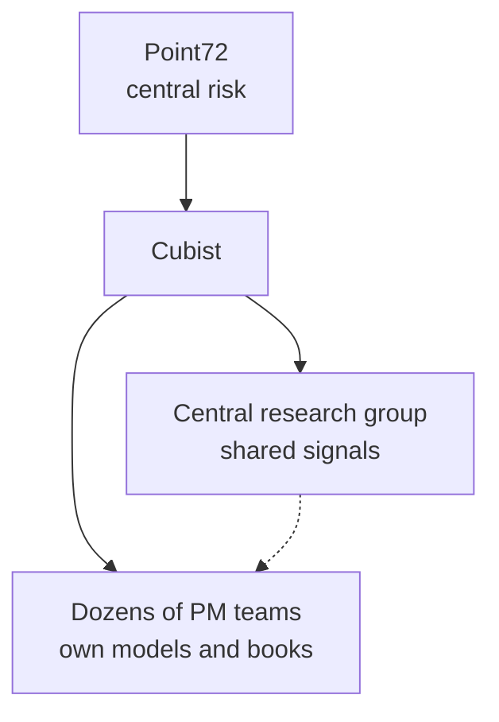

# Cubist Systematic Strategies

> **TL;DR**
>
> - Point72's quantitative arm: dozens of independent systematic teams plus a central research group, a hybrid between a pod shop and a single-model fund.
> - Roughly a sixth of Point72's capital in 2025, by press estimates; the firm does not publish Cubist's assets.
> - New leadership from WorldQuant since late 2025 and turnover in the central unit make its model a work in progress.

**Type:** systematic arm of a multi-manager · **Last verified:** 2026-11

| Field | Value |
|---|---|
| Type | Quant unit of Point72 Asset Management (Steven A. Cohen) `[Verified]` |
| Scale | Point72: \$55.5B AUM, 3,500+ staff (Oct 2026) `[Verified]`. Cubist: about 17% of Point72's \$40B, 600+ staff (Sep 2025) `[Reported]`, so roughly \$7B `[Estimate]` |
| Horizon | Not disclosed; liquid markets only `[Verified]` |
| Known strategies | Systematic models in equities, fixed income, FX and volatility, built with statistics and machine learning `[Verified]` (careers pages) |
| Tech signals | ~100-person central quant group (2025) `[Reported]` |
| Confidence | Medium: structure from the firm; size and performance from press |
| Sources | Point72 website; Form ADV; Hedgeweek (citing Bloomberg, Business Insider) |

## What they do

Point72's timeline dates its quant work to 1994, when predecessor SAC Capital hired its first quantitative PM; the business grew into Cubist from 2003 `[Verified]`. Point72 itself was founded in April 2014 as a family office after Cohen settled regulatory matters `[Verified]`. The firm describes Cubist as "dozens of discrete investing teams" plus "a complementary centralized team" trading liquid asset classes `[Verified]`. Point72 returned 17.5% in 2025 across all strategies `[Reported]`.

## Strategy focus and approach

Cubist sits between the two architectures in [how firms combine strategies](../../02-strategies/h-cross-cutting/how-firms-combine-strategies.md). Each PM team runs its own systematic book, as in a [pod](../../09-reference/glossary.md#pod) platform. Under former head Denis Dancanet the unit added a central research group that contributes signals across the portfolio `[Reported]`, which is [alpha combination](../../03-algorithms/b-forecasting-models/alpha-combination-and-ensembling.md) layered on pods. In September 2025 Point72 named Geoffrey Lauprete, formerly WorldQuant's chief investment officer, to run Cubist `[Reported]`; his firm biography confirms the role `[Verified]`. After a sharp summer 2025 drawdown, Cubist still finished 2025 positive `[Reported]`. In March 2026 an executive who helped build its central trading unit left after months of losses `[Reported]`.

## Fact vs lore

- **Size.** The 17% share is a press estimate; Point72's \$274.1B regulatory AUM (Form ADV) is gross of leverage and covers the whole firm `[Verified]`.
- **"Just another pod shop."** Partly: the central group is the difference, and its value is still being tested `[Reported]`.
- **Strategy content.** Only the asset classes and methods in job descriptions are public; claims about specific signals are `[Lore]`.

## Related pages

- [ML-driven short-horizon alpha](../../02-strategies/c-statistical-arbitrage/ml-driven-short-horizon-alpha.md)
- [Factor-residual mean reversion](../../02-strategies/c-statistical-arbitrage/factor-residual-mean-reversion.md)
- [Millennium (quant pods)](millennium.md)

## Sources

- [Verified] Point72 (n.d.). Homepage statistics as of 2026-10-01 (AUM, employees, investing teams). <https://point72.com/> (accessed 2026-11)
- [Verified] Point72 (n.d.). "What We Do" (Cubist description; firm timeline 1992, 1994, 2003, 2014). <https://point72.com/what-we-do/> (accessed 2026-11)
- [Verified] Point72 (n.d.). "Cubist" careers page (asset classes, methods). <https://point72.com/cubist/> (accessed 2026-11)
- [Verified] Point72 (n.d.). "Geoffrey Lauprete" leadership biography. <https://point72.com/leader/geoffrey-lauprete/> (accessed 2026-11)
- [Verified] Point72 Asset Management, L.P. (2026-11-06). Form ADV (Item 5.F regulatory AUM). SEC IAPD, CRD 283077. <https://reports.adviserinfo.sec.gov/reports/ADV/283077/PDF/283077.pdf> (accessed 2026-11)
- [Reported] Hedgeweek, citing Bloomberg (2025-09-11). "Point72 taps ex-WorldQuant CIO to lead Cubist." <https://www.hedgeweek.com/point72-taps-ex-worldquant-cio-to-lead-cubist/> (accessed 2026-11)
- [Reported] Hedgeweek (2025-12-11). "Point72's Cubist Systematic Strategies loses senior quant leader." <https://www.hedgeweek.com/point72s-cubist-systematic-strategies-loses-senior-quant-leader/> (accessed 2026-11)
- [Reported] Hedgeweek, citing Business Insider (2026-03-23). "Senior Cubist quant leader departs Point72 after prolonged losses." <https://www.hedgeweek.com/senior-cubist-quant-leader-departs-point72-after-prolonged-losses/> (accessed 2026-11)
- [Reported] Reuters via Tiger Brokers (2026-01-02). "Top hedge funds led by D.E. Shaw, Bridgewater and Balyasny deliver big gains in 2025." <https://www.itiger.com/news/2600609750> (accessed 2026-11)
