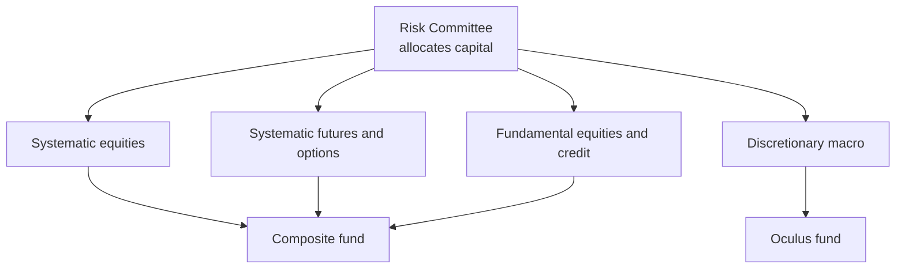

# D. E. Shaw

> **TL;DR**
>
> - A 1988 pioneer of computerized [statistical arbitrage](../../09-reference/glossary.md#statistical-arbitrage), now a multi-strategy firm, systematic and discretionary.
> - One central Risk Committee allocates capital across units, rather than a pod marketplace.
> - Flagship funds are multi-strategy (Composite) and macro (Oculus); the quant engines inside are not disclosed.

**Type:** multi-strategy hedge fund with large systematic units · **Last verified:** 2026-11

| Field | Value |
|---|---|
| Type | Multi-strategy hedge fund and asset manager, New York `[Verified]` |
| Scale | Over \$115B of investment and committed capital (1 Sep 2026); 3,000+ people `[Verified]`. Regulatory AUM \$213.4B (Form ADV) `[Verified]` |
| Horizon | Intraday to multi-year across units `[Estimate]` (from systematic books to private credit) |
| Known strategies | Systematic equities, systematic futures, options, macro, fundamental equities, convertibles, credit `[Verified]` |
| Tech signals | 800+ developers; spun off Arcesium (2015); sponsors NumPy and Jupyter `[Verified]` |
| Confidence | High on structure; low on how the systematic books work |
| Sources | Firm website; Form ADV; Reuters; Bloomberg |

## What they do

David E. Shaw, a former Columbia computer scientist, started the firm in 1988 with six employees and \$28M `[Verified]`. He now spends most of his time at D. E. Shaw Research, a computational biochemistry group; a seven-person Executive Committee chaired by Anne Dinning runs the firm `[Verified]`. Its hedge funds are mainly multi-strategy vehicles; it also runs private credit, benchmark-relative active equity and multi-asset strategies `[Verified]`.

## Strategy focus and approach

The quant lineage starts in equity arbitrage: Dinning joined in 1990 as a researcher in the Equity Arbitrage unit `[Verified]`, and the firm carried Morgan Stanley-style stat arb into the hedge-fund era `[Reported]` (see [stat arb history](../../02-strategies/c-statistical-arbitrage/stat-arb-overview-and-history.md)). Today separate units run systematic equities, systematic futures and options, beside discretionary macro and fundamental teams `[Verified]`. A Risk Committee allocates capital among strategies, and the firm says it runs "on collaboration, not internal competition" `[Verified]`, unlike [pod](../../09-reference/glossary.md#pod) platforms (see [how firms combine strategies](../../02-strategies/h-cross-cutting/how-firms-combine-strategies.md)). The firm's long-only active equity uses systematic stock selection `[Verified]`, the [cross-sectional alpha](../../02-strategies/d-mid-frequency-alpha/cross-sectional-alpha-and-neutralization.md) problem.

*Which units feed which fund is illustrative; the firm does not publish the mapping.*

## Fact vs lore

- **2025 results.** Composite reportedly returned about 18.5% net (12.9% a year since 2001) and Oculus 28.2% (14.4% since 2004); both are closed to new money `[Reported]`. These are source-reported, not audited public figures.
- **Capacity discipline.** The firm returned profits to investors every year from 2018, then paused in January 2026 `[Reported]`.
- **"Pure quant shop."** False: the firm describes a continuum from systematic to discretionary `[Verified]` and is raising a human-driven fund, Cogence `[Reported]`.
- **Signal content.** Specific models are not public; claims about them are `[Lore]`.

## Related pages

- [Factor-residual mean reversion](../../02-strategies/c-statistical-arbitrage/factor-residual-mean-reversion.md)
- [Risk models](../../03-algorithms/d-portfolio-construction/risk-models.md)
- [Renaissance Technologies](renaissance-technologies.md)

## Sources

- [Verified] D. E. Shaw & Co. (n.d.). "Who We Are" (founding, leadership, founder profile). <https://www.deshaw.com/who-we-are> (accessed 2026-11)
- [Verified] D. E. Shaw & Co. (n.d.). "What We Do" (capital as of 2026-09-01, approaches, Risk Committee, Arcesium). <https://www.deshaw.com/what-we-do> (accessed 2026-11)
- [Verified] D. E. Shaw & Co., L.P. (2026-08-14). Form ADV (Item 5.F regulatory AUM, Schedule A). SEC IAPD, CRD 108679. <https://reports.adviserinfo.sec.gov/reports/ADV/108679/PDF/108679.pdf> (accessed 2026-11)
- [Reported] Reuters via Tiger Brokers (2026-01-02). "Top hedge funds led by D.E. Shaw, Bridgewater and Balyasny deliver big gains in 2025." <https://www.itiger.com/news/2600609750> (accessed 2026-11)
- [Reported] Hedgeweek, citing Bloomberg (2026-01-05). "DE Shaw pauses cash returns despite double-digit gains in 2025." <https://www.hedgeweek.com/de-shaw-pauses-cash-returns-despite-double-digit-gains-in-2025/> (accessed 2026-11)
- [Reported] Gatev, E., Goetzmann, W. N. & Rouwenhorst, K. G. (2006). "Pairs Trading: Performance of a Relative-Value Arbitrage Rule." *Review of Financial Studies* 19(3), 797–827 (history of Morgan Stanley stat arb). <https://doi.org/10.1093/rfs/hhj020> (accessed 2026-11)
